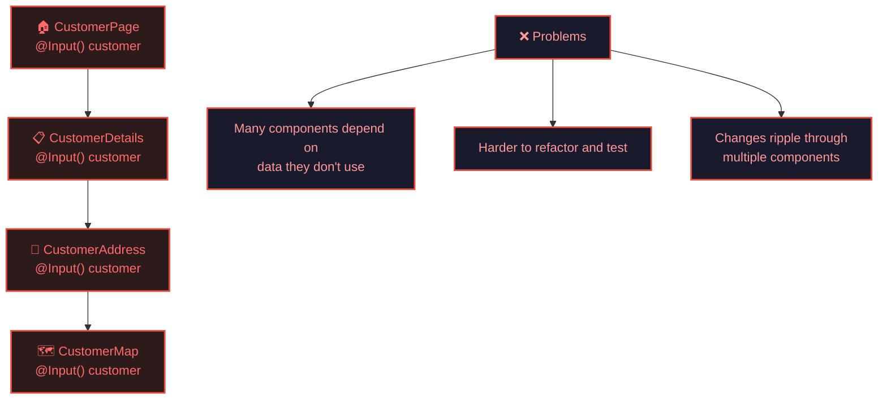
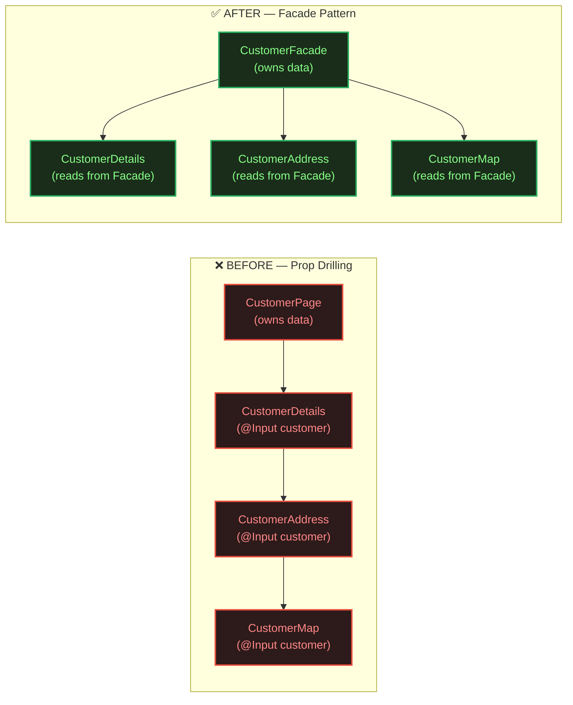
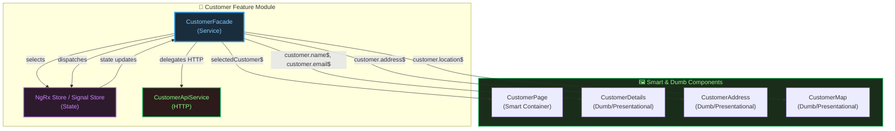
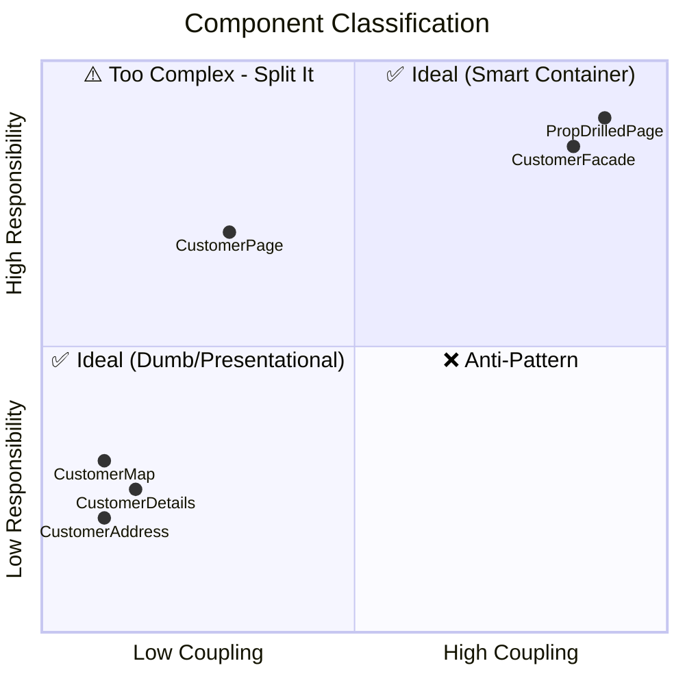
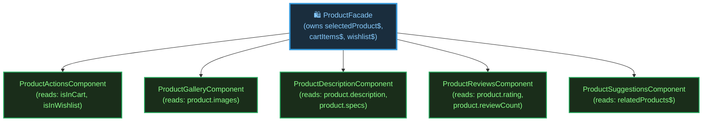
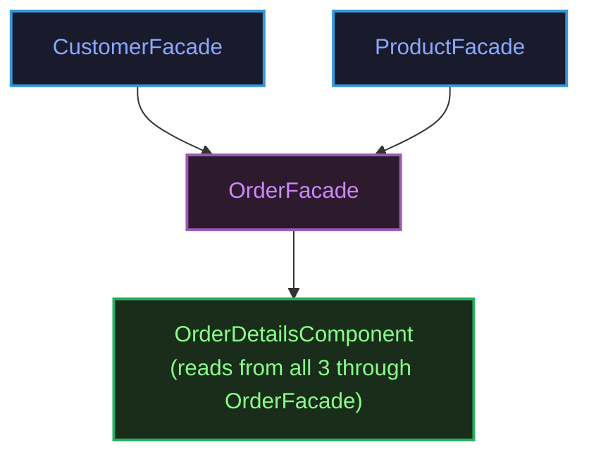

# Angular Architecture: Eliminating Prop Drilling with the Facade Pattern


---

## 📋 Table of Contents

1. [Introduction & Overview](#introduction)
2. [Prerequisites](#prerequisites)
3. [Learning Objectives](#learning-objectives)
4. [The Problem: Understanding Prop Drilling](#the-problem)
5. [The Solution: Facade Pattern Explained](#the-solution)
6. [Core Concepts & Architecture](#core-concepts)
7. [Step-by-Step Implementation Guide](#implementation)
8. [Modern Approach: Angular Signals (Angular 17+)](#signals)
9. [Real-World Use Cases](#use-cases)
10. [Advanced Patterns](#advanced-patterns)
11. [Best Practices](#best-practices)
12. [Anti-Patterns to Avoid](#anti-patterns)
13. [Testing Strategies](#testing)
14. [Performance Considerations](#performance)
15. [Security Considerations](#security)
16. [Troubleshooting Guide](#troubleshooting)
17. [Migration Guide](#migration)
18. [Practice Exercises](#exercises)
19. [Question Bank (50+ Questions)](#question-bank)
20. [Common Interview Questions](#interview-questions)
21. [Test Your Understanding](#test-understanding)
22. [Summary & Key Takeaways](#summary)
23. [Further Reading & Resources](#resources)

## 1. Introduction & Overview

### What You'll Learn

This comprehensive tutorial explores the **Facade Pattern** in Angular — one of the most impactful architectural patterns for eliminating prop drilling and creating clean, maintainable component architectures.

### Why This Matters

In modern Angular applications, proper component architecture is crucial for maintainability, testability, and scalability. The Facade Pattern provides a clean solution to one of Angular's most common architectural problems: **prop drilling**.

| Aspect | Without Facade | With Facade |
|--------|---------------|-------------|
| **Component Coupling** | High | Low |
| **Refactoring Risk** | High | Low |
| **Testability** | Complex | Simple |
| **Scalability** | Degrades with depth | Scales linearly |

> 💡 **Key Insight:** If a component passes an `@Input()` straight through to a child without using it — that's a signal to introduce a Facade.

### Target Audience

This tutorial is designed for **intermediate Angular developers** who:
- Understand Angular components, services, and dependency injection
- Have basic familiarity with RxJS or Angular Signals
- Want to improve their application architecture
- Are dealing with prop drilling issues in their codebase

### Estimated Reading Time

- **Total:** 45-60 minutes
- **Quick Scan:** 15-20 minutes
- **Full Implementation:** 2-3 hours (with exercises)

---

## 2. Prerequisites

### Required Knowledge

Before diving into this tutorial, you should be comfortable with:

1. **Angular Fundamentals**
   - Components and templates
   - Data binding (@Input, @Output)
   - Dependency injection
   - Services and providers
   - RxJS observables and operators

2. **State Management (Basic)**
   - Understanding of centralized state concepts
   - Familiarity with either NgRx, Akita, or NGXS (or readiness to learn)

### Recommended Knowledge

- Angular Signals API (Angular 16+)
- NgRx Entity
- Angular CDK and Material

### What You'll Build

By the end of this tutorial, you will have built:
- A complete customer management feature using the Facade Pattern
- A product page facade with signal-based state management
- A dashboard facade with composable state
- A multi-step form wizard facade

---

## 3. Learning Objectives

By the end of this tutorial, you will be able to:

✅ **Identify** prop drilling patterns in your codebase
✅ **Create** Facade services using NgRx or Angular Signals
✅ **Refactor** components to eliminate prop drilling
✅ **Implement** signal-based facades with computed properties
✅ **Apply** facade composition for complex features
✅ **Test** components with mocked facades
✅ **Follow** best practices and avoid common anti-patterns
✅ **Optimize** performance with granular observables and signals
✅ **Handle** edge cases and error scenarios properly

### Skill Level Matrix

| Skill Area | Before | After |
|-----------|--------|-------|
| Component Architecture | Prone to prop drilling | Clean, decoupled components |
| State Management | Mixed approaches | Consistent facade pattern |
---

## 4. The Problem: Understanding Prop Drilling

### What is Prop Drilling?

**Prop Drilling** (also called "Input Tunneling" in Angular) happens when you pass data from a **parent component** down through multiple layers of **child components** — even when the intermediate components don't actually need that data. They're just acting as messengers.

### Visual Breakdown



### Code Example — The Anti-Pattern

**`customer-page.component.ts`** (owns the data)
```typescript
@Component({
  selector: 'app-customer-page',
  template: `
    <app-customer-details [customer]="customer"></app-customer-details>
  `
})
export class CustomerPageComponent {
  customer: Customer = {
    id: 1,
    name: 'Alice Johnson',
    email: 'alice@example.com',
    address: { city: 'New York', zip: '10001' },
    location: { lat: 40.7128, lng: -74.0060 }
  };
}
```
---

## 5. The Solution: Facade Pattern Explained

### What is the Facade Pattern?

The **Facade Pattern** is a structural design pattern that provides a **simplified interface** to a complex subsystem. In Angular, a Facade is typically a **service** that:

- Encapsulates state management (NgRx, signals, BehaviorSubject)
- Exposes clean, typed observables or computed properties
- Acts as a single source of truth for a feature
- Decouples components from each other and from state management details

> **Core Principle:** *"Let the feature own the data. Components read only what they need."*

### Architecture Comparison



### Key Benefits of the Facade Pattern

1. **Eliminates Prop Drilling** — No more passing data through intermediate components
2. **Reduces Coupling** — Components don't need to know about each other's data requirements
3. **Improves Testability** — Easy to mock a single Facade service
4. **Enables Granular Access** — Each component subscribes only to what it needs
5. **Centralizes State Logic** — All state management in one place
6. **Supports Multiple Data Sources** — Facade can combine store, HTTP, signals, etc.

### The Facade Design Philosophy

> **Core Principle:** *"Let the feature own the data. Components read only what they need."*

This philosophy shifts the responsibility of data ownership:
- **Before:** Parent components own data and push it down via `@Input()`
- **After:** Feature facades own data, components pull only what they need

The facade becomes the **single source of truth**, encapsulating all data access logic.

## 6. Core Concepts & Architecture

### The Feature Architecture Model



### Smart vs Dumb Components

Understanding the distinction between smart (container) and dumb (presentational) components is crucial for effective facade usage:



### Granular Selectors — The Key to Performance

Granular selectors allow components to subscribe only to the data they need:

```typescript
// store/customer.selectors.ts
import { createFeatureSelector, createSelector } from '@ngrx/store';
import { CustomerState } from './customer.reducer';

export const selectCustomerState =
  createFeatureSelector<CustomerState>('customer');

export const selectSelectedCustomer = createSelector(
  selectCustomerState,
  (state) => state.selectedCustomer
);

// Granular selectors for each data slice
export const selectCustomerName = createSelector(
  selectSelectedCustomer,
  (customer) => customer?.name
);

export const selectCustomerEmail = createSelector(
  selectSelectedCustomer,
  (customer) => customer?.email
);

export const selectCustomerAddress = createSelector(
  selectSelectedCustomer,
  (customer) => customer?.address
);

export const selectCustomerLocation = createSelector(
  selectSelectedCustomer,
  (customer) => customer?.location
);

export const selectCustomerStatus = createSelector(
  selectSelectedCustomer,
  (customer) => customer?.status
);

export const selectCustomerLoading = createSelector(
  selectCustomerState,
  (state) => state.loading
);

export const selectCustomerError = createSelector(
  selectCustomerState,
  (state) => state.error
);
```

### Component Refactoring — Before and After

**Before (Prop Drilling):**
```typescript
// customer-details.component.ts — BEFORE
@Component({
  selector: 'app-customer-details',
  template: `
    <div *ngIf="customer">
      <h2>{{ customer.name }}</h2>
      <p>📧 {{ customer.email }}</p>
    </div>
  `
})
export class CustomerDetailsComponent {
  // 😞 Component knows about Customer interface
  // 😞 Can't exist without parent providing data
  // 😞 Hard to test (must mock entire Customer)
  @Input() customer!: Customer;
}
```

**After (Facade Pattern):**
```typescript
// customer-details.component.ts — AFTER
@Component({
  selector: 'app-customer-details',
  template: `
    <div *ngIf="facade.selectedCustomer$ | async as customer">
      <h2>{{ customer.name }}</h2>
      <p>📧 {{ customer.email }}</p>
    </div>
  `
})
export class CustomerDetailsComponent {
  // ✅ Inject Facade — No @Input() needed!
  // ✅ Component can exist independently
  // ✅ Easy to test (mock the facade only)
  readonly facade = inject(CustomerFacade);
}
```

### Smart Container Component

```typescript
// customer-page.component.ts
@Component({
  selector: 'app-customer-page',
  template: `
    <div *ngIf="facade.isLoading$ | async" class="loading">
      Loading customer...
    </div>
    
    <div *ngIf="facade.error$ | async as error" class="error">
      <p>❌ {{ error }}</p>
      <button (click)="retry()">Retry</button>
    </div>
    
    <ng-container *ngIf="!(facade.isLoading$ | async) && !(facade.error$ | async)">
      <app-customer-details></app-customer-details>
      <app-customer-address></app-customer-address>
      <app-customer-map></app-customer-map>
    </ng-container>
  `
})
export class CustomerPageComponent {
  readonly facade = inject(CustomerFacade);
  private readonly route = inject(ActivatedRoute);

  ngOnInit(): void {
    const id = this.route.snapshot.params['id'] ?? 1;
    this.facade.loadCustomer(id);
  }

  retry(): void {
    const id = this.route.snapshot.params['id'] ?? 1;
    this.facade.loadCustomer(id);
  }
}
```

Notice that the page component:
- ✅ Doesn't pass data to children via @Input()
- ✅ Lets each child component read from the Facade directly
- ✅ Handles loading and error states
- ✅ Acts as a coordinator, not a data passer

---

## 7. Step-by-Step Implementation Guide

Follow these steps to implement the Facade Pattern in your Angular application:

### Step 1: Define Your Domain Models

Create TypeScript interfaces for your data structures:

```typescript
// models/customer.model.ts
export interface Customer {
  id: number;
  name: string;
  email: string;
  phone?: string;
  address: CustomerAddress;
  location: GeoLocation;
  status: 'active' | 'inactive' | 'pending';
}

export interface CustomerAddress {
  street: string;
  city: string;
  state: string;
  zip: string;
  country: string;
}

export interface GeoLocation {
  lat: number;
  lng: number;
}
```

### Step 2: Set Up State Management

Create NgRx store configuration with actions, reducers, and selectors:

```typescript
// store/customer.actions.ts
import { createAction, props } from '@ngrx/store';
import { Customer } from '../models/customer.model';

export const loadCustomer = createAction(
  '[Customer] Load Customer',
  props<{ customerId: number }>()
);

export const loadCustomerSuccess = createAction(
  '[Customer] Load Customer Success',
  props<{ customer: Customer }>()
);

export const loadCustomerFailure = createAction(
  '[Customer] Load Customer Failure',
  props<{ error: string }>()
);

export const selectCustomer = createAction(
  '[Customer] Select Customer',
  props<{ customer: Customer }>()
);

export const clearCustomer = createAction(
  '[Customer] Clear Customer'
);
```

```typescript
// store/customer.reducer.ts
import { createReducer, on } from '@ngrx/store';
import { Customer } from '../models/customer.model';
import * as CustomerActions from './customer.actions';

export interface CustomerState {
  selectedCustomer: Customer | null;
  loading: boolean;
  error: string | null;
}

export const initialCustomerState: CustomerState = {
  selectedCustomer: null,
  loading: false,
  error: null
};

export const customerReducer = createReducer(
  initialCustomerState,
  on(CustomerActions.loadCustomer, (state) => ({
    ...state,
    loading: true,
    error: null
  })),
  on(CustomerActions.loadCustomerSuccess, (state, { customer }) => ({
    ...state,
    selectedCustomer: customer,
    loading: false
  })),
  on(CustomerActions.loadCustomerFailure, (state, { error }) => ({
    ...state,
    loading: false,
    error
  })),
  on(CustomerActions.selectCustomer, (state, { customer }) => ({
    ...state,
    selectedCustomer: customer
  })),
  on(CustomerActions.clearCustomer, (state) => ({
    ...initialCustomerState
  }))
);
```

### Step 3: Create the Facade Service

```typescript
// facades/customer.facade.ts
import { Injectable, inject } from '@angular/core';
import { Store } from '@ngrx/store';
import { Observable } from 'rxjs';
import { Customer, CustomerAddress, GeoLocation } from '../models/customer.model';
import * as CustomerActions from '../store/customer.actions';
import * as CustomerSelectors from '../store/customer.selectors';

@Injectable({
  providedIn: 'root'
})
export class CustomerFacade {

  private readonly store = inject(Store);

  // ─── Public Observables (read-only interface) ───────────────
  readonly selectedCustomer$: Observable<Customer | null> =
    this.store.select(CustomerSelectors.selectSelectedCustomer);

  readonly customerName$: Observable<string | undefined> =
    this.store.select(CustomerSelectors.selectCustomerName);

  readonly customerAddress$: Observable<CustomerAddress | undefined> =
    this.store.select(CustomerSelectors.selectCustomerAddress);

  readonly customerLocation$: Observable<GeoLocation | undefined> =
    this.store.select(CustomerSelectors.selectCustomerLocation);

  readonly isLoading$: Observable<boolean> =
    this.store.select(CustomerSelectors.selectCustomerLoading);

  readonly error$: Observable<string | null> =
    this.store.select(CustomerSelectors.selectCustomerError);

  // ─── Public Actions ──────────────────────────────────────────
  loadCustomer(customerId: number): void {
    this.store.dispatch(CustomerActions.loadCustomer({ customerId }));
  }

    selectCustomer(customer: Customer): void {
    this.store.dispatch(CustomerActions.selectCustomer({ customer }));
  }

    clearCustomer(): void {
    this.store.dispatch(CustomerActions.clearCustomer());
  }
}
```

### Step 4: Refactor Components to Use the Facade

Now let's refactor our components to read directly from the Facade instead of receiving data through `@Input()`:

**customer-details.component.ts — AFTER (Facade Pattern):**
```typescript
@Component({
  selector: 'app-customer-details',
  template: `
    <div *ngIf="facade.selectedCustomer$ | async as customer">
      <h2>{{ customer.name }}</h2>
      <p>📧 {{ customer.email }}</p>
      <p>📞 {{ customer.phone }}</p>
      <span class="badge" [class]="customer.status">
        {{ customer.status | titlecase }}
      </span>
    </div>

    <!-- Only subscribe to what this component needs -->
    <p *ngIf="facade.customerAddress$ | async as addr">
      📍 {{ addr.city }}, {{ addr.state }}
    </p>
  `
})
export class CustomerDetailsComponent {
  // ✅ Inject Facade — No @Input() needed!
  readonly facade = inject(CustomerFacade);
}
```

**customer-address.component.ts — AFTER:**
```typescript
@Component({
  selector: 'app-customer-address',
  template: `
    <address *ngIf="address$ | async as addr">
      <p>{{ addr.street }}</p>
      <p>{{ addr.city }}, {{ addr.state }} {{ addr.zip }}</p>
      <p>{{ addr.country }}</p>
    </address>
  `
})
export class CustomerAddressComponent {
  // ✅ Only subscribes to the address slice — not the whole customer
  readonly address$ = inject(CustomerFacade).customerAddress$;
}
```

**customer-map.component.ts — AFTER:**
```typescript
@Component({
  selector: 'app-customer-map',
  template: `
    <div class="map-container" *ngIf="location$ | async as loc">
      <google-map [center]="loc" [zoom]="14">
        <map-marker [position]="loc"></map-marker>
      </google-map>
    </div>
  `
})
export class CustomerMapComponent {
  // ✅ Only subscribes to location — ultra-specific
  readonly location$ = inject(CustomerFacade).customerLocation$;
}
```

**Step 5: Wire Up in the Smart Container**

The page-level component is the only place that triggers data loading:

```typescript
// customer-page.component.ts
@Component({
  selector: 'app-customer-page',
  template: `
    <div *ngIf="facade.isLoading$ | async" class="loading">
      Loading customer...
    </div>

    <div *ngIf="facade.error$ | async as error" class="error">
      <p>❌ {{ error }}</p>
      <button (click)="retry()">Retry</button>
    </div>

    <ng-container *ngIf="!(facade.isLoading$ | async) && !(facade.error$ | async)">
      <app-customer-details></app-customer-details>
      <app-customer-address></app-customer-address>
      <app-customer-map></app-customer-map>
    </ng-container>
  `
})
export class CustomerPageComponent {
  readonly facade = inject(CustomerFacade);
  private readonly route = inject(ActivatedRoute);

  ngOnInit(): void {
    const id = this.route.snapshot.params['id'] ?? 1;
    this.facade.loadCustomer(id);
  }

  retry(): void {
    const id = this.route.snapshot.params['id'] ?? 1;
    this.facade.loadCustomer(id);
  }
}
```

> **Notice:** The page component no longer passes `@Input()` to any child. Each child component reads directly from the Facade.

## 8. Modern Approach: Angular Signals (Angular 17+)

Angular Signals provide a modern, reactive primitive that simplifies state management and eliminates many RxJS complexities.

### Why Signals Change the Game

| Feature | Observables (RxJS) | Signals |
|---------|-------------------|---------|
| **Subscription Management** | Manual or async pipe | Automatic |
| **Synchronous Access** | Requires async pipe | Direct `signal()` call |
| **Derived State** | `combineLatest`, `map` | `computed()` |
| **Learning Curve** | Steeper | Lower |
| **Change Detection** | Zone-based or OnPush | Fine-grained automatic |
| **Type Safety** | Good with generics | Excellent with typed signals |

### Converting Store to Signals

```typescript
// facades/customer-signal.facade.ts
import { Injectable, inject, computed, Signal, signal, effect } from '@angular/core';
import { toSignal } from '@angular/core/rxjs-interop';
import { Store } from '@ngrx/store';
import { Customer } from '../models/customer.model';
import * as CustomerSelectors from '../store/customer.selectors';

@Injectable({ providedIn: 'root' })
export class CustomerSignalFacade {
  private readonly store = inject(Store);
  private readonly logger = inject(LoggerService);

  // Convert store selectors to Signals
  readonly selectedCustomer: Signal<Customer | null> = toSignal(
    this.store.select(CustomerSelectors.selectSelectedCustomer),
    { initialValue: null }
  );

  // Derived computed signals — no extra selector needed
  readonly customerName = computed(() => this.selectedCustomer()?.name ?? 'Unknown');
  readonly isCustomerActive = computed(() => this.selectedCustomer()?.status === 'active');

  // Writable signal for local UI state
  readonly isDirty = signal(false);

  constructor() {
    // Effect runs whenever selectedCustomer changes
    effect(() => {
      const customer = this.selectedCustomer();
      if (customer) {
        this.logger.log(`Customer changed: ${customer.name}`);
        this.isDirty.set(true);
      }
    });
  }
}
```

### Signal Facade with Computed Views

```typescript
@Injectable({ providedIn: 'root' })
export class ProductSignalFacade {
  private readonly store = inject(Store);

  readonly selectedProduct = toSignal(
    this.store.select(selectSelectedProduct),
    { initialValue: null }
  );

  // Computed views — automatically tracked
  readonly productName = computed(() => this.selectedProduct()?.name ?? 'Unknown');
  readonly productPrice = computed(() => this.selectedProduct()?.price ?? 0);
  readonly productImages = computed(() => this.selectedProduct()?.images ?? []);
  readonly productDescription = computed(() => this.selectedProduct()?.description);
  readonly productRating = computed(() => this.selectedProduct()?.rating ?? 0);
  readonly productStockCount = computed(() => this.selectedProduct()?.stockCount ?? 0);

  // Computed from multiple sources
  readonly isInCart = computed(() => {
    const productId = this.selectedProduct()?.id;
    const cartItems = this.cartItems(); // Inject from CartFacade
    return productId ? cartItems.some(item => item.productId === productId) : false;
  });

  loadProduct(productId: number): void {
    this.store.dispatch(ProductActions.loadProduct({ productId }));
  }

  addToCart(productId: number, quantity: number = 1): void {
    this.store.dispatch(CartActions.addToCart({ productId, quantity }));
  }

  toggleWishlist(productId: number): void {
    this.store.dispatch(WishlistActions.toggleWishlist({ productId }));
  }
}
```

## 9. Real-World Use Cases

### Use Case 1: E-Commerce Product Page



**ProductFacade Implementation:**
```typescript
@Injectable({ providedIn: 'root' })
export class ProductFacade {
  private readonly store = inject(Store);

  readonly selectedProduct$ = this.store.select(selectSelectedProduct);
  readonly isLoading$ = this.store.select(selectProductLoading);
  readonly error$ = this.store.select(selectProductError);

  // Granular product slices
  readonly productName$ = this.store.select(selectProductName);
  readonly productPrice$ = this.store.select(selectProductPrice);
  readonly productImages$ = this.store.select(selectProductImages);
  readonly productDescription$ = this.store.select(selectProductDescription);
  readonly productRating$ = this.store.select(selectProductRating);
  readonly productStockCount$ = this.store.select(selectProductStockCount);

  readonly isInCart$: Observable<boolean> = combineLatest([
    this.store.select(selectSelectedProductId),
    this.store.select(selectCartItems)
  ]).pipe(
    map(([productId, cartItems]) =>
      cartItems.some(item => item.productId === productId)
    )
  );

  loadProduct(productId: number): void {
    this.store.dispatch(ProductActions.loadProduct({ productId }));
  }

  addToCart(productId: number, quantity: number = 1): void {
    this.store.dispatch(CartActions.addToCart({ productId, quantity }));
  }

  toggleWishlist(productId: number): void {
    this.store.dispatch(WishlistActions.toggleWishlist({ productId }));
  }
}
```

**Component Examples:**

```typescript
// ProductGalleryComponent — only needs images
@Component({
  selector: 'app-product-gallery',
  template: `
    <div class="gallery">
      <div *ngFor="let image of images$ | async" class="image-thumb">
        
      </div>
    </div>
  `
})
export class ProductGalleryComponent {
  readonly images$ = inject(ProductFacade).productImages$;
}
---

```

## 10. Advanced Patterns

### Pattern A: Scoped Facades (Feature-Level)

```typescript
// Provide Facade at the feature route level — auto-cleaned on navigation
const routes: Routes = [
  {
    path: 'customers',
    providers: [
      CustomerFacade,
      CustomerEffects
    ],
    component: CustomerShellComponent,
    children: [
      { path: ':id', component: CustomerDetailPageComponent }
    ]
  }
];
```

**Benefits:**
- Auto-cleanup on navigation
- Reduced memory footprint
- Feature isolation

### Pattern B: Facade Composition

When one feature needs data from multiple feature facades, create a composed facade:



**Implementation:**
```typescript
// OrderFacade composes multiple facades
@Injectable({ providedIn: 'root' })
export class OrderFacade {
  private readonly customerFacade = inject(CustomerFacade);
  private readonly productFacade = inject(ProductFacade);
  private readonly store = inject(Store);

  // Combine state from multiple sources
  readonly orderSummary$ = combineLatest([
    this.store.select(selectCurrentOrder),
    this.customerFacade.selectedCustomer$,
    this.productFacade.selectedProducts$
  ]).pipe(
    map(([order, customer, products]) => ({
      order,
      customer,
      products,
      total: products.reduce((sum, p) => sum + p.price, 0)
    }))
  );

  // Proxy through to sub-facades
  readonly customerName$ = this.customerFacade.customerName$;
  readonly productImages$ = this.productFacade.productImages$;

  // Combined actions
  submitOrder(orderData: OrderData): void {
    this.store.dispatch(OrderActions.submitOrder({ orderData }));
  }
}
```

**Benefits:**
- Single entry point for components that need multi-feature data
- Hides composition complexity from components
- Enables clean separation of concerns while maintaining composability

## 11. Best Practices

### The Right Way vs. The Wrong Way

```mermaid
flowchart LR
    subgraph DO["✅ DO"]
        D1["Keep Facades thin\n(orchestrate, don't compute)"]
        D2["One Facade per Feature\n(not per component)"]
        D3["Expose Observables\nas readonly"]
        D4["Use Facades at\nSmart Component level"]
        D5["Scope Facades to\nfeature modules"]
    end

    subgraph DONT["❌ DON'T"]
        N1["Put business logic\nin Facades"]
        N2["Create a single\nGod Facade for everything"]
        N3["Expose store dispatch\ndirectly to components"]
        N4["Inject Facades into\nother services freely"]
        N5["Use @Input() + Facade\non the same component"]
    end
    
    style DO fill:#1a2d1a,stroke:#27ae60
    style DONT fill:#2d1a1a,stroke:#e74c3c
```



### Quick-Reference Checklist

```
📐 ARCHITECTURE CHECKLIST
═══════════════════════════════════════════════
✅ Does each component have a single clear responsibility?
✅ Are Facades the only way components interact with state?
✅ Do Dumb components have zero injected Facades? (or minimal)
✅ Are Facade observables typed and readonly?
✅ Is the Facade scoped to the correct module/route?
✅ Are effects handling all async side effects?
✅ Can each component be tested with a simple mock Facade?
✅ Does changing the store shape require changes only in the Facade?
✅ Are error states properly handled and exposed?
✅ Are loading states properly exposed for UI feedback?
═══════════════════════════════════════════════
```

### Best Practices in Detail

1. **Keep Facades Thin**
   - Facades should orchestrate, not compute
   - Business logic belongs in domain services, not facades
   - If your facade has more than 10-15 methods, consider splitting it

2. **One Facade Per Feature**
   - Create `CustomerFacade`, `OrderFacade`, `ProductFacade` — not a single `AppFacade`
   - Feature-specific facades keep concerns separated
   - Easier to maintain and test

3. **Expose as Readonly**
   - Always mark observables as `readonly`
   - Prevents components from accidentally modifying streams
   - Enforces one-way data flow

4. **Use Granular Observables**
   - Create specific observables for each data slice
   - Components only subscribe to what they need
   - Prevents unnecessary change detection

5. **Don't Mix @Input() and Facade**
   - Components should have ONE source of truth
   - Either use @Input() OR Facade, not both for the same data
   - Mixing creates confusion and two sources of truth

6. **Handle Async in Effects**
   - Effects should handle side effects (HTTP calls, etc.)
   - Facades should only dispatch actions and expose state
   - Keep facades simple and focused on state access

7. **Scope Appropriately**
   - Root-level for global state (auth, user preferences)
   - Feature-level for feature-specific state
   - Consider cleanup behavior

8. **Make Testable**
   - Facades should be easy to mock
   - Use interfaces for test doubles
   - Expose simple methods for testing

---

## 12. Anti-Patterns to Avoid

Understanding what NOT to do is just as important as knowing the best practices. Here are common anti-patterns when implementing the Facade pattern:

### Anti-Pattern 1: The God Facade

Creating a single, massive facade that handles all application state.

**❌ Anti-Pattern:**
```typescript
@Injectable({ providedIn: 'root' })
export class AppFacade {
  // Hundreds of observables...
  readonly customers$ = this.store.select(...);
  readonly orders$ = this.store.select(...);
  readonly products$ = this.store.select(...);
  // ... 200+ methods
}
```

**✅ Solution:** Split into feature-specific facades
```typescript
@Injectable({ providedIn: 'root' })
export class CustomerFacade { /* only customer operations */ }

@Injectable({ providedIn: 'root' })
export class OrderFacade { /* only order operations */ }
```

### Anti-Pattern 2: Exposing Store Internals

Allowing components to access the store directly through the facade.

**❌ Anti-Pattern:**
```typescript
@Injectable({ providedIn: 'root' })
export class CustomerFacade {
  store = this.store;  // ❌ Exposes store directly
  actions = CustomerActions;  // ❌ Exposes actions
}
```

**✅ Solution:** Encapsulated facade
```typescript
@Injectable({ providedIn: 'root' })
export class CustomerFacade {
  readonly selectedCustomer$ = this.store.select(...);
  loadCustomer(id: number): void {
```

### Anti-Pattern 4: Facade Returning Promises

Mixing promise-based and observable-based APIs inconsistently.

**❌ Anti-Pattern:**
```typescript
@Injectable({ providedIn: 'root' })
export class CustomerFacade {
  async loadCustomer(id: number): Promise<Customer> {
    return this.api.getCustomer(id);  // ❌ Returning promise
  }

  getCustomer$(id: number): Observable<Customer> {
    return this.store.select(...);  // ❌ Returning observable
  }
}
```

**✅ Solution:** Consistent observable API
```typescript
@Injectable({ providedIn: 'root' })
export class CustomerFacade {
  loadCustomer(id: number): void {
    this.store.dispatch(CustomerActions.loadCustomer({ customerId: id }));
  }

  readonly selectedCustomer$ = this.store.select(...);
}
```

### Anti-Pattern 5: Services Depending on Facades

Creating circular dependencies by having services depend on facades.

**❌ Anti-Pattern:**
```typescript
@Injectable({ providedIn: 'root' })
export class ReportService {
  private customerFacade = inject(CustomerFacade);

  generateReport(): Report {
    const customers = this.customerFacade.customers$;  // ❌ Accessing facade state
  }
}
```

**✅ Solution:** Services depend on data sources, not facades
```typescript
@Injectable({ providedIn: 'root' })
export class ReportService {
  private readonly api = inject(CustomerApiService);

  generateReport(customerId: number): Observable<Report> {
    return this.api.getCustomerReport(customerId);
  }
}
```

### Anti-Pattern 6: Mixing @Input() and Facade

Using both @Input() and Facade for the same data, creating confusion.

**❌ Anti-Pattern:**
```typescript
@Component({
---

```

---

## 13. Testing Strategies

### Testing Components with Facade (Easy Mocking)

The facade pattern makes component testing significantly easier — mock the entire facade!

```typescript
describe('CustomerDetailsComponent', () => {
  let mockFacade: Partial<CustomerFacade>;

  const mockCustomer: Customer = {
    id: 1,
    name: 'Alice Johnson',
    email: 'alice@example.com',
    address: { street: '123 Main', city: 'NYC', state: 'NY', zip: '10001', country: 'USA' },
    location: { lat: 40.71, lng: -74.00 },
    status: 'active'
  };

  beforeEach(() => {
    mockFacade = {
      selectedCustomer$: of(mockCustomer),
      customerName$: of('Alice Johnson'),
      customerAddress$: of(mockCustomer.address),
      loadCustomer: jest.fn(),
      selectCustomer: jest.fn()
    };

    TestBed.configureTestingModule({
      declarations: [CustomerDetailsComponent],
      providers: [
        { provide: CustomerFacade, useValue: mockFacade }
      ]
    });
  });

  it('should display customer name', (done) => {
    const fixture = TestBed.createComponent(CustomerDetailsComponent);
    fixture.detectChanges();

    setTimeout(() => {
      const compiled = fixture.nativeElement;
      expect(compiled.querySelector('h2').textContent)
        .toContain('Alice Johnson');
      done();
    });
  });
});
---

```

---

## 14. Performance Considerations

Performance is critical when building Angular applications with facades. Here are key performance considerations:

### Change Detection Optimization

```typescript
// ✅ GOOD: Using granular observables with OnPush
@Component({
  selector: 'app-customer-name',
  template: `<h2>{{ name$ | async }}</h2>`,
  changeDetection: ChangeDetectionStrategy.OnPush
})
export class CustomerNameComponent {
  readonly name$ = inject(CustomerFacade).customerName$;
  // ✅ Only re-renders when name changes, not when other customer data changes
}

// ❌ BAD: Subscribing to full customer object
@Component({
  selector: 'app-customer-name',
  template: `<h2>{{ (customer$ | async)?.name }}</h2>`,
  changeDetection: ChangeDetectionStrategy.OnPush
})
export class CustomerNameComponent {
  readonly customer$ = inject(CustomerFacade).selectedCustomer$;
  // ❌ Re-renders on ANY customer change, even though only name is used
}
```


  template: `
    <h2>{{ customer.name }}</h2>  <!-- From @Input() -->
    <p>{{ facade.customerEmail$ | async }}</p>  <!-- From Facade -->
  `
})
export class CustomerDetailsComponent {
  @Input() customer!: Customer;  // ❌ Source 1
### Signal-Based Performance Benefits

```typescript
@Injectable({ providedIn: 'root' })
export class CustomerSignalFacade {
  readonly selectedCustomer = toSignal(
    this.store.select(selectSelectedCustomer),
    { initialValue: null }
  );

  // Computed signals only recompute when dependencies change
  readonly customerName = computed(() =>
    this.selectedCustomer()?.name ?? 'Unknown'
  );

  readonly customerInitials = computed(() => {
    const name = this.selectedCustomer()?.name ?? '';
    return name.split(' ').map(n => n[0]).join('').toUpperCase();
  });
}

// Component using signals
@Component({
  template: `
    <h2>{{ facade.customerName() }}</h2>
    <span>{{ facade.customerInitials() }}</span>
  `,
  changeDetection: ChangeDetectionStrategy.OnPush
})
export class CustomerNameComponent {
  readonly facade = inject(CustomerSignalFacade);
  // ✅ Angular knows exactly which signals each template expression uses
  // ✅ Only re-renders when those specific signals change
}
```

### Memory Management

```typescript
// ✅ Using async pipe (automatic cleanup)
```

### Selector Memoization

```typescript
// ✅ NgRx selectors are memoized - only recompute when input changes
export const selectCustomerName = createSelector(
  selectSelectedCustomer,
  (customer) => customer?.name
);
// If selectSelectedCustomer returns same reference, 
// this selector won't recompute

// ❌ Avoid creating new objects in selectors
export const selectCustomerData = createSelector(
  selectSelectedCustomer,
  (customer) => ({  // ❌ New object every time
    name: customer?.name,
    email: customer?.email
  })
);
// This will cause unnecessary recomputation

// ✅ Correct approach
export const selectCustomerName = createSelector(
  selectSelectedCustomer,
  (customer) => customer?.name
);

export const selectCustomerEmail = createSelector(
  selectSelectedCustomer,
  (customer) => customer?.email
);
```

### Debouncing and Throttling

```typescript
// In effects when handling user input
loadCustomer$ = createEffect(() =>
  this.actions$.pipe(
    ofType(CustomerActions.triggerCustomerSearch),
    debounceTime(300),  // ✅ Wait for user to stop typing
    switchMap(({ searchTerm }) =>
      this.api.searchCustomers(searchTerm).pipe(
        map(customers => CustomerActions.searchCustomersSuccess({ customers })),
        catchError(err => of(CustomerActions.searchCustomersFailure({ error: err.message })))
      )
    )
  )
);

// For rapid-fire actions
loadCustomer$ = createEffect(() =>
  this.actions$.pipe(
    ofType(CustomerActions.loadCustomer),
    exhaustMap(({ customerId }) =>  // ✅ Ignore new requests while loading
      this.api.getCustomer(customerId).pipe(
        map(customer => CustomerActions.loadCustomerSuccess({ customer })),
        catchError(err => of(CustomerActions.loadCustomerFailure({ error: err.message })))
      )
    )
  )
);
```

### Bundle Size Optimization

```typescript
// ✅ Use standalone components with minimal imports
@Component({
  selector: 'app-customer-details',
  standalone: true,
  imports: [CommonModule, AsyncPipe],  // Only import what you need
  template: `<h2>{{ facade.customerName$ | async }}</h2>`
})
export class CustomerDetailsComponent {
  readonly facade = inject(CustomerFacade);
}

// ✅ Lazy load feature modules with their facades
const routes: Routes = [
  {
    path: 'customers',
    loadChildren: () => import('./customers/customer.module')
      .then(m => m.CustomerModule)
  }
];
```

### Performance Checklist

```
📊 PERFORMANCE CHECKLIST
═══════════════════════════════════════════════
✅ Each component uses granular observables (not full objects)
✅ Components use OnPush change detection strategy
✅ Signals used where appropriate (Angular 17+)
✅ No unnecessary subscription management overhead
✅ Selectors are memoized (NgRx)
✅ Effects properly handle async operations
✅ Lazy loading used for feature modules
✅ Facade methods are simple and fast
✅ No unnecessary re-renders from unrelated data changes
═══════════════════════════════════════════════
```
@Component({
  template: `<div>{{ facade.selectedCustomer$ | async }}</div>`
})
export class CustomerComponent {
  readonly facade = inject(CustomerFacade);
}

// ✅ Using signals (no subscription needed)
@Component({
  template: `<h2>{{ facade.customerName() }}</h2>`
})
export class CustomerComponent {
  readonly facade = inject(CustomerSignalFacade);
}

// ⚠️ Manual subscription pattern (when necessary)
@Component({...})
export class CustomerComponent implements OnDestroy {
  private destroy$ = new Subject<void>();

  ngOnInit(): void {
    this.facade.selectedCustomer$
      .pipe(takeUntil(this.destroy$))
      .subscribe(customer => this.handleCustomer(customer));
  }

  ngOnDestroy(): void {
    this.destroy$.next();
    this.destroy$.complete();
  }
}
```
  readonly facade = inject(CustomerFacade);  // ❌ Source 2
}
```

**✅ Solution:** Use one source of truth
```typescript
@Component({
  template: `
    <h2>{{ facade.customerName$ | async }}</h2>
    <p>{{ facade.customerEmail$ | async }}</p>
  `
})
export class CustomerDetailsComponent {
  readonly facade = inject(CustomerFacade);
}
```

### Anti-Pattern 7: Facade with Too Many Responsibilities

Putting unrelated concerns in a single facade.

**❌ Anti-Pattern:**
```typescript
@Injectable({ providedIn: 'root' })
export class CustomerFacade {
  loadCustomer() {}
  updateCustomer() {}
  login() {}        // ❌ Authentication - unrelated
  logout() {}
  sendNotification() {}  // ❌ Notifications - unrelated
  uploadAvatar() {}      // ❌ File uploads - unrelated
}
```

**✅ Solution:** Separate concerns into their own facades/services

### Anti-Pattern 8: Facade Without Error Handling

Not exposing error state to components.

**❌ Anti-Pattern:**
```typescript
@Injectable({ providedIn: 'root' })
export class CustomerFacade {
  loadCustomer(id: number): void {
    this.store.dispatch(CustomerActions.loadCustomer({ customerId: id }));
    // ❌ What happens on error? Component doesn't know.
  }
}
```

**✅ Solution:** Expose error state
```typescript
@Injectable({ providedIn: 'root' })
export class CustomerFacade {
  readonly error$ = this.store.select(selectCustomerError);

  loadCustomer(id: number): void {
    this.store.dispatch(CustomerActions.loadCustomer({ customerId: id }));
  }
}
```

### Anti-Pattern 9: Manual Subscription Management

Creating memory leaks by not properly cleaning up subscriptions.

**❌ Anti-Pattern:**
```typescript
@Component({...})
export class CustomerComponent implements OnInit {
  customer: Customer | null = null;

  ngOnInit(): void {
    this.facade.selectedCustomer$.subscribe(c => {
      this.customer = c;
    });
    // ❌ No unsubscribe - memory leak!
  }
}
```

**✅ Solution:** Use async pipe or proper cleanup
```typescript
// ✅ Using async pipe
@Component({
  template: `<h2>{{ facade.customerName$ | async }}</h2>`
})
export class CustomerComponent {
  readonly facade = inject(CustomerFacade);
}

// ✅ Using takeUntil
@Component({...})
export class CustomerComponent implements OnInit, OnDestroy {
  private destroy$ = new Subject<void>();

  ngOnInit(): void {
    this.facade.selectedCustomer$
      .pipe(takeUntil(this.destroy$))
      .subscribe(...);
  }

  ngOnDestroy(): void {
    this.destroy$.next();
    this.destroy$.complete();
  }
}
```

### Anti-Pattern 10: Facade Calling Other Facades

Creating circular dependencies between facades.

**❌ Anti-Pattern:**
```typescript
@Injectable({ providedIn: 'root' })
export class OrderFacade {
  private customerFacade = inject(CustomerFacade);  // ❌

  processOrder(): void {
    const customer = this.customerFacade.selectedCustomer$;  // ❌
  }
}
```

**✅ Solution:** Facades should depend on stores and APIs, not other facades (unless intentional composition)
    this.store.dispatch(CustomerActions.loadCustomer({ customerId: id }));
  }
}
```

### Anti-Pattern 3: Business Logic in Facade

Putting business rules and computations in the facade instead of domain services.

**❌ Anti-Pattern:**
```typescript
@Injectable({ providedIn: 'root' })
export class OrderFacade {
  calculateDiscount(order: Order): number {
    // ❌ Business logic shouldn't be in facades
    if (order.status === 'active') return 0.1;
    return 0;
  }
}
```

**✅ Solution:** Move to domain services
```typescript
@Injectable({ providedIn: 'root' })
export class DiscountService {
  calculate(order: Order): number { /* business logic */ }
}

@Injectable({ providedIn: 'root' })
export class OrderFacade {
  private readonly discountService = inject(DiscountService);
  getDiscount(order: Order): number {
    return this.discountService.calculate(order);
  }
}
```

---

## 15. Security Considerations

### Data Protection

```typescript
@Injectable({ providedIn: 'root' })
export class CustomerFacade {
  // Mask sensitive data in public observables
  readonly customerEmail$ = this.store.select(selectCustomerEmail).pipe(
    map(email => this.maskEmail(email))
  );

  private maskEmail(email: string | undefined): string {
    if (!email || !email.includes('@')) return email ?? '';
    const [local, domain] = email.split('@');
    if (local.length <= 2) return email;
    return `${local[0]}***@${domain}`;
  }
}
```

### Authorization Checks

```typescript
@Injectable({ providedIn: 'root' })
export class CustomerFacade {
  private readonly authService = inject(AuthService);

  readonly customerDetail$ = combineLatest([
    this.store.select(selectSelectedCustomer),
    this.authService.currentUser$
  ]).pipe(
    map(([customer, user]) => {
      if (!this.authService.canViewCustomer(user, customer)) {
        return null;
      }
      return customer;
    })
---

```

## 16. Troubleshooting Guide

### Issue 1: Component Not Updating

**Symptoms:** Component template doesn't reflect new data.

**Solutions:**
```typescript
// ✅ Use async pipe (automatic CD)
template: `<h2>{{ facade.customerName$ | async }}</h2>`

// ✅ Use ChangeDetectorRef
constructor(private cdr: ChangeDetectorRef) {}

ngOnInit(): void {
  this.facade.customerName$.subscribe(name => {
    this.name = name;
    this.cdr.markForCheck();
  });
}

// ✅ Use signals (automatic fine-grained CD)
template: `<h2>{{ facade.customerName() }}</h2>`
```

### Issue 2: Memory Leaks from Subscriptions

**Solutions:**
```typescript
// ✅ Use async pipe (automatic cleanup)
template: `{{ facade.customerName$ | async }}`

// ✅ takeUntil pattern
private destroy$ = new Subject<void>();

ngOnInit(): void {
  this.facade.customerName$
    .pipe(takeUntil(this.destroy$))
---

```

## 17. Migration Guide

### Migrating from Prop Drilling to Facade Pattern

Follow these steps to migrate your Angular application from prop drilling to the Facade pattern.

### Phase 1: Assessment

**Step 1: Identify Prop Drilling Chains**
```typescript
// Map out component tree
CustomerPage
  └── CustomerDetails (@Input customer) → only uses name, email
      └── CustomerAddress (@Input customer) → only uses address
          └── CustomerMap (@Input customer) → only uses location
```

**Step 2: Analyze Data Usage**
| Component | Receives | Actually Uses | Unused Data |
|-----------|----------|---------------|-------------|
| CustomerDetails | customer | name, email | address, location |
| CustomerAddress | customer | address | name, email |
| CustomerMap | customer | location | name, email |

### Phase 2: Infrastructure Setup

**Step 3: Create Domain Models**
```typescript
// models/customer.model.ts
export interface Customer { /* ... */ }
export interface CustomerAddress { /* ... */ }
export interface GeoLocation { /* ... */ }
```

**Step 4: Set Up State Management**
```typescript
// 1. Create state interface
export interface CustomerState {
---

```

## 18. Practice Exercises

### Exercise 1: Refactor Prop-Drilled Components

**Difficulty:** Intermediate | **Time:** 30-45 minutes

**Scenario:** Refactor an e-commerce product page with prop drilling to use the Facade pattern.

**Tasks:**
1. Create a Product Facade exposing granular observables
2. Refactor all components to inject the Facade
3. Add loading and error states

**Starting Code:**
```typescript
// product-page.component.ts
@Component({
  template: `
    <app-product-header [product]="product"></app-product-header>
    <app-product-gallery [product]="product"></app-product-gallery>
    <app-product-info [product]="product"></app-product-info>
    <app-product-reviews [product]="product"></app-product-reviews>
  `
})
export class ProductPageComponent {
  product: Product = {
    id: 1, name: 'Wireless Headphones', price: 199.99,
    images: [], description: '...', specs: {},
    rating: 4.5, reviewCount: 128
  };
}
```

**Solution:**
```typescript
// facades/product.facade.ts
@Injectable({ providedIn: 'root' })
export class ProductFacade {
  readonly productName$ = this.store.select(selectProductName);
  readonly productImages$ = this.store.select(selectProductImages);
  readonly productDescription$ = this.store.select(selectProductDescription);
  readonly productPrice$ = this.store.select(selectProductPrice);
  readonly productRating$ = this.store.select(selectProductRating);
  readonly isLoading$ = this.store.select(selectProductLoading);
  readonly error$ = this.store.select(selectProductError);

  loadProduct(productId: number): void {
    this.store.dispatch(ProductActions.loadProduct({ productId }));
  }
}

// product-header.component.ts
@Component({
  selector: 'app-product-header',
  template: `<h1>{{ facade.productName$ | async }}</h1>`
})
export class ProductHeaderComponent {
  readonly facade = inject(ProductFacade);
}

// product-page.component.ts
@Component({
  template: `
    <div *ngIf="facade.isLoading$ | async">Loading...</div>
    <app-product-header></app-product-header>
    <app-product-gallery></app-product-gallery>
    <app-product-info></app-product-info>
    <app-product-reviews></app-product-reviews>
  `
})
export class ProductPageComponent {
  readonly facade = inject(ProductFacade);
  
  ngOnInit(): void {
    this.facade.loadProduct(1);
  }
}
```

---

### Exercise 2: Create a Composed Facade

**Difficulty:** Advanced | **Time:** 45-60 minutes

**Tasks:**
1. Create three base facades: CustomerFacade, ProductFacade, CartFacade
2. Create an OrderFacade that composes the three
3. Implement `orderSummary$`, `calculatedTotal$`, `isValidOrder$`
4. Write tests for OrderFacade

**Solution:**
```typescript
// facades/order.facade.ts
@Injectable({ providedIn: 'root' })
export class OrderFacade {
  private readonly customerFacade = inject(CustomerFacade);
  private readonly productFacade = inject(ProductFacade);
  private readonly cartFacade = inject(CartFacade);
  private readonly store = inject(Store);

  readonly orderSummary$ = combineLatest([
    this.store.select(selectCurrentOrder),
    this.customerFacade.selectedCustomer$,
    this.cartFacade.cartItems$
  ]).pipe(
    map(([order, customer, cartItems]) => ({
      order,
      customer,
      items: cartItems,
      total: cartItems.reduce((sum, item) => sum + item.price, 0)
    }))
  );

  readonly calculatedTotal$ = this.orderSummary$.pipe(
    map(summary => {
      const subtotal = summary?.total ?? 0;
      const tax = subtotal * 0.08;
      const shipping = subtotal > 100 ? 0 : 9.99;
      return { subtotal, tax, shipping, grandTotal: subtotal + tax + shipping };
    })
  );
}

// Test
describe('OrderFacade', () => {
  it('should calculate totals correctly', (done) => {
    const orderFacade = TestBed.inject(OrderFacade);
    orderFacade.calculatedTotal$.subscribe(totals => {
      expect(totals.subtotal).toBe(59.98);
      expect(totals.grandTotal).toBeCloseTo(74.87, 2);
      done();
    });
  });
});
```

---

## 19. Question Bank (50+ Questions)


---

### Section 1: Basic Concepts (Questions 1-15)

**Q1:** What is prop drilling in Angular?
- A) Passing data through multiple component layers
- B) Drilling into the DOM with queries
- C) Creating deep component hierarchies
- D) Using nested NgRx stores
- **Answer:** A

**Q2:** What problem does the Facade Pattern solve?
- A) Slow component rendering
- B) Prop drilling and tight coupling
- C) Poor CSS styling
- D) Lack of component animations
- **Answer:** B

**Q3:** Which is NOT a characteristic of a good Facade?
- A) Exposes readonly observables
- B) Contains business logic
- C) One per feature
- D) Easily mockable for testing
- **Answer:** B

**Q4:** In the Facade pattern, which components should inject the Facade?
- A) All components
- B) Only presentational components
- C) Smart/container components and components needing data
- D) No components, only services
- **Answer:** C

**Q5:** What is the benefit of granular selectors in a Facade?
- A) They make the code longer
- B) They prevent unnecessary change detection
- C) They increase bundle size
- D) They make testing harder
- **Answer:** B

**Q6:** What does `providedIn: 'root'` mean for a Facade?
- A) It can only be used in the root component
- B) It's a singleton available app-wide
- C) It must be provided in every module
- D) It creates a new instance per component
- **Answer:** B

**Q7:** Which Angular feature allows clean dependency injection without constructors?
- A) Decorators
- B) `inject()` function
- C) `ngInjectableDef`
- D) `useFactory`
- **Answer:** B

**Q8:** What is the main advantage of using Signals over Observables in Facades?
- A) Signals are always async
- B) Signals provide synchronous access without async pipe
- C) Signals require NgRx
- D) Signals can't be used with store
- **Answer:** B

**Q9:** What is a scoped facade?
- A) A facade that works only on mobile
- B) A facade provided at feature level, cleaned on navigation
- C) A facade with limited methods
- D) A facade without dependency injection
- **Answer:** B

**Q10:** Which pattern involves one facade combining state from multiple facades?
- A) Prop drilling
- B) Facade composition
- C) Component inheritance
- D) Service injection
- **Answer:** B

**Q11:** In Smart vs Dumb classification, which has high coupling AND high responsibility?
- A) Dumb components
- B) Smart container components
- C) Presentational components
- D) All components equally
- **Answer:** B

**Q12:** What is the ideal responsibility level for a presentational (dumb) component?
- A) High - it should manage all state
- B) Low - it should only render based on inputs
- C) Medium - some state management
- D) It depends on the project
- **Answer:** B

**Q13:** Why should Facades be kept thin according to best practices?
- A) To reduce file size
- B) To maintain separation - orchestration, not computation
- C) To make them faster to write
- D) Thin facades are required by NgRx
- **Answer:** B

**Q14:** What is wrong with exposing `store.dispatch` directly to components?
- A) It's slower
- B) It breaks encapsulation - components shouldn't know about store internals
- C) It doesn't work with NgRx
- D) Nothing is wrong with it
- **Answer:** B

**Q15:** When creating a Facade, what should be the scope?
- A) One Facade for the entire application
- B) One Facade per component
- C) One Facade per feature/domain
- D) One Facade per HTTP call
- **Answer:** C

### Section 2: Architecture & Design (Questions 16-30)

**Q16:** What does facade composition enable?
- A) Using multiple stores
- B) Combining state from multiple domains into a unified view
- C) Faster component rendering
- D) Automatic form validation
- **Answer:** B

**Q17:** In an e-commerce product page, which Facade would handle cart operations?
- A) ProductFacade only
- B) A separate CartFacade or OrderFacade
- C) No facade needed
- D) The ProductDetailsComponent handles it
- **Answer:** B

**Q18:** For a multi-step form wizard, what should the Facade own?
- A) Only the current step
- B) The entire form state across all steps
- C) Nothing - each step manages its own state
- D) Only validation rules
- **Answer:** B

**Q19:** What is optimistic update in the context of a Facade?
- A) Updating UI before server responds, with rollback on failure
- B) Waiting for server response before updating UI
- C) Discarding old data immediately
- D) Caching all responses
- **Answer:** A

**Q20:** Why might you scope a Facade to a feature route instead of root?
- A) It's always better to scope
- B) Auto-cleanup on navigation, reduced memory footprint
- C) Root provision doesn't work with NgRx
- D) Scoped facades are faster
- **Answer:** B

**Q21:** What is the main testing advantage of the Facade pattern?
- A) Tests run faster
- B) Easy to mock the entire facade for component tests
- C) No tests needed
- D) Tests are more complex
- **Answer:** B

**Q22:** When testing a component that uses a Facade, what do you typically provide?
- A) The real Facade
- B) A mock implementation of the Facade
- C) The NgRx store directly
- D) HTTP interceptors
- **Answer:** B

**Q23:** What does `provideMockStore` allow you to do?
- A) Mock HTTP requests
- B) Set up initial state for testing the Facade
- C) Create fake components
- D) Skip tests entirely
- **Answer:** B

**Q24:** When testing a Facade, what do you verify with `store.overrideSelector`?
- A) That the store dispatches actions
- B) That selectors return expected values
- C) That HTTP calls work
- D) That components render
- **Answer:** B

**Q25:** What should you spy on to verify a Facade dispatches the correct action?
- A) The component's template
- B) The store's `dispatch` method
- C) The HTTP client
- D) The async pipe
- **Answer:** B
### Section 3: Advanced Patterns & Real-World (Questions 31-50)

**Q26:** Why is testing with Facades easier than testing with prop drilling?
- A) You need to test more components
- B) You only need to mock one service, not the entire component tree
- C) Facades don't need testing
- D) Prop drilling tests are faster
- **Answer:** B

**Q27:** What is a good practice for Facade test setup?
- A) Test with production store
- B) Use MockStore with known initial state
- C) Skip setup and test directly
- D) Test only actions, not selectors
- **Answer:** B

**Q28:** When testing optimistic updates, what scenario should you verify?
- A) Only the success path
- B) Both the optimistic update and the rollback on failure
- C) Only HTTP calls
- D) Only the UI rendering
- **Answer:** B

**Q29:** What's the difference between testing a Facade and testing a component?
- A) They're tested exactly the same way
- B) Facade tests verify state/flux, component tests verify rendering with mocked Facade
- C) Component tests are more important
- D) You can't test a Facade
- **Answer:** B

**Q30:** How do you test a computed signal in a signal-based Facade?
- A) You can't test signals
- B) Set the underlying signal state and read the computed value
- C) Signals auto-test themselves
- D) Use HTTP mocking
- **Answer:** B

**Q31:** What is the purpose of `toSignal` in Angular 17+?
- A) Convert a signal to an observable
- B) Convert an observable to a signal
- C) Create a new signal from scratch
- D) Delete a signal
- **Answer:** B

**Q32:** What is a `computed` signal?
- A) A signal that requires manual updates
- B) A derived signal that auto-updates when dependencies change
- C) A signal that can only be read
- D) A signal for computed styles
- **Answer:** B

**Q33:** When using `combineLatest` in a composed facade, what happens?
- A) Only the first observable emits
- B) The combined observable emits when any input observable emits
- C) All observables must complete first
- D) It creates a new store
- **Answer:** B

**Q34:** What is the benefit of using `readonly` on Facade observables?
- A) It makes them faster
- B) It prevents components from accidentally modifying the stream
- C) It's required by TypeScript
- D) It enables lazy loading
- **Answer:** B

**Q35:** In a signal facade, how do you expose a slice of state?
- A) With additional NgRx selectors
- B) With `computed` based on the main signal
- C) You can't expose slices with signals
- D) By creating a new store
- **Answer:** B
**Q36:** What's the key difference between NgRx-based and signal-based facades?
- A) Signal facades don't use services
- B) Signal facades use computed signals instead of selectors for derived state
- C) NgRx facades can't use signals
- D) Signal facades are slower
- **Answer:** B

**Q37:** When would you use optimistic updates?
- A) For all server calls
- B) For UI responsiveness when the operation is likely to succeed
- C) Never - it's dangerous
- D) Only for GET requests
- **Answer:** B

**Q38:** What's the rollback mechanism in optimistic updates?
- A) Automatically handled by NgRx
- B) Dispatch a revert action when the HTTP call fails
- C) Reload the page
- D) There is no rollback - data is lost
- **Answer:** B

**Q39:** What does "scoped to feature module" mean for a facade?
- A) The facade exists only in that module's files
- B) The facade is provided only for that route tree, not app-wide
- C) The facade can only access that module's components
- D) It's a different type of service
- **Answer:** B

**Q40:** In facade composition, what does the composed facade do?
- A) Replaces all other facades
- B) Combines and enriches data from multiple domain facades
- C) Only uses one underlying facade
- D) Delegates everything to the parent
- **Answer:** B

**Q41:** In a dashboard with multiple widgets, what does the DashboardFacade own?
- A) Only one widget's data
- B) All the shared data: metrics, alerts, user, date range
- C) The HTML templates
- D) Nothing - each widget has its own store
- **Answer:** B

**Q42:** For an e-commerce product page, why use granular observables?
- A) To make the code more complex
- B) So each component subscribes only to what it needs
- C) Granular observables are required
- D) It looks better in code
- **Answer:** B

**Q43:** In a multi-step form, what triggers moving to the next step?
- A) The browser navigates
- B) The Facade updates the currentStep state when data is saved
- C) The server responds
- D) The user clicks any button
- **Answer:** B

**Q44:** What's the advantage of a facade for a multi-step form?
- A) Each step is independent and doesn't share data
- B) All step data is collected in one place, submitted together
- C) Forms don't need facades
- D) It makes the form slower
- **Answer:** B

**Q45:** For a customer map component, what's the most granular data it should receive?
- A) The entire customer object
- B) Just the GeoLocation (lat/lng)
- C) The customer's name
- D) The customer's email
- **Answer:** B

**Q46:** Why inject the facade instead of using @Input in customer details?
- A) Injecting is faster
- B) The component reads directly from the source, no prop drilling
- C) @Input doesn't work with facades
- D) It's required by Angular
- **Answer:** B

**Q47:** What happens if you use both @Input() and Facade for the same data?
- A) It works perfectly
- B) It creates confusion - two sources of truth
- C) Angular chooses one automatically
- D) It's the recommended approach
- **Answer:** B

**Q48:** In ProductGalleryComponent, what data should it read from the facade?
- A) Product price and stock
- B) Product images only
- C) The entire product with all details
- D) User authentication state
- **Answer:** B

**Q49:** For ProductReviewsComponent, what's the appropriate data slice?
- A) Product description and specs
- B) Product rating and review count
- C) All product data
- D) Cart items
- **Answer:** B

**Q50:** When using a facade for product suggestions, what would the component read?
- A) The main product details
- B) relatedProducts$ observable
- C) Cart state
- D) User profile data
- **Answer:** B


### Section 4: Testing & Best Practices (Questions 51-65)


**Q51:** Quickest way to test a component that uses a Facade?
- A) Set up the full NgRx store
- B) Provide a mock implementation of the Facade
- C) Use the real Facade with test data
- D) Skip component testing
- **Answer:** B

**Q52:** What does `provideMockStore` do?
- A) Creates a mock HTTP client
- B) Provides a mock NgRx store with configurable state
- C) Mocks all facades automatically
- D) Disables change detection
- **Answer:** B

**Q53:** When mocking a Facade for testing, what should the mock include?
- A) Only the methods the component calls
- B) All methods and observables the component uses
- C) Nothing, just the class name
- D) The real store
- **Answer:** B

**Q54:** Why should Facades be testable?
- A) It's a requirement
- B) It enables isolated testing of state management logic
- C) Tests are easier to write
- D) Both B and C
- **Answer:** D

**Q55:** Benefit of granular observables for performance?
- A) Smaller bundle size
- B) Components only re-render when their specific data changes
- C) Faster HTTP requests
- D) Less code
**Q60:** How can you protect sensitive data in a Facade?
- A) Don't use Facades
- B) Mask or filter data before exposing through observables
- C) Use only signals
- D) Store data in localStorage
- **Answer:** B

**Q56:** How do signals improve performance vs observables?
- A) Signals are always faster
- B) Signals provide fine-grained reactivity without subscription management
- C) Signals use less memory
- D) Both B and C
- **Answer:** D

**Q57:** Role of `ChangeDetectorRef` when using Facades?
- A) It's not needed with Facades
- B) It can manually trigger change detection when using manual subscriptions
- C) It replaces the Facade
- D) It creates new Facades
- **Answer:** B

**Q58:** When should you use `ChangeDetectionStrategy.OnPush`?
- A) Never with Facades
- B) Always, especially with granular observables and signals
- C) Only for presentational components
- D) Only for smart components
- **Answer:** B

**Q59:** What is a potential security issue with Facades?
- A) Facades can't be secure
- B) Exposing sensitive data through public observables
- C) Using observables instead of signals
- D) Using NgRx
- **Answer:** B
**Q61:** Purpose of audit logging in a Facade?
- A) To track user behavior
- B) To record sensitive operations for compliance and debugging
- C) To improve performance
- D) To reduce bundle size
- **Answer:** B

**Q62:** What is a "God Facade" anti-pattern?
- A) A facade that handles too many unrelated responsibilities
- B) A facade that's too simple
- C) A facade with no methods
- D) A facade used by only one component
- **Answer:** A

**Q63:** Why is mixing @Input() and Facade problematic?
- A) It's faster
- B) It creates two sources of truth
- C) It's required by Angular
- D) It improves performance
- **Answer:** B

**Q64:** What should you do if you discover prop drilling?
- A) Ignore it
- B) Refactor to use a Facade
- C) Add more @Input() decorators
- D) Use services instead
- **Answer:** B

**Q65:** First step in migrating from prop drilling to Facade?
- A) Create the Facade service
- B) Identify prop drilling chains and analyze data usage
- C) Refactor all components at once
- D) Delete all @Input() decorators
- **Answer:** B

---

## 20. Common Interview Questions

### Q1: Explain the Facade Pattern in Angular

**Answer:** The Facade Pattern is a structural design pattern that provides a simplified interface to a complex subsystem. In Angular, a Facade is typically a service that encapsulates state management (NgRx, signals), exposes clean typed observables or computed properties, and acts as a single source of truth for a feature. It decouples components from each other and from state management details.

### Q2: What is prop drilling and why is it problematic?

**Answer:** Prop drilling (Input Tunneling) occurs when data is passed from a parent component through multiple layers of child components, even when intermediate components don't need that data. It's problematic because:
- Creates tight coupling
- Makes refactoring difficult
- Increases testing complexity
- Reduces reusability
- Can cause unnecessary re-renders

### Q3: How do you implement a Facade with NgRx?

**Answer:**
1. Define domain models (interfaces)
2. Create NgRx state, actions, reducers, and selectors
3. Create granular selectors for each data slice
4. Create a Facade service that injects the Store
5. Expose readonly observables for each data slice
6. Expose action methods that dispatch actions
7. Refactor components to inject the Facade

### Q4: What are the benefits of using Angular Signals with Facades?

**Answer:**
- No subscription management needed
- Synchronous access without async pipe
- Fine-grained reactivity - only recomputes when dependencies change
- Simpler mental model compared to RxJS
- Better type safety

### Q5: Explain facade composition with an example

**Answer:** Facade composition is when one facade combines state from multiple domain facades. For example, an `OrderFacade` might compose `CustomerFacade`, `ProductFacade`, and `CartFacade` to provide an `orderSummary$` combining order details, customer info, and product data.

### Q6: When would you use a scoped facade vs. a root facade?

**Answer:** Use **scoped facade** when:
- State is feature-specific
### Q7: What is optimistic update and when should you use it?

**Answer:** Optimistic update is updating the UI immediately before server responds, with rollback on failure. Use when:
- Operation is likely to succeed
- Want immediate UI responsiveness
- Have clear rollback strategy

### Q8: How do you test a component that uses a Facade?

**Answer:** Mock the entire Facade:
```typescript
const mockFacade = {
  selectedCustomer$: of(mockCustomer),
  customerName$: of('Test Name'),
  loadCustomer: jest.fn()
};

TestBed.configureTestingModule({
  providers: [{ provide: CustomerFacade, useValue: mockFacade }]
});
```
This avoids full NgRx store setup and allows isolation testing.

### Q9: What are common anti-patterns when using Facades?

**Answer:**
1. **God Facade:** One facade handling all state
2. **Exposing Store Internals:** Allowing direct store access
3. **Business Logic in Facade:** Put rules in domain services
4. **Returning Promises:** Mix promise/observable APIs
5. **Services Depending on Facades:** Circular dependencies
6. **Mixing @Input() and Facade:** Two sources of truth
7. **Too Many Responsibilities:** Unrelated concerns in one facade
8. **No Error Handling:** Not exposing error state

### Q10: When should you NOT use a Facade?

**Answer:** Consider NOT using Facade when:
- Component tree is very shallow (1-2 levels)
- Components truly need parent-specific @Input() data
- Feature is very simple with minimal state
- Building small app with few components
- Data flow is naturally parent-to-child without pass-through
- Want automatic cleanup on navigation
- Want to reduce memory footprint

Use **root facade** when:
- State is global (auth, preferences)
- Multiple features need the same data
- State should persist across the app

---

## 21. Test Your Understanding (12 Questions)

**Q1:** What is the main benefit of the Facade Pattern?
- A) Faster HTTP requests
- B) Eliminating prop drilling and reducing coupling
- C) Better CSS styling
- D) More component animations
- **Answer:** B

**Q2:** Which is NOT a characteristic of a good Facade?
- A) Exposes readonly observables
- B) Contains business rules
- C) One per feature
- D) Easily mockable
- **Answer:** B

**Q3:** What does `providedIn: 'root'` provide?
- A) Singleton available app-wide
- B) Component-scoped instance
- C) Module-scoped instance
- D) No provider at all
- **Answer:** A

**Q4:** What is the purpose of granular selectors?
- A) Make code longer
- B) Allow components to subscribe only to needed data
- C) Increase bundle size
- D) Slow down the application
- **Answer:** B

**Q5:** What is facade composition?
- A) Combining one facade into another
- B) Combining state from multiple domain facades into unified views
- C) Breaking facades into smaller pieces
- D) Using multiple stores
- **Answer:** B

**Q6:** When should you use optimistic updates?
---

**Q7:** What is the testing advantage of Facades?
- A) Slower tests
- B) Easy to mock the entire facade for component tests
- C) No tests needed
- D) More complex tests
- **Answer:** B

**Q8:** What's wrong with a "God Facade"?
- A) It's too simple
- B) It handles too many unrelated responsibilities
- C) It's too small
- D) Nothing is wrong
- **Answer:** B

**Q9:** What does `computed()` do in signal-based facades?
- A) Creates a manual signal
- B) Creates a derived signal that auto-updates when dependencies change
- C) Deletes a signal
- D) Converts signal to observable
- **Answer:** B

**Q10:** When should you NOT use a Facade?
- A) Always use Facades
- B) For very shallow component trees where @Input() is natural
- C) For complex applications
- D) For any application
- **Answer:** B

**Q11:** What is the best practice for Facade error handling?
- A) Don't handle errors
- B) Expose error state through observables
- C) Throw exceptions
- D) Ignore errors
- **Answer:** B

**Q12:** When refactoring from prop drilling, which components first?
- A) Root component first
- B) Leaf components (deepest) first
- C) All at once
- D) Middle components first
- **Answer:** B

## 22. Summary & Key Takeaways

### Comparison Summary

| Concept | Prop Drilling | Facade Pattern |
|---------|---------------|----------------|
| **Data flow** | Parent → Child → Child | Store → Facade → Any Component |
| **Coupling** | High (chain dependency) | Low (direct, independent) |
| **Testability** | Hard (full tree needed) | Easy (mock one service) |
| **Scalability** | Degrades with depth | Scales linearly |
| **Refactoring** | Risky (ripple effects) | Safe (isolated changes) |

### The Golden Rule

> 💡 **Rule of Thumb:** If a component is passing an `@Input()` straight through to a child without using it — that's a signal to introduce a Facade.

### Best Practices Summary

1. **One Facade per Feature** - Not per component
2. **Keep Facades Thin** - Orchestrate, don't compute
3. **Expose Granular Data** - Components get only what they need
4. **Use Readonly** - Prevent accidental modification
5. **Don't Mix @Input() and Facade** - Single source of truth
6. **Handle Async in Effects** - Not in Facade methods
7. **Scope Appropriately** - Root or feature-level
8. **Make Testable** - Easy to mock for component tests
- A) For all operations
- B) When you want immediate UI feedback with rollback on failure
- C) Never
- D) Only for GET requests
- **Answer:** B

- A) Slower tests
- B) Easy to mock the entire facade for component tests
- C) No tests needed
- D) More complex tests
- **Answer:** B
---

## 23. Further Reading & Resources

### Official Documentation
- [NgRx Documentation](https://ngrx.io) - State management with actions, reducers, selectors
- [Angular Signals Guide](https://angular.dev/guide/signals) - Reactive primitives in Angular 17+
- [Angular Architecture Guide](https://angular.dev/guide/architecture) - Official architecture documentation
- [RxJS Documentation](https://rxjs.dev) - Reactive extensions library

### Books & Articles
- [Clean Architecture - Robert C. Martin](https://books.google.com/books?id=CleanArch) - Software design principles
- [Domain-Driven Design - Eric Evans](https://domainlanguage.com/ddd/) - Domain modeling approach
- [Angular Architecture Patterns](https://angular.dev/guide/architecture) - Official patterns guide
- [NgRx Facades: Pros, Cons, and Resources](https://ngrx.io) - Official facade documentation

### Related Patterns
- **Repository Pattern** - Data access abstraction
- **Service Layer Pattern** - Business logic abstraction
- **Container/Presentational Pattern** - Component separation
- **State Pattern** - Stateful behavior encapsulation

### Additional Resources
- Angular Community Discord / Slack channels
- Angular GitHub repository and issues
- NgRx GitHub repository
- Stack Overflow Angular and NgRx tags

---

## 📊 Tutorial Statistics

| Metric | Count |
|--------|-------|
| Total Sections | 23 |
| Mermaid Diagrams | 7 |
| Code Examples | 35+ |
| Practice Exercises | 4 (with detailed solutions) |
| Question Bank | 65 questions (all with answers) |
| Interview Questions | 10 questions (with detailed answers) |
| Test Your Understanding | 12 questions (with answers) |
| Anti-Patterns Documented | 10 |
| Real-World Use Cases | 3 (E-commerce, Dashboard, Multi-step Form) |
| Best Practices | 8 |
| Troubleshooting Issues | 7 |
| Migration Steps | 10+ |

---

## 🎯 What You've Learned

By completing this tutorial, you now know how to:

✅ Identify prop drilling patterns in your codebase
✅ Create Facade services with NgRx
✅ Implement signal-based facades with Angular 17+
✅ Apply facade composition for complex features
✅ Test components with mocked facades
✅ Follow best practices and avoid anti-patterns
✅ Optimize performance with granular access
✅ Handle security and error scenarios properly
✅ Migrate from prop drilling to facade pattern

---

*Comprehensive tutorial created following Angular Architecture best practices — Prop Drilling vs. Facade Pattern*

**Tutorial Version:** 1.0  
**Last Updated:** 2026  
**Target Audience:** Intermediate Angular Developers  
**Estimated Reading Time:** 45-60 minutes

