# Stop Letting Angular Features Read `environment.ts` Directly — Angular Configuration Architecture

> 💡 **What you'll learn:** Why importing `environment.ts` everywhere quietly destroys your Angular application's architecture, how to fix it using Dependency Injection, and how to build a configuration system that scales from a 5-page app to a multi-tenant enterprise platform.

| 📋 Property | Detail |
|---|---|
| **Difficulty Level** | 🟡 Intermediate |
| **Estimated Reading Time** | ~60 minutes |
| **Last Updated** | 2026-09-04 |
| **Angular Version Coverage** | Angular 15+ (standalone APIs, `inject()`), Angular 16+ (Signals) |
| **Format** | Comprehensive deep dive |

---

## Table of Contents

1. [Introduction: The Innocent Beginning](#1-introduction-the-innocent-beginning)
2. [How `environment.ts` Turns Into a Global Service Locator](#2-how-environmentts-turns-into-a-global-service-locator)
3. [How to Read This Tutorial](#3-how-to-read-this-tutorial)
4. [Learning Objectives by Section](#4-learning-objectives-by-section)
5. [The Five Categories of Configuration](#5-the-five-categories-of-configuration)
6. [Fixing It: Injection Tokens](#6-fixing-it-injection-tokens)
7. [Build-Time vs Runtime Configuration](#7-build-time-vs-runtime-configuration)
8. [Feature Flags Are Not Environment Configuration](#8-feature-flags-are-not-environment-configuration)
9. [Business Rules Do Not Belong on the Frontend](#9-business-rules-do-not-belong-on-the-frontend)
10. [Multi-Tenant Configuration with Signals](#10-multi-tenant-configuration-with-signals)
11. [Validating Runtime Configuration](#11-validating-runtime-configuration)
12. [Secrets, Public Config, and the Browser (Security Considerations)](#12-secrets-public-config-and-the-browser-security-considerations)
13. [Testability and Testing Strategies](#13-testability-and-testing-strategies)
14. [Reusable Libraries and Route-Scoped Config](#14-reusable-libraries-and-route-scoped-config)
15. [Real-World Use Cases](#15-real-world-use-cases)
16. [The Decision Framework](#16-the-decision-framework)
17. [Best Practices](#17-best-practices)
18. [Anti-Patterns to Avoid](#18-anti-patterns-to-avoid)
19. [Performance Considerations](#19-performance-considerations)
20. [Common Pitfalls and Troubleshooting](#20-common-pitfalls-and-troubleshooting)
21. [Migration Guide: Incremental Refactoring](#21-migration-guide-incremental-refactoring)
22. [Hands-On Lab](#22-hands-on-lab)
23. [Pro Tips](#23-pro-tips)
24. [Practice Exercises (with Solutions)](#24-practice-exercises-with-solutions)
25. [Test Your Understanding](#25-test-your-understanding)
26. [Common Interview Questions](#26-common-interview-questions)
27. [Question Bank (50 Questions)](#27-question-bank-50-questions)
28. [Self-Assessment Checklist](#28-self-assessment-checklist)
29. [Warning Signs Audit Checklist](#29-warning-signs-audit-checklist)
30. [Key Takeaways](#30-key-takeaways)
31. [Quick Recap and Learning Path](#31-quick-recap-and-learning-path)
32. [Further Reading](#32-further-reading)

---

## Prerequisites

To get the most out of this tutorial, you should have:

- ✅ **Working knowledge of Angular** — components, services, and `@Injectable()`
- ✅ **Basic understanding of Angular Dependency Injection** — you should have seen `providers: []` before, even if you don't fully understand tree-shakable providers yet
- ✅ **Intermediate TypeScript** — interfaces, generics, type narrowing, and `Partial<T>`
- ✅ **Familiarity with Angular Signals** (Angular 16+) for Section 10 — `signal()`, `computed()`
- ✅ **Node.js and Angular CLI installed** for the Hands-On Lab (Angular CLI 15 or later)

> 💡 **New to Angular DI?** If `InjectionToken` is completely unfamiliar, skim the official [Dependency Injection guide](https://angular.dev/guide/di) first, then come back. Everything here builds directly on it.

## Learning Objectives

By the end of this tutorial, you will be able to:

1. **Explain** why direct `environment.ts` imports create tight coupling and identify the symptoms in an existing codebase
2. **Classify** any configuration value into one of five categories: build, deployment, release, business, or user preference
3. **Design** feature-owned configuration contracts using `InjectionToken` and provide them at the composition root
4. **Implement** a runtime configuration system (`config.json` + `APP_CONFIG` token) enabling "build once, deploy many"
5. **Differentiate** feature flags, business rules, and environment configuration — and place each in its proper home
6. **Model** tenant configuration as reactive state using Angular Signals
7. **Validate and normalize** runtime configuration at startup with clear failure messages
8. **Test** features with injected configuration instead of global environment mutation
9. **Audit** a codebase for configuration anti-patterns and secrets leakage, and execute an incremental migration plan

---

## 1. Introduction: The Innocent Beginning

Every Angular project starts the same innocent way. You need to know if you're running in production, so you write:

```typescript
import { environment } from '../environments/environment';

if (environment.production) {
  // do something
}
```

It's fast. It's easy. It works. So the next developer does the same thing for an API URL. Then someone adds a feature flag to `environment.ts` because "it's already there." Six months later, `environment.ts` looks like this:

```typescript
export const environment = {
  production: true,
  apiUrl: 'https://api.company.com',
  paymentApiUrl: 'https://payments.company.com',
  enableAdvancedSearch: true,
  enableNewCheckout: false,
  supportEmail: 'support@company.com',
  retryCount: 3,
  orderPageSize: 100,
  tenant: 'enterprise'
};
```

And it's imported directly in 40+ files across the codebase.

At this point, `environment.ts` isn't "build configuration" anymore. It has silently become **a global service locator made of constants** — a single object every part of your application secretly depends on. This tutorial explains exactly why that's dangerous, and walks through a concrete, incremental path to fixing it.

### Why this matters beyond style

This isn't a cosmetic complaint about code cleanliness. Direct `environment` coupling has real, measurable costs:

| Cost | Symptom |
|---|---|
| **Testing friction** | You can't isolate a feature without faking the whole global environment object |
| **Deployment rigidity** | You may be forced into separate builds per environment instead of "build once, deploy many" |
| **Security risk** | Secrets accidentally end up in `environment.ts` and ship to the browser |
| **Unclear ownership** | Nobody can say who "owns" a given config value or when it's allowed to change |
| **Library pollution** | Reusable libraries accidentally depend on the host app's environment shape |

## 2. How `environment.ts` Turns Into a Global Service Locator

Let's look at what direct environment coupling looks like inside a real feature — an `Orders` module.

```typescript
@Injectable()
export class OrderRepository {
  private readonly http = inject(HttpClient);

  getOrders() {
    return this.http.get<Order[]>(
      `${environment.orderApiUrl}/orders`  // ❌ direct global read
    );
  }
}
```

Then, elsewhere in the same feature:

```typescript
readonly showBulkEdit = environment.enableBulkEdit;  // ❌
readonly pageSize = environment.orderPageSize;       // ❌

if (environment.production) {   // ❌
  this.analytics.track(/* ... */);
}
```

Just from these snippets, the `Orders` feature now silently understands **five unrelated concerns**:

1. Infrastructure URLs (`orderApiUrl`)
2. Release configuration (`enableBulkEdit`)
3. Application mode (`production`)
4. UI settings (`orderPageSize`)
5. Operational behaviour (`analytics.track`)

### Visualizing the problem

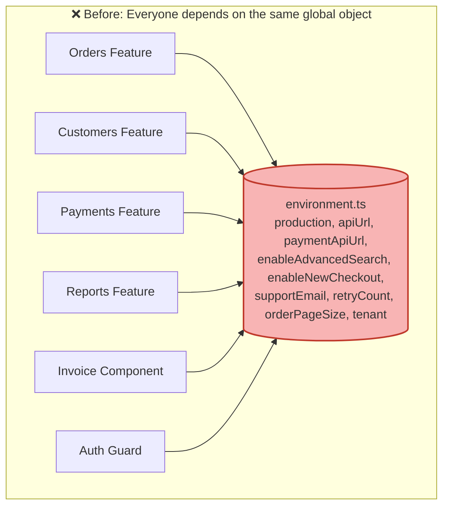

Every box in that diagram can theoretically read **every property** meant for every other feature. Changing one property's meaning, renaming it, or splitting it into two values means you must hunt down every consumer across the entire app. This is the textbook definition of tight coupling — it just doesn't *look* like coupling because it's "just importing a constant."

> 💡 **Analogy:** Imagine a company where every employee — from interns to the CEO — has a master key that opens every door in the building, including HR's filing cabinets and the server room. It "works," until it doesn't. Injection tokens are like giving each employee a keycard that only opens the doors relevant to their job.
---

## 3. How to Read This Tutorial

> 📌 **Quick Recap before continuing:** Sections 1–2 showed how a harmless ``environment`` import grows into a global service locator. The rest of the tutorial gives you the tools to dismantle it — one category, one token, one feature at a time.

**Conventions used throughout:**

| Marker | Meaning |
|---|---|
| ✅ / ❌ in code | Recommended vs. anti-pattern implementation |
| 💡 callouts | Tips, analogies, and "aha moments" |
| ⚠️ callouts | Warnings, trade-offs, and over-engineering traps |

**Two ways through this document:**

- 📖 **Read-through path:** Sections 1 → 18 in order, then jump to [Key Takeaways](#30-key-takeaways). (~60 minutes)
- 🛠️ **Hands-on path:** After Section 6, jump to the [Hands-On Lab](#22-hands-on-lab) and build while you learn; return to Sections 15–16 (use cases, decision framework) when designing your own migration.

## 4. Learning Objectives by Section

Each objective (listed at the top of this document) maps to the sections that teach it — and to a concrete way to verify you've got it:

| # | Objective | Taught in | Verify by |
|---|---|---|---|
| 1 | Explain the coupling problem | 1–2 | Warning Signs Audit (Section 29) |
| 2 | Classify config into five categories | 5, 16 | Practice Exercise 1 |
| 3 | Design feature-owned contracts | 6 | Practice Exercise 2 |
| 4 | Implement runtime configuration | 7, 11 | Hands-On Lab steps 3–4 |
| 5 | Separate flags, rules, and env config | 8–9 | Interview Q4, Q5 |
| 6 | Model tenant state with Signals | 10 | Question Bank Q22–Q23 |
| 7 | Validate and normalize config | 11 | Hands-On Lab step 5 |
| 8 | Test with injected config | 13 | Practice Exercise 4 |
| 9 | Audit and migrate a codebase | 19–21 | Migration Guide, Phase 1 |

## 5. The Five Categories of Configuration

The root of the problem is that `environment.ts` typically mixes **five distinct kinds of configuration**, each with a different owner and a different lifecycle.

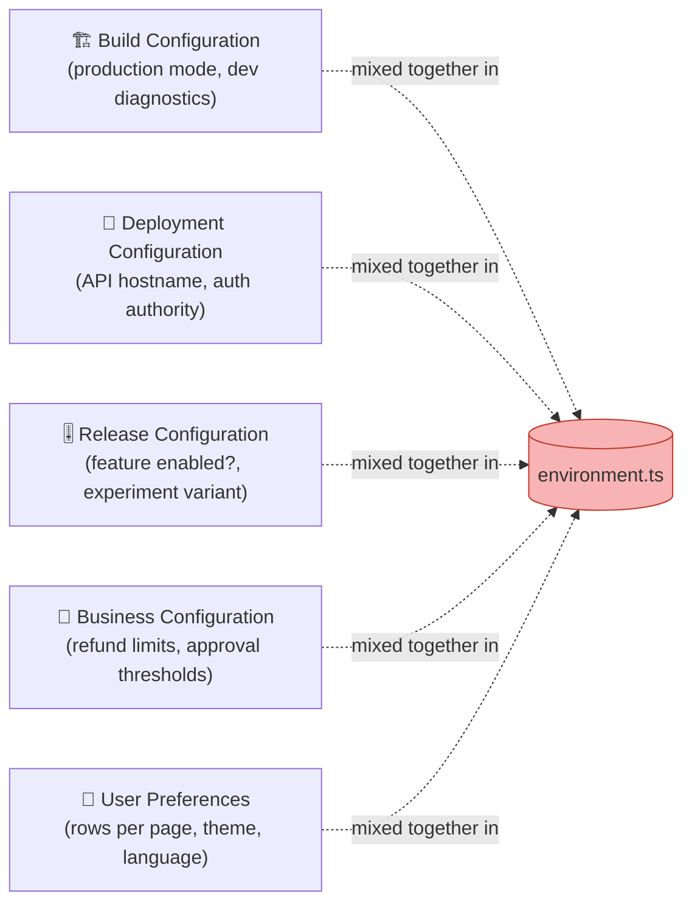

| Category | Example | Who should own it | How often it changes |
|---|---|---|---|
| **Build configuration** | Production optimization mode, dev diagnostics | The build pipeline | Once per build |
| **Deployment configuration** | API hostname, telemetry endpoint | Ops / DevOps | Once per environment |
| **Release configuration** | Feature flag `enableNewCheckout` | Product / release manager | Anytime, without redeploy |
| **Business configuration** | Refund limit ₹5,000 | Backend / domain team | Business decision, not a rebuild |
| **User preferences** | Rows per page, theme | The end user | Per user, per session |

When all five live in the same flat object, there's no way to tell, just by reading code, which category a given property belongs to — or who is allowed to change it. That ambiguity is what causes teams to ask questions like *"Wait, can I change `environment.maxRefundAmount` without redeploying the frontend?"* — a question that should never need to be asked.

> ⚠️ **Aha moment:** Most "config architecture" debates are really **ownership disputes in disguise**. Once you name the owner of each category (build pipeline, DevOps, product, backend, user), the right technical home for each value becomes obvious.

## 6. Fixing It: Injection Tokens

Angular's Dependency Injection system gives you a clean, built-in mechanism to draw boundaries: **Injection Tokens**.

### Step-by-step walkthrough

**Step 1 — Define what the feature actually needs.**

Instead of the entire `environment` object, define a narrow interface describing only what the `Orders` feature cares about:

```typescript
export interface OrderFeatureConfig {
  apiUrl: string;
  pageSize: number;
  bulkEditEnabled: boolean;
}
```

This interface is a **contract**. Anyone reading it instantly knows what `Orders` requires — no searching through a dozen files for `environment.someProperty`.

**Step 2 — Create the injection token.**

```typescript
export const ORDER_FEATURE_CONFIG =
  new InjectionToken<OrderFeatureConfig>('ORDER_FEATURE_CONFIG');
```

**Step 3 — Provide it once, at the composition root.**

```typescript
providers: [
  {
    provide: ORDER_FEATURE_CONFIG,
    useValue: {
      apiUrl: environment.orderApiUrl,
      pageSize: environment.orderPageSize,
      bulkEditEnabled: environment.enableBulkEdit
    }
  }
]
```

**Step 4 — Inject the contract, not the global.**

```typescript
@Injectable()
export class OrderRepository {
  private readonly http = inject(HttpClient);
  private readonly config = inject(ORDER_FEATURE_CONFIG);  // ✅ narrow contract

  getOrders() {
    return this.http.get<Order[]>(`${this.config.apiUrl}/orders`);
  }
}
```

### The dependency direction has changed

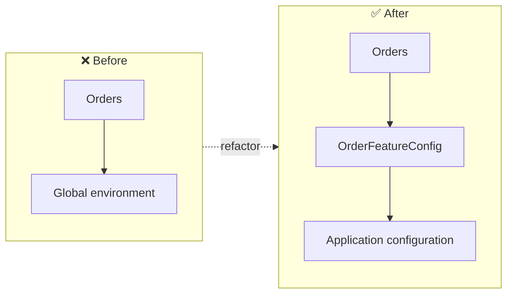

The `Orders` feature now says *"these are the specific things I need to operate"* instead of *"give me the application's entire global configuration object."*

### Visualizing the healthy architecture

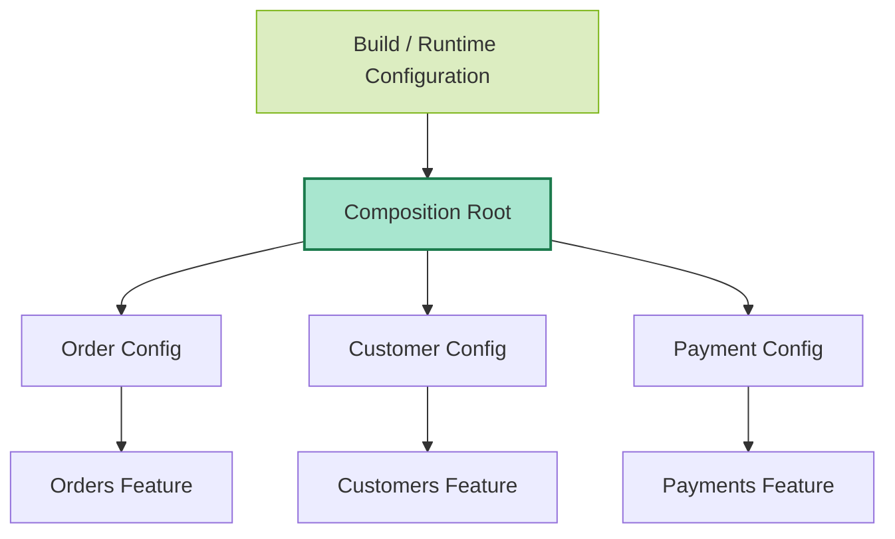

Only the **composition root** (typically your `app.config.ts` / bootstrap code) is allowed to know about the full, messy configuration surface. Everything downstream depends on small, purpose-built contracts.
---

## 7. Build-Time vs Runtime Configuration

This is one of the most important — and most frequently mishandled — distinctions in enterprise Angular apps.

### Build-time configuration

Traditional Angular environments are resolved **when the app is compiled**:

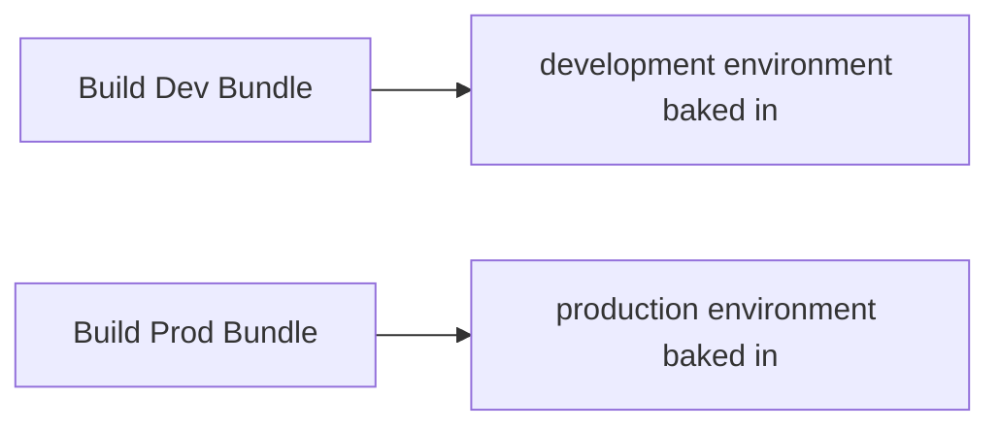

This is perfectly fine **if every environment gets its own separate build**. But many enterprise pipelines want the opposite:

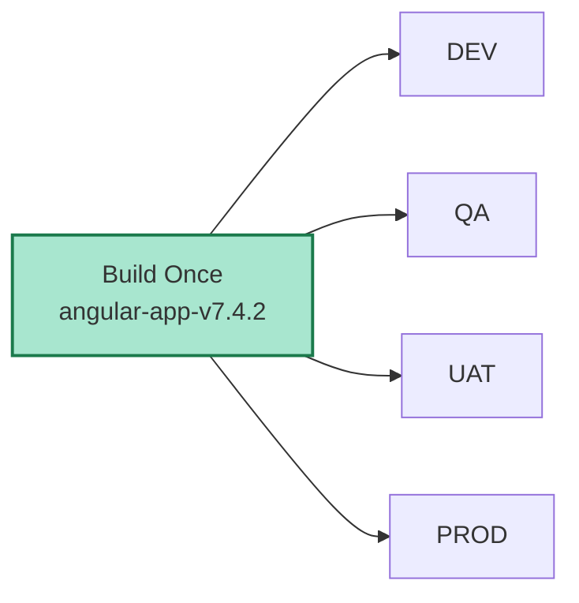

If your API URLs are baked into the bundle at compile time, "build once, deploy everywhere" becomes impossible — you're forced into `DEV build`, `UAT build`, `PROD build` as three (or more) *different* artifacts, which undermines the whole point of a promotion pipeline: verifying the *exact same binary* that passed QA is the one going to production.

### Runtime configuration

The fix is to load configuration **after the bundle ships but before the app bootstraps**:

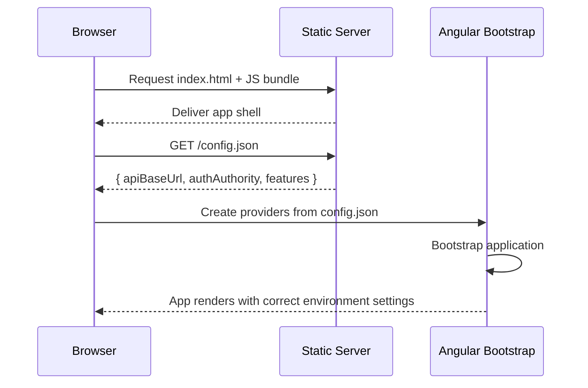

Example `config.json`, served per-environment and fetched before bootstrap:

```json
{
  "apiBaseUrl": "https://api.example.com",
  "authAuthority": "https://login.example.com",
  "features": {
    "advancedSearch": true
  }
}
```

The wiring in `app.config.ts` uses Angular's `provideAppInitializer` (or `APP_INITIALIZER` in older versions) to fetch the JSON before bootstrap completes:

```typescript
import { provideHttpClient, withFetch } from '@angular/common/http';
import { provideAppInitializer, inject } from '@angular/core';

export const appConfig: ApplicationConfig = {
  providers: [
    provideHttpClient(withFetch()),
    provideAppInitializer(async () => {
      const http = inject(HttpClient);
      const raw = await firstValueFrom(http.get<Partial<ApplicationConfig>>('/config.json'));
      const config = validateRuntimeConfig(raw);            // Section 11
      // ... map into feature tokens here (composition root)
    }),
    // { provide: APP_CONFIG, useFactory: () => loadedConfig }
  ]
};
```

**Critically, keep this typed** — don't scatter `(window as any).appConfig.apiUrl` throughout the app (that just recreates the exact same global-dependency problem you were trying to escape, wearing a different hat):

```typescript
export interface ApplicationConfig {
  apiBaseUrl: string;
  authAuthority: string;
  features: {
    advancedSearch: boolean;
  };
}

export const APP_CONFIG = new InjectionToken<ApplicationConfig>('APP_CONFIG');
```

### Don't stop at `APP_CONFIG` for every feature

Injecting the full `APP_CONFIG` everywhere is a step up from raw `environment` imports, but it's still broad coupling if `ApplicationConfig` has grown to include `orderApi`, `customerApi`, `paymentApi`, `authUrl`, `analyticsId`, and a dozen flags. The fix is the same pattern as before — map the big object down to small ones at the composition root:

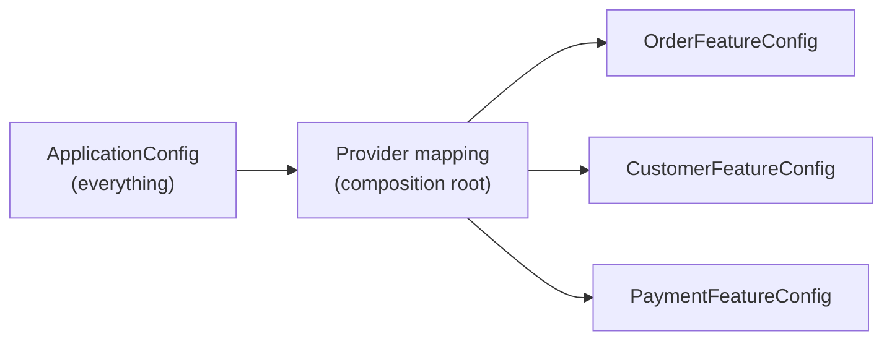

## 8. Feature Flags Are Not Environment Configuration

Consider:

```typescript
environment.newCheckout = true;  // ❌ build-time constant pretending to be a runtime decision
```

This *might* work for a simple on/off toggle. But real feature rollout usually needs more:

- Gradual rollout (10% of users today, 50% tomorrow)
- Tenant-specific rollout (Tenant A gets it, Tenant B doesn't)
- User-specific rollout (internal beta testers only)
- Runtime enable/disable (no redeploy needed)
- Emergency kill switches (turn it off *instantly* if something breaks in production)

None of that is "build configuration" anymore — it's **release configuration**, and it deserves its own dedicated abstraction:

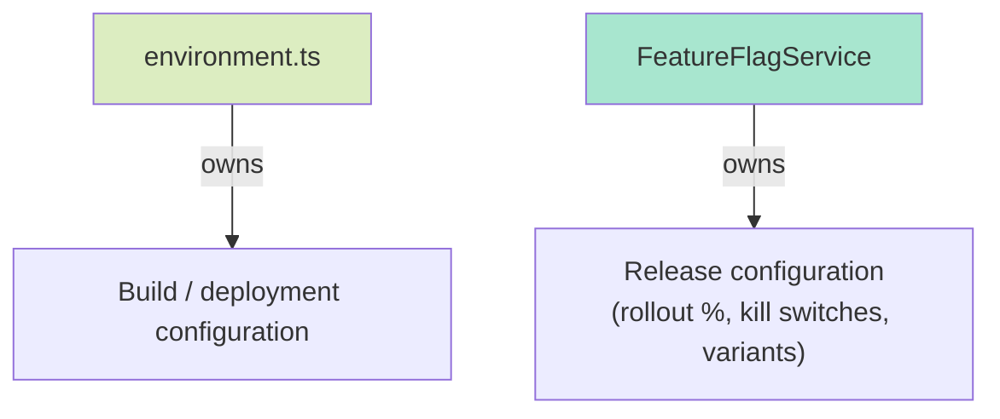

```typescript
@Injectable({ providedIn: 'root' })
export class FeatureFlagService {
  private readonly flags = signal<Record<string, boolean>>({});

  isEnabled(flag: string): boolean {
    return this.flags()[flag] ?? false;
  }
}
```

**Use case:** An e-commerce platform rolling out a new checkout flow. The team wants to enable it for 5% of traffic, watch conversion metrics for 48 hours, then ramp to 25%, 50%, 100% — all without a single redeploy. A boolean baked into `environment.ts` at build time simply cannot do this; a `FeatureFlagService` backed by a remote flag provider (LaunchDarkly, Unleash, a custom endpoint) can.

## 9. Business Rules Do Not Belong on the Frontend

This is a subtler but even more important trap:

```typescript
environment.maxRefundAmount = 5000;  // ❌

if (refundAmount > environment.maxRefundAmount) {
  return false;
}
```

Ask yourself: **is ₹5,000 deployment configuration, or is it a business rule?**

If Finance decides to raise the refund limit to ₹10,000 tomorrow, should that require rebuilding and redeploying the entire Angular application? And more fundamentally — should the *frontend* even be the authoritative source of truth for that number, when a malicious or buggy client could simply bypass the check?

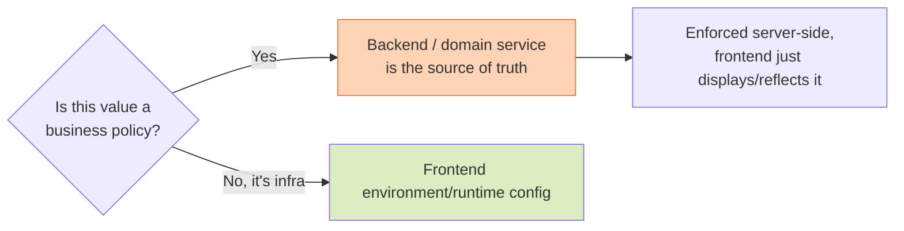

**Use case:** A banking app has a daily transfer limit. If that limit is only checked in the Angular frontend, a user could bypass it entirely via a direct API call or by modifying client-side JavaScript in devtools. The rule must be enforced server-side; the frontend, at most, *displays* the current limit (fetched from the backend) for UX purposes.
---

## 10. Multi-Tenant Configuration with Signals

Tenant configuration is a great real-world illustration of why a single immutable `environment` object breaks down.

Imagine:

| | Tenant A | Tenant B |
|---|---|---|
| Bulk export | ✅ Enabled | ❌ Disabled |
| Currency | USD | EUR |
| Upload limit | 20 MB | 10 MB |

If a user can switch tenants **without reloading the browser** (common in enterprise B2B SaaS with multi-org accounts), tenant configuration is **runtime state**, not a static constant. Model it reactively:

```typescript
@Injectable({ providedIn: 'root' })
export class TenantConfigStore {
  readonly config = signal<TenantConfig | null>(null);
}
```

```typescript
readonly bulkExportEnabled = computed(
  () => this.tenantConfig()?.bulkExportEnabled ?? false
);
```

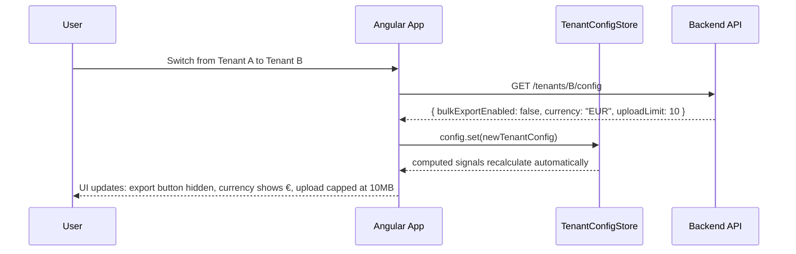

This is fundamentally different from `environment.bulkExportEnabled` — ownership (the tenant), lifecycle (changes on tenant switch), and reactivity (UI updates automatically via `computed`) are all explicit.

## 11. Validating Runtime Configuration

Runtime configuration is **external input** — it comes from a JSON file or endpoint you don't fully control at compile time (a typo in `config.json`, a missing key during a rushed deploy). Treat it with the same suspicion you'd treat any external API response.

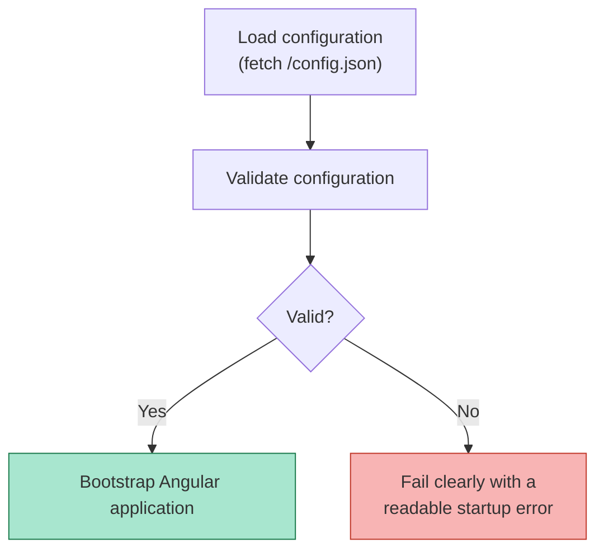

**Why this matters:** a missing `apiUrl` that isn't caught at startup won't fail loudly and immediately. Instead, it silently becomes `undefined`, and twenty minutes later you're debugging twenty unrelated-looking HTTP 404 errors scattered across the app — instead of one clear message: *"Startup failed: `apiUrl` is required but missing from runtime configuration."*

```typescript
function validateRuntimeConfig(config: Partial<RuntimeConfig>): RuntimeConfig {
  if (!config.apiUrl) {
    throw new Error('Startup failed: "apiUrl" is required in runtime configuration.');
  }
  if (!config.authAuthority) {
    throw new Error('Startup failed: "authAuthority" is required in runtime configuration.');
  }
  return config as RuntimeConfig;
}
```

Also **normalize defaults in one place**, not scattered across every consumer:

```typescript
// ❌ Inconsistent — different defaults in different files
config.advancedSearchEnabled ?? true;   // in feature A
config.advancedSearchEnabled ?? false;  // in feature B

// ✅ One normalization function at the boundary
function normalizeOrderConfig(
  config: Partial<OrderFeatureConfig>
): OrderFeatureConfig {
  return {
    apiUrl: config.apiUrl ?? '',
    defaultPageSize: config.defaultPageSize ?? 25,
    allowBulkEditing: config.allowBulkEditing ?? false
  };
}
```

> 💡 **Going further:** for larger config surfaces, consider a schema-validation library such as **Zod** or **Valibot** at the boundary — parse, don't validate. One `schema.parse(json)` call replaces a dozen hand-written `if (!config.x)` checks and gives you a fully typed result.

## 12. Secrets, Public Config, and the Browser (Security Considerations)

This is non-negotiable: **anything shipped in an Angular bundle or runtime config JSON is visible to every user**, no matter how it's minified or bundled.

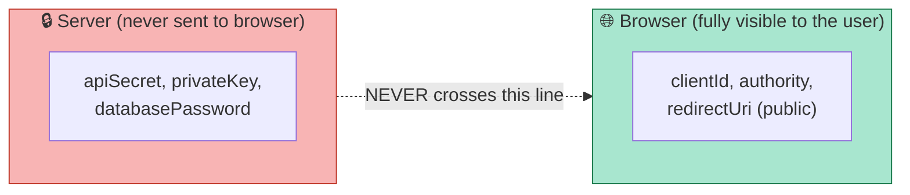

| ✅ Safe in Angular config | ❌ Never in Angular config |
|---|---|
| OAuth `clientId` | `apiSecret` |
| `authority` URL | `privateKey` |
| `redirectUri` | `databasePassword` |
| Public API base URL | Any signing key |

A public OAuth client ID (`AuthConfig.clientId`) is fundamentally different from a client *secret* — a client ID identifies your app to an auth server; a secret proves you're allowed to act on its behalf and must never leave the server.

### Security hardening checklist

- ✅ Treat `environment.ts` and `config.json` as **public artifacts** from day one — write them as if a competitor will read them (they can).
- ✅ Put secrets in **server-side environment variables**, a vault (Azure Key Vault, AWS Secrets Manager, HashiCorp Vault), or your backend's configuration — then expose functionality via authenticated APIs.
- ✅ If the frontend needs a proxy (e.g., to hide third-party API keys), route through your own backend (a **BFF — Backend-for-Frontend**).
- ✅ Add a CI check that greps shipped config for suspicious keys (`secret`, `password`, `key`, `token`) and fails the build.
- ❌ Never "obfuscate" a secret in the bundle — obfuscation is delay, not protection.
- ❌ Never put connection strings, JWT signing keys, or service-account credentials anywhere in the frontend pipeline.
---

## 13. Testability and Testing Strategies

Direct `environment` imports make unit tests fragile because the test now depends on whatever the *build-time* environment happened to be — you can't easily flip a value per test case.

```typescript
// ❌ Hard to test — environment is baked in at import time
if (environment.enableExport) { /* ... */ }
```

With an injection token, each test provides exactly the configuration it needs:

```typescript
// ✅ Test 1: export enabled
TestBed.configureTestingModule({
  providers: [
    { provide: ORDER_FEATURE_CONFIG, useValue: {
      apiUrl: '/api', defaultPageSize: 20, allowBulkEditing: true
    }}
  ]
});

// ✅ Test 2: export disabled — no global mutation needed
TestBed.configureTestingModule({
  providers: [
    { provide: ORDER_FEATURE_CONFIG, useValue: {
      apiUrl: '/api', defaultPageSize: 20, allowBulkEditing: false
    }}
  ]
});
```

No global mutation, no `environment` replacement hacks, no test pollution between suites.

### A complete test example

```typescript
describe('OrderRepository', () => {
  it('builds the orders URL from the injected config', () => {
    TestBed.configureTestingModule({
      providers: [
        { provide: ORDER_FEATURE_CONFIG, useValue: {
          apiUrl: 'https://test-api', defaultPageSize: 10, allowBulkEditing: false
        }},
        { provide: HttpClient, useValue: { get: jasmine.createSpy('get') } }
      ]
    });

    const repo = TestBed.inject(OrderRepository);
    repo.getOrders();

    const http = TestBed.inject(HttpClient) as jasmine.SpyObj<HttpClient>;
    expect(http.get).toHaveBeenCalledWith('https://test-api/orders');
  });
});
```

### Testing strategy summary

| Test type | Configuration approach |
|---|---|
| **Unit tests** | Provide `useValue` objects per test case — full control, zero globals |
| **Integration tests** | Provide a shared `TestConfigModule` with sane defaults, override per test as needed |
| **E2E tests** | Point E2E runs at a test `config.json` served by the test web server — the same runtime-config mechanism the app already uses |
| **Visual/Storybook tests** | Provide decorative config values per story via the same tokens |

> 💡 **Pro insight:** once configuration is injected, your tests document behaviour. A reader of the test file can see *exactly* which config values affect the component — something an `environment` import can never tell you.

## 14. Reusable Libraries and Route-Scoped Config

### Libraries should never import your app's environment

```typescript
// ❌ Inside a shared library — now the library depends on the HOST app
import { environment } from '../../../environments/environment';
```

Instead, expose a token the *consuming* app provides:

```typescript
export interface UploadConfig {
  maxFileSize: number;
  allowedTypes: string[];
}

export const UPLOAD_CONFIG = new InjectionToken<UploadConfig>('UPLOAD_CONFIG');
```

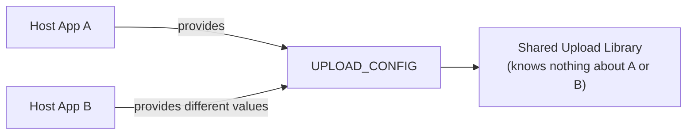

You can also give the token a **default** so the library works out of the box:

```typescript
export const UPLOAD_CONFIG = new InjectionToken<UploadConfig>('UPLOAD_CONFIG', {
  factory: () => ({ maxFileSize: 5 * 1024 * 1024, allowedTypes: ['image/png', 'image/jpeg'] })
});
```

### Route providers scope configuration per instance

Modern Angular routing lets the *same* feature component run with *different* configuration, without any `if (environment...)` branching inside the feature itself:

```typescript
{
  path: 'domestic-orders',
  providers: [
    { provide: ORDER_FEATURE_CONFIG, useValue: { mode: 'domestic', pageSize: 50 } }
  ],
  loadComponent: () => import('./orders.page').then(m => m.OrdersPage)
},
{
  path: 'international-orders',
  providers: [
    { provide: ORDER_FEATURE_CONFIG, useValue: { mode: 'international', pageSize: 25 } }
  ],
  loadComponent: () => import('./orders.page').then(m => m.OrdersPage)
}
```

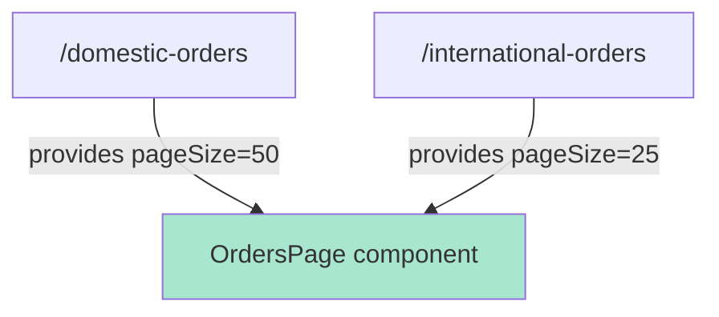

Same component, two configurations, zero environment checks inside the feature. That's composition.

> 💡 **Where's the “multiple implementation approaches”?** You now have three levels to choose from, in increasing sophistication: (1) keep `environment.ts` for genuine build-time constants only; (2) add `InjectionToken` contracts per feature; (3) go fully runtime-configurable with `config.json` + `provideAppInitializer`. Pick the lowest level that solves your actual deployment problem.
---

## 15. Real-World Use Cases

### Use Case A — Enterprise "Build Once, Deploy Many" Pipeline

**Scenario:** A bank's internal portal must pass through DEV → QA → UAT → PROD, with compliance requiring the *exact binary* tested in UAT to reach PROD unchanged.

**Solution:** Move `apiUrl`, `authAuthority`, and similar values out of build-time `environment.ts` and into a `config.json` fetched at startup, injected via a typed `APP_CONFIG` token. The same JS bundle now runs everywhere; only the JSON file differs per environment.

### Use Case B — SaaS Product with Per-Tenant Feature Sets

**Scenario:** A project-management SaaS sells three plans (Basic, Pro, Enterprise), each unlocking different features (Gantt charts, time tracking, SSO), and enterprise customers can switch between multiple organizations without a full page reload.

**Solution:** `TenantConfigStore` backed by Signals (Section 10), populated from an API call on tenant switch, with `computed()` signals deriving feature availability reactively throughout the UI.

### Use Case C — Gradual Rollout of a Risky New Checkout Flow

**Scenario:** An e-commerce team wants to test a redesigned checkout on 10% of traffic and instantly disable it if error rates spike.

**Solution:** A `FeatureFlagService` (Section 8) backed by a remote flag provider, decoupled entirely from `environment.ts`, checked at composition boundaries (e.g., choosing which component/provider to load) rather than scattered `if (environment.newCheckout)` checks.

### Use Case D — Shared Component Library Published to Multiple Internal Apps

**Scenario:** A design-system team publishes an `@company/ui-upload` library used by five different internal Angular apps, each with different max file sizes and allowed MIME types.

**Solution:** `UPLOAD_CONFIG` injection token (Section 14) — the library defines the contract, each host app provides its own values. The library never imports anyone's `environment.ts`.

## 16. The Decision Framework

Before adding *anything* to `environment.ts`, run it through this flow:

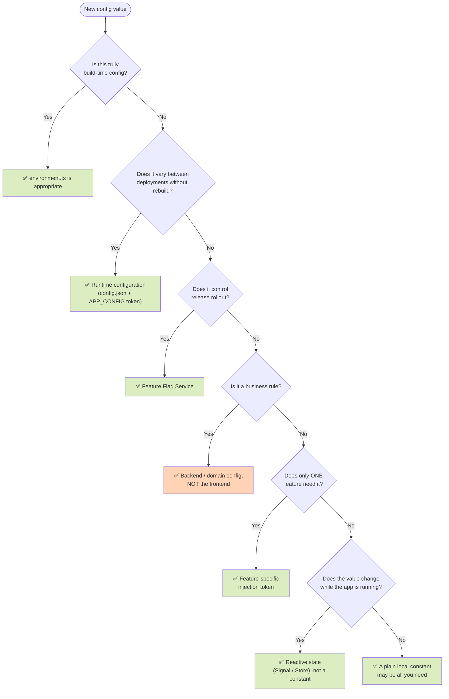

> ⚠️ **Don't over-engineer.** Not every constant needs an `InjectionToken`, a provider factory, a validation service, *and* an adapter. `export const DEFAULT_PAGE_SIZE = 25;` inside the `Orders` feature is perfectly fine if it's simply an implementation default that never varies by deployment, tenant, or test. Reserve configuration boundaries for values that genuinely vary between deployments, hosts, tenants, feature instances, or tests.

## 17. Best Practices

1. **Let the composition root own the mess.** Only `app.config.ts` (and route-level `providers`) should know the full configuration surface; everything else gets narrow contracts.
2. **One token per feature concern, not per property.** `ORDER_FEATURE_CONFIG` carrying 3–6 related values beats six single-property tokens.
3. **Type every token.** `new InjectionToken<T>()` with a real interface — untyped config is the second-worst outcome after global config.
4. **Validate at the boundary, normalize once.** Fail fast at startup with readable messages; apply defaults in a single normalization function.
5. **Keep `environment.ts` boring.** If it only holds `production` and genuinely compile-time values, it has done its job.
6. **Prevent regressions mechanically.** ESLint rules (`no-restricted-imports`) and CI greps beat code-review vigilance.
7. **Provide defaults for library tokens** so hosts can opt in gradually.
8. **Name tokens after the consumer's need** (`ORDER_FEATURE_CONFIG`), not the source (`ENV_ORDER_VALUES`).
9. **Document ownership.** A short comment per config category — *who owns this, when does it change* — prevents future debates.
10. **Review config changes like API changes.** Renaming a config key is a breaking change to every consumer; treat it with the same rigour.

### Enforcement snippet: ban the import with ESLint

```json
{
  "rules": {
    "no-restricted-imports": ["error", {
      "patterns": [{
        "group": ["**/environments/*"],
        "message": "Import feature configuration via its InjectionToken instead of the global environment."
      }]
    }]
  }
}
```

## 18. Anti-Patterns to Avoid

| ❌ Anti-Pattern | Why it hurts | ✅ Do instead |
|---|---|---|
| **God environment** — everything dumped in `environment.ts` | Global coupling, unclear ownership | Split into the five categories (Section 5) |
| **`ConfigService` with `get(key: string): any`** | Loses all type safety; becomes a second global locator | Typed injection tokens per contract |
| **`(window as any).appConfig`** | Untyped global, recreates the problem | Typed `APP_CONFIG` token mapped to feature tokens |
| **Branching on `environment.production` in features** | Build mode leaks into business logic | DI to select implementations (real vs fake gateway) |
| **Secrets in `environment.prod.ts`** | Ships to every user's browser | Server-side secrets / vault / BFF |
| **Library importing host `environment`** | Library breaks in every other host | Library defines the token; host provides |
| **Mutating environment at runtime** (`environment.tenant = 'B'`) | Hidden global state; change detection chaos | Signals / store for runtime state |
| **Defaults scattered across consumers** (`?? 25` here, `?? 100` there) | Inconsistent behaviour, unmaintainable | One normalization function at the boundary |
| **A separate build per environment** (out of habit) | QA never tests the shipped binary | Runtime `config.json` + build once, deploy many |
---

## 19. Performance Considerations

A good configuration architecture is not just cleaner — it can be *faster*:

1. **No runtime cost for tokens.** `InjectionToken` lookups resolve once at DI instantiation; there is no measurable per-request overhead compared to a constant import.
2. **Tree-shaking stays intact.** `InjectionToken` values provided via `useValue` or `useFactory` work fine with the AOT compiler and dead-code elimination. Avoid huge config objects built with side-effectful module code.
3. **Lazy-load config with the feature.** Route-scoped `providers` mean a feature's config is only created when the route loads — you get configuration-level code splitting for free.
4. **One `config.json` fetch, cached.** Fetch runtime config once in `provideAppInitializer` and reuse it. Keep the file small (a few KB); avoid multi-MB config payloads that delay Time-to-Interactive. Compress (gzip/brotli) and set long-lived cache headers with a hashed filename or versioned query string.
5. **Signals over change detection storms.** Replacing `environment.x` reads with `computed()` signals means only components that actually depend on a config value re-render when it changes — instead of nothing ever updating (stale) or everything re-rendering (via global mutation hacks).
6. **Fail fast, boot fast.** Startup validation catches a broken deploy in milliseconds at bootstrap, rather than after the user has waited for a full app load and a burst of failed API calls.

> ⚠️ **The one performance trap:** `provideAppInitializer` blocks bootstrap until config.json resolves. If your config endpoint is slow or down, the app never renders. Mitigate with a short timeout, a fallback default config for non-critical values, and a clear error page for missing *required* values.

## 20. Common Pitfalls and Troubleshooting

| 🐛 Symptom | 🔍 Likely cause | 🛠️ Fix |
|---|---|---|
| `NullInjectorError: No provider for ORDER_FEATURE_CONFIG` | Token provided in a different injector (root vs route vs component) | Provide the token in the injector that covers the consumer — or in the route/component that actually needs it |
| Config value is `undefined` at runtime | `config.json` key typo, or provider factory ran before fetch completed | Validate at startup (Section 11); ensure the fetch completes inside `provideAppInitializer` before providers are created |
| Feature works in dev, fails in prod | Values read from `environment.ts` differ per build; prod file is stale | Stop reading environment in features; map from runtime config at the composition root |
| Every test fails after adding a token to a service | No test provider for the new token | Add a `useValue` provider to `TestBed`, or centralize defaults in a `TestConfigModule` |
| Changing `config.json` has no effect | Browser cached the old file | Serve config with `Cache-Control: no-cache` (or short TTL) and/or version the filename |
| Two features disagree on a default | Defaults normalized in two different places | Move all defaults into the single normalization function |
| Secrets found in shipped bundle | Sensitive values placed in `environment.prod.ts` | Move secrets server-side immediately, rotate the exposed credentials, add CI secret scanning |
| Library throws `NullInjectorError` in a new host app | Library token has no default and the host didn't provide it | Add a token `factory` default in the library, and document the provider in the library README |
| App renders blank on slow networks | Bootstrap blocked on slow config fetch | Add fetch timeout + explicit loading/error state before bootstrap |
| Tenant switch shows stale data | Tenant config stored as a plain constant | Move tenant config into a signal-based store (Section 10) |

## 21. Migration Guide: Incremental Refactoring

You can adopt this architecture **incrementally** — no big-bang rewrite required. Follow the steps in order; each step ships independently.

### Phase 1 — Understand (read-only, zero risk)

1. **Inventory** — list every `environment.xxx` usage across the codebase:
   ```powershell
   Select-String -Path src\**\*.ts -Pattern 'environment\.' | Measure-Object
   # or on Linux/macOS: grep -rn "environment\." src/
   ```
2. **Classify** — sort each value into one of the five categories from Section 5. Anything you can't classify is a red flag in itself.
3. **Audit for secrets** — grep for anything resembling a key, password, or secret and move it server-side *first*, before any refactor:
   ```powershell
   Select-String -Path src\**\*.ts -Pattern '(secret|password|apiKey|privateKey)'
   ```

### Phase 2 — Introduce boundaries (low risk)

4. **Extract contracts** — for each feature, write a narrow interface describing exactly what it needs.
5. **Introduce tokens** — create an `InjectionToken` per contract.
6. **Provide at the composition root** — map the old `environment` (or new runtime config) into the new tokens in one place.
7. **Migrate features incrementally** — replace `environment.xxx` reads with `inject(FEATURE_CONFIG)` one feature at a time. Keep ESLint's `no-restricted-imports` on *migrated* paths so they don't regress.

### Phase 3 — Move the lifecycle (medium risk, high value)

8. **Extract feature flags and business rules** — move these out of `environment.ts` into a `FeatureFlagService` and the backend, respectively.
9. **Add runtime configuration** — create `config.json`, load it via `provideAppInitializer`, and switch the composition root's mapping source from `environment` to the validated runtime config.
10. **Add validation** — validate runtime config at startup and fail loudly on missing required values.
11. **Clean up** — shrink `environment.ts` to `{ production }` (and any true compile-time constants); add the ESLint ban everywhere; update onboarding docs.

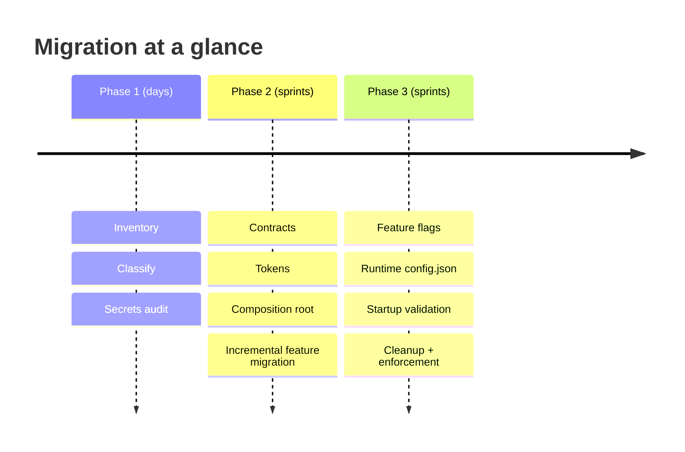

> ✅ **Rollback safety:** each phase leaves the app in a working state. The composition root can keep reading `environment` while `config.json` is introduced behind a flag, so you can revert any single step without touching features.
---

## 22. Hands-On Lab

Complete this lab in a scratch Angular workspace (`ng new config-lab --standalone --routing`). Estimated time: **45–60 minutes**.

### Lab goal

Convert an app that reads a global `environment` object into one with runtime configuration and a feature-owned injection token.

### Step 1 — Create the fake "legacy" starting point

Create `src/environments/environment.ts`:

```typescript
export const environment = {
  production: false,
  productsApiUrl: 'https://api.demo.local',
  productsPageSize: 10,
  showBetaGrid: true
};
```

Create a component that reads it directly (our villain):

```typescript
// products.component.ts — ❌ starting point
import { Component, inject } from '@angular/core';
import { HttpClient } from '@angular/common/http';
import { environment } from '../../environments/environment';

@Component({
  selector: 'app-products',
  template: `
    @if (showBeta) { <p>Beta grid enabled</p> }
    <ul>@for (p of products(); track p.id) { <li>{{ p.name }}</li> }</ul>`
})
export class ProductsComponent {
  private readonly http = inject(HttpClient);
  products = signal<any[]>([]);
  showBeta = environment.showBetaGrid;

  ngOnInit() {
    this.http.get<any[]>(`${environment.productsApiUrl}/products?_limit=${environment.productsPageSize}`)
      .subscribe(p => this.products.set(p));
  }
}
```

### Step 2 — Define the contract and token

```typescript
// products.config.ts
import { InjectionToken } from '@angular/core';

export interface ProductsConfig {
  apiUrl: string;
  pageSize: number;
  betaGridEnabled: boolean;
}

export const PRODUCTS_CONFIG =
  new InjectionToken<ProductsConfig>('PRODUCTS_CONFIG');
```

### Step 3 — Add runtime config + validation

Create `public/config.json` (files in `public/` are copied into the build output and can be replaced per environment after deployment):

```json
{
  "productsApiUrl": "https://api.demo.local",
  "productsPageSize": 10,
  "betaGridEnabled": true
}
```

```typescript
// runtime-config.ts
import { HttpClient } from '@angular/common/http';
import { firstValueFrom } from 'rxjs';

export interface RuntimeConfig {
  productsApiUrl: string;
  productsPageSize: number;
  betaGridEnabled: boolean;
}

export function validateRuntimeConfig(c: Partial<RuntimeConfig>): RuntimeConfig {
  if (!c.productsApiUrl) {
    throw new Error('Startup failed: "productsApiUrl" is required in config.json.');
  }
  return {
    productsApiUrl: c.productsApiUrl,
    productsPageSize: c.productsPageSize ?? 10,
    betaGridEnabled: c.betaGridEnabled ?? false
  };
}

export function loadRuntimeConfig(http: HttpClient): Promise<RuntimeConfig> {
  return firstValueFrom(http.get<Partial<RuntimeConfig>>('/config.json'))
    .then(validateRuntimeConfig);
}
```

### Step 4 — Wire the composition root

```typescript
// app.config.ts
import { ApplicationConfig, inject, provideAppInitializer } from '@angular/core';
import { provideHttpClient, withFetch } from '@angular/common/http';
import { PRODUCTS_CONFIG } from './products/products.config';
import { loadRuntimeConfig, RuntimeConfig } from './runtime-config';

let runtimeConfig: RuntimeConfig;

export const appConfig: ApplicationConfig = {
  providers: [
    provideHttpClient(withFetch()),
    provideAppInitializer(async () => {
      runtimeConfig = await loadRuntimeConfig(inject(HttpClient));
    }),
    {
      provide: PRODUCTS_CONFIG,
      useFactory: () => ({
        apiUrl: runtimeConfig.productsApiUrl,
        pageSize: runtimeConfig.productsPageSize,
        betaGridEnabled: runtimeConfig.betaGridEnabled
      })
    }
  ]
};
```

### Step 5 — Migrate the component and prove it works

Replace all three `environment.*` reads in `ProductsComponent` with `inject(PRODUCTS_CONFIG)`. Then:

1. Run `ng serve` — the app must work identically.
2. Edit `public/config.json` (change `pageSize` to `5`, `betaGridEnabled` to `false`) and refresh — the UI must change **without a rebuild**.
3. Delete a required key from `config.json` — you must see the clear startup error, not 404s.
4. Write one test that provides `PRODUCTS_CONFIG` with `betaGridEnabled: false` and asserts the beta banner is hidden.

**Lab acceptance criteria:** zero `environment` imports outside `app.config.ts`; the app is configurable by editing a single JSON file after build.

## 23. Pro Tips

> 🚀 **Tip 1 — Token defaults as scaffolding.** Give library tokens a `factory` default (Section 14). Hosts that don't provide the token still work, and migration to a host-provided config becomes non-breaking.

> 🚀 **Tip 2 — `inject()` in route guards and resolvers.** Guards run in an injection context in modern Angular, so `inject(FEATURE_CONFIG)` works there too — no more passing config through route `data` bags.

> 🚀 **Tip 3 — Freeze what you provide.** In the composition root, `Object.freeze(...)` the mapped config object. It turns accidental runtime mutation into an immediate TypeError instead of a silent bug.

> 🚀 **Tip 4 — Derive, don't duplicate.** If two tokens both need `apiUrl`, don't store it twice — map both from the same runtime config value in the composition root. One source, many contracts.

> 🚀 **Tip 5 — Config versioning.** Add a `configVersion` key to `config.json` and log it at startup. When QA reports "the UAT app is broken," the first question — *which config was it running?* — answers itself.

> 🚀 **Tip 6 — Smoke-test the config, not just the app.** A tiny CI job that fetches each environment's `config.json` and runs the same `validateRuntimeConfig` function catches config drift before users ever see it.
---

## 24. Practice Exercises (with Solutions)

### ✏️ Exercise 1 — Classify the configuration (Beginner)

Sort each value into one of the five categories (build, deployment, release, business, user preference) and name its correct home:

`a)` `theme: 'dark'` · `b)` `apiBaseUrl` · `c)` `enableNewCheckout` · `d)` `maxInvoiceDiscountPercent: 15` · `e)` `production: true`

**Solution:**

| Value | Category | Correct home |
|---|---|---|
| `theme: 'dark'` | User preference | Per-user state (Signal/store, persisted to `localStorage` or backend profile) |
| `apiBaseUrl` | Deployment configuration | Runtime `config.json` + `APP_CONFIG` token |
| `enableNewCheckout` | Release configuration | `FeatureFlagService` (remote flags, runtime toggles) |
| `maxInvoiceDiscountPercent: 15` | Business configuration | Backend/domain service — the frontend only *displays* it |
| `production: true` | Build configuration | `environment.ts` — exactly where it belongs |

### ✏️ Exercise 2 — Build a feature config contract (Intermediate)

The `Invoicing` feature currently reads `environment.invoiceApiUrl`, `environment.invoicePageSize`, and `environment.requireApprovalAbove` (an amount in rupees). Refactor it.

**Solution:**

```typescript
// invoicing.config.ts
import { InjectionToken } from '@angular/core';

export interface InvoicingConfig {
  apiUrl: string;
  pageSize: number;
  // ⚠️ NOT included: requireApprovalAbove is a business rule.
  // The frontend displays the limit (fetched from the backend); the backend enforces it.
}

export const INVOICING_CONFIG =
  new InjectionToken<InvoicingConfig>('INVOICING_CONFIG');
```

```typescript
// app.config.ts (composition root)
providers: [
  {
    provide: INVOICING_CONFIG,
    useFactory: () => ({
      apiUrl: runtimeConfig.invoiceApiUrl,
      pageSize: runtimeConfig.invoicePageSize ?? 25
    })
  }
]
```

Key decisions: (1) `requireApprovalAbove` was **excluded** from the frontend contract because it's a business rule owned by the backend — the invoice approval check must happen server-side. (2) The default for `pageSize` lives in the composition-root mapping, not in the feature.

### ✏️ Exercise 3 — Route-scoped configuration (Intermediate)

Using route `providers`, run the same `CatalogPage` at `/wholesale-catalog` (pageSize 100, currency USD) and `/retail-catalog` (pageSize 25, currency EUR) with zero conditionals inside the component.

**Solution:**

```typescript
// catalog.config.ts
export interface CatalogConfig {
  pageSize: number;
  currency: 'USD' | 'EUR';
}
export const CATALOG_CONFIG = new InjectionToken<CatalogConfig>('CATALOG_CONFIG');
```

```typescript
// app.routes.ts
export const routes: Routes = [
  {
    path: 'wholesale-catalog',
    providers: [{ provide: CATALOG_CONFIG, useValue: { pageSize: 100, currency: 'USD' } }],
    loadComponent: () => import('./catalog.page').then(m => m.CatalogPage)
  },
  {
    path: 'retail-catalog',
    providers: [{ provide: CATALOG_CONFIG, useValue: { pageSize: 25, currency: 'EUR' } }],
    loadComponent: () => import('./catalog.page').then(m => m.CatalogPage)
  }
];
```

```typescript
// catalog.page.ts
@Component({ /* ... */ })
export class CatalogPage {
  private readonly config = inject(CATALOG_CONFIG);  // resolves to the route-scoped value
  readonly pageSize = this.config.pageSize;
  readonly currency = this.config.currency;
}
```

Route-level providers create a child injector per route, so the same component class resolves *different* config depending on which route instantiated it.

### ✏️ Exercise 4 — Testable flag behaviour (Advanced)

`CheckoutService` should fall back to the legacy flow when `checkoutConfig.newFlowEnabled` is `false`. Write the two unit tests that prove both branches — without touching any global.

**Solution:**

```typescript
describe('CheckoutService', () => {
  function setup(newFlowEnabled: boolean) {
    TestBed.configureTestingModule({
      providers: [
        { provide: CHECKOUT_CONFIG, useValue: {
          apiUrl: '/api', newFlowEnabled, legacyFlowPath: '/checkout/legacy'
        }}
      ]
    });
    return TestBed.inject(CheckoutService);
  }

  it('uses the new flow when enabled', () => {
    const svc = setup(true);
    expect(svc.flowPath()).toBe('/checkout/new');
  });

  it('falls back to the legacy flow when disabled', () => {
    const svc = setup(false);
    expect(svc.flowPath()).toBe('/checkout/legacy');
  });
});
```

The `setup()` helper makes the config an explicit *input* of each test case — flipping behaviour is a one-word change, and there is no global state to reset between tests.
---

## 25. Test Your Understanding

Answer these before moving on. (Answers below — no peeking.)

1. What single phrase describes what `environment.ts` becomes when 40 files import it directly?
2. Name the five categories of configuration and one example of each.
3. In which single place is the *full* configuration surface allowed to be known?
4. Why does baking API URLs into the bundle break "build once, deploy many"?
5. What Angular mechanism loads `config.json` before bootstrap completes?
6. Give three capabilities of a real feature-flag rollout that a build-time boolean cannot provide.
7. Why must a refund limit be enforced on the backend even if the frontend also checks it?
8. Which Angular primitive makes tenant configuration reactive on tenant switch?
9. What should happen when a required key is missing from `config.json`?
10. Why is a public OAuth `clientId` safe to ship but a `clientSecret` is not?
11. How do route-level `providers` let one component run with two configurations?
12. Name two mechanical (non-code-review) ways to prevent `environment` imports from creeping back.

**Answers:**

1. A global service locator made of constants.
2. Build (`production` flag), Deployment (API hostname), Release (feature flags), Business (refund limits), User preferences (page size/theme).
3. The composition root (`app.config.ts` / bootstrap, plus route-level providers).
4. Each environment would need its own compiled artifact, so the binary tested in QA is not the binary deployed to prod.
5. `provideAppInitializer` (or the older `APP_INITIALIZER`).
6. Gradual rollout percentages, tenant/user targeting, and runtime kill switches — none need a redeploy.
7. Any client-side check can be bypassed via direct API calls or devtools; the server is the only authoritative enforcement point.
8. Signals — a `TenantConfigStore` with `signal()` and `computed()`.
9. Fail startup immediately with a clear, readable error naming the missing key.
10. A client ID merely *identifies* the app to the auth server and is designed to be public; a secret *authenticates* the app and must never leave the server.
11. Each route creates a child injector; its `providers` override the token for components instantiated on that route.
12. An ESLint `no-restricted-imports` rule and a CI grep/secret-scan step.

## 26. Common Interview Questions

**Q1. Why is importing `environment.ts` directly considered tight coupling?**
*A:* It makes every consuming feature depend on the entire global config object and its shape, not just the values it needs. Renaming or splitting a property requires finding every consumer, features can read values meant for other features, tests depend on build-time values, and libraries become coupled to the host app. It looks like a constant import but behaves like a service locator.

**Q2. How would you implement "build once, deploy many" in Angular?**
*A:* Keep only compile-time values in `environment.ts`, move deployment values (API URLs, auth authority) into a per-environment `config.json` served next to the app, fetch it in `provideAppInitializer` before bootstrap, validate it, and map it into typed injection tokens at the composition root. The bundle stays identical across environments; only the JSON differs.

**Q3. What is an `InjectionToken` and when would you use one over a `@Inject` class token?**
*A:* `InjectionToken<T>` creates a type-safe, unique DI key for non-class values (config objects, strings, numbers). Use it whenever the dependency is an interface or primitive — class tokens can't represent an interface and would force a dummy class or lose type safety.

**Q4. Where should feature flags live, and why not in `environment.ts`?**
*A:* In a dedicated `FeatureFlagService` (optionally backed by LaunchDarkly/Unleash/a custom endpoint). Flags are release configuration: they change at runtime, need gradual rollout, targeting, and kill switches — none of which a build-time constant can support.

**Q5. A teammate put `maxRefundAmount` in `environment.ts` and checks it in the frontend. What do you say?**
*A:* That's a business rule, not deployment config. The frontend check is a UX nicety at best — it can be bypassed with direct API calls — so the backend must be the source of truth and enforce it. The frontend should fetch and display the limit. And Finance changing the number must not require a frontend rebuild.

**Q6. How do you make configuration available to a reusable library without coupling it to the host app?**
*A:* The library defines a typed `InjectionToken` (with a sensible default factory) and never imports the host's environment. Each host app provides its own values at bootstrap or route level.

**Q7. How do signals change multi-tenant configuration handling?**
*A:* Tenant settings become reactive runtime state: a `TenantConfigStore` holds a `signal<TenantConfig>`, switching tenants sets a new value, and `computed()` signals recalculate feature availability so the UI updates without a reload — impossible with a static `environment` constant.

**Q8. How do you validate runtime configuration, and why bother?**
*A:* Treat it as external input: validate required keys at startup and throw a readable error naming the missing key; normalize defaults in one boundary function (or a schema library like Zod). Otherwise a missing `apiUrl` surfaces later as scattered 404s instead of one clear startup failure.

**Q9. What's the DI difference between providing config in `app.config.ts` vs a route's `providers` array?**
*A:* `app.config.ts` registers in the root injector (one value app-wide); a route's `providers` creates a child injector for that route's subtree, so the same feature component can resolve different config per route instance — route-scoped configuration.

**Q10. How does this architecture improve unit testing?**
*A:* Tests provide exact config values via `useValue` per test case — behaviour flips by changing the provided object, with no global mutation, no environment replacement hacks, and no cross-test pollution.

**Q11. Is `environment.ts` evil? Should we delete it?**
*A:* No — it's the right home for *build* configuration (`production`, compile-time constants, feature-contract mapping done at build time). The problem is only when deployment flags, business rules, and runtime state get dumped into it. Keep it small and boring; delete nothing but its extra responsibilities.

**Q12. How would you stop developers from re-introducing direct `environment` imports?**
*A:* Mechanically, not socially: an ESLint `no-restricted-imports` pattern banning `**/environments/*` outside the composition root, a CI grep that fails on new matches, and code-review guidelines that route new config through the decision framework.
---

## 27. Question Bank (50 Questions)

### 🟢 Beginner (1–15)

**Q1.** What file do Angular apps traditionally use for configuration? — **A:** `environment.ts` (with per-build variants like `environment.prod.ts`).

**Q2.** What flag distinguishes dev from production in `environment.ts`? — **A:** `production: boolean`.

**Q3.** What phrase best describes an `environment.ts` imported by 40+ files? — **A:** A global service locator made of constants.

**Q4.** Name the five categories of configuration. — **A:** Build, deployment, release, business, user preferences.

**Q5.** Who should own deployment configuration like an API hostname? — **A:** Ops/DevOps — it changes once per environment.

**Q6.** Who should own feature flags? — **A:** Product/release management — they change at runtime without redeploy.

**Q7.** What Angular mechanism is the recommended fix for global config coupling? — **A:** Dependency Injection via `InjectionToken`.

**Q8.** What is an `InjectionToken`? — **A:** A unique, type-safe DI key used to provide and inject non-class values such as config objects.

**Q9.** In which file should the full configuration object be known? — **A:** The composition root, typically `app.config.ts`.

**Q10.** What is "build once, deploy many"? — **A:** Compiling one artifact that is promoted through all environments, differing only in runtime configuration.

**Q11.** Why do baked-in API URLs break build-once-deploy-many? — **A:** Each environment would need its own compiled build, so QA never tests the exact production binary.

**Q12.** What Angular API fetches config before bootstrap? — **A:** `provideAppInitializer` (formerly `APP_INITIALIZER`).

**Q13.** Give one example of a value that is safe to ship to the browser. — **A:** A public OAuth `clientId` (also: authority URL, redirect URI, public API base URL).

**Q14.** Give three examples of values that must never ship to the browser. — **A:** API secrets, private keys, database passwords.

**Q15.** Should a refund limit be enforced in the frontend? — **A:** No — the backend is the source of truth; the frontend may only display it.

### 🟡 Intermediate (16–35)

**Q16.** Why is direct environment coupling a *testing* problem? — **A:** Tests depend on whatever build-time environment was compiled in; you can't flip values per test without hacks, and suites pollute each other via global state.

**Q17.** What are the four steps of the token-based fix? — **A:** Define a narrow interface → create an `InjectionToken` → provide it once at the composition root → inject the contract in features.

**Q18.** Why is injecting the full `APP_CONFIG` everywhere still a problem? — **A:** It's broad coupling — a smaller version of the same global dependency; features should get narrow mapped contracts instead.

**Q19.** How do you keep runtime config typed? — **A:** Define an interface, create a typed token, validate/parse the fetched JSON, and never use `(window as any)`.

**Q20.** Name three rollout capabilities a build-time flag can't provide. — **A:** Gradual percentages, tenant/user targeting, instant runtime kill switches.

**Q21.** What's the difference between release configuration and build configuration? — **A:** Build config is fixed at compile time (owned by the pipeline); release config changes at runtime without redeploy (owned by product).

**Q22.** When is tenant config *runtime state* rather than a constant? — **A:** When users can switch tenants without a page reload — model it with signals.

**Q23.** Which Signal primitives model tenant config? — **A:** `signal()` to store the config, `computed()` to derive feature availability.

**Q24.** Why validate `config.json` at startup? — **A:** It's external input; a missing key would otherwise surface later as `undefined` and scattered 404s instead of one clear startup error.

**Q25.** Why normalize defaults in one place? — **A:** Scattered `?? default` fallbacks drift out of sync across files; one normalization function guarantees consistency.

**Q26.** What does a token `factory` default give a library? — **A:** Out-of-the-box behaviour when the host hasn't provided the token, enabling non-breaking gradual adoption.

**Q27.** How do route-level `providers` enable per-instance configuration? — **A:** Each route creates a child injector; the same component resolves different token values depending on the route that instantiated it.

**Q28.** What ESLint rule mechanically bans environment imports? — **A:** `no-restricted-imports` with a pattern group like `**/environments/*`.

**Q29.** What is a BFF in the secrets context? — **A:** A Backend-for-Frontend — your own server that holds secrets/third-party keys and proxies calls so they never reach the browser.

**Q30.** Why is minification not protection for secrets? — **A:** The bundle ships entirely to the user; obfuscation only delays discovery, it doesn't prevent it.

**Q31.** How should E2E tests get their configuration? — **A:** Via a test-served `config.json` — the same runtime-config mechanism production uses.

**Q32.** What is the risk of blocking bootstrap on a slow config fetch? — **A:** The app never renders (blank screen); mitigate with timeouts, fallback defaults, and an explicit error state.

**Q33.** What's the first step of the incremental migration? — **A:** Inventory: find every `environment.` usage (grep/`Select-String`), then classify each value.

**Q34.** What should you audit *before* any refactor? — **A:** Secrets — grep for keys/passwords/tokens and move them server-side immediately.

**Q35.** When is a plain local constant better than an injection token? — **A:** When it never varies by deployment, tenant, route instance, or test — e.g., `DEFAULT_PAGE_SIZE = 25` inside the feature.

### 🔴 Advanced (36–50)

**Q36.** Compare providing config via `useValue` vs `useFactory` at the composition root. — **A:** `useValue` is a static object evaluated at module load — fine for build-time mapping; `useFactory` runs lazily in the injector, which is required when the value derives from runtime config fetched in `provideAppInitializer`.

**Q37.** Why can `inject()` be called inside `provideAppInitializer` and route guards, and what does that enable? — **A:** They run in an injection context, so dependencies like `HttpClient` or config tokens resolve without constructor injection — enabling config loading and config-aware guards without manual wiring.

**Q38.** How do you prevent a mapped config object from being mutated at runtime? — **A:** `Object.freeze()` the mapped value at the composition root so accidental mutation throws immediately; for deeper safety, freeze recursively.

**Q39.** What injector hierarchy issue causes `NullInjectorError` for a token that *is* provided somewhere? — **A:** The token was provided in a child injector (route/component) that doesn't cover the consumer, or vice versa — DI resolves up the tree, never sideways or down.

**Q40.** How would you migrate 40 files importing `environment` without a big-bang rewrite? — **A:** Inventory and classify → extract contracts and tokens per feature → map at the composition root → migrate one feature at a time, enforcing ESLint bans on completed paths → finally shrink `environment.ts`.

**Q41.** Why is a `ConfigService` exposing `get(key: string): any` an anti-pattern? — **A:** It trades compile-time type safety for a stringly-typed lookup — the second-worst outcome after direct global imports: no autocomplete, no refactoring safety, runtime `undefined`s.

**Q42.** How do you cache `config.json` correctly? — **A:** `Cache-Control: no-cache` (or very short TTL) with ETag validation, or hash the filename per release — never long-lived cache on an unversioned path, or deploys won't take effect.

**Q43.** How does route-scoped config interact with lazy loading? — **A:** The child injector (and its config instances) is created when the lazy route loads, so config for unloaded features costs nothing — configuration-level code splitting.

**Q44.** How do you test a service whose behaviour depends on runtime config fetched over HTTP? — **A:** Unit tests inject `useValue` config directly (bypassing the fetch); integration tests provide a fake config source; the validation function itself is tested pure, with partial configs as input.

**Q45.** What changes when you adopt Signals for config that used to be a constant? — **A:** Consumers move from property reads to reactive reads (`config()`, `computed()`); ownership and change timing become explicit; UI updates on change without global mutation or reload.

**Q46.** Describe a failure mode of scattered `?? default` normalization. — **A:** Two files default the same key differently (`?? true` vs `?? false`), so environments/tenants behave inconsistently and the bug only appears where the *other* default was written.

**Q47.** Why does the decision framework ask "does only ONE feature need it?" before suggesting a plain constant? — **A:** Single-consumer values that never vary can live next to their consumer as a local constant — a token would be ceremony without benefit.

**Q48.** How can CI smoke-test configuration across environments? — **A:** Fetch each environment's `config.json` in CI and run the same `validateRuntimeConfig` (or schema parse) against it, failing the pipeline on drift or missing keys.

**Q49.** What's the difference between `environment.ts`'s legitimate job and scope creep? — **A:** Legitimate: values fixed at compile time (production flag, build metadata) and build-time mapping; scope creep: deployment URLs, flags, business thresholds, tenant data, anything that should change without a rebuild.

**Q50.** What single question resolves almost every configuration-architecture decision? — **A:** "Who owns this, when can it change, and who should be allowed to depend on it?"

## 28. Self-Assessment Checklist

Check off each item you can do **from memory**, without looking back:

- [ ] I can name all five configuration categories and their owners
- [ ] I can write a feature config interface and matching `InjectionToken` from scratch
- [ ] I can wire a token provider at the composition root using `useValue` and `useFactory`
- [ ] I can implement `config.json` loading with `provideAppInitializer` and startup validation
- [ ] I can explain to a teammate why a build-time flag can't do gradual rollout
- [ ] I can model tenant switching with a signal store and `computed()` derivations
- [ ] I can write unit tests that flip feature behaviour purely via provided config
- [ ] I can create a library-defined config token with a default factory
- [ ] I can set up route-scoped config so one component runs with two configurations
- [ ] I can run the migration inventory (grep + classify) on a real codebase
- [ ] I can list which values may and may never ship to the browser
- [ ] I can configure ESLint to ban direct environment imports

**Scoring:** 10–12 ✅ — you're ready to lead this refactor. 6–9 ✅ — re-read Sections 5–11 and redo the lab. 0–5 ✅ — work through the tutorial again with a scratch project alongside.

## 29. Warning Signs Audit Checklist

Use this as an audit checklist for an existing codebase. If you check **several** of these boxes, your configuration architecture needs attention:

- [ ] Dozens of features `import { environment }` directly
- [ ] Components build API URLs by string-concatenating `environment.xxx`
- [ ] Feature flags live inside `environment.ts` files
- [ ] Business thresholds (limits, quotas) live inside `environment.ts`
- [ ] A `ConfigService` exposes an untyped `any` object
- [ ] Reusable/shared libraries import the host application's `environment`
- [ ] Unit tests depend on global `environment` values instead of injected config
- [ ] Switching tenant requires mutating a global configuration object
- [ ] Every environment requires a **separately built** bundle
- [ ] `if (environment.production)` checks appear scattered throughout feature code
- [ ] Browser-shipped configuration contains anything resembling a secret
---

## 30. Key Takeaways

- `environment.ts` should describe **build/deployment configuration** — not become your application's global dependency container.
- Translate global configuration into **small, feature-owned contracts** using Angular's `InjectionToken`.
- Use DI to **select implementations** (e.g., real vs fake payment gateway) and **provide values** — never branch on `environment.production` inside feature logic.
- Keep **deployment config, feature flags, business rules, and runtime state** as separate concerns with separate owners.
- Treat runtime configuration as **external input**: validate it, normalize defaults at the boundary, and fail clearly on startup if something required is missing.
- **Never** put secrets in anything shipped to the browser — public client IDs are fine, private keys and passwords are not.
- Ask, for every new config value: *"Who owns this, when can it change, and who should be allowed to depend on it?"* — that single question resolves almost every configuration architecture decision.

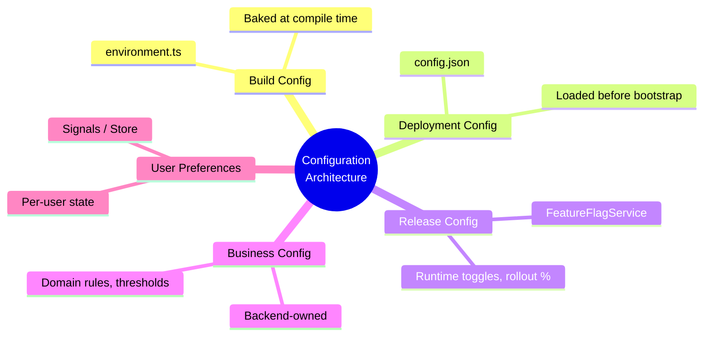

Answer the ownership question consistently, and configuration architecture stops being an accident of convenience — and becomes a deliberate, maintainable part of your Angular application's design.

## 31. Quick Recap and Learning Path

### Quick Recap (the whole tutorial in ten lines)

1. Direct `environment` imports silently turn config into a global service locator.
2. Configuration has five categories: build, deployment, release, business, user preferences.
3. `InjectionToken` + narrow interfaces give each feature only the keys it needs.
4. Only the composition root should know the full configuration surface.
5. Runtime `config.json` enables build once, deploy many.
6. Validate runtime config at startup; normalize defaults in one place.
7. Feature flags belong to a `FeatureFlagService`, not to `environment.ts`.
8. Business rules are enforced by the backend; the frontend only displays them.
9. Tenant/user settings that change at runtime are signal-based state, not constants.
10. Secrets never ship to the browser — enforce it mechanically, not by convention.

### Suggested learning path

- 🌱 **Week 1:** Run the inventory + secrets audit (Section 21, Phase 1) on your own codebase.
- 🌿 **Weeks 2–3:** Extract tokens for your two most environment-coupled features; do the Hands-On Lab (Section 22) in parallel.
- 🌳 **Month 2:** Introduce runtime `config.json` and startup validation; enable the ESLint ban.
- 🎋 **Ongoing:** Migrate flags to a `FeatureFlagService`; move business thresholds to the backend; add a CI config smoke test.

### Next steps after this tutorial

- Deepen DI knowledge: multi providers, `ElementInjector` hierarchies, `EnvironmentInjector`
- Explore schema validation with Zod/Valibot for `config.json`
- Study a feature-flag platform (Unleash, LaunchDarkly, Flagsmith) and its Angular SDKs
- Apply the same contract thinking to NgRx/store selectors for runtime state

## 32. Further Reading

- 📗 [Angular — Dependency Injection in Action](https://angular.dev/guide/di) — official guide covering `InjectionToken` and providers
- 📗 [Angular — provideAppInitializer](https://angular.dev/api/core/provideAppInitializer) — the modern replacement for `APP_INITIALIZER`
- 📗 [Angular — Signals](https://angular.dev/guide/signals) — `signal`, `computed`, and reactive state fundamentals
- 📘 [12 Factor App — Config](https://12factor.net/config) — the canonical argument for storing config in the environment, not the code
- 📘 [OWASP — Secrets Management](https://owasp.org/www-project-secrets-management/) — vaulting, rotation, and why client-side secrets are a vulnerability
- 📙 [Martin Fowler — Feature Toggles (Feature Flags)](https://martinfowler.com/articles/feature-toggles.html) — taxonomy of release, ops, and experiment toggles
- 📙 [Martin Fowler — Inversion of Control Containers and the Dependency Injection pattern](https://martinfowler.com/articles/injection.html) — the composition-root pattern this tutorial leans on
- 📕 [Zod documentation](https://zod.dev) — schema validation for runtime configuration parsing

---

*📄 Document version: 1.0 · Last Updated: 2026-09-04 · Covers Angular 15+ (Signals require Angular 16+)*
