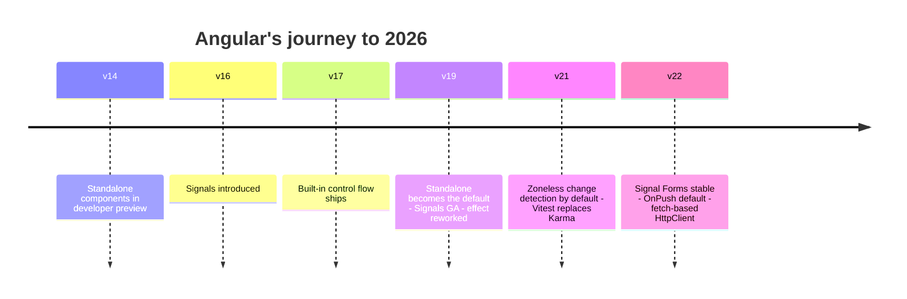
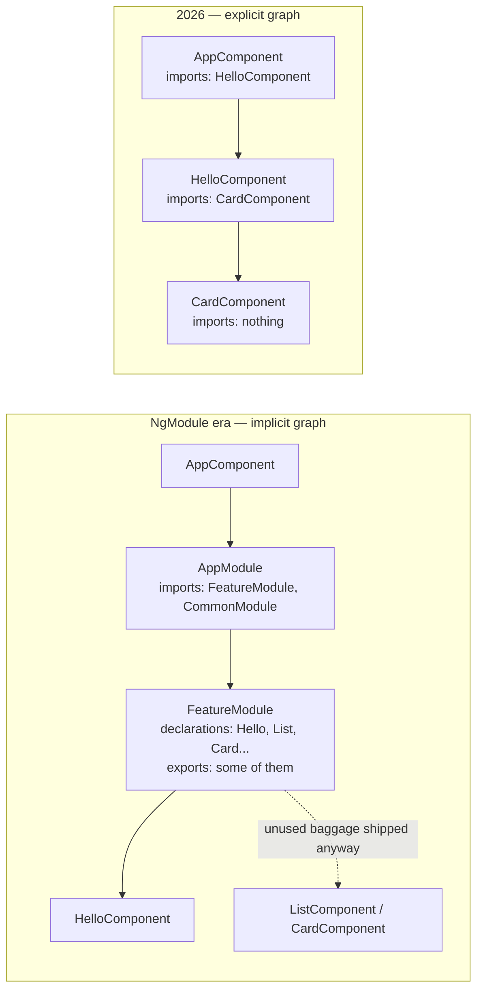
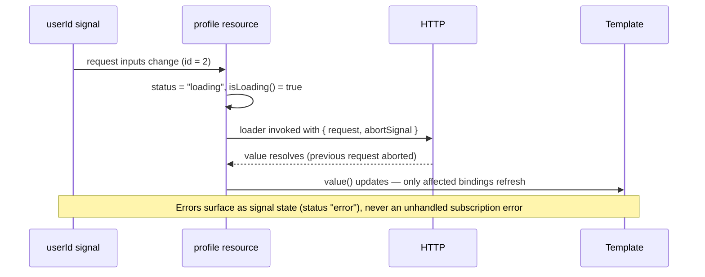
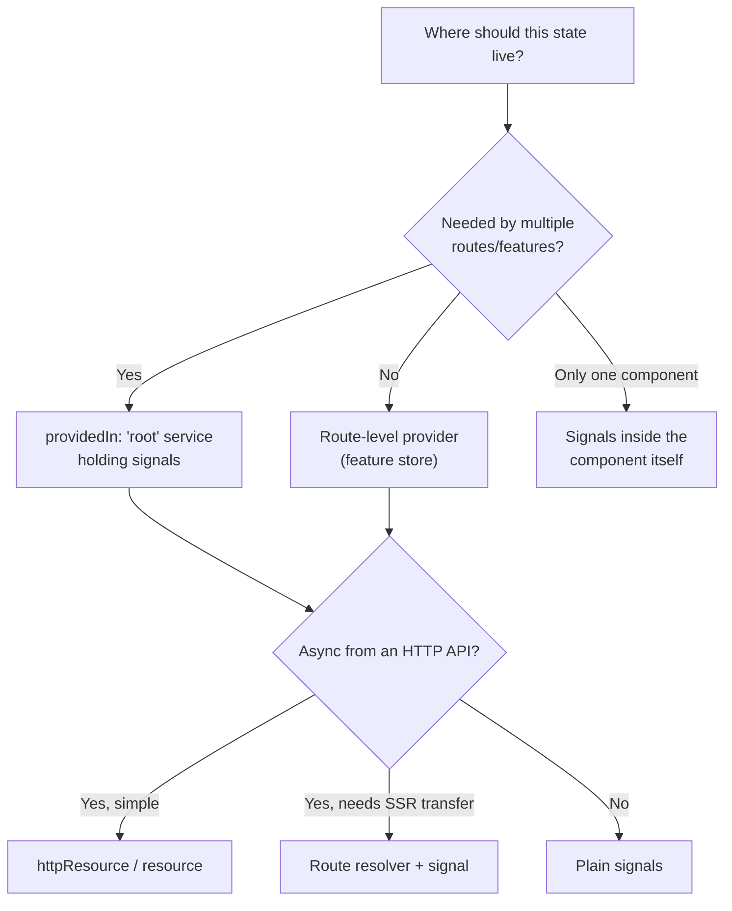
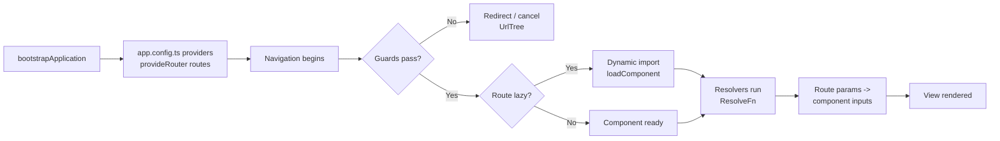
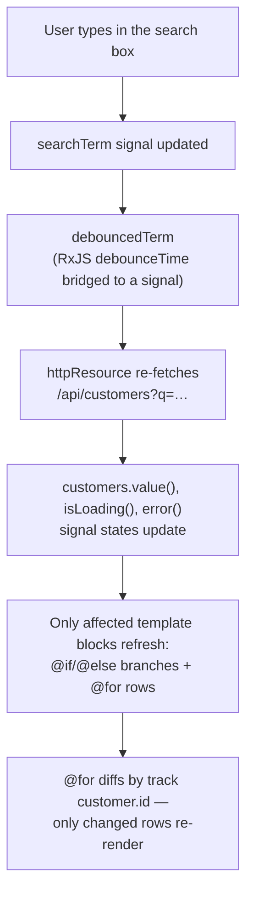
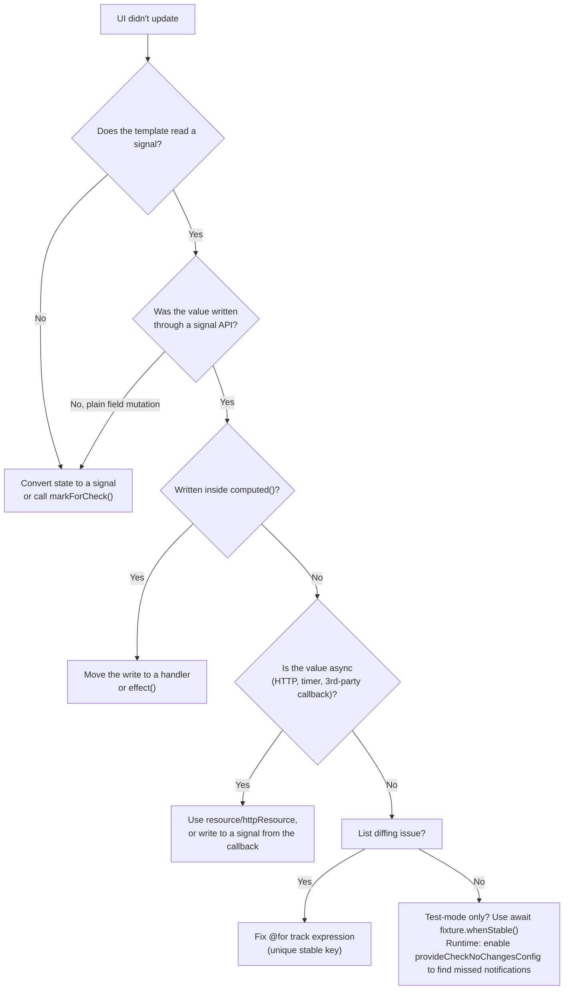

# Angular in 2026: A Practical Guide to Building Modern Web Applications
### A Comprehensive Deep-Dive Tutorial on Standalone Components, Signals, Built-in Control Flow, and Zoneless Change Detection

<!--
Difficulty Level: Intermediate
Estimated Reading Time: 75–95 minutes
Last Updated: 2026-09-19
Source: Content provided by the user ("Angular in 2026: A Practical Guide to Building Modern Web Applications" by Bharat Chandera), augmented to meet tutorial-preferences.md requirements
Based on: Angular v21/v22 — standalone by default, Signals, built-in control flow (@if/@for/@switch), zoneless change detection by default (since v21), Signal Forms stable (v22), OnPush default (v22), Vitest default test runner (since v21)
-->

---

## 📚 Table of Contents

1. [Prerequisites](#prerequisites)
2. [Learning Objectives](#learning-objectives)
3. [Introduction: The NgModule Era Is Over](#introduction-the-ngmodule-era-is-over)
4. [The Mental Model: Reactivity Down to the Template](#the-mental-model-reactivity-down-to-the-template)
5. [Standalone Components: A Real Example](#standalone-components-a-real-example)
6. [Signals: The New Reactivity Model](#signals-the-new-reactivity-model)
7. [Signals in Depth: linkedSignal, resource, httpResource](#signals-in-depth-linkedsignal-resource-httpresource)
8. [Built-in Control Flow](#built-in-control-flow)
9. [Services with Signals: Lightweight State Management](#services-with-signals-lightweight-state-management)
10. [Routing with Standalone APIs](#routing-with-standalone-apis)
11. [Zoneless by Default](#zoneless-by-default)
12. [Signal Forms and the 2026 Defaults](#signal-forms-and-the-2026-defaults)
13. [Testing in 2026: Vitest and whenStable](#testing-in-2026-vitest-and-whenstable)
14. [Angular CLI: Power Tools You're Probably Under-Using](#angular-cli-power-tools-youre-probably-under-using)
15. [Real-World Case Study: A Customer Dashboard Feature](#real-world-case-study-a-customer-dashboard-feature)
16. [Common Pitfalls & Troubleshooting](#common-pitfalls--troubleshooting)
17. [Best Practices](#best-practices)
18. [Anti-Patterns Recap](#anti-patterns-recap)
19. [Performance Considerations](#performance-considerations)
20. [Security Considerations](#security-considerations)
21. [Testing Strategies](#testing-strategies)
22. [Migration Guide: From NgModule-Era Angular to 2026](#migration-guide-from-ngmodule-era-angular-to-2026)
23. [Practice Exercises with Solutions](#practice-exercises-with-solutions)
24. [Test Your Understanding](#test-your-understanding)
25. [Common Interview Questions](#common-interview-questions)
26. [Comprehensive Question Bank](#comprehensive-question-bank)
27. [Summary & Key Takeaways](#summary--key-takeaways)
28. [Further Reading & Resources](#further-reading--resources)
29. [Next Steps](#next-steps)

---

## 🧰 Prerequisites

To get the most out of this tutorial, you should have:

**Required:**
- 🟢 **Node.js 22+** — Angular v22 requires Node 22 or later (Node 20 support was dropped; Node 26 is supported). Verify with `node --version`.
- 🅰️ **Angular CLI v22** — install globally with `npm install -g @angular/cli`, or use `npx @angular/cli@latest` per command.
- 📘 **TypeScript 6 basics** — Angular v22 requires TypeScript 6. You should be comfortable with types, generics, and union types.
- 🧩 **Component fundamentals** — templates, bindings, inputs/outputs, and dependency injection (DI).
- 🔁 **RxJS awareness** — you do not need to be an expert, but this tutorial explains where RxJS still beats Signals.

**Recommended:**
- 🛠️ **VS Code + Angular Language Service** — inline type errors inside templates and auto-imports.
- 🧪 **Vitest basics** — the default unit-test runner since Angular v21.
- 📦 **Git basics** — so you can run `ng update` on a clean branch, as the CLI's migrations rewrite code.

**Scaffolding a playground:**

```bash
# Creates a standalone, zoneless, Vitest-ready application
npx @angular/cli@latest new customer-portal --style=css --ssr=false
cd customer-portal
ng serve --open
```

> 💡 **What you get by default in 2026:** `ng new` generates **standalone components** (no NgModule, no `app.module.ts`), a **zoneless** bootstrap (`zone.js` is absent from `angular.json` polyfills), **Vitest** as the test runner, and `provideRouter` already wired in `app.config.ts`. The default path a new Angular project takes today is exactly the modern path this tutorial teaches.

## 🎯 Learning Objectives

By the end of this tutorial, you will be able to:

1. Explain what changed between the NgModule era and Angular 2026 — and why the framework is leaner without being "rewritten".
2. Build **standalone components** with explicit dependency graphs instead of NgModules.
3. Model application state with **`signal`, `computed`, `effect`, `linkedSignal`, `resource`, and `httpResource`** — and know exactly when RxJS is still the better tool.
4. Write templates with **built-in control flow** (`@if`, `@for` + `track`, `@switch`, `@defer`) and understand why compiled blocks outperform structural directives.
5. Create **signal-based services** that replace most `BehaviorSubject`-heavy state containers.
6. Configure **standalone routing** with `loadComponent`, functional guards, and route input binding.
7. Run applications **zoneless** — remove Zone.js safely and handle the reactive-forms and third-party caveats.
8. Write **Vitest** tests that use `await fixture.whenStable()` instead of `fixture.detectChanges()`.
9. Use the **CLI's** migration schematics (`@angular/core:standalone`, `@angular/core:control-flow`) and MCP server tools to modernize an existing codebase.
10. Apply performance, security, and testing best practices to a 2026 Angular codebase.

---
## 📖 Introduction: The NgModule Era Is Over

If you last touched Angular in the NgModule era, the framework you'll find in 2026 looks and feels different.

Not "rewritten" different — the same dependency injection, the same CLI-driven workflow, the same enterprise-grade discipline — but leaner, faster to write, and reactive down to the template level. Angular spent the last several release cycles quietly removing friction, and by v21/v22 the default experience has changed in ways that alter how you structure every component:

| Aspect | NgModule era (≈ v2–v15) | Angular 2026 (v21/v22) |
|---|---|---|
| Component registration | Declared in an NgModule's `declarations` array | **Standalone by default** — imports listed on the component itself |
| Reactivity | Zone.js change detection + RxJS `BehaviorSubject` for state | **Signals** — fine-grained, template-level reactivity |
| Change detection | `Zone.js` patches browser APIs, checks broadly | **Zoneless by default** (v21+) — signal-driven scheduling |
| Default change-detection strategy | Eager (formerly "Default") | **OnPush** (v22+) |
| Template control flow | `*ngIf`, `*ngFor`, `*ngSwitch` structural directives | **`@if` / `@for` / `@switch`** — compiled, not interpreted |
| Lazy loading | `loadChildren` + feature NgModules | **`loadComponent`** per route |
| Forms | Reactive forms / template-driven forms | + **Signal Forms** (stable in v22) |
| HTTP client | Provided via `provideHttpClient()` | Provided in root injector by default; **Fetch API by default** (v22+) |
| Unit testing | Karma + Jasmine | **Vitest** (default since v21) |
| Bundle weight | `zone.js` polyfill always present | Zone.js removed from the build by default |

**Why Angular in 2026?** The framework's pitch hasn't changed — it's the "batteries included" choice for large teams — but the friction is gone:

- **Mature, opinionated, and enterprise-ready.** Routing, forms, HTTP, testing, and DI all ship as one coherent framework, not a pile of community choices.
- **Signals for simple, powerful reactivity.** Fine-grained updates without manually managing subscriptions.
- **Excellent tooling and developer experience.** A CLI that scaffolds, serves, tests, updates — and now drives AI assistants via an MCP server.
- **High performance and smaller bundles.** Standalone components and zoneless change detection cut dead weight.
- **A strong ecosystem with long-term support.** Google's backing means predictable release trains and automated migration paths.

The journey to this point was deliberate rather than sudden:



> 💡 **The one-sentence summary:** Angular 2026 removes ceremony — NgModules, Zone.js, manual subscriptions, structural-directive indirection — while keeping the structure and DI discipline that made it a safe choice for large teams in the first place.

---
## 🧠 The Mental Model: Reactivity Down to the Template

Before writing code, internalize the single biggest shift: **change detection is now pull-based and precise.**

**The old world (Zone.js):** Zone.js monkey-patched browser APIs (`setTimeout`, `addEventListener`, `Promise`, XHR). When *any* async task completed anywhere, Angular assumed *something* might have changed and ran change detection across the component tree. Correct, but blunt — Angular had no insight into whether state actually changed, so it synchronized more often than necessary. Frameworks didn't need to know *what* changed, only that *something happened*.

**The new world (Signals + zoneless):** The template itself declares its dependencies by reading signals. When you write to a signal, Angular knows the exact set of consumers — the precise template bindings and `computed` values that read it — and schedules a refresh for *only those views*. There is no tree walk, no Zone.js, no "check everything to be safe."

```mermaid
flowchart TD
    A["User clicks the increment button"] --> B["Handler writes the signal:<br/>count.update(c => c + 1)"]
    B --> C["Signal marks its direct consumers dirty<br/>(bindings, computed values, effects)"]
    C --> D{"Which views read this signal?"}
    D --> "Only views that read count" --> E["Scheduler queues a refresh<br/>for exactly those views"]
    E --> F["Change detection runs the affected views only<br/>no Zone.js, no whole-tree walk"]
    F --> G["DOM updates: 'Count: 2'"]
    H["Old way: Zone.js patched browser APIs"] --> I["Any async task completed anywhere"] --> J["Change detection ran over the<br/>entire component tree — just in case"]
```

Three consequences worth memorizing:

1. **A plain class field is invisible to the template.** `this.user = {...}` mutates nothing Angular tracks. State the template reads must be a signal (or an observable bound with `async`, or an input via `input()`). This is the #1 migration stumbling block — and the #1 debugging question in zoneless mode ("why didn't my UI update?").
2. **`computed()` is memoized.** It recalculates only when a *real dependency* changes; unrelated writes never touch it.
3. **Effects run after rendering**, replacing most of the manual `Subscription` bookkeeping RxJS used to require for simple side effects.

> ⚠️ **Zoneless is the default, not an option you enable.** Since v21 you get zoneless unless you explicitly opt out with `provideZoneChangeDetection()`. Code written "the old way" (mutable fields, no notifications) doesn't crash loudly — it *silently stops updating the UI*. That's why the mental model matters more than the syntax.

### Quick Recap

- Signals make the template's data dependencies explicit and precise.
- Zone.js is gone by default; change detection is scheduled by signal writes, not by patched browser events.
- If the template reads it, it should be a signal (or signal input / observable).

---
## 🧩 Standalone Components: A Real Example

The biggest structural change is simply this: **components don't need NgModules anymore.** A component declares what it depends on, right where you can see it.

```typescript
// hello.component.ts
import { Component, signal } from '@angular/core';

@Component({
  selector: 'app-hello',
  // standalone: true is the default since v19 — you rarely write it anymore.
  imports: [], // only needed if this template uses other components/directives/pipes
  template: `
    <div class="card">
      <h2>Hello, {{ name() }}!</h2>
      <p>Angular makes building modern apps enjoyable!</p>
    </div>
  `,
  styles: [`
    .card { padding: 1rem; border: 1px solid #eee; border-radius: 12px; }
  `]
})
export class HelloComponent {
  name = signal('Angular Developer');
}
```

```typescript
// app.component.ts — use it by importing it, nothing else required
import { Component } from '@angular/core';
import { HelloComponent } from './hello/hello.component';

@Component({
  selector: 'app-root',
  imports: [HelloComponent],
  template: `<app-hello />`
})
export class AppComponent {}
```

Notice two things: there's **no enclosing NgModule** declaring this component, and `name` isn't a plain field — it's a **signal**. That second detail is the real story of modern Angular (next section), but first, appreciate what the first detail buys you.

### ❌ The Problem: NgModule Indirection

In the NgModule era, the same component required a module *somewhere else* to declare it, and the "what does this template use?" question was answered by a chain of `imports`/`exports` arrays three files away:

```typescript
// ❌ NgModule era: two files, one layer of indirection
import { NgModule } from '@angular/core';
import { CommonModule } from '@angular/common';
import { HelloComponent } from './hello.component';

@NgModule({
  declarations: [HelloComponent],   // "declared" here, defined elsewhere
  imports: [CommonModule],          // blanket-import for *ngIf/*ngFor/date pipes
  exports: [HelloComponent]
})
export class HelloModule {}
```

Every consumer had to import the *module*, and the module might declare ten other things you don't use. Tree-shaking and dependency reasoning both suffered. The dependency graph was implicit — reconstructed by tooling, not stated by the author.

### ✅ The Solution: Explicit, Local Dependencies

In 2026 the component is the unit of composition. Its `imports` array is the complete, checkable truth about what the template uses — and the compiler enforces it. Because templates now use built-in control flow (`@if`/`@for`) instead of structural directives, the once-ubiquitous `CommonModule` import usually disappears entirely.



| Concern | NgModule approach | Standalone approach |
|---|---|---|
| Where usage is declared | Module `declarations` (far from the component) | Component `imports` (on the component) |
| Blanket imports | `CommonModule` "just in case" | Import only the specific pipe/directive — often nothing, thanks to built-in control flow |
| Unused components shipped | Possible if exported from a shared module | Impossible — a component nothing imports is never bundled |
| Lazy loading | `loadChildren` + a feature NgModule per route | `loadComponent` per route, no module needed |
| Bootstrap | `platformBrowser().bootstrapModule(AppModule)` | `bootstrapApplication(AppComponent, { providers })` |
| mental overhead | "Which module declares this?" | Read the component |

> 💡 **Pro tip:** The CLI generates standalone components by default — `ng generate component hello` needs no flags. If you're on an older codebase, `ng generate @angular/core:standalone` migrates you automatically (see the [Migration Guide](#migration-guide-from-ngmodule-era-angular-to-2026)).

> ⚠️ **Common compile errors after going standalone:** *"Component is not standalone"* (add `standalone: true` if you're on v14–v18) and *"X is used in the template but not imported"* — the fix is always the same: add the exact component/directive/pipe to that component's `imports` array, or drop it from the template.

---
## ⚡ Signals: The New Reactivity Model

Signals are Angular's answer to a long-standing problem: **how do you know exactly which part of the UI needs to update when data changes, without re-checking the entire component tree?**

A signal is a wrapper around a value that notifies its consumers when it changes. Three primitives cover almost everything:

- **`signal(initialValue)`** — a writable reactive container. Read it by calling it (`count()`), write it with `.set()`, `.update()`, or `.mutate()`.
- **`computed(() => ...)`** — derives a new value from other signals. Memoized and lazily evaluated; it only recalculates when a real dependency changes.
- **`effect(() => ...)`** — runs a side effect whenever a dependency changes. No manual subscribe/unsubscribe dance required.

```typescript
// counter.service.ts
import { Injectable, signal, computed, effect } from '@angular/core';

@Injectable({ providedIn: 'root' })
export class CounterService {
  // 1. Writable state
  count = signal(0);

  // 2. Derived state — recalculates ONLY when count() changes
  double = computed(() => this.count() * 2);

  constructor() {
    // 3. Side effect — runs after each change (injection context required)
    effect(() => {
      console.log('Count changed:', this.count());
    });
  }

  increment(): void {
    this.count.update(c => c + 1);
  }
}
```

```typescript
// The three write APIs — pick by intent
count.set(5);                    // replace the value
count.update(c => c + 1);        // transform the current value
items.mutate(list => list.push('new item'));  // mutate in place, then notify
```

**What makes this powerful in practice:**

- **Only the templates that actually read a signal re-render** — Angular doesn't need to walk the whole tree on every change.
- **`computed()` values are memoized** and only recalculate when a real dependency changes. `double` never recomputes because an unrelated signal changed.
- **`effect()` replaces manual `Subscription` bookkeeping** that RxJS used to require for simple side effects (logging, analytics, syncing to `localStorage`).

### ❌ The Problem: BehaviorSubject State Containers

For a decade, "hold and derive plain state" in Angular looked like this:

```typescript
// ❌ Lots of machinery just to hold and derive a number
import { Injectable } from '@angular/core';
import { BehaviorSubject, map } from 'rxjs';

export class LegacyCounterService {
  private readonly _count = new BehaviorSubject<number>(0);
  readonly count$ = this._count.asObservable();
  readonly double$ = this._count.pipe(map(c => c * 2));

  increment(): void {
    this._count.next(this._count.value + 1);
  }
}
```

```html
<!-- ❌ Template must remember the async pipe everywhere -->
<p>Count: {{ counter.count$ | async }}</p>
<p>Double: {{ counter.double$ | async }}</p>
```

It works — but note the ceremony: a private observable-plus-next pattern, pipe transforms for derived values, `| async` in every binding, and a subscription lifecycle (or the pipe's) to manage. If you forget `| async`, the template renders nothing; if you subscribe manually, you must unsubscribe in `ngOnDestroy`.

### ✅ The Solution: Signals for State, RxJS for Streams

```typescript
// ✅ Same behavior, no subscription lifecycle
readonly count = signal(0);
readonly double = computed(() => this.count() * 2);
```

```html
<p>Count: {{ count() }}</p>
<p>Double: {{ double() }}</p>
```

| Concern | RxJS `BehaviorSubject` | Signals |
|---|---|---|
| Holding current state | Works (`.value` / `| async`) | Purpose-built |
| Deriving values | `.pipe(map(...))` — runs per emission | `computed()` — memoized |
| Template binding | Requires `| async` in every binding | Call it: `count()` |
| Subscription cleanup | Manual (`takeUntil`, `unsubscribe`) or `async` pipe | None — automatic |
| Push-based streams (debounce, events) | ✅ Excellent | ❌ Not designed for this |
| Combining async sources over time | ✅ `combineLatest`, `switchMap` | Limited — use `resource()` or RxJS |

> 💡 **The division of labor:** Signals took over the job RxJS was overkill for — *holding and deriving plain state*. RxJS isn't going away: it's still the right tool for complex async streams, debouncing, and event composition. In practice: **signals are the state, observables are the events.**

> ⚠️ **Correct vs. incorrect `computed`:** `computed` must be *pure* — never write to signals or mutate DOM inside it. `computed(() => this.count.update(c => c + 1))` will throw (writes are not allowed in computed) — and a `computed` that reads a signal *conditionally* can miss updates because the dependency graph only records what was actually read during evaluation. Read every dependency unconditionally, or use `untracked()` for values you deliberately don't want as dependencies.

### Quick Recap

- `signal` = hold, `computed` = derive, `effect` = react.
- Signals eliminated the `BehaviorSubject`-as-state pattern; RxJS remains king for event streams.
- `computed` must stay pure and read all dependencies unconditionally.

---
## ⚙️ Signals in Depth: linkedSignal, resource, httpResource

Three newer primitives handle the cases where plain `signal` + `computed` fall short: *state that resets*, *state that comes from async work*, and *HTTP state specifically*.

### `linkedSignal()` — state that resets when its inputs change

`computed` is read-only; `signal` never resets. `linkedSignal` is both: writable local state that automatically resets to a computed default when a dependency changes.

```typescript
import { linkedSignal, signal } from '@angular/core';

export class ShoppingCartComponent {
  readonly shippingOptions = signal([
    { id: 'standard', label: 'Standard (free)', price: 0 },
    { id: 'express', label: 'Express ($9.99)', price: 9.99 }
  ]);

  // Selecting a shipping method resets when the options change
  // (e.g., a different country loads new options)
  readonly selectedShipping = linkedSignal({
    source: this.shippingOptions,
    computation: (options, previous) =>
      options.find(o => o.id === previous?.value?.id) ?? options[0]
  });

  changeShipping(id: string): void {
    this.selectedShipping.set(id);   // locally writable
  }
}
```

> 💡 **When to reach for it:** any "selection that must stay valid" — the selected tab when the tab list changes, the selected item when a filter changes the list, the selected locale when available locales change.

### `resource()` — async state as a signal

`resource()` models async data with a *reactive request* and a *fetcher*, exposing the result as signals: `.value()`, `.status()`, `.error()`, `.isLoading()`.

```typescript
import { inject, resource, signal } from '@angular/core';
import { HttpClient } from '@angular/common/http';
import { firstValueFrom } from 'rxjs';

export class UserProfileComponent {
  userId = signal(1);
  private http = inject(HttpClient);

  profile = resource({
    request: () => ({ id: this.userId() }),        // reactive request inputs
    loader: ({ request, abortSignal }) =>
      firstValueFrom(
        this.http.get<User>(`/api/users/${request.id}`),
        { signal: abortSignal }                     // auto-cancelled on re-request
      )
  });

  // profile.value(), profile.isLoading(), profile.error() — all signals
  retry(): void {
    this.profile.reload();
  }
}
```



> ⚠️ **Server-side rendering caveat:** `resource()` loaders run only on the client by default. For SSR-prerendered data, prefer a resolver, `httpResource` with transfer enabled, or stream the data down.

### `httpResource()` — the HTTP-flavored shortcut

`httpResource` wraps `HttpClient` directly and returns signal state — no `firstValueFrom`, no manual abort wiring:

```typescript
import { httpResource } from '@angular/core';

export class ProductListComponent {
  private http = inject(HttpClient);
  readonly searchTerm = signal('');

  readonly products = httpResource<Product[]>(() => ({
    url: '/api/products',
    params: { q: this.searchTerm() },     // re-fetches automatically when the signal changes
    // defaultValue: [] — render immediately, avoids undefined on first tick
  }));
}
```

**Decision guide:**

| Situation | Use |
|---|---|
| Derived, synchronous value | `computed()` |
| Writable state that resets with inputs | `linkedSignal()` |
| One-shot async value driven by reactive inputs | `resource()` |
| Direct HTTP request as signal state | `httpResource()` |
| Debounced search-as-you-type, websocket feeds, event streams | **RxJS** (convert results into signals at the edge) |
| Route-entry data that must resolve before navigation | Route resolver (`ResolveFn`) |

---
## 🎛️ Built-in Control Flow

Angular templates now have their own control-flow syntax, **compiled directly** instead of relying on structural directives like `*ngIf` and `*ngFor`. The result reads closer to plain logic and performs better: the compiler can generate optimized update instructions per block, rather than parsing directives at runtime.

### Conditionals — `@if` / `@else` / `else if`

```html
@if (user(); as u) {
  <p>Welcome, {{ u.name }}</p>
} @else if (isLoading()) {
  <p>Loading…</p>
} @else {
  <p>Please log in</p>
}
```

The `as u` alias binds a narrowed, non-null value for the whole block — no `?.` chains or `*ngIf="x as y"` ceremony.

### Loops — `@for` with `track` and `@empty`

```html
@for (item of items(); track item.id) {
  <li>{{ item.name }}</li>
} @empty {
  <li>No items found</li>
}
```

Two details worth calling out:

- **`track` is required**, which nudges you toward correct, efficient list diffing by default rather than as an afterthought. When the list changes, Angular moves/creates/destroys only the affected DOM nodes — using the tracked key as identity.
- **`@empty`** gives you a built-in empty state without extra conditional wrapping.

> ⚠️ **Choosing a `track` expression:** use a stable unique key (`item.id`) when one exists. `track item` (identity) is right for immutable object arrays that are rebuilt wholesale. **Avoid `track $index`** for lists that reorder or delete from the middle — identity by position causes stale rows, wrong input state, and focus bugs. Correct:
> `@for (row of rows(); track row.id)` · Incorrect: `@for (row of rows(); track $index)` when rows can move.

### Switch — `@switch`

```html
@switch (status()) {
  @case ('loading') { <p>Loading...</p> }
  @case ('success') { <p>Done!</p> }
  @default { <p>Unknown</p> }
}
```

### Deferring content — `@defer`

`@defer` splits a component's code out of the initial bundle and loads it on demand — the template itself declares the lazy-loading boundary, no router configuration needed:

```html
<section>
  <h2>Dashboard</h2>

  @defer (on viewport; prefetch on idle) {
    <app-heavy-chart [data]="chartData()" />
  } @placeholder (minimum 200ms) {
    <div class="chart-skeleton"></div>
  } @loading (minimum 200ms; after 100ms) {
    <app-spinner />
  } @error {
    <p>Failed to load chart. <button (click)="retry()">Retry</button></p>
  }
</section>
```

Available triggers: `on viewport`, `on interaction`, `on hover`, `on idle`, `on timer(…)`, `when(expr)`, plus `prefetch` variants. Below the fold = `on viewport`. Heavy editor tools = `on interaction`. Non-critical prefetchable data = `on idle`.

### Legacy directives vs. built-in control flow

| Feature | Structural directives | Built-in control flow |
|---|---|---|
| Syntax | `*ngIf="cond"`, `*ngFor="let x of xs"` | `@if (cond) {}`, `@for (x of xs; track x.id)` |
| Execution | Interpreted at runtime by directive factories | **Compiled** into template instructions |
| `track` / diffing | Optional (`trackBy` callback) | **Mandatory** — safe by default |
| Empty state | Extra `*ngIf="!xs.length"` wrapper | Built-in `@empty` block |
| Type narrowing | Via `as` syntax, limited | Precise, block-scoped |
| Bundle/runtime cost | Directive instantiation per usage | Leaner generated code |

> 💡 **Migration is mechanical:** `ng generate @angular/core:control-flow` rewrites `*ngIf`/`*ngFor`/`*ngSwitch` to the new blocks across your project. Do it on a clean branch and review the diff.

---
## 🏪 Services with Signals: Lightweight State Management

State management doesn't need a heavyweight store for a lot of real-world cases. A plain injectable service holding signals is often enough — and it's fully compatible with Angular's dependency injection.

```typescript
// user.service.ts
import { Injectable, computed, signal } from '@angular/core';

export interface User {
  id: string;
  name: string;
  roles: string[];
}

@Injectable({ providedIn: 'root' })
export class UserService {
  // Private writable state — components cannot bypass the service API
  private readonly user = signal<User | null>(null);

  // Public read-only derived state
  readonly isLoggedIn = computed(() => !!this.user());
  readonly displayName = computed(() => this.user()?.name ?? 'Guest');
  readonly isAdmin = computed(() => this.user()?.roles.includes('admin') ?? false);

  login(user: User): void {
    this.user.set(user);
  }

  logout(): void {
    this.user.set(null);
  }
}
```

```typescript
// nav-bar.component.ts
import { Component, inject } from '@angular/core';
import { UserService } from './user.service';

@Component({
  selector: 'app-nav-bar',
  template: `
    <nav>
      <span>Hello, {{ auth.displayName() }}</span>
      @if (auth.isLoggedIn()) {
        <button (click)="auth.logout()">Log out</button>
      } @else {
        <button (click)="login()">Log in</button>
      }
    </nav>
  `
})
export class NavBarComponent {
  protected readonly auth = inject(UserService);
}
```

Any component that injects `UserService` and reads `isLoggedIn()` in its template updates automatically, in sync, with **no manual subscriptions to clean up in `ngOnDestroy`**.

**Error handling and loading belong in the same service** — as signals, not ad-hoc flags:

```typescript
// product.service.ts — a realistic signal-based store
import { Injectable, computed, inject, signal } from '@angular/core';
import { HttpClient } from '@angular/common/http';
import { HttpErrorResponse } from '@angular/common/http';

export interface Product { id: string; name: string; price: number; }

@Injectable({ providedIn: 'root' })
export class ProductService {
  private readonly http = inject(HttpClient);

  private readonly products = signal<Product[]>([]);
  private readonly error = signal<string | null>(null);
  private readonly loading = signal(false);

  // Public read-only view — note the `.asReadonly()` pattern for direct state
  readonly items = this.products.asReadonly();
  readonly hasError = computed(() => this.error() !== null);
  readonly total = computed(() =>
    this.products().reduce((sum, p) => sum + p.price, 0)
  );

  async load(): Promise<void> {
    this.loading.set(true);
    this.error.set(null);                       // reset previous errors
    try {
      const data = await firstValueFrom(this.http.get<Product[]>('/api/products'));
      this.products.set(data);
    } catch (err) {
      const msg = err instanceof HttpErrorResponse
        ? `Server error ${err.status}`          // structured handling
        : 'Network error — check your connection';
      this.error.set(msg);                      // state, not console noise
    } finally {
      this.loading.set(false);
    }
  }
}
```

### Feature-scoped stores

`providedIn: 'root'` makes the state a **singleton**. For state that must reset when a feature closes, provide the store at the **route level** instead:

```typescript
// checkout.routes.ts
export const CHECKOUT_ROUTES: Routes = [{
  path: 'checkout',
  loadComponent: () => import('./checkout.component').then(m => m.CheckoutComponent),
  providers: [CheckoutStore]   // one instance per entry into the feature
}];
```



> ⚠️ **When you *do* need NgRx:** complex event-driven workflows, strict unidirectional data flow with devtools time-travel, cross-team conventions at scale, or large shared entity models. Signals don't replace stores — they replace the *leaky BehaviorSubject containers* stores used to be built on.

---

## 🧭 Routing with Standalone APIs

Routing has followed the same standalone philosophy. Instead of an `AppRoutingModule`, **routes are a plain array**, and the application bootstraps with functional providers.

```typescript
// app.routes.ts
import { Routes } from '@angular/router';

export const routes: Routes = [
  { path: '', component: HomeComponent },
  {
    path: 'about',
    loadComponent: () =>
      import('./about/about.component').then(m => m.AboutComponent)
  },
  {
    path: 'users/:id',
    loadComponent: () => import('./users/user-detail.component').then(m => m.UserDetailComponent),
    // Route params become inputs (see withComponentInputBinding below)
  },
  { path: '**', redirectTo: '' }
];
```

```typescript
// app.config.ts — the NgModule replacement
import { ApplicationConfig, provideZoneChangeDetection } from '@angular/core';
import { provideRouter, withComponentInputBinding, withInMemoryScrolling } from '@angular/router';
import { provideHttpClient } from '@angular/common/http';

export const appConfig: ApplicationConfig = {
  providers: [
    provideRouter(
      routes,
      withComponentInputBinding(),                       // route params -> component inputs
      withInMemoryScrolling({ anchorScrolling: 'enabled' })
    ),
    // provideHttpClient() is only needed to add interceptors or
    // customize; HttpClient is available in the root injector by default (v22+)
    provideHttpClient(withInterceptors([authInterceptor]))
  ]
};
```

```typescript
// main.ts — functional bootstrap, no AppModule
import { bootstrapApplication } from '@angular/platform-browser';
import { AppComponent } from './app/app.component';
import { appConfig } from './app/app.config';

bootstrapApplication(AppComponent, appConfig).catch(err => console.error(err));
```

`loadComponent` gives you **per-route lazy loading** without needing a whole feature module just to defer code. For an app with a handful of rarely visited routes, that alone can meaningfully shrink your initial bundle.

### Route params as inputs

With `withComponentInputBinding()`, route data arrives as regular inputs — even signal inputs:

```typescript
// user-detail.component.ts
import { Component, input } from '@angular/core';

@Component({
  selector: 'app-user-detail',
  template: `<h1>User {{ userId() }}</h1>`
})
export class UserDetailComponent {
  // Bound automatically from the :id route parameter
  userId = input.required<string>();
}
```

### Functional guards and resolvers

Guards are plain functions returning `boolean | UrlTree | Observable | Promise`:

```typescript
// auth.guard.ts
import { inject } from '@angular/core';
import { Router, CanActivateFn } from '@angular/router';
import { UserService } from './user.service';

export const authGuard: CanActivateFn = () => {
  const auth = inject(UserService);
  const router = inject(Router);
  return auth.isLoggedIn() ? true : router.createUrlTree(['/login']);
};

// usage: { path: 'admin', canActivate: [authGuard], ... }
```



> 💡 **Pro tip:** Preloading with `provideRouter(routes, withPreloading(PreloadAllModules))` — or a custom strategy that preloads only on fast connections — gets you lazy-loading benefits *and* instant navigation for the routes users actually visit.

---

## 🚫 Zoneless by Default

Angular v21 made **zoneless change detection the default**. New applications don't need `provideZonelessChangeDetection()` and don't include Zone.js at all. This matters for three reasons:

1. **Performance** — no more change detection triggered "just in case" by every async task. Scheduling is signal-driven and precise.
2. **Core Web Vitals** — Zone.js adds payload size and startup overhead; removing it speeds up first load.
3. **Debuggability & compatibility** — stack traces stop being polluted by zone patches, and new browser APIs (which Zone.js can't always patch effectively, e.g. `async/await` downleveling) just work.

### Verifying your app is zoneless

```bash
# 1. Check angular.json — these must be ABSENT from polyfills in build AND test targets:
#    "zone.js" and "zone.js/testing"

# 2. Remove the dependency entirely
npm uninstall zone.js

# 3. Search for opt-outs that would silently restore zone-based behavior
grep -rn "provideZoneChangeDetection" src/
```

> ⚠️ **If your application still relies on Zone.js** (e.g., during a migration), you must explicitly add `provideZoneChangeDetection()` to the root providers — on v21+ the CLI migration adds this for you when required.

### What zoneless changes in daily code

| Situation | Zone.js era | Zoneless 2026 |
|---|---|---|
| Template reads a signal | — | ✅ Updates automatically on signal write |
| Template reads a mutable field | Sometimes worked (zone triggered CD) | ❌ UI never updates — convert to a signal or call `markForCheck()` |
| `setTimeout`/promise mutates state | UI updated (zone fired) | ❌ Not anymore — write to a signal instead |
| Reactive forms (`setValue`, `patchValue`, `FormArray.push`) | UI updated via zone | ⚠️ Model + observables update, but **no automatic CD** — bridge via signals or `markForCheck()` |
| Third-party lib mutating DOM/callbacks outside Angular | Worked via zone patches | ⚠️ Wrap the callback: write into a signal, or use `NgZone.run()` / `ChangeDetectorRef.markForCheck()` |
| SSR hydration "am I done?" | Zone instability heuristic | `PendingTasks` / `pendingUntilEvent()` |

### Telling Angular when work is pending

Zoneless apps answer "is anything still in flight?" explicitly. The framework tracks router navigations and `HttpClient` calls for you; for custom async work, use the `PendingTasks` service (or `pendingUntilEvent` in `rxjs-interop`):

```typescript
import { PendingTasks, inject } from '@angular/core';

async function doSomeWorkThatNeedsToBeRendered(): Promise<void> {
  const taskCleanup = inject(PendingTasks).add();   // marks app "unstable"
  try {
    await loadRemoteConfig();                        // custom async work
  } finally {
    taskCleanup();                                   // marks app "stable" again
  }
}
```

### A debugging aid while migrating

`provideCheckNoChangesConfig({ exhaustive: true, interval: 1000 })` (dev only) periodically verifies that no binding changed *without a notification* — it throws `ExpressionChangedAfterItHasBeenCheckedError` for updates zoneless CD would have missed. Use it to find the last mutable-field stragglers, then turn it off.

> 💡 **The migration rule of thumb:** every value the template reads becomes a signal (or signal input); every place that mutates state writes through a signal API. Do that, and zoneless "just works" — the CLI's MCP tool `onpush_zoneless_migration` analyzes your codebase and produces a step-by-step plan for exactly this.

---

## 📝 Signal Forms and the 2026 Defaults

Two more "2026 defaults" complete the picture: Signal Forms (stable in v22) and OnPush-everywhere.

### Signal Forms — stable in v22

Signal Forms (`@angular/forms/signals`) bind a form to a **signal model**, with typed field validation. No `FormGroup`/`FormControl` scaffolding, no `rebuildForm()` — the model *is* the state:

```typescript
// signup.component.ts
import { Component, signal } from '@angular/core';
import { form, FormField, required, email, minLength, disable } from '@angular/forms/signals';

@Component({
  selector: 'app-signup',
  imports: [FormField],                       // directive with the [formField] selector
  template: `
    <form (submit)="submit($event)">
      <label>Email
        <input type="email" [formField]="signupForm.email" />
        @if (signupForm.email().invalid()) {
          <small>{{ signupForm.email().errors()[0].message }}</small>
        }
      </label>

      <label>Password
        <input type="password" [formField]="signupForm.password" />
      </label>

      <label>
        <input type="checkbox" [formField]="signupForm.acceptedTerms" />
        I accept the terms
      </label>

      <!-- submit is disabled reactively while the form is invalid -->
      <button type="submit" [disabled]="signupForm().invalid()">Sign up</button>
    </form>
  `
})
export class SignupComponent {
  readonly model = signal({ email: '', password: '', acceptedTerms: false });

  readonly signupForm = form(this.model, f => {
    required(f.email,    { message: 'Email is required' });
    email(f.email,       { message: 'Email is not valid' });
    minLength(f.password, 8, { message: 'Password must be at least 8 characters' });

    // dynamic behavior is a function of the form state:
    // keep the password field disabled until the user enters an email
    disable(f.password, { when: ({ valueOf }) => valueOf(f.email) === '' });
  });

  submit(event: Event): void {
    event.preventDefault();
    if (this.signupForm().valid()) {
      // this.model() is already the typed, valid value
      console.log('Submit', this.model());
    }
  }
}
```

Because the model is a signal, **anything reading it reacts automatically** — including zoneless change detection. There's no bridge layer between "the form" and "the state."

> ⚠️ **Legacy forms still work** — reactive and template-driven forms are not deprecated. But in zoneless mode they come with the caveat from the previous section: reactive-form model updates don't schedule change detection by themselves, so bridge them to signals (or `markForCheck()`). For new forms, Signal Forms avoid the problem entirely.

### OnPush by default (v22)

Since v22, a component that doesn't specify a `changeDetection` strategy uses **OnPush** (the old default was Eager, formerly called "Default"). With signals + OnPush:

- A component re-renders when its **inputs change** (by reference), an **event fires from its template**, or a **signal it reads changes**.
- Plain mutable fields never trigger re-renders — which is exactly the discipline zoneless requires anyway.

```typescript
@Component({
  selector: 'app-customer-card',
  changeDetection: ChangeDetectionStrategy.OnPush, // redundant in v22, but explicit for readers
  template: `<h3>{{ customer().name }}</h3>`
})
export class CustomerCardComponent {
  customer = input.required<Customer>();   // signal input — new object reference triggers update
}
```

### Signal inputs and model inputs

`@Input()` decorators are superseded by `input()` / `input.required()`; two-way binding without boilerplate uses `model()`:

```typescript
export class PageSizeSelectorComponent {
  // Required and optional signal inputs — typed, no @Input decorator, no setter glue
  pageSize = input.required<number>();
  label = input('Items per page');

  // Two-way binding: <app-page-size [(size)]="size">
  size = model(10);

  grow(): void {
    this.size.update(s => s * 2);   // emits sizeChange — [(size)] stays in sync
  }
}
```

> 💡 **v22's fetch-based HttpClient:** the HTTP client uses the Fetch API by default, which removes the XHR polyfill path and plays nicely with SSR streaming and `abortSignal`s in `resource()`. Interceptors (`withInterceptors([...])`) continue to work unchanged.

---

## 🧪 Testing in 2026: Vitest and whenStable

Angular v21 made **Vitest the default unit-test runner**, replacing Karma+Jasmine. Tests run in Node with jsdom (or a real browser via Vitest browser mode) — faster startup, native ESM, better watch mode.

```typescript
// counter.component.spec.ts
import { TestBed } from '@angular/core/testing';
import { CounterComponent } from './counter.component';

describe('CounterComponent', () => {
  beforeEach(async () => {
    await TestBed.configureTestingModule({
      imports: [CounterComponent]        // standalone: just import it
    }).compileComponents();
  });

  it('increments the count when the button is clicked', async () => {
    const fixture = TestBed.createComponent(CounterComponent);
    await fixture.whenStable();          // let initial rendering settle

    const button = fixture.nativeElement.querySelector('button');
    button.click();
    await fixture.whenStable();          // ✅ zoneless: wait for scheduled CD to finish

    expect(fixture.nativeElement.querySelector('p').textContent).toContain('1');
  });
});
```

**The single biggest testing change:** `await fixture.whenStable()` replaces `fixture.detectChanges()`.

| Approach | What it does | Verdict |
|---|---|---|
| `await fixture.whenStable()` | Waits until Angular's scheduler has drained pending work, exactly like production | ✅ Default choice |
| `fixture.detectChanges()` | Forces a synchronous CD run whether or not one was scheduled | ⚠️ Legacy; masks missed notifications — avoid in new tests |
| `fixture.autoDetectChanges()` | Hooks into zone (when present) | ❌ Meaningless zoneless |

> ⚠️ **`ExpressionChangedAfterItHasBeenCheckedError` in tests:** TestBed still enforces OnPush compatibility. If a test assigns `fixture.componentInstance.value = x` without a signal write or `markForCheck()`, the fixture throws. Fix the component (use signals), or for test-only wrappers call `fixture.changeDetectorRef.markForCheck()`.

> 💡 **Forcing zoneless in tests:** TestBed runs zoneless automatically when `zone.js` is absent from the test target's polyfills. If your project still loads zone.js but you want zoneless test behavior, add `provideZonelessChangeDetection()` to `TestBed.configureTestingModule({ providers: [...] })`.

---

## 🛠️ Angular CLI: Power Tools You're Probably Under-Using

The CLI remains one of Angular's biggest, most underappreciated advantages. A few commands worth revisiting:

```bash
# Schematics worth knowing (all standalone-aware)
ng generate component customer-card          # standalone component
ng generate @angular/core:control-flow       # migrate *ngIf/*ngFor -> @if/@for
ng generate @angular/core:standalone         # migrate NgModules -> standalone
ng generate @angular/core:signal-inputs      # migrate @Input() -> input()
ng generate @angular/core:inject             # migrate constructor injection -> inject()

# Keep the framework current — on a clean branch!
ng update @angular/core @angular/cli         # applies migrations automatically
ng update @angular/core@22 @angular/cli@22   # target a specific major

# Diagnose + build
ng doctor                                    # environment sanity check
ng build                                     # production build (esbuild-based, chunk-optimized)
ng test                                      # Vitest (default since v21)
ng serve                                     # dev server; PORT env var supported (v22)
```

If you haven't run `ng update` in a while, it's worth doing on a clean branch — it applies a lot of the migration boilerplate (like converting modules to standalone) automatically.

### The CLI's MCP server (new)

The Angular CLI ships an **MCP (Model Context Protocol) server** so AI coding assistants can query the framework directly instead of hallucinating:

| Tool | What it does |
|---|---|
| `list_projects` | Lists Angular projects in the workspace |
| `get_best_practices` | Returns the latest style-guide best practices |
| `find_examples` | Finds vetted code examples for a topic (stable) |
| `search_documentation` | Searches docs **for your project's Angular version** |
| `modernize` | Suggests (and can run) migrations: control flow, signal inputs, standalone |
| `onpush_zoneless_migration` | Analyzes the codebase and produces a step-by-step OnPush/zoneless migration plan |
| `ai_tutor` | Interactive guided learning inside your project |

> 💡 **Pro tip:** `search_documentation` is version-aware — an assistant answering for your Angular 22 codebase gets Angular 22 docs, not 2019 blog posts. That alone eliminates a whole class of AI-generated Angular mistakes.

---

## 🌍 Real-World Case Study: A Customer Dashboard Feature

Let's assemble everything into one coherent feature: a lazy-loaded **Customer Dashboard** with a searchable, debounced customer list, detail navigation, and a deferred heavy panel. This is the shape most enterprise Angular features take in 2026.

First, a tiny helper that bridges RxJS (where it wins: debouncing) into a signal:

```typescript
// debounce-signal.ts — RxJS at the boundary, signals as the state
import { effect, Signal, untracked } from '@angular/core';
import { toSignal } from '@angular/core/rxjs-interop';
import { Subject, debounceTime } from 'rxjs';

/**
 * Returns a read-only signal that mirrors `source`, debounced by `ms`.
 * RxJS handles the time dimension; the result is plain signal state.
 * Must be called in an injection context (constructor / field initializer).
 */
export function debounceSignal<T>(source: Signal<T>, ms: number): Signal<T> {
  const subject = new Subject<T>();
  // Seed with the current value — read without creating a dependency cycle
  const current = untracked(source);
  // Push every signal change into the stream (effect created in caller's context)
  effect(() => subject.next(source()));
  return toSignal(subject.pipe(debounceTime(ms)), { initialValue: current });
}
```

```typescript
// customer.store.ts — signal-based feature store, route-provided
import { Injectable, computed, signal } from '@angular/core';
import { httpResource } from '@angular/common/http';
import { debounceSignal } from './debounce-signal';

export interface Customer {
  id: string;
  name: string;
  tier: 'free' | 'pro' | 'enterprise';
  mrr: number;
}

@Injectable()
export class CustomerStore {
  // Local UI state
  readonly searchTerm = signal('');
  readonly debouncedTerm = debounceSignal(this.searchTerm, 300);

  // Server state as signal — refetches when the debounced term changes
  readonly customers = httpResource<Customer[]>(() => ({
    url: '/api/customers',
    params: { q: this.debouncedTerm() }
  }));

  // Derived state
  readonly totalMrr = computed(() =>
    (this.customers.value() ?? []).reduce((sum, c) => sum + c.mrr, 0)
  );
  readonly isEmpty = computed(() =>
    !this.customers.isLoading() && (this.customers.value() ?? []).length === 0
  );
}
```

```typescript
// dashboard.routes.ts — the feature is a directory, not a module
import { Routes } from '@angular/router';

export const DASHBOARD_ROUTES: Routes = [
  {
    path: '',
    loadComponent: () => import('./dashboard.component').then(m => m.DashboardComponent),
    canActivate: [authGuard]
  },
  {
    path: ':id',
    loadComponent: () => import('./customer-detail.component').then(m => m.CustomerDetailComponent)
  }
];
```

```typescript
// dashboard.component.ts
import { Component, inject } from '@angular/core';
import { RouterLink } from '@angular/router';
import { CustomerStore } from './customer.store';

@Component({
  selector: 'app-dashboard',
  imports: [RouterLink],
  providers: [CustomerStore],           // fresh store per entry into the feature
  template: `
    <h1>Customers</h1>

    <input
      type="search"
      [value]="store.searchTerm()"
      (input)="store.searchTerm.set($any($event.target).value)"
      placeholder="Search customers…" />

    @if (store.customers.isLoading()) {
      <app-spinner />
    } @else if (store.customers.error(); as err) {
      <p role="alert">Failed to load customers: {{ err.message }}</p>
    } @else if (store.isEmpty()) {
      <p>No customers match "{{ store.debouncedTerm() }}".</p>
    } @else {
      <ul>
        @for (customer of store.customers.value(); track customer.id) {
          <li>
            <a [routerLink]="[customer.id]">{{ customer.name }}</a>
            <span class="tier">{{ customer.tier }}</span>
          </li>
        }
      </ul>
    }

    @defer (on interaction) {
      <app-mass-email-panel />   <!-- heavy: loaded only when actually used -->
    } @placeholder {
      <button>Open bulk tools…</button>
    }
  `
})
export class DashboardComponent {
  protected readonly store = inject(CustomerStore);
}
```



**What this feature demonstrates:**

1. **No NgModule anywhere** — the feature is routes + components + a store class.
2. **State split correctly:** UI state (`searchTerm`) and server state (`httpResource`) are separate signals; derived values are `computed`.
3. **RxJS used where it wins** (debounce), converted to a signal at the boundary.
4. **Every async state rendered explicitly:** loading, error, empty, and data branches — no unhandled intermediate states.
5. **`track customer.id`** for correct list diffing; **`@defer`** keeps the heavy bulk-email panel out of the initial bundle.

---
## 🕳️ Common Pitfalls & Troubleshooting

### Pitfall 1: Assigning to a Mutable Field and Wondering Why the UI Didn't Update

**Symptom:** In zoneless mode, `this.total = 42;` in a handler updates nothing.
**Cause:** The template now declares its dependencies by reading signals. A plain field is invisible to the scheduler — and Zone.js no longer fires change detection "just in case."
**Fix:** Convert the field to a signal and write via `set`/`update`/`mutate`. If you genuinely can't, call `ChangeDetectorRef.markForCheck()` after the mutation — but treat that as a smells-the-code migration marker, not a pattern.

### Pitfall 2: Calling a Signal Without Parentheses in the Template

**Symptom:** Template renders `function () { … }` or `[object Object]`, or a type error appears.
**Cause:** `{{ count }}` renders the signal *object*; only `count()` reads the value.
**Fix:** Always call it: `{{ count() }}`, `@if (user()) { … }`. The Angular Language Service flags most of these at compile time.

### Pitfall 3: Writing to Signals Inside `computed()`

**Symptom:** `Error: Writing to signals is not allowed in a computed` — or infinite recomputation.
**Cause:** `computed` must be a pure derivation. Side effects belong in `effect()`.
**Fix:** Move the write into an event handler or `effect`. Also make sure `computed` reads *all* its dependencies unconditionally — conditionally-read signals aren't recorded as dependencies, so later updates can be missed. Wrap deliberately-untracked reads in `untracked()`.

### Pitfall 4: Wrong `track` Expression in `@for`

**Symptom:** Rows show stale data after sorting/deleting, inputs keep old values, focus jumps.
**Cause:** `track $index` (or a non-unique key) makes DOM node identity positional. When the array reorders, Angular moves *values* onto nodes it believes are the same items.
**Fix:** Track a stable unique identity — `track item.id`. Reserve `track $index` for append-only, never-reordered lists.

### Pitfall 5: Reactive Forms Go Stale in Zoneless Mode

**Symptom:** After `form.setValue(...)` or `FormArray.push`, the UI doesn't reflect the new model state.
**Cause:** Reactive-form model updates emit observables but don't schedule zoneless change detection.
**Fix (pick one):**
- Bridge model → signal and read the signal in the template (`toSignal(this.form.valueChanges)`),
- call `ChangeDetectorRef.markForCheck()` after programmatic updates,
- or adopt Signal Forms for new forms and avoid the bridge entirely.

### Pitfall 6: App Broke After Upgrading — Zone.js Was Removed Too Early

**Symptom:** Upgraded to v21+, removed `zone.js`, and legacy components (mutable fields, third-party widgets) stopped updating.
**Cause:** Zoneless is now the default; those components relied on Zone.js to trigger change detection.
**Fix:** Either complete the signal migration for the affected components, or temporarily restore zone behavior with `provideZoneChangeDetection()` in root providers *and* re-add `zone.js` to `angular.json` polyfills — then migrate piece by piece. `ng update` re-adds these automatically when the migration detects zone-dependent code.

### Pitfall 7: `effect()` Runs in the Wrong Context (or Not at All)

**Symptom:** `error NG0203: effect() can only be used within an injection context`, or the effect never fires.
**Cause:** `effect()` must be created in an injection context — a constructor/field initializer of a class created by DI, or inside `createEffect`-style helpers. Effects created elsewhere are silently root-less.
**Fix:** Create effects in a service constructor or component field initializer; for dynamic lifecycles, use `Injector` explicitly. Remember effects are **at least once** and run after rendering — don't use them for deriving values (that's `computed`).

### Pitfall 8: SSR Prerendering Hangs or Outputs Empty Data

**Symptom:** Server prerender never completes, or HTML lacks data that's visible in the browser.
**Cause:** In zoneless SSR, Angular decides "done" via the stability system — an infinite observable, a never-resolved promise, or an untracked pending task keeps the app unstable forever; conversely, data fetched outside tracked tasks may not be awaited before serialization.
**Fix:** Use `pendingUntilEvent()` on observables, register custom work with `PendingTasks`, and prefer route resolvers or `httpResource` (transfer-enabled) for data that must appear in the prerendered HTML.

### 🧯 Troubleshooting Decision Tree



---

## 🌟 Best Practices

A short list worth pinning above your desk:

1. **Prefer standalone APIs.** Standalone components, directives, and pipes as the default — not an opt-in. New NgModules should be a code-review red flag.
2. **Use Signals for state.** Reach for `signal`/`computed` before `BehaviorSubject` when you just need to hold and derive values. Keep observables for *streams* (debounce, websockets, event composition).
3. **Leverage built-in control flow.** `@if`/`@for`/`@switch` produce cleaner templates and better runtime performance than the legacy directives. Always give `@for` a stable `track` key.
4. **Keep components focused.** Small, single-responsibility components are still the difference between a codebase that scales and one that doesn't. Push state into services when two or more components need it.
5. **Expose read-only state.** Private writable signals + public `computed`/`asReadonly()` — components should never reach around a service's API.
6. **Model async explicitly.** Render `isLoading()`, `error()`, and empty states deliberately (`@empty`) — never leave an intermediate state unhandled.
7. **Optimize performance deliberately.** OnPush (now the default), `@defer` blocks, and hydration where they apply — don't leave performance on the table by default.
8. **Write tests.** TestBed and the component test harness still matter, especially as templates get terser. Prefer `await fixture.whenStable()` over `fixture.detectChanges()`.
9. **Let the CLI do the mechanical work.** `ng update`, the control-flow/standalone/signal-inputs schematics, and the MCP server's `modernize` tool eliminate most migration toil.
10. **Zoneless discipline everywhere.** Assume no zone. Every template-read value is a signal; every mutation goes through a signal API.

## 🚫 Anti-Patterns Recap

| # | Anti-pattern | Why it hurts | Do this instead |
|---|---|---|---|
| 1 | Creating an NgModule "for organization" | Two sources of truth for the dependency graph; import indirection | Standalone components + a well-named directory |
| 2 | `BehaviorSubject` + `asObservable()` for plain state | Subscription lifecycle, `| async` everywhere, no memoization | `signal` + `computed` |
| 3 | Subscribing in components and unsubscribing in `ngOnDestroy` | Boilerplate; leaks when forgotten | `toSignal()`, `httpResource`, or the `async` pipe at the edge |
| 4 | Mutating class fields the template reads | Invisible to zoneless CD → stale UI | Signals; `markForCheck()` only as a migration crutch |
| 5 | Side effects inside `computed()` | Impure derivations, missed updates, runtime errors | `effect()` in an injection context |
| 6 | `*ngIf` / `*ngFor` in new code | Interpreted, less type-safe, `trackBy` forgotten | `@if` / `@for (…; track id)` / `@switch` |
| 7 | `track $index` on reorderable lists | Stale rows, leaked input state | `track item.id` |
| 8 | Importing `CommonModule` "just in case" | Ships unused pipes/directives | Import exactly what the template uses — often nothing |
| 9 | Hand-rolled loading/error flags scattered across components | Inconsistent states, race conditions | `resource`/`httpResource` status signals, or store-level `loading`/`error` signals |
| 10 | `fixture.detectChanges()` in new tests | Masks missing change notifications; fights the scheduler | `await fixture.whenStable()` |
| 11 | Giant services provided in root with per-feature state | State leaks between users/features; never resets | Route-level providers for feature stores |
| 12 | Reaching for NgRx/state libraries by default for small apps | Ceremony the problem doesn't have | Signal services first; adopt a store when complexity demands it |

---
## ⚡ Performance Considerations

**Where the wins come from in 2026:**

1. **Zone.js removal** — the polyfill itself costs payload bytes and startup time; more importantly, zone-based CD ran after *every* async task. Zoneless scheduling runs change detection only for views whose signal-read bindings changed.
2. **OnPush by default (v22)** — components re-render only on input-reference change, template events, or signal changes. Combined with signals, unaffected subtrees are skipped entirely.
3. **Fine-grained template updates** — compiled control-flow blocks generate per-block update instructions; `@for` diffs by `track` key instead of destroying/recreating lists.
4. **Route-level code splitting** — `loadComponent` splits per route with zero module ceremony; `@defer` splits *within* a page, keeping below-the-fold and on-interaction widgets out of the initial bundle.
5. **Leaner HTTP** — the fetch-based client (v22) removes the XHR adapter path and integrates with `abortSignal`-based cancellation in `resource()`.
6. **Build defaults** — production builds are esbuild-based with lazy-chunk optimization enabled by default (v22), reducing the number of tiny chunks.

```typescript
// Performance-optimized pattern: defer the heavy widget + track the list
@defer (on viewport; prefetch on idle) {
  <app-analytics-chart [rows]="rows()" />
} @placeholder {
  <div class="skeleton"></div>
}

@for (row of rows(); track row.id) {
  <app-row [row]="row" />
}
```

```typescript
// Derived values are memoized — safe to call freely in templates
readonly filtered = computed(() =>
  this.items().filter(i => i.tier === this.tier())   // re-runs only when items or tier change
);
```

**Benchmark guidance:** measure, don't guess — Angular DevTools shows per-component render counts and signal dependencies; `ng build` budget hints flag bundle regressions; Core Web Vitals (LCP/INP) validate the zoneless win on real users. Typical outcomes reported after zoneless + OnPush migrations: reduced scripting time on interaction-heavy pages and smaller initial bundles from Zone.js removal.

> 💡 **Watch out for "zone pollution":** long-running work on the main thread (heavy JSON parsing, big loops) starves rendering in *any* mode. Move it to a Web Worker; zoneless makes this *easier* to reason about, not unnecessary.

## 🔐 Security Considerations

1. **Sanitization is still Angular's job — don't bypass it.** Never call `bypassSecurityTrustHtml` on user input; use `DomSanitizer` only for content from a trusted origin, and prefer components over HTML strings.
2. **Property binding beats string interpolation for URLs.** `<a [href]="userUrl">` is context-sanitized; `href="{{userUrl}}"` can slip `javascript:` URLs through custom logic.
3. **`innerHTML` in 2026 templates** — still a sink. If a rich-text requirement exists, sanitize server-side *and* rely on Angular's sanitizer, or adopt a vetted sanitizer pipeline (DOMPurify) before the value ever becomes a signal.
4. **Signals don't change XSS semantics** — a signal holding attacker-controlled HTML is as dangerous as any string. Keep raw HTML out of state; keep *data* in state and render it through templates.
5. **HTTP via `httpResource`/`HttpClient`** — same rules as before: never put tokens in URLs, prefer `withInterceptors` for auth headers, and validate error payloads before rendering `error().message` (server messages are untrusted input too).
6. **Trusted Types** — Angular supports Trusted Types enforcement; fetch-based HTTP and compiled templates reduce the string-to-DOM surface. Enable the CSP `require-trusted-types-for 'script'` where your platform supports it.
7. **SSR/hydration** — treat prerendered state embedded in HTML as public: no secrets, no PII in transfer state.
8. **Dependency hygiene** — `ng update` also matters for security patches; the framework's predictable release train is a security feature. Run `npm audit` as part of CI.

## 🧪 Testing Strategies

**The 2026 testing pyramid:**

| Layer | Tool | What to test |
|---|---|---|
| Unit (logic) | Vitest, no TestBed | Services holding signals: `service.count()`, `computed` outputs — no DOM needed |
| Unit (component) | Vitest + TestBed | Template wiring, control-flow branches, `@if/@else` states |
| Interaction | TestBed + `whenStable()` | Click handlers → signal writes → rendered output |
| Async/state | Vitest + `httpResource` fakes | Loading → success/error transitions |
| E2E | Playwright/Cypress | Routes, guards, `@defer` hydration behavior |

```typescript
// Testing a signal service — no TestBed required
import { CounterService } from './counter.service';

describe('CounterService', () => {
  it('derives double from count', () => {
    const service = new CounterService();
    service.increment();
    service.increment();
    expect(service.count()).toBe(2);
    expect(service.double()).toBe(4);
  });
});
```

```typescript
// Testing control-flow branches
it('renders the empty state when there are no items', async () => {
  const fixture = TestBed.createComponent(ItemListComponent);
  fixture.componentRef.setInput('items', []);        // signal inputs: setInput
  await fixture.whenStable();

  const list = fixture.nativeElement;
  expect(list.querySelector('li')).toBeNull();
  expect(list.textContent).toContain('No items found');
});
```

**Guidelines:**
- Prefer `setInput()` over property assignment for signal inputs — it goes through the input pipeline.
- Query rendered branches (`@if`/`@for`) rather than implementation details.
- For error paths, feed the service a rejected promise/observable and assert the rendered error branch.
- Keep `fixture.detectChanges()` out of new tests; if a legacy suite uses it, migrate opportunistically.

---

## 🧭 Migration Guide: From NgModule-Era Angular to 2026

### Phase 0 — Prepare (30 minutes)

```bash
git checkout -b modernize
npm install
ng update @angular/core@22 @angular/cli@22   # or latest; migrations run automatically
ng generate @angular/core:standalone --path ./src   # dry-runable — remove --dry-run when ready
```

Run `ng update` on a **clean branch** — migrations rewrite source files. Review the diff, commit, then continue.

### Phase 1 — Standalone (the structural change)

The `@angular/core:standalone` schematic runs three passes automatically:
1. **`prune-ng-modules`** — removes unnecessary NgModules,
2. **`separate-components`** — moves `declarations` into component `imports` arrays,
3. **`delete-unused-modules`** — deletes what's left empty.

```bash
ng generate @angular/core:standalone
```

After it finishes: `bootstrapApplication` replaces `bootstrapModule` in `main.ts`, and `app.config.ts` holds the providers the AppModule used to declare (`provideRouter`, `provideHttpClient`, etc.).

### Phase 2 — Control flow and inputs (mechanical)

```bash
ng generate @angular/core:control-flow    # *ngIf/*ngFor/*ngSwitch -> @if/@for/@switch
ng generate @angular/core:signal-inputs   # @Input() -> input()
ng generate @angular/core:inject          # constructor DI -> inject()
```

> ⚠️ After `control-flow`, **review every generated `track` expression** — the schematic picks a safe default, but only you know which field is a true stable identity.

### Phase 3 — Signals for state (the thinking work)

- Convert `BehaviorSubject` state containers to `signal`/`computed` (see the [Signals](#signals-the-new-reactivity-model) and [Services](#services-with-signals-lightweight-state-management) sections).
- Replace manual `| async` subscriptions with `toSignal()` at the boundary.
- Keep observables for genuinely stream-shaped problems (debounce, websockets).

### Phase 4 — Zoneless

```bash
# 1. Remove zone.js from angular.json polyfills (build AND test targets)
# 2. npm uninstall zone.js
# 3. grep for provideZoneChangeDetection — should only exist if you deliberately opt out
# 4. Convert remaining mutable template-read fields to signals
```

Validate with `provideCheckNoChangesConfig({ exhaustive: true, interval: 1000 })` in dev, and audit tests: `detectChanges()` → `await whenStable()`.

### Phase 5 — Adopt the 2026 defaults

- Signal Forms for new forms; bridge existing reactive forms where rewriting isn't justified yet.
- `@defer` for heavy below-the-fold widgets; audit bundle budgets after.
- Confirm `OnPush` (automatic in v22 — add it explicitly only to document intent).

### Migration risk table

| Change | Risk | Rollback |
|---|---|---|
| `ng update` migrations | Low — automated, reviewable diff | `git revert` the branch |
| Standalone conversion | Low–medium — compile errors surface immediately | Same |
| Control-flow rewrite | Low — template-local changes | Same |
| Signal state refactor | **Medium** — behavioral, needs tests | Feature-flag or revert per service |
| Zoneless switch | **Medium–high** — silent stale-UI bugs | Re-add `zone.js` + `provideZoneChangeDetection()` |

> 💡 **Do it incrementally.** Each phase ships independently. Many teams run zone-aware and zoneless code side by side (via route-level `provideZoneChangeDetection` escape hatches) for a release cycle while migrating feature by feature.

---

## 🏋️ Practice Exercises with Solutions

### Exercise 1: Build a Signal-Based Cart Service

**Task:** Create a `CartService` that manages cart items (`{ id, name, price, qty }`) using signals only — no RxJS. It must expose: the items (read-only), the total price, the item count, an `add(item)` method that increments `qty` when the item already exists, and a `remove(id)` method. Then render it in a component with built-in control flow, including an empty state.

**Solution:**

```typescript
// cart.service.ts
import { Injectable, computed, signal } from '@angular/core';

export interface CartItem { id: string; name: string; price: number; qty: number; }

@Injectable({ providedIn: 'root' })
export class CartService {
  private readonly _items = signal<CartItem[]>([]);

  // Read-only view of the list
  readonly items = this._items.asReadonly();

  // Derived values — memoized
  readonly total = computed(() =>
    this._items().reduce((sum, i) => sum + i.price * i.qty, 0)
  );
  readonly count = computed(() =>
    this._items().reduce((sum, i) => sum + i.qty, 0)
  );
  readonly isEmpty = computed(() => this._items().length === 0);

  add(item: Omit<CartItem, 'qty'>): void {
    this._items.mutate(items => {
      const existing = items.find(i => i.id === item.id);
      if (existing) {
        existing.qty += 1;              // mutate in place, then notify
      } else {
        items.push({ ...item, qty: 1 });
      }
    });
  }

  remove(id: string): void {
    this._items.update(items => items.filter(i => i.id !== id));
  }
}
```

```typescript
// cart.component.ts
import { Component, inject } from '@angular/core';
import { CurrencyPipe } from '@angular/common';
import { CartService } from './cart.service';

@Component({
  selector: 'app-cart',
  imports: [CurrencyPipe],
  template: `
    <h2>Cart ({{ cart.count() }} items)</h2>

    @for (item of cart.items(); track item.id) {
      <div class="row">
        <span>{{ item.name }} × {{ item.qty }}</span>
        <span>{{ item.price * item.qty | currency }}</span>
        <button (click)="cart.remove(item.id)">Remove</button>
      </div>
    } @empty {
      <p>Your cart is empty.</p>
    }

    <footer>Total: {{ cart.total() | currency }}</footer>
  `
})
export class CartComponent {
  protected readonly cart = inject(CartService);
}
```

**Key points:** `_items` is private (state can only change through the API); `items` is exposed via `asReadonly()`; derived values are `computed` so they can never drift out of sync; `track item.id` keeps DOM stable across removals; `@empty` renders the empty state without a second conditional.

---

### Exercise 2: Convert an NgModule-Era Component

**Task:** Modernize this NgModule-era code: convert to standalone, replace the structural directives, replace the `@Input()`/`EventEmitter` with signal APIs, and make it work without any module.

```typescript
// BEFORE — NgModule era
@Component({
  selector: 'app-task-list',
  template: `
    <ul>
      <li *ngFor="let task of tasks">
        {{ task.title }}
        <button (click)="complete.emit(task.id)">Done</button>
      </li>
    </ul>
  `
})
export class TaskListComponent {
  @Input() tasks: Task[] = [];
  @Output() complete = new EventEmitter<string>();
}

@NgModule({
  declarations: [TaskListComponent],
  imports: [CommonModule]
})
export class TaskModule {}
```

**Solution:**

```typescript
// AFTER — 2026 idiom
import { Component, input, output } from '@angular/core';

export interface Task { id: string; title: string; done: boolean; }

@Component({
  selector: 'app-task-list',
  template: `
    <ul>
      @for (task of tasks(); track task.id) {
        <li [class.done]="task.done">
          {{ task.title }}
          <button (click)="complete.emit(task.id)">Done</button>
        </li>
      } @empty {
        <li>No tasks yet.</li>
      }
    </ul>
  `,
  styles: [`li.done { text-decoration: line-through; }`]
})
export class TaskListComponent {
  tasks = input.required<Task[]>();               // signal input — no @Input decorator
  complete = output<string>();                     // typed output — no EventEmitter boilerplate
}
```

```typescript
// parent usage — no NgModule anywhere
import { Component, inject } from '@angular/core';
import { TaskListComponent } from './task-list.component';
import { TaskStateService } from './task-state.service';

@Component({
  selector: 'app-task-page',
  imports: [TaskListComponent],
  template: `
    <app-task-list [tasks]="tasks()" (complete)="markDone($event)" />
  `
})
export class TaskPageComponent {
  private readonly taskState = inject(TaskStateService);
  tasks = this.taskState.tasks;                    // Signal<Task[]>
  markDone(id: string): void {
    this.taskState.complete(id);                   // signal write — list updates automatically
  }
}
```

**Key points:** no `@NgModule`, no `CommonModule` (`@for` replaces `*ngFor`), `input.required<Task[]>()` is typed and template-checkable, `output()` replaces the `EventEmitter` ceremony, and the parent's `tasks()` signal means a completed task re-renders only the affected bindings — no manual refresh.

---

### Exercise 3: Lazy Route with Loading, Error, and Empty States

**Task:** Configure a standalone route for `/reports` that lazy-loads a `ReportsComponent`. The component loads reports via `httpResource`, renders a spinner while loading, an error message with a Retry button on failure, an empty state, and the list otherwise. Use built-in control flow throughout.

**Solution:**

```typescript
// app.routes.ts
import { Routes } from '@angular/router';

export const routes: Routes = [
  { path: '', component: HomeComponent },
  {
    path: 'reports',
    loadComponent: () => import('./reports/reports.component').then(m => m.ReportsComponent)
  },
  { path: '**', redirectTo: '' }
];
```

```typescript
// reports/reports.component.ts
import { Component } from '@angular/core';
import { httpResource } from '@angular/common/http';
import { DatePipe } from '@angular/common';

interface Report { id: string; title: string; createdAt: string; }

@Component({
  selector: 'app-reports',
  imports: [DatePipe],
  template: `
    <h1>Reports</h1>

    @if (reports.isLoading()) {
      <p aria-busy="true">Loading reports…</p>
    } @else if (reports.error(); as err) {
      <p role="alert">Could not load reports.</p>
      <button (click)="reload()">Retry</button>
    } @else {
      @for (report of reports.value(); track report.id) {
        <article>
          <h3>{{ report.title }}</h3>
          <time>{{ report.createdAt | date: 'mediumDate' }}</time>
        </article>
      } @empty {
        <p>No reports yet.</p>
      }
    }
  `
})
export class ReportsComponent {
  readonly reports = httpResource<Report[]>(() => ({
    url: '/api/reports',
    defaultValue: []                                 // defined during loading too
  }));

  reload(): void {
    this.reports.reload();
  }
}
```

**Key points:** `loadComponent` defers the component's code until the route is visited; `httpResource` exposes `isLoading()`/`error()`/`value()` as signals so all four UI states are explicit; `defaultValue: []` avoids `undefined` in the `@for` before the first response; `reload()` reuses the same resource; the nested `@for` + `@empty` lives inside the success branch.

---

### Exercise 4: Write a Zoneless Vitest Component Test

**Task:** Write a Vitest test for `StatusBannerComponent`, which takes a signal input `status: 'loading' | 'success' | 'error'` and renders a matching message via `@switch`. Use zoneless-correct waiting, and verify the error branch and the default branch.

**Solution:**

```typescript
// status-banner.component.ts (the component under test)
import { Component, input } from '@angular/core';

@Component({
  selector: 'app-status-banner',
  template: `
    @switch (status()) {
      @case ('loading') { <p aria-busy="true">Loading…</p> }
      @case ('success') { <p class="ok">All done!</p> }
      @case ('error')   { <p class="err" role="alert">Something went wrong.</p> }
      @default          { <p>Unknown status</p> }
    }
  `
})
export class StatusBannerComponent {
  status = input<'loading' | 'success' | 'error'>('loading');
}
```

```typescript
// status-banner.component.spec.ts
import { TestBed } from '@angular/core/testing';
import { StatusBannerComponent } from './status-banner.component';

describe('StatusBannerComponent', () => {
  beforeEach(async () => {
    await TestBed.configureTestingModule({
      imports: [StatusBannerComponent]               // standalone: just import it
    }).compileComponents();
  });

  async function render(status: 'loading' | 'success' | 'error') {
    const fixture = TestBed.createComponent(StatusBannerComponent);
    fixture.componentRef.setInput('status', status); // signal input — setInput, not property assignment
    await fixture.whenStable();                      // zoneless-correct: wait for scheduled CD
    return fixture;
  }

  it('shows the loading message initially', async () => {
    const fixture = await render('loading');
    const p = fixture.nativeElement.querySelector('p');
    expect(p.getAttribute('aria-busy')).toBe('true');
    expect(p.textContent).toContain('Loading');
  });

  it('renders the alert role on the error branch', async () => {
    const fixture = await render('error');
    const p = fixture.nativeElement.querySelector('p.err');
    expect(p.getAttribute('role')).toBe('alert');
    expect(p.textContent).toContain('Something went wrong');
  });

  it('falls through to the default branch for unexpected values', async () => {
    const fixture = await render('success');
    fixture.componentRef.setInput('status', 'weird' as any);   // simulate a bad runtime value
    await fixture.whenStable();
    expect(fixture.nativeElement.textContent).toContain('Unknown status');
  });
});
```

**Key points:** standalone component tests need only `imports: [Component]`; `setInput()` goes through the signal-input pipeline (assigning `fixture.componentInstance.status = …` would not notify OnPush); `await fixture.whenStable()` replaces `detectChanges()`; each `@switch` branch is asserted via rendered output, not internals.

---

## 🧠 Test Your Understanding

Answer these 12 questions, then check the solutions below. (Aim for 9+ correct before moving on.)

1. What are the five ideas that define the shape of Angular in 2026?
2. Why does a plain class field like `this.total = 42` no longer update the UI — and what are two ways to fix it?
3. What does `standalone: true` change about a component, and why is the flag rarely written anymore?
4. How does `computed()` decide when to recalculate, and what happens if you read a signal only inside a conditional branch of the computation?
5. When is RxJS still the better tool than Signals? Give two concrete cases.
6. What does the `track` expression in `@for` control, and what breaks when you use `track $index` on a reorderable list?
7. How does `loadComponent` differ from NgModule-era `loadChildren`?
8. What is the default change-detection strategy since v22, and what three things trigger a re-render under it?
9. In zoneless mode, why don't reactive-form model updates (`setValue`, `patchValue`) update the UI, and how do you fix it?
10. Why is `await fixture.whenStable()` preferred over `fixture.detectChanges()` in modern tests?
11. What is `linkedSignal()` for, and how does it differ from `computed()`?
12. Name two responsibilities of the CLI's MCP server tools and how they help during a migration.

**Solutions:**

1. Standalone components, Signals, built-in control flow, improved developer experience, and zoneless-readiness (signal-based change detection replacing Zone.js).
2. Zoneless change detection is pull-based: the template declares dependencies by reading signals, and a plain field provides no notification. Fixes: (a) make it a signal and write with `set`/`update`/`mutate`, or (b) call `ChangeDetectorRef.markForCheck()` as a migration crutch.
3. It removes the need for the component to be declared in an NgModule — the component lists its own template dependencies in `imports`. It's the default since v19, so the flag is usually omitted.
4. It recalculates only when a *real dependency* changes and memoizes otherwise; signals read only conditionally are not recorded as dependencies, so later writes to them can be missed. Read all dependencies unconditionally or wrap intentional non-dependencies in `untracked()`.
5. Debouncing/type-ahead streams, event composition, websocket/retry streams — anything time- or event-based where push semantics over *time* matter. Signals hold and derive plain state.
6. `track` defines DOM-node identity for diffing. With `track $index`, identity is positional: on reorder/delete Angular moves values onto the "wrong" nodes, producing stale content, retained input state, and focus bugs.
7. `loadChildren` lazy-loaded an NgModule (a module bundle); `loadComponent` lazy-loads a single component directly — no feature module required, finer-grained splitting.
8. OnPush. Re-renders on: an input reference change (via the signal-input pipeline), a template event from that component, or a change to a signal the component's template reads.
9. Reactive-form model updates emit observables but don't schedule zoneless change detection. Fix: bridge the model through signals (`toSignal(form.valueChanges)`), call `markForCheck()` after updates, or use Signal Forms.
10. `whenStable()` waits for Angular's actual scheduler to drain pending work — the same behavior as production. `detectChanges()` forces a synchronous run whether or not one was scheduled, masking missed change notifications.
11. `linkedSignal()` is *writable* state that also *resets* to a computed default when its source changes — `computed` is read-only, `signal` never resets. Ideal for selections that must stay valid when their option list changes.
12. `modernize` suggests (and can run) control-flow/signal-input/standalone migrations; `onpush_zoneless_migration` analyzes the codebase and produces a step-by-step OnPush/zoneless migration plan; `search_documentation` returns docs for the project's exact Angular version.

---

## 💼 Common Interview Questions

**Q1. What actually changed in Angular between the NgModule era and 2026?**
A: The pillars are standalone components, Signals, built-in control flow, zoneless change detection (default since v21), and better DX (Vitest, CLI, DevTools). It's the same framework — DI, CLI, discipline — with the ceremony removed: no NgModules, no Zone.js by default, OnPush by default (v22), and compiled control-flow blocks.

**Q2. How do Signals differ from RxJS observables?**
A: Signals are pull-based, synchronous value containers with automatic dependency tracking and memoized derivation — ideal for state. Observables are push-based streams over time — ideal for events, debouncing, and composition. Modern Angular uses signals as state and RxJS at the edges for streams, converting with `toSignal()`.

**Q3. Explain how zoneless change detection knows when to run.**
A: When a signal is written, it marks its consumers dirty; the scheduler queues change detection for exactly the views reading those signals. There is no Zone.js patching of browser APIs and no whole-tree check — updates are event-driven from signal writes, input changes, and template events.

**Q4. Why are standalone components better for tree-shaking?**
A: The dependency graph is explicit: a component's `imports` array lists exactly what its template uses. Anything no component imports is provably unused and dropped at build time. NgModule re-exports and blanket `CommonModule` imports made that proof impossible.

**Q5. What does `track` do in `@for`, and what are the consequences of a bad choice?**
A: It defines item identity for DOM diffing. A stable unique key (`item.id`) lets Angular move/create/destroy only affected nodes. `track $index` on a reorderable list makes identity positional, causing stale rows, retained form-control state, and lost focus.

**Q6. When would you choose `resource()`/`httpResource()` over a route resolver?**
A: For component-owned server state that reacts to in-component signals (search terms, filters) — the resource refetches automatically. A resolver fits data that must exist *before* navigation completes (deep links, SSR transfer). They're complementary: resolvers for navigation-critical data, resources for reactive in-page data.

**Q7. How do Signal Forms differ from reactive forms?**
A: Signal Forms (stable in v22) bind directly to a signal model with typed validation functions — no `FormGroup`/`FormControl` scaffolding — so form state is just signal state that zoneless CD already understands. Reactive forms remain supported but need a bridge (signals or `markForCheck()`) to update UI in zoneless mode.

**Q8. What breaks when you remove Zone.js?**
A: Anything that relied on zone to trigger change detection: mutable class fields read by templates, `setTimeout`/promise-based state mutation, third-party widgets writing to the DOM, and reactive-form programmatic updates. Each needs signals (or `markForCheck()`/`NgZone.run()` interop).

**Q9. What is the role of `PendingTasks`?**
A: It's the zoneless stability API. Registering a task marks the application "unstable" until the cleanup runs — used by SSR/hydration to know when serialization can happen, and by `whenStable()` to wait for custom async work. The framework uses it internally for router navigations and HTTP calls.

**Q10. Why is OnPush default now, and what does it demand from you?**
A: Because signals made change notification precise, checking every component eagerly is wasted work. OnPush (v22 default) re-renders on input-reference changes, template events, and signal reads. It demands immutable-ish input handling and signal-based state — the same discipline zoneless requires anyway.

**Q11. Compare `computed`, `effect`, and `linkedSignal`.**
A: `computed` derives a read-only, memoized value (pure). `effect` runs side effects after rendering whenever dependencies change (needs an injection context). `linkedSignal` is writable state that resets to a computed default when its source changes — for selections that must stay valid as options change.

**Q12. How do you migrate an NgModule codebase to standalone with minimal risk?**
A: On a clean branch: `ng update` first, then `ng generate @angular/core:standalone` (three passes: prune modules, move declarations into component `imports`, delete empty modules). Compile errors surface immediately; each step is a reviewable, revertable commit. Then run the control-flow and signal-inputs schematics.

**Q13. What's the difference between `@defer` and `loadComponent`?**
A: `loadComponent` splits at the route level — the code loads when the route is visited. `@defer` splits within a page — a component's code loads on a trigger (viewport, interaction, idle, timer) with `@placeholder`/`@loading`/`@error` fallbacks. They compose: lazy routes for navigation boundaries, `@defer` for below-the-fold widgets.

**Q14. How does SSR work without Zone.js?**
A: Stability is explicit: the framework tracks router navigations and HTTP via `PendingTasks`; your custom async work registers with `PendingTasks` (or `pendingUntilEvent()` on observables). Serialization waits for stability instead of waiting for the zone to empty — meaning a never-settling observable hangs prerendering unless tracked correctly.

**Q15. Why can't you write to signals inside `computed()`?**
A: `computed` is a pure derivation that may be re-evaluated lazily and skipped when dependencies don't change. A write inside it would create cycles and nondeterministic state. Writes belong in event handlers or `effect()`.

**Q16. What do `input()`/`model()` give you over `@Input()`/`@Output()`?**
A: Typed, signal-based bindings with no decorator/setter glue: `input.required<T>()` is compile-time enforced, values are read by calling the input like a signal, and `model()` implements two-way binding in one line (`[(size)]="x"`). They integrate directly with `setInput()` in tests and OnPush change detection.

**Q17. Where does `ChangeDetectorRef.markForCheck()` still have a place?**
A: As a migration crutch and an interop boundary — e.g., after a third-party callback mutates state outside Angular's knowledge, or for legacy reactive-form updates. New code should express the same update as a signal write instead.

**Q18. What is `provideCheckNoChangesConfig({ exhaustive: true })` for?**
A: A dev-only audit mode that periodically verifies no binding changed without a change notification, throwing `ExpressionChangedAfterItHasBeenCheckedError` where zoneless CD would have missed an update. It finds the last mutable-field stragglers during a zoneless migration.

**Q19. Why do compiled control-flow blocks outperform `*ngIf`/`*ngFor`?**
A: Structural directives are interpreted at runtime — each usage instantiates a directive and template. The built-in blocks are compiled into dedicated template instructions with per-block update logic, mandatory diffing keys, and built-in empty/error states — less machinery, better type checking, fewer runtime surprises.

**Q20. When is a state library (NgRx, etc.) still justified in 2026?**
A: Complex event-driven workflows needing strict unidirectional flow and devtools time-travel, large shared entity models with normalization, or org-wide conventions across many teams. Signal services cover most feature-level state; libraries layer *discipline and tooling*, not basic reactivity.

---

## 📝 Comprehensive Question Bank

### 🟢 Beginner (Q1–Q20)

**Q1. What is a signal?**
A: A wrapper around a value that notifies its consumers (template bindings, `computed`, `effect`) when the value changes.

**Q2. How do you read a signal's value in a template?**
A: By calling it as a function: `{{ count() }}`.

**Q3. What are the three main signal primitives?**
A: `signal()` (hold writable state), `computed()` (derive memoized values), `effect()` (run side effects on change).

**Q4. What is a standalone component?**
A: A component that declares its own template dependencies in an `imports` array instead of being declared by an NgModule — the default since v19.

**Q5. Do you still need `standalone: true` in 2026?**
A: Rarely — it's the default. You only write it on v14–v18 codebases.

**Q6. What replaced `*ngIf` and `*ngFor`?**
A: Built-in control flow: `@if`/`@else` and `@for` with a mandatory `track` expression.

**Q7. What is `@empty`?**
A: An optional block in `@for` rendered when the iterated list is empty — no extra `*ngIf="!list.length"` needed.

**Q8. What is Zone.js and why is it gone?**
A: A monkey-patching polyfill that triggered change detection after async tasks. It's removed by default since v21 for performance, bundle size, and debuggability.

**Q9. What is the default change-detection strategy since Angular v22?**
A: OnPush (the previous default was Eager, formerly called "Default").

**Q10. What command creates a new Angular app with 2026 defaults?**
A: `ng new my-app` — it generates standalone, zoneless, Vitest-based projects by default.

**Q11. What does `loadComponent` do?**
A: Lazily loads a single standalone component for a route via dynamic import — no feature NgModule needed.

**Q12. What is `computed()` memoization?**
A: A `computed` re-evaluates only when one of the signals it actually read changes; otherwise it returns the cached value.

**Q13. Can you write to a signal inside `computed()`?**
A: No — `computed` must be pure. Writes belong in event handlers or `effect()`.

**Q14. What is an `effect()`?**
A: A function that re-runs whenever the signals it reads change, used for side effects like logging or `localStorage` sync. It must be created in an injection context and runs after rendering.

**Q15. What is `input()`?**
A: A signal-based `@Input()` replacement: `taskId = input.required<string>()` — typed, read as `taskId()`.

**Q16. What is `model()`?**
A: A signal input that supports two-way binding: `<app-size [(size)]="n">` — writes emit the update to the parent automatically.

**Q17. What is the default unit-test runner since v21?**
A: Vitest, replacing Karma/Jasmine.

**Q18. What should you use instead of `fixture.detectChanges()` in new tests?**
A: `await fixture.whenStable()` — it waits for Angular's real scheduler instead of forcing a synchronous check.

**Q19. What is the CLI command to rewrite `*ngIf`/`*ngFor` to built-in control flow?**
A: `ng generate @angular/core:control-flow`.

**Q20. Why does `@for` require `track`?**
A: It defines item identity for efficient DOM diffing — the compiler enforces it so lists diff correctly by default.

### 🟡 Intermediate (Q21–Q40)

**Q21. What's the difference between `signal.set()`, `.update()`, and `.mutate()`?**
A: `set(v)` replaces the value; `update(fn)` derives the next value from the current one; `mutate(fn)` mutates the current object in place and then notifies — convenient for arrays/objects.

**Q22. What does `asReadonly()` give you?**
A: A read-only view of a writable signal — services expose state through it so consumers can't `set()` directly.

**Q23. How does `linkedSignal()` behave?**
A: It's writable state that resets to a computed default when its source signal changes — e.g., reselecting a shipping option when the options list is replaced.

**Q24. What signals does `resource()` expose?**
A: `.value()`, `.status()`, `.error()`, `.isLoading()` — plus `reload()` to refetch. The request function is reactive: changing it triggers a new load with the previous request aborted.

**Q25. What is `httpResource()`?**
A: An HTTP-flavored `resource()` bound directly to `HttpClient` — pass a reactive request descriptor (`url`, `params`) and get signal state back.

**Q26. Why do reactive forms need special handling in zoneless apps?**
A: `setValue`/`patchValue`/`FormArray.push` update the model and observables but don't schedule change detection — bridge via signals (`toSignal`) or call `markForCheck()`.

**Q27. What is `toSignal()` and where does it belong?**
A: An rxjs-interop function converting an observable into a signal. Use it at the boundary — keep RxJS for streams, expose the result as signal state.

**Q28. What is `PendingTasks` used for?**
A: Marking custom async work as "pending" so zoneless SSR serialization and `whenStable()` know the app is still unstable until it finishes.

**Q29. What does `provideZoneChangeDetection()` do in a v21+ app?**
A: Opts the app back into Zone.js-based change detection — the escape hatch for apps not yet zoneless-ready.

**Q30. What is `provideCheckNoChangesConfig({ exhaustive: true })`?**
A: A dev-mode audit that periodically verifies no binding changed without a notification, throwing an error where zoneless CD would have missed an update.

**Q31. Why is importing `CommonModule` usually unnecessary now?**
A: Built-in control flow replaced the structural directives it provided, and the most common pipes (`DatePipe`, `CurrencyPipe`, …) can be imported individually.

**Q32. What's the difference between `@defer` triggers `on viewport`, `on interaction`, and `on idle`?**
A: `on viewport` loads when scrolled into view; `on interaction` when the user focuses/hovers/clicks the placeholder; `on idle` when the browser is idle (prefetching non-critical work).

**Q33. What are `@placeholder`, `@loading`, and `@error` blocks?**
A: The `@defer` fallbacks: `@placeholder` renders before loading starts, `@loading` while the deferred chunk loads, `@error` if loading fails.

**Q34. How do route params reach a component in 2026?**
A: With `withComponentInputBinding()`, route params map to component inputs — `path: 'users/:id'` feeds `userId = input.required<string>()`.

**Q35. What does a functional guard look like?**
A: `export const authGuard: CanActivateFn = () => inject(AuthService).isLoggedIn() || router.createUrlTree(['/login'])` — a plain function with DI via `inject()`.

**Q36. Why are compiled control-flow blocks faster than structural directives?**
A: They compile into per-block template instructions instead of runtime directive instantiation — less machinery, precise update logic, no directive overhead.

**Q37. What changed about `HttpClient` in v21/v22?**
A: It's provided in the root injector by default (no `provideHttpClient()` unless configuring interceptors), and uses the Fetch API by default in v22.

**Q38. What does `form()` from `@angular/forms/signals` do?**
A: Binds a signal model to a form with typed validation functions (`required`, `email`, `minLength`, …) and reactive state (`valid()`, `errors()`) — stable since v22.

**Q39. How do you test a signal-based service without TestBed?**
A: Instantiate it directly: `const svc = new CounterService(); svc.increment(); expect(svc.double()).toBe(2);` — signals are plain TypeScript at that level.

**Q40. What do the CLI's `modernize` and `onpush_zoneless_migration` MCP tools do?**
A: `modernize` suggests and can run framework migrations (standalone, control flow, signal inputs); `onpush_zoneless_migration` analyzes the codebase and produces a step-by-step OnPush/zoneless migration plan.

### 🔴 Advanced (Q41–Q55)

**Q41. How does the signal dependency graph stay correct when a `computed` reads signals conditionally?**
A: It doesn't — dependencies are recorded *during evaluation*. A signal read only in one branch is a dependency only for evaluations that took that branch; a later write to it may not invalidate. Fix: read all dependencies unconditionally (compute the branch choice from the memoized values), or wrap intentionally non-reactive reads in `untracked()`.

**Q42. What is the execution order guarantee between `effect()` and render?**
A: Effects run *after* the DOM has been updated for the current change — so an effect reading `viewChild` element state sees the rendered DOM. Effects are "at least once" and batched; never rely on exact per-write invocation counts.

**Q43. How does `resource()` cancellation work, and when does it trigger?**
A: When the reactive request inputs change before the previous loader resolves, the previous loader is aborted via the provided `abortSignal` (fetch/XHR teardown) and a new load starts. Also aborts on destroy. Prevent unintended re-fetches by reading the minimum necessary in `request`.

**Q44. Why does `mutate()` exist when `update()` can spread-copy?**
A: For large arrays/objects where copying is wasteful: `mutate` applies in-place edits then notifies the signal — one notification, no copy. Semantically identical to `update(items => { items.push(x); return items; })` but cheaper for big structures.

**Q45. What is "glitch-free" propagation and how does Angular's signal graph avoid cascading intermediate states?**
A: Angular topologically orders computations: when several signals change in one batch, downstream `computed` values re-evaluate once against the *final* values, not once per intermediate write — so UI and effects never observe torn intermediate state.

**Q46. How does `allowSignalWrites` (removed in v19+) change how you refactor old effect-based code?**
A: Pre-v19 effects could write to signals with a flag; that's gone. Refactor writes into event handlers, move derivations into `computed`, or use `linkedSignal` for reset-on-source-change state. Effects are for *side effects only* — API calls, logging, DOM interop.

**Q47. What does `untracked()` do and when would you use it?**
A: It reads signals *without* registering a dependency — e.g., logging inside a `computed`, reading a config signal inside an effect you don't want re-triggered by it, or emitting into an RxJS subject from a `computed`-adjacent helper without coupling the graph.

**Q48. In a zoneless SSR app, what makes prerendering hang, and how do you diagnose it?**
A: An unregistered pending task that never settles (an infinite observable piped into transfer state, a promise without cleanup). Diagnose with `PendingTasks` instrumentation and by auditing `pendingUntilEvent`/`toSignal` sources; anything long-lived must not be counted as pending during prerender.

**Q49. Why does `track $index` break focus and form state inside `@for`, at the DOM level?**
A: Node identity becomes positional: when the array shifts, Angular reuses the same DOM nodes with different data. A focused input stays on "row 2's node" while row 2's data moved elsewhere — the caret and any uncommitted input state attach to the wrong logical item.

**Q50. How would you architect incremental zoneless adoption in a 200-component app?**
A: Route-by-route: keep `provideZoneChangeDetection()` at the root; per feature, convert that route's components to signals + OnPush, convert their tests to `whenStable()`, and drop the zone opt-in for that subtree; use `provideCheckNoChangesConfig` to catch missed notifications; sequence via the CLI's `onpush_zoneless_migration` analysis.

**Q51. What are the trade-offs between `httpResource`, resolvers, and effect-driven service loads?**
A: `httpResource`: least code, reactive refetch, but client-side only (no transfer by default). Resolvers: navigation-blocking, SSR-transfer-friendly, but less reactive to in-page state. Effect-driven loads: full control (cancellation, queues) but you own the loading/error signal state. Choose per data criticality and SSR needs.

**Q52. How do signal inputs interact with OnPush when passing object literals from a parent template?**
A: Each parent render creates a new literal (`[config]="{a: 1}"`), which counts as an input change and re-renders the child. Hoist the object into a `computed` or a constant so the reference is stable — the signal graph then prevents the re-render.

**Q53. What memory-lifecycle pitfalls do signals introduce in long-lived services?**
A: Unbounded growth from appending to signal arrays without pruning, and effects in long-lived services that capture large component graphs. Mitigate: prune/paginate state, keep effects scoped to feature stores provided at route level (destroyed with the injector), and avoid component references inside root-service effects.

**Q54. How does `@defer` interact with SSR and hydration?**
A: On the server, `@placeholder` content is serialized; the deferred component hydrates/loads on the client when its trigger fires. Prefer `on viewport`/`on idle` (browser-event-driven) for below-the-fold content; `on interaction` needs the placeholder present to receive the event.

**Q55. What does the v22 chunk-optimization default change about lazy-loading strategy?**
A: Lazy chunks below a threshold are merged automatically (default: optimize when fewer than ~3–4 chunks would result), reducing request waterfalls. You may need fewer manual `@defer`/`loadComponent` splits for small features — measure with build output rather than micro-splitting everything.

---

## 🎓 Summary & Key Takeaways

1. **The NgModule era is over.** Standalone-by-default makes every component's dependency graph explicit, local, and tree-shakeable — no module indirection, no `CommonModule` baggage.
2. **Signals are the new state primitive.** `signal` holds, `computed` derives (memoized and pure), `effect` reacts. The `BehaviorSubject`-as-state pattern is obsolete; RxJS remains the tool for true streams (debounce, websockets, event composition).
3. **Templates run compiled control flow.** `@if`/`@for`/`@switch` replace structural directives with better type narrowing, mandatory `track` keys, built-in `@empty` states — and `@defer` moves code-splitting into the template itself.
4. **Zoneless is the default since v21.** Change detection is scheduled by signal writes, not patched browser events. The discipline: every template-read value is a signal; every mutation goes through a signal API.
5. **OnPush is the default since v22** — re-render on input change, template event, or signal change. With signals, that's free; with mutable fields, it's silent staleness.
6. **Async state is first-class.** `resource()`/`httpResource()` expose `value()`/`isLoading()`/`error()` as signals; `linkedSignal()` handles selections that must reset; Signal Forms (stable in v22) make form state just… state.
7. **Testing changed with the runtime.** Vitest by default; `await fixture.whenStable()` over `detectChanges()`; `setInput()` for signal inputs; services test as plain TypeScript.
8. **The CLI does the mechanical work.** `ng update`, the standalone/control-flow/signal-inputs schematics, and the MCP server's `modernize` and `onpush_zoneless_migration` tools turn week-long migrations into reviewable diffs.
9. **Performance is now default, not effort.** Zone.js removal, OnPush, compiled blocks, `loadComponent`, `@defer`, and fetch-based HTTP compound into smaller bundles and less scripting time — measure with DevTools and Core Web Vitals.
10. **The fundamentals haven't changed.** Build scalable, maintainable, modern web applications — the tools to get there just got better.

> **Final thought:** Angular's 2026 identity is less about flashy syntax and more about removing the steps between "I want to build this" and "it's built." Standalone components remove the NgModule tax. Signals remove the subscription bookkeeping that simple state never needed. Built-in control flow removes a layer of template indirection. None of it is radical alone — together, it's a framework noticeably faster to work in than a few years ago, without giving up the structure that made it a safe choice for large teams in the first place. If you're starting a new project today, **standalone-by-default and Signals-first isn't just an option — it's the idiomatic way to write Angular.**

---

## 📚 Further Reading & Resources

**Official Documentation**
- [Angular Docs — Signals](https://angular.dev/guide/signals) — `signal`, `computed`, `effect`, `linkedSignal`
- [Angular Docs — Zoneless](https://angular.dev/guide/zoneless) — the default change-detection model, migration and testing notes
- [Angular Docs — Built-in Control Flow](https://angular.dev/guide/templates/control-flow) — `@if`, `@for`, `@switch`, `@defer`
- [Angular Docs — Standalone Components](https://angular.dev/guide/components/standalone)
- [Angular Docs — Signal Forms](https://angular.dev/guide/forms/signals/overview) — stable since v22
- [Angular Docs — Testing](https://angular.dev/guide/testing) — Vitest setup and `whenStable` patterns
- [Angular Release Notes](https://angular.dev/reference/releases) — every major and minor, with migration notes

**Release Deep-Dives**
- What's new in Angular 21.0 (Nov 2025) — zoneless default, Vitest default, Signal Forms experimental
- What's new in Angular 22.0 (Jun 2026) — Signal Forms stable, OnPush default, fetch-based HttpClient, CLI MCP additions

**Related Tutorials in This Knowledge Base**
- `UI and Javascript Ecosystem/Angular Signals - The Complete Tutorial.md` — deeper signal fundamentals
- `UI and Javascript Ecosystem/Angular Standalone Components.md` — the standalone conversion in detail
- `UI and Javascript Ecosystem/Zone-Free Angular - A Complete Guide to High-Performance Zoneless Change Detection.md` — zoneless internals and migration war stories
- `UI and Javascript Ecosystem/Scalable Angular Applications - A Real-World Architecture Guide.md` — feature structure at scale
- `UI and Javascript Ecosystem/ngrx Tutorial.md` — when a store still beats signal services

---

## 🚀 Next Steps

1. **Scaffold a 2026 project today:** `npx @angular/cli@latest new demo` — read the generated `app.config.ts` and notice what *isn't* there (no module, no zone, no Karma).
2. **Audit one legacy feature** against the [Anti-Patterns Recap](#anti-patterns-recap) table and convert it end-to-end: standalone → control flow → signals → zoneless.
3. **Run the schematics on a clean branch:** `ng generate @angular/core:standalone`, then `:control-flow`, then `:signal-inputs` — review each diff separately.
4. **Add `provideCheckNoChangesConfig({ exhaustive: true })`** in dev mode for a week to flush out silent stale-binding bugs before going zoneless.
5. **Replace one `BehaviorSubject` service per sprint** with a signal-based store, and measure the deleted boilerplate.
6. **Try the CLI's MCP server** with your AI assistant — ask `modernize` for a migration plan for your oldest module.

---

*Last Updated: 2026-09-19* · *Difficulty: Intermediate* · *Part of the knowledge-base tutorial series, created per `tutorial-preferences.md` requirements.*

*Source: "Angular in 2026: A Practical Guide to Building Modern Web Applications" by Bharat Chandera. Tutorial expanded with verified v21/v22 specifics (zoneless and Vitest defaults, Signal Forms stability, OnPush default), diagrams, exercises, and production context.*
