# Building Production-Ready AI Apps with JavaScript — Complete Tutorial

> **Difficulty:** 🟡 Intermediate  
> **Estimated Reading Time:** ~90 minutes  
> **Last Updated:** 2026-08-30  
> **Format:** Comprehensive deep dive — concepts, code, diagrams, labs, exercises, and a 50-question knowledge bank

This tutorial takes you far beyond the "one `fetch` call to an LLM API" pattern. You will learn **eight JavaScript libraries** for building real AI systems — TensorFlow.js, LangChain.js, Transformers.js, the OpenAI Node SDK, Brain.js, ONNX Runtime, Node-NLP, and LlamaIndex.js — and, more importantly, **the architecture that turns AI demos into production systems**.

---

## Table of Contents

1. [Introduction: Why "Adding AI" Isn't the Same as "Building AI Systems"](#1-introduction)
2. [Prerequisites](#2-prerequisites)
3. [Learning Objectives](#3-learning-objectives)
4. [The Mental Model: AI as Architecture, Not a Feature](#4-mental-model)
5. [TensorFlow.js — Real Machine Learning Without Leaving JavaScript](#5-tensorflowjs)
6. [LangChain.js — Building AI Workflows, Not One-Off Prompts](#6-langchainjs)
7. [Transformers.js — Running AI Models Locally](#7-transformersjs)
8. [OpenAI Node SDK — Shipping Production AI in Minutes](#8-openai-sdk)
9. [Brain.js — Lightweight Neural Networks](#9-brainjs)
10. [ONNX Runtime — Train Anywhere, Run in Node](#10-onnx-runtime)
11. [Node-NLP — Plug-and-Play Natural Language Processing](#11-node-nlp)
12. [LlamaIndex.js — Build "ChatGPT for Your Data"](#12-llamaindexjs)
13. [Choosing the Right Tool: A Decision Framework](#13-decision-framework)
14. [How to Actually Combine These Libraries](#14-combining-libraries)
15. [Performance Considerations](#15-performance-considerations)
16. [Security Considerations](#16-security-considerations)
17. [Testing Strategies](#17-testing-strategies)
18. [Best Practices](#18-best-practices)
19. [Anti-Patterns](#19-anti-patterns)
20. [Common Pitfalls & Troubleshooting](#20-troubleshooting)
21. [Hands-On Labs](#21-hands-on-labs)
22. [Practice Exercises (with Solutions)](#22-practice-exercises)
23. [Question Bank (50 Questions)](#23-question-bank)
24. [Test Your Understanding](#24-test-your-understanding)
25. [Common Interview Questions](#25-common-interview-questions)
26. [Self-Assessment Checklist](#26-self-assessment-checklist)
27. [Summary & Key Takeaways](#27-summary)
28. [Further Reading & Resources](#28-further-reading)
29. [Learning Path & Next Steps](#29-next-steps)

---

## 1. Introduction: Why "Adding AI" Isn't the Same as "Building AI Systems" {#1-introduction}

Almost every JavaScript project in 2026 claims to have "AI" in it somewhere. But if you look under the hood of most of these projects, you will find the same shallow pattern repeated over and over:

- A single `fetch` call to an LLM API
- No memory, no context management
- No structure for handling failures, retries, or scaling
- No real data pipeline behind the "intelligence"

This is the difference between **using AI** and **engineering with AI**. The good news: you don't need a PhD in machine learning to cross that gap. You need the right libraries, used with the right architecture.

> 💡 **Key Insight ("Aha" moment):** What separates a toy demo from a production system is rarely the model — it is everything *around* the model: validation, memory, retrieval, guardrails, observability, and failure handling. Think of the model as one function call inside a much larger, well-engineered system.

This tutorial walks through eight JavaScript libraries that let you build AI features that are genuinely production-ready — with detailed explanations, multiple examples, real use cases, and diagrams for every one of them.

### A short history (why this moment matters)

- **2018–2020:** ML in JavaScript meant TensorFlow.js demos — fun, but rarely production-grade.
- **2021–2022:** ONNX Runtime Node and Transformers.js matured, letting JavaScript run real pre-trained models.
- **2023–2024:** The LLM explosion brought LangChain.js, LlamaIndex (TypeScript), and official SDKs with streaming and tool-calling.
- **2025–2026:** The frontier moved from "can we call a model?" to "can we build reliable systems around models?" — memory, RAG, agents, guardrails, and hybrid local/cloud inference are now standard expectations.

## 2. Prerequisites {#2-prerequisites}

| Requirement | Details |
|---|---|
| **JavaScript/Node.js** | Solid ES modules knowledge; Node.js 18+ recommended (native `fetch`, WebAssembly, worker support) |
| **npm** | Package installation and `package.json` basics |
| **Async JavaScript** | Promises, `async/await`, async iterators (used heavily by streaming APIs) |
| **Environment variables** | Loading secrets with `dotenv` or `process.env` |
| **HTTP basics** | REST endpoints, JSON request/response (for Express examples) |
| **Optional** | Basic ML vocabulary (features, training, inference) — explained inline where needed |

## 3. Learning Objectives {#3-learning-objectives}

By the end of this tutorial, you will be able to:

1. ✅ Explain the difference between a one-off AI call and a production AI architecture
2. ✅ Train and run models directly in JavaScript with **TensorFlow.js**
3. ✅ Compose LLM calls into structured, stateful workflows with **LangChain.js**
4. ✅ Run transformer models fully **locally** (browser/Node) with **Transformers.js**
5. ✅ Ship LLM features fast — chat, streaming, tool-calling — with the **OpenAI Node SDK**
6. ✅ Solve small, narrow prediction problems with **Brain.js**
7. ✅ Deploy Python-trained models into Node.js with **ONNX Runtime**
8. ✅ Build deterministic, offline NLP routing with **Node-NLP**
9. ✅ Build RAG ("chat with your data") systems with **LlamaIndex.js**
10. ✅ Choose the right library with a decision framework — and combine several in one stack
11. ✅ Apply production concerns: performance, security, testing, and troubleshooting

---

## 4. The Mental Model: AI as Architecture, Not a Feature {#4-mental-model}

Before diving into libraries, it helps to see the shape of a "real" AI system versus a toy demo.

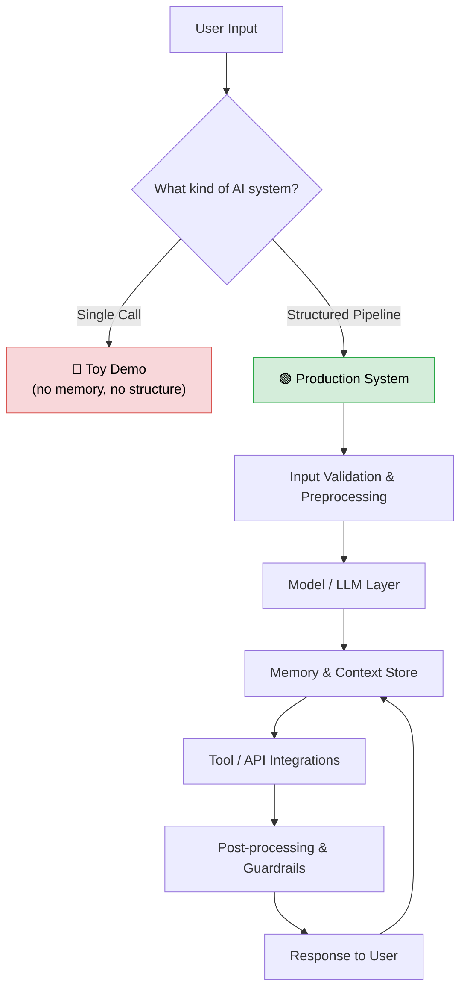

Notice the feedback loop: production AI systems **remember**, **use tools**, and **validate** — they don't just answer once and forget.

**Analogy:** a toy demo is like a brilliant consultant you can only talk to once, who has never met you, takes no notes, and cannot look anything up. A production AI system is a team member: onboarding context (memory), access to tools (APIs, databases), a manager reviewing output (guardrails), and a filing cabinet (retrieval).

Throughout this tutorial, you will see how each library plugs into one or more parts of this pipeline.

> 📌 **Quick Recap:** Production AI = Validation → Model/LLM → Memory → Tools → Guardrails → Response, in a loop. The next eight sections map libraries onto this pipeline.

---

## 5. TensorFlow.js — Real Machine Learning Without Leaving JavaScript {#5-tensorflowjs}

### What it is

[TensorFlow.js](https://www.tensorflow.org/js) is Google's JavaScript port of TensorFlow. It lets you **train, load, and run machine learning models directly in Node.js or the browser** — no Python runtime required.

This challenges the assumption that "real ML" only happens in Python. With TensorFlow.js, the entire training loop (forward pass, backpropagation, gradient descent) runs in JavaScript, using WebGL or Node's native bindings for acceleration.

### How it works — step by step

1. **Define a model architecture** using layers (dense, convolutional, recurrent, etc.)
2. **Compile the model** with a loss function and optimizer
3. **Feed it tensors** (TensorFlow's data structure for arrays/matrices)
4. **Train** using `.fit()`, which runs the epochs
5. **Predict** using `.predict()`

### Example 1: Basic Linear Regression

```javascript
import * as tf from '@tensorflow/tfjs';

// Step 1: Define the model — a single dense layer
const model = tf.sequential();
model.add(tf.layers.dense({
  units: 1,        // one output neuron
  inputShape: [1],  // one input feature
}));

// Step 2: Compile with loss + optimizer
model.compile({
  loss: 'meanSquaredError', // measures prediction error
  optimizer: 'sgd',          // stochastic gradient descent
});

// Step 3: Prepare training data (y = 2x - 1)
const xs = tf.tensor([1, 2, 3, 4]);
const ys = tf.tensor([1, 3, 5, 7]);

// Step 4: Train
await model.fit(xs, ys, { epochs: 100 });

// Step 5: Predict
model.predict(tf.tensor([5])).print(); // ~9
```

**Explanation:** the model learns the function `y = 2x - 1` from four examples. `meanSquaredError` penalizes the square of the gap between predictions and truth; `sgd` nudges the layer's weight after each batch. After 100 epochs the prediction for input `5` converges to roughly `9`.

### Example 2: Loading a Pre-Trained Model for Image Classification

Instead of training from scratch, you can load an existing model (like MobileNet) and run inference in the browser:

```javascript
import * as tf from '@tensorflow/tfjs';
import * as mobilenet from '@tensorflow-models/mobilenet';

async function classifyImage(imgElement) {
  const model = await mobilenet.load();
  const predictions = await model.classify(imgElement);
  console.log(predictions);
  // [{ className: 'golden retriever', probability: 0.94 }, ...]
}
```

### Example 3: Anomaly Detection for Server Metrics (with error handling)

```javascript
import * as tf from '@tensorflow/tfjs-node';

// Assume `metrics` is an array of normalized CPU/memory readings
async function detectAnomaly(model, metrics) {
  try {
    // Guardrail: validate input before it reaches the model
    if (!Array.isArray(metrics) || metrics.some(v => !Number.isFinite(v))) {
      throw new TypeError('metrics must be an array of finite numbers');
    }

    const input = tf.tensor2d([metrics]);
    const reconstruction = model.predict(input);

    // How far is the reconstruction from the original? Big error = anomaly
    const error = tf.losses.meanSquaredError(input, reconstruction);
    const errorValue = (await error.data())[0];

    // Always dispose tensors — tfjs-node keeps a memory graph otherwise
    tf.dispose([input, reconstruction, error]);

    return errorValue > 0.05; // threshold tuned per system
  } catch (err) {
    console.error('Anomaly detection failed:', err.message);
    return false; // fail safe: never crash the metrics pipeline
  }
}
```

### Diagram: TensorFlow.js Training Flow

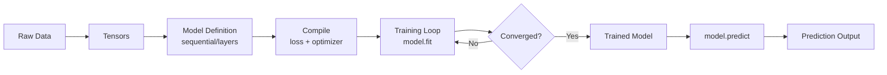

### Real-World Use Cases

- **Anomaly detection**: flagging unusual server metrics, fraud patterns, or sensor readings in real time
- **Lightweight prediction services**: recommending prices, churn scores, or ratings without a heavy Python backend
- **Browser-based ML**: pose detection, face tracking, or gesture recognition running entirely client-side (great for privacy — data never leaves the device)

### When to reach for it — and when not to

| ✅ Use TensorFlow.js when... | ❌ Avoid it when... |
|---|---|
| You need actual model **training or inference logic** in JS | You just need to call an LLM API (use OpenAI SDK / LangChain) |
| Latency, privacy, or offline capability matter more than raw model power | Your dataset is tiny and the problem is trivial (Brain.js is simpler) |
| You need browser-side ML with no server round-trip | You need a frontier-scale model (call a hosted API instead) |
| You are deploying models trained by a Python/TF team | You only need to *deploy* a Python-trained model (ONNX is easier) |

> 💡 **Pro Tip:** In Node.js, prefer `@tensorflow/tfjs-node` (native bindings) over the pure-JS backend — it is significantly faster. In the browser, call `tf.setBackend('webgl')` early and wrap training in `tf.tidy()` to auto-dispose intermediate tensors and prevent GPU memory leaks.

> ⚠️ **Common Pitfall:** Forgetting to dispose tensors is the #1 TensorFlow.js memory leak in long-running Node processes. Every `tf.tensor(...)` you create holds memory until disposed.

> 📌 **Quick Recap:** TensorFlow.js = full ML lifecycle in JS: define → compile → fit → predict. Best for custom models, privacy, and offline inference.

---

## 6. LangChain.js — Building AI Workflows, Not One-Off Prompts {#6-langchainjs}

### What it is

[LangChain.js](https://js.langchain.com/) is a framework for **composing** LLM calls into structured workflows — often called "chains." Instead of sending one prompt and getting one response, you build pipelines that combine prompts, memory, tools, and multiple models.

### The core problem it solves

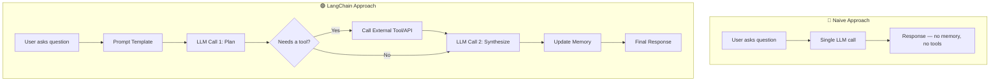

### Step-by-step explanation

1. **Prompt templates** standardize how you construct prompts (with variables)
2. **Chains** link multiple calls together — output of one step feeds the next
3. **Memory** stores conversation history so the model has context across turns
4. **Agents & tools** let the LLM decide to call a calculator, search engine, or database mid-conversation

### Example 1: Basic Chat Call

```javascript
import { ChatOpenAI } from "@langchain/openai";
import { HumanMessage } from "@langchain/core/messages";

const model = new ChatOpenAI({ model: "gpt-4o-mini" });

const response = await model.invoke([
  new HumanMessage("Explain JavaScript closures like I'm 5"),
]);

console.log(response.content);
```

### Example 2: Adding Memory Across Turns (with migration note)

> ⚠️ **Version note (migration guide):** `ConversationChain` and `BufferMemory` from the older `langchain/memory` package are **deprecated** in LangChain.js 0.3+. The supported approach is `RunnableWithMessageHistory` from `@langchain/core/runnables` (or LangGraph for complex agents). Both versions are shown below so you can recognize legacy code.

**Legacy (works, deprecated — seen in many older tutorials):**

```javascript
import { ChatOpenAI } from "@langchain/openai";
import { ConversationChain } from "langchain/chains";
import { BufferMemory } from "langchain/memory";

const model = new ChatOpenAI({ model: "gpt-4o-mini" });
const memory = new BufferMemory();

const chain = new ConversationChain({ llm: model, memory });

await chain.call({ input: "My name is Sachin." });
const res = await chain.call({ input: "What's my name?" });
console.log(res.response); // "Your name is Sachin."
```

**Modern (recommended):**

```javascript
import { ChatOpenAI } from "@langchain/openai";
import { ChatPromptTemplate, MessagesPlaceholder } from "@langchain/core/prompts";
import { RunnableWithMessageHistory } from "@langchain/core/runnables";
import { ChatMessageHistory } from "@langchain/stores/message/in_memory";

const model = new ChatOpenAI({ model: "gpt-4o-mini" });

const prompt = ChatPromptTemplate.fromMessages([
  ["system", "You are a helpful assistant."],
  new MessagesPlaceholder("history"),
  ["human", "{input}"],
]);

const chain = prompt.pipe(model);

const store = new Map(); // sessionId -> message history

const withHistory = new RunnableWithMessageHistory({
  runnable: chain,
  getMessageHistory: (sessionId) => {
    if (!store.has(sessionId)) store.set(sessionId, new ChatMessageHistory());
    return store.get(sessionId);
  },
  inputMessagesKey: "input",
  historyMessagesKey: "history",
});

const config = { configurable: { sessionId: "user-42" } };
await withHistory.invoke({ input: "My name is Sachin." }, config);
const res = await withHistory.invoke({ input: "What's my name?" }, config);
console.log(res.content); // "Your name is Sachin."
```

### Example 3: A Prompt-Chaining Pipeline

```javascript
import { ChatOpenAI } from "@langchain/openai";
import { PromptTemplate } from "@langchain/core/prompts";

const model = new ChatOpenAI({ model: "gpt-4o-mini" });

const outlinePrompt = PromptTemplate.fromTemplate(
  "Create a 3-point outline for a blog post about {topic}"
);
const draftPrompt = PromptTemplate.fromTemplate(
  "Write a short paragraph for each point in this outline:\n{outline}"
);

const outline = await model.invoke(await outlinePrompt.format({ topic: "Node.js performance" }));
const draft = await model.invoke(await draftPrompt.format({ outline: outline.content }));

console.log(draft.content);
```

**Explanation:** the output of the first LLM call (`outline.content`) becomes an input variable of the second prompt. This is the essence of chaining: **structured data flow between model calls**, instead of one giant prompt doing everything.

### Real-World Use Cases

- **Customer support agents** that remember earlier parts of a conversation
- **Multi-step content pipelines** (outline → draft → edit → summarize)
- **Tool-using agents** that can query a database, hit an API, or run a calculation mid-answer
- **Workflow automation** — e.g., "read this email, decide urgency, draft a reply"

### Why this matters

A single prompt can't hold state, call external systems, or recover from partial failures. LangChain gives you the scaffolding to treat LLM calls as **steps in a pipeline**, not isolated events — which is exactly what senior engineers mean when they say "treat AI like a system."

> 💡 **Pro Tip:** Name your chains with `.withConfig({ runName: 'draft-writer' })` and enable LangSmith tracing in development. When a multi-step workflow produces a bad answer, you can inspect each intermediate step instead of guessing which link broke.

> 📌 **Quick Recap:** LangChain = templates + chains + memory + tools. Use it when your AI feature needs more than one prompt, or needs state across turns.

---

## 7. Transformers.js — Running AI Models Locally {#7-transformersjs}

### What it is

[Transformers.js](https://huggingface.co/docs/transformers.js) (by Hugging Face) lets you run pre-trained transformer models — for sentiment analysis, translation, summarization, embeddings, and more — **directly in the browser or Node**, with no server-side inference call needed.

> ⚠️ **Version note:** The original package was `@xenova/transformers` (v2). The current package is **`@huggingface/transformers` (v3)** — the `pipeline()` API is the same, with added WebGPU support and better quantization. Use the new package for new projects.

### Why this "feels unfair"

Normally, running a transformer model means standing up a Python backend with GPU access. Transformers.js compiles models to run via ONNX in WebAssembly or WebGL, so the model executes **on the user's own device**.

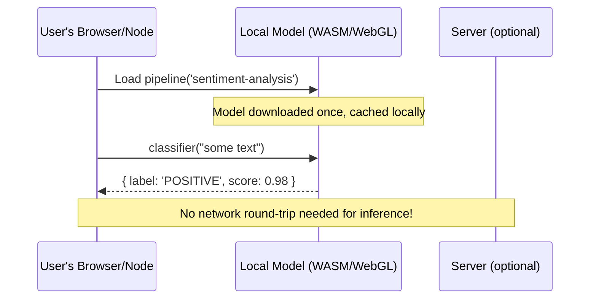

### Example 1: Sentiment Analysis

```javascript
import { pipeline } from '@huggingface/transformers';

const classifier = await pipeline('sentiment-analysis');
const result = await classifier("This library is ridiculously good");
console.log(result);
// [{ label: 'POSITIVE', score: 0.9998 }]
```

### Example 2: Text Summarization

```javascript
import { pipeline } from '@huggingface/transformers';

const summarizer = await pipeline('summarization');
const article = "Long article text goes here...";
const summary = await summarizer(article, { max_length: 60 });
console.log(summary[0].summary_text);
```

### Example 3: Generating Embeddings for Semantic Search

```javascript
import { pipeline } from '@huggingface/transformers';

const embedder = await pipeline('feature-extraction', 'Xenova/all-MiniLM-L6-v2');

const embedding = await embedder("How do I reset my password?", {
  pooling: 'mean',
  normalize: true,
});
// Use this vector for cosine-similarity search against a document store
```

### Real-World Use Cases

- **Offline AI tools** — apps that work without internet (e.g., note-taking apps with local summarization)
- **Privacy-first apps** — sensitive text (medical notes, journal entries) never leaves the user's device
- **Edge deployments** — running inference on IoT devices or low-connectivity environments
- **Cost reduction** — no per-request API billing since inference is local

### Trade-offs to know

Local models are typically smaller and less powerful than hosted frontier models like GPT-4o. Use Transformers.js when **privacy, cost, or offline access** matter more than raw model quality.

> 💡 **Pro Tip:** The first pipeline call downloads the model (often 20–100 MB) — always warm it up at app startup and show a loading state. Models are cached in the browser's Cache Storage or Node's file cache, so subsequent runs are instant.

> 📌 **Quick Recap:** Transformers.js = frontier-style models running fully client-side via WASM/WebGL. Trade model quality for privacy, cost, and offline capability.

---

## 8. OpenAI Node SDK — Shipping Production AI in Minutes {#8-openai-sdk}

### What it is

The [OpenAI Node SDK](https://github.com/openai/openai-node) is the official client for calling OpenAI's models (GPT-4o, GPT-4o-mini, o-series reasoning models, etc.) from JavaScript/TypeScript. It's the fastest path from "idea" to "working AI feature."

### Example 1: Basic Chat Completion

```javascript
import OpenAI from "openai";

const openai = new OpenAI(); // reads OPENAI_API_KEY from environment

const response = await openai.chat.completions.create({
  model: "gpt-4o-mini",
  messages: [
    { role: "user", content: "Explain the event loop simply" }
  ],
});

console.log(response.choices[0].message.content);
```

### Example 2: Streaming Responses (for a real chat UI)

```javascript
import OpenAI from "openai";
const openai = new OpenAI();

const stream = await openai.chat.completions.create({
  model: "gpt-4o-mini",
  messages: [{ role: "user", content: "Write a haiku about debugging" }],
  stream: true,
});

for await (const chunk of stream) {
  process.stdout.write(chunk.choices[0]?.delta?.content || "");
}
```

**Explanation:** streaming returns an async iterator of chunks. Optional chaining (`?.delta?.content`) guards against final chunks that carry only finish metadata. In a web server, forward each chunk over Server-Sent Events so users see text appear token-by-token instead of waiting seconds for the full response.

### Example 3: Function/Tool Calling for Structured Actions (with defensive parsing)

```javascript
const response = await openai.chat.completions.create({
  model: "gpt-4o-mini",
  messages: [{ role: "user", content: "Book a meeting with Alex for 3pm tomorrow" }],
  tools: [{
    type: "function",
    function: {
      name: "create_calendar_event",
      description: "Creates a calendar event",
      parameters: {
        type: "object",
        properties: {
          title: { type: "string" },
          time: { type: "string" },
        },
        required: ["title", "time"],
      },
    },
  }],
});

const toolCall = response.choices[0].message.tool_calls?.[0];
if (toolCall) {
  try {
    const args = JSON.parse(toolCall.function.arguments);
    // ✅ Validate before executing — never trust model output blindly
    if (!args.title || !args.time) throw new Error('missing required fields');
    console.log("Would create event:", args);
  } catch (err) {
    console.error("Invalid tool arguments:", err.message);
  }
}
```

### Diagram: A Production-Ready OpenAI Request Flow

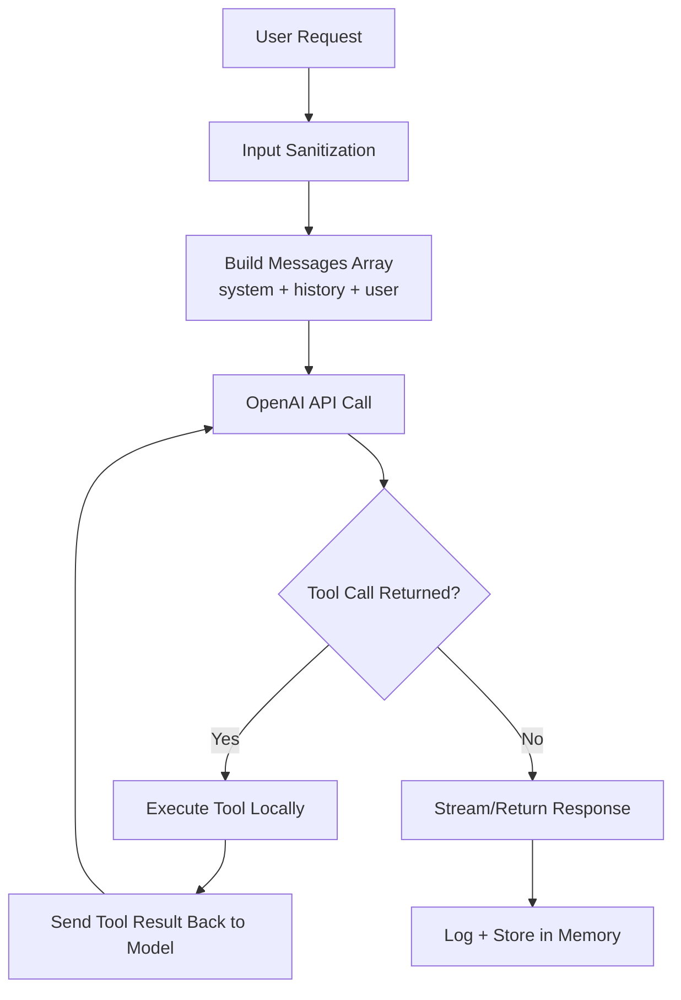

### Real-World Use Cases

- **Chatbots and support assistants** with tool-calling for real actions (booking, lookups)
- **Summarization services** — condensing meeting notes, articles, or support tickets
- **Internal dev tools** — SQL generation from natural language, code review assistants
- **Structured data extraction** — pulling fields from unstructured text into JSON

> 💡 **Best practice tip:** Always set a `system` message to constrain behavior, and validate/parse tool-call arguments defensively — never trust the model's JSON blindly in production. Use `max_tokens`, `temperature`, and `timeout`/retry options (the SDK retries transient 429/5xx errors automatically with exponential backoff) to bound cost and latency.

> 📌 **Quick Recap:** OpenAI SDK = fastest path to a working AI feature. Production flow: sanitize → messages → call → (tool loop) → stream → log.

---

## 9. Brain.js — Lightweight Neural Networks {#9-brainjs}

### What it is

[Brain.js](https://brain.js.org/) is a minimal neural network library for JavaScript. It's not for training GPT-scale models — it's for **small, fast, interpretable neural nets** that solve narrow problems.

### Example 1: Basic Neural Net

```javascript
import brain from 'brain.js';

const net = new brain.NeuralNetwork();

net.train([
  { input: [0], output: [0] },
  { input: [1], output: [1] },
]);

const output = net.run([1]);
console.log(output); // close to [1]
```

### Example 2: XOR Problem (a classic neural net demonstration)

```javascript
import brain from 'brain.js';

const net = new brain.NeuralNetwork();

// XOR is NOT linearly separable — a single linear rule cannot solve it,
// which proves the network is learning a real (non-linear) mapping.
net.train([
  { input: [0, 0], output: [0] },
  { input: [0, 1], output: [1] },
  { input: [1, 0], output: [1] },
  { input: [1, 1], output: [0] },
]);

console.log(net.run([1, 0])); // ~[0.98]
console.log(net.run([1, 1])); // ~[0.02]
```

### Example 3: Simple Recommendation Scoring

```javascript
import brain from 'brain.js';

const net = new brain.NeuralNetwork();

// input: [priceScore, ratingScore, recencyScore] -> output: [likelihoodToBuy]
// Note: inputs/outputs must be in the 0..1 range — normalize your features first!
net.train([
  { input: [0.9, 0.8, 0.7], output: [0.9] },
  { input: [0.2, 0.3, 0.1], output: [0.1] },
  { input: [0.6, 0.9, 0.5], output: [0.7] },
]);

const likelihood = net.run([0.7, 0.6, 0.6]);
console.log("Purchase likelihood:", likelihood);
```

### Diagram: Where Brain.js Fits vs TensorFlow.js

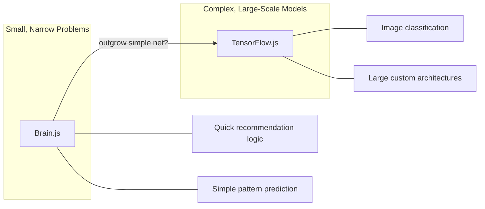

### Real-World Use Cases

- **Small predictions** — estimating a value from a handful of numeric features
- **Recommendation logic** — lightweight scoring without a full ML pipeline
- **Quick experiments/prototypes** — validating an idea before investing in TensorFlow.js

### When to use it over TensorFlow.js

Choose Brain.js when your problem is small, your dataset is tiny, and you want minimal setup — it's the "quick sketch" tool, not the production canvas.

> 💡 **Pro Tip:** Brain.js supports GPU acceleration in the browser (`new brain.NeuralNetwork({ gpu: true })`) and lets you save/load trained networks as JSON (`net.toJSON()` / `net.fromJSON()`) — train once at build time, ship the weights with your app.

> ⚠️ **Common Pitfall:** Brain.js requires inputs and outputs between 0 and 1. Feeding raw values like prices (e.g., `499`) silently produces garbage — always min-max normalize your features first.

> 📌 **Quick Recap:** Brain.js = tiny, fast neural nets for narrow numeric problems. Prototype with it; graduate to TensorFlow.js when complexity grows.

---

## 10. ONNX Runtime — Train Anywhere, Run in Node {#10-onnx-runtime}

### What it is

[ONNX Runtime](https://onnxruntime.ai/) lets you run models trained in **any framework** (PyTorch, scikit-learn, TensorFlow) inside JavaScript, by converting them to the ONNX (Open Neural Network Exchange) format — a shared model representation.

### Why this is a "senior-level move"

Most teams already have data scientists training models in Python. ONNX means you don't have to reinvent that work in JavaScript — you just **deploy** the already-trained model.

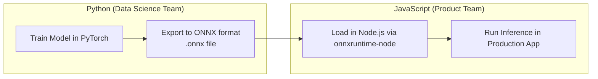

### Example 1: Loading and Running an ONNX Model

```javascript
import * as ort from 'onnxruntime-node';

async function runModel() {
  const session = await ort.InferenceSession.create('./model.onnx');

  const inputTensor = new ort.Tensor('float32', [1, 2, 3, 4], [1, 4]);
  const feeds = { input: inputTensor };

  const results = await session.run(feeds);
  console.log(results.output.data);
}

runModel();
```

> 💡 **Note:** the feeds key (`input`) and output key (`output`) must match the names **inside the .onnx file**, which vary per model. Inspect them with `session.inputNames` / `session.outputNames` and build your feeds dynamically instead of hard-coding.

### Example 2: Converting a scikit-learn Model (Python side, for context)

```python
# train_and_export.py — run once in Python
from skl2onnx import convert_sklearn
from skl2onnx.common.data_types import FloatTensorType
import joblib

model = joblib.load("churn_model.pkl")
onnx_model = convert_sklearn(model, initial_types=[('input', FloatTensorType([None, 5]))])

with open("churn_model.onnx", "wb") as f:
    f.write(onnx_model.SerializeToString())
```

### Example 3: Serving Predictions via an Express Endpoint (corrected + hardened)

> 🐛 **Correction:** the original version of this example contained a double-assignment typo (`s => session = session = s`). The corrected, production-hardened version below also validates feature count and handles the not-yet-loaded session.

```javascript
import express from 'express';
import * as ort from 'onnxruntime-node';

const app = express();
app.use(express.json());

let session = null;

// Load the model before accepting traffic
ort.InferenceSession.create('./churn_model.onnx')
  .then(s => { session = s; console.log('Model loaded'); })
  .catch(err => { console.error('Model failed to load:', err); process.exit(1); });

const EXPECTED_FEATURES = 5;

app.post('/predict', async (req, res) => {
  if (!session) return res.status(503).json({ error: 'Model still loading' });

  const { features } = req.body; // e.g. [0.5, 0.2, 0.9, 0.1, 0.3]

  // Guardrail: validate shape and types before inference
  if (!Array.isArray(features) || features.length !== EXPECTED_FEATURES
      || features.some(v => !Number.isFinite(v))) {
    return res.status(400).json({ error: `features must be ${EXPECTED_FEATURES} finite numbers` });
  }

  try {
    const tensor = new ort.Tensor('float32', Float32Array.from(features), [1, features.length]);
    const output = await session.run({ input: tensor });
    res.json({ churnRisk: output.output.data[0] });
  } catch (err) {
    console.error('Inference failed:', err);
    res.status(500).json({ error: 'Inference error' });
  }
});

app.listen(3000);
```

### Real-World Use Cases

- **Reusing existing ML models** trained by a data science team without retraining in JS
- **No duplicate training pipelines** — one source of truth for the model
- **Production-ready performance** — ONNX Runtime is optimized (often faster than framework-native runtimes)

### Key takeaway

ONNX is the **bridge**, not a training tool. Think of it as the "compiled binary" for machine learning — train once, run anywhere.

> 💡 **Pro Tip:** Serve model files from a versioned path (e.g., `/models/churn/v3.onnx`) and keep the version in your API response. When accuracy regresses, you can roll back by pointing to the previous version — no redeploy needed.

> 📌 **Quick Recap:** ONNX Runtime = deploy Python-trained models in Node with zero retraining. Validate input shape, load the model before serving, version your model files.

---

## 11. Node-NLP — Plug-and-Play Natural Language Processing {#11-node-nlp}

### What it is

[Node-NLP](https://github.com/axa-group/nlp.js) is a toolkit for natural language processing tasks — intent classification, entity extraction, sentiment, and simple chatbot logic — **without needing an external LLM API call** for basic tasks.

### Example 1: Simple Intent-Based Bot

```javascript
const { NlpManager } = require('node-nlp');

const manager = new NlpManager({ languages: ['en'] });

manager.addDocument('en', 'hello', 'greet');
manager.addDocument('en', 'hi there', 'greet');
manager.addAnswer('en', 'greet', 'Hey there!');

await manager.train();

const response = await manager.process('en', 'hello');
console.log(response.answer); // "Hey there!"
```

### Example 2: Entity Extraction

```javascript
const { NlpManager } = require('node-nlp');
const manager = new NlpManager({ languages: ['en'] });

manager.addNamedEntityText('food', 'pizza', ['en'], ['pizza', 'pizzas']);
manager.addNamedEntityText('food', 'burger', ['en'], ['burger', 'burgers']);

manager.addDocument('en', 'I want to order %food%', 'order.food');
manager.addAnswer('en', 'order.food', 'Great choice!');

await manager.train();

const result = await manager.process('en', 'I want to order pizza');
console.log(result.entities); // [{ entity: 'food', option: 'pizza', ... }]
```

### Example 3: Multi-Intent Classification for Support Routing (with fallback)

```javascript
const { NlpManager } = require('node-nlp');
const manager = new NlpManager({ languages: ['en'], threshold: 0.6 });

manager.addDocument('en', 'I want a refund', 'billing.refund');
manager.addDocument('en', 'my payment failed', 'billing.paymentIssue');
manager.addDocument('en', 'the app keeps crashing', 'support.bug');

await manager.train();

const result = await manager.process('en', 'the app is crashing on startup');

// ✅ Always check confidence before acting on a prediction
if (result.score < 0.6) {
  console.log('Low confidence — ask the user to clarify or fall back to an LLM');
} else {
  console.log(result.intent); // "support.bug"
  console.log(result.score);  // confidence score
}
```

### Diagram: Node-NLP Intent Classification Flow

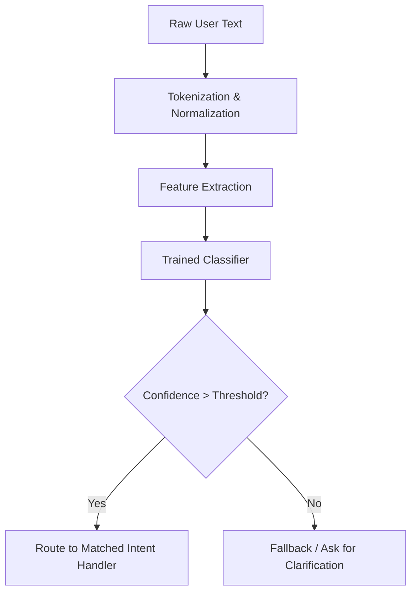

### Real-World Use Cases

- **Rule-based chatbots** that don't need the cost/latency of an LLM call for simple routing
- **Intent classification** for support ticket triage
- **Basic assistants** — FAQ bots, IVR-style text routing

### Why use it instead of an LLM?

For narrow, well-defined domains, Node-NLP is **faster, cheaper, and fully offline** compared to calling GPT-4o for every message. Reserve LLMs for open-ended understanding; use Node-NLP for deterministic routing.

> 💡 **Pro Tip:** Persist the trained model with `manager.save()` and reload with `manager.load()` at startup — training on boot wastes time, and you can retrain offline as part of your CI pipeline when new utterances are added.

> 📌 **Quick Recap:** Node-NLP = deterministic, offline intent + entity routing. Perfect for FAQ bots and triage; escalate ambiguous inputs to an LLM.

---

## 12. LlamaIndex.js — Build "ChatGPT for Your Data" {#12-llamaindexjs}

### What it is

[LlamaIndex.js](https://ts.llamaindex.ai/) specializes in **Retrieval-Augmented Generation (RAG)** — connecting LLMs to your own private data (docs, PDFs, databases) so answers are grounded in your content instead of the model's general training data.

### How RAG works — step by step

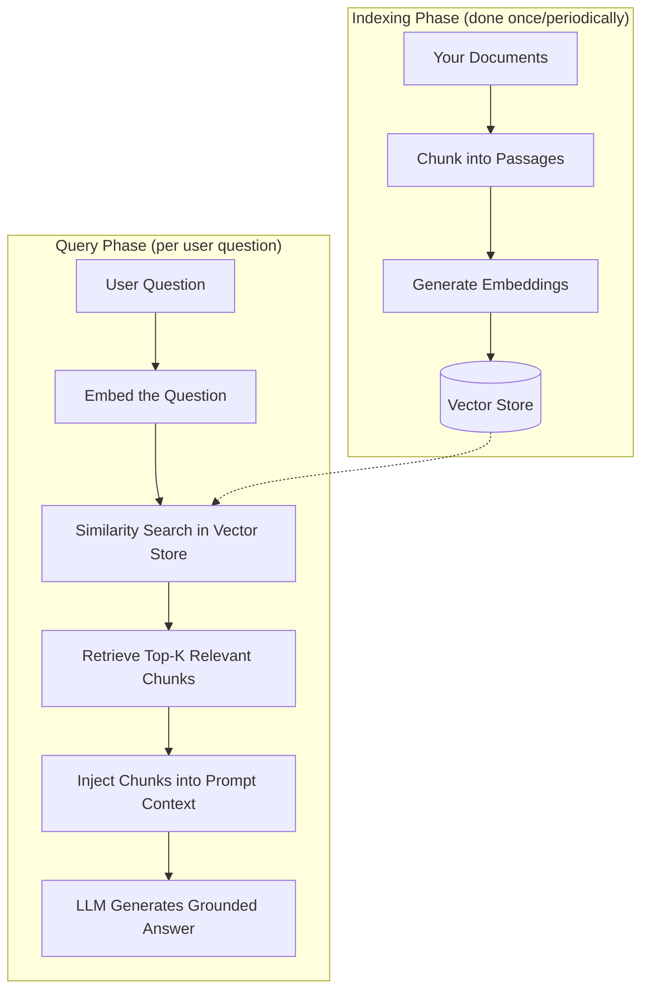

**Analogy:** RAG is an **open-book exam** instead of a closed-book one. The LLM doesn't memorize your data (fine-tuning); it gets to look up the relevant page right before answering.

### Example 1: Basic Document Q&A

```javascript
import { Document, VectorStoreIndex } from "llamaindex";

const document = new Document({
  text: "Our refund policy allows returns within 30 days of purchase...",
});

const index = await VectorStoreIndex.fromDocuments([document]);
const queryEngine = index.asQueryEngine();

const response = await queryEngine.query({ query: "How long do I have to return an item?" });

console.log(response.toString());
```

### Example 2: Indexing Multiple Files (Internal Knowledge Base)

```javascript
import { SimpleDirectoryReader, VectorStoreIndex } from "llamaindex";

const documents = await new SimpleDirectoryReader().loadData({
  directoryPath: "./company-docs",
});

const index = await VectorStoreIndex.fromDocuments(documents);
const queryEngine = index.asQueryEngine();

const response = await queryEngine.query({
  query: "What's our policy on remote work stipends?",
});

console.log(response.toString());
```

### Example 3: Chat Engine with Memory (Conversational RAG)

```javascript
import { VectorStoreIndex, SimpleDirectoryReader } from "llamaindex";

const documents = await new SimpleDirectoryReader().loadData({ directoryPath: "./docs" });
const index = await VectorStoreIndex.fromDocuments(documents);

const chatEngine = index.asChatEngine();

let response = await chatEngine.chat({ message: "What products do we sell?" });
console.log(response.toString());

response = await chatEngine.chat({ message: "Which of those is cheapest?" });
console.log(response.toString()); // remembers previous answer's context
```

### Real-World Use Cases

- **Internal company knowledge bots** — HR policies, engineering docs, onboarding guides
- **Document search** — semantic search across contracts, research papers, or manuals
- **AI copilots** — customer support tools that answer from your product docs, not generic knowledge
- **Compliance & legal review assistants** grounded strictly in your policy documents

### Why RAG matters

LLMs don't know about your private data by default, and fine-tuning is expensive and slow to update. RAG lets you **keep the data separate and swappable** — update the documents, and the bot's answers update instantly without retraining anything.

> 💡 **Pro Tip:** Chunk size is the most impactful RAG tuning knob. Too large (2,000+ tokens) and retrieval loses precision; too small (under 100 tokens) and chunks lose context. Start at ~512 tokens with 10–20% overlap, then evaluate with real questions from your users.

> ⚠️ **Common Pitfall:** RAG reduces hallucination but doesn't eliminate it. Always log the retrieved source chunks alongside the answer so you can audit whether the model actually used your documents — and consider citing sources in the UI.

> 📌 **Quick Recap:** LlamaIndex = open-book LLM. Index (chunk → embed → store), then query (embed question → retrieve → generate grounded answer).

---

## 13. Choosing the Right Tool: A Decision Framework {#13-decision-framework}

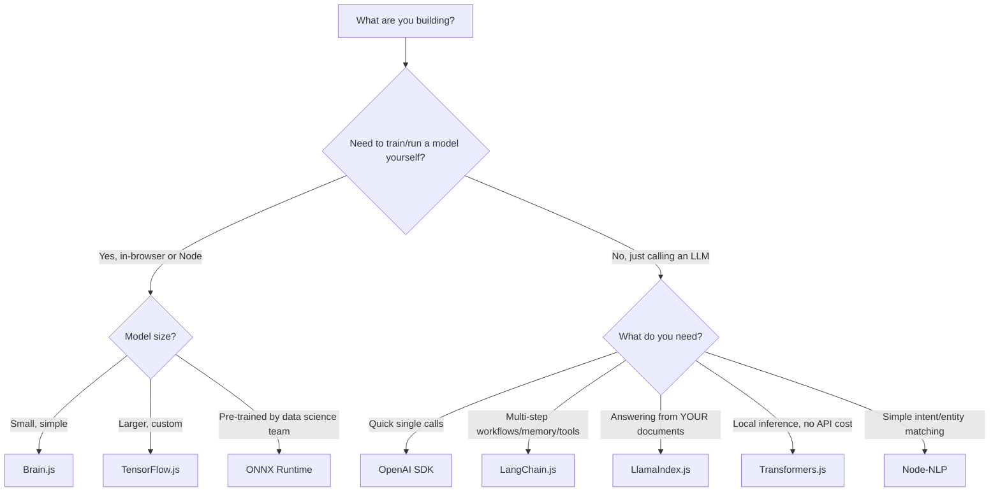

### Quick Reference Table

| Library | Best For | Runs Where | Needs API Key? |
|---|---|---|---|
| TensorFlow.js | Custom model training/inference | Browser/Node | No |
| LangChain.js | Multi-step LLM workflows | Node/Browser (calls API) | Yes (for LLM) |
| Transformers.js | Local model inference | Browser/Node | No |
| OpenAI SDK | Fast LLM integration | Node/Browser (calls API) | Yes |
| Brain.js | Small neural nets | Browser/Node | No |
| ONNX Runtime | Deploying pre-trained models | Node | No |
| Node-NLP | Rule-based NLP/chatbots | Node | No |
| LlamaIndex.js | RAG over your own data | Node (calls API) | Yes (for LLM) |

### Multiple implementation approaches: the same feature, three ways

**Requirement: classify a support message.**

1. **Cheapest/deterministic:** Node-NLP intent matching (offline, microseconds, but only as good as your utterance list)
2. **Balanced:** Transformers.js local model (better generalization, ~10–100ms per message, no API cost)
3. **Most capable:** OpenAI SDK with a system prompt and JSON output (handles anything, costs per call, needs guardrails)

Pick based on volume, domain stability, and accuracy requirements — this is exactly the trade-off discussion a senior engineer documents before writing code.

---

## 14. How to Actually Combine These Libraries {#14-combining-libraries}

**Don't try all eight at once.** A realistic production stack often layers a few of these together.

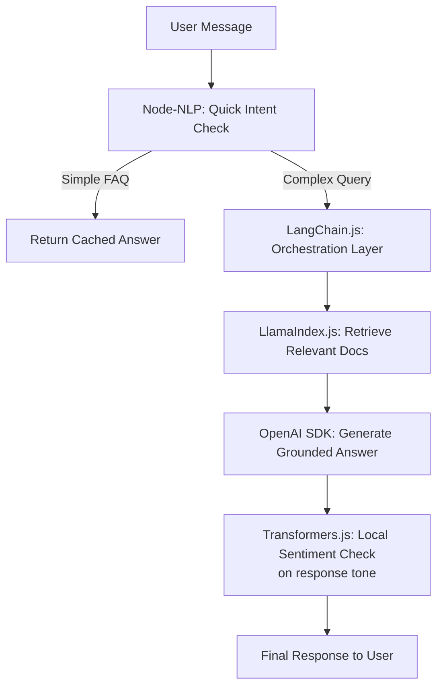

### How each layer earns its place

- **Node-NLP** short-circuits the ~40% of messages that are simple FAQs — no API cost, ~0 latency
- **LangChain.js** orchestrates the multi-step path and owns conversation memory
- **LlamaIndex.js** grounds complex answers in your actual documents
- **OpenAI SDK** is the final generator (frontier quality when it matters)
- **Transformers.js** runs a local tone/sentiment check before the response ships — catching accidentally rude drafts before users see them

### A recommended learning path

1. **Start with the OpenAI SDK** — get comfortable with prompts, roles, and streaming.
2. **Layer in LangChain.js** — once you need memory or multi-step reasoning.
3. **Add LlamaIndex.js** — when your answers need to be grounded in your own data (docs, tickets, wikis).
4. **Bring in the rest** (TensorFlow.js, Transformers.js, Brain.js, ONNX, Node-NLP) **only when a specific need arises** — offline mode, cost reduction, or custom model deployment.

---

## 15. Performance Considerations {#15-performance-considerations}

| Concern | Guidance |
|---|---|
| **Model warm-up** | Load models (ONNX sessions, Transformers.js pipelines, TF.js graphs) once at startup — never per request |
| **Tensor lifecycle** | In TensorFlow.js, wrap computation in `tf.tidy()` or call `tf.dispose()` — leaking tensors is the #1 Node memory issue |
| **Batching** | For local inference, batch multiple inputs into one tensor when possible; for LLM APIs, use batch endpoints for offline workloads |
| **Streaming** | Stream LLM responses (SSE) — perceived latency drops from seconds to ~200ms even when total time is unchanged |
| **Caching** | Cache LLM answers for repeated/similar prompts (exact-match + semantic cache); cache Node-NLP answers aggressively — they are deterministic |
| **Model size vs speed** | Use quantized models (Transformers.js `dtype: 'q8'`, ONNX quantization) — often 3–4x smaller with minimal accuracy loss |
| **Right-size the model** | Route: cheap model first (Node-NLP/local), escalate to frontier LLM only on low confidence — cuts cost 60–90% in typical support workloads |
| **Concurrency** | Local inference is CPU/GPU bound — limit with a worker pool (e.g., `piscina`) to avoid blocking the event loop |
| **Timeouts + retries** | Always set request timeouts on LLM calls; the OpenAI SDK retries transient errors automatically, but bound total wait time |

> 💡 **Benchmark tip:** Measure end-to-end latency percentiles (p50/p95/p99), not averages. A "400ms average" LLM call with a 4s p99 will break your SLA during traffic spikes.

## 16. Security Considerations {#16-security-considerations}

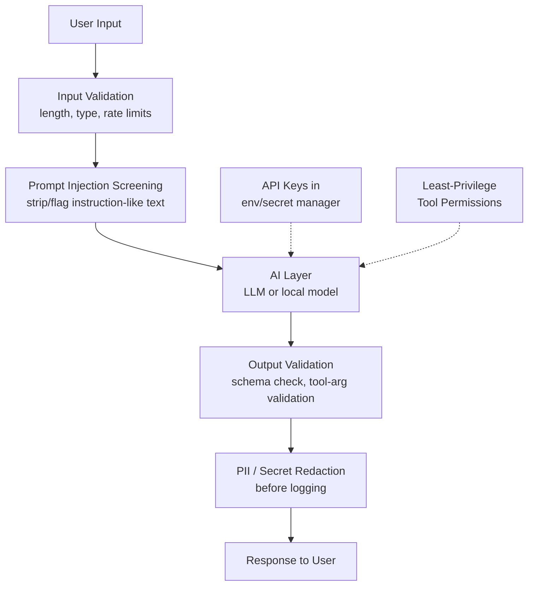

- 🔐 **API keys:** never in client-side code. Browser apps must call your backend, which proxies to the LLM provider. Use a secret manager; rotate keys.
- 🛡️ **Prompt injection:** treat all user text as untrusted input, not instructions. Constrain the system prompt, prefer structured outputs (JSON schema / tool calling) over free-text parsing, and validate every tool call against an allow-list before executing.
- 🚫 **Excessive agency:** give tools least-privilege permissions. An LLM with a "run SQL" tool should connect as a read-only DB user — model output is never a trusted authorization signal.
- 🕵️ **Data privacy:** with Transformers.js/Node-NLP, sensitive data never leaves the device — a genuine architectural security advantage over hosted APIs. Check provider data-retention terms for hosted calls.
- 🧯 **PII redaction:** scrub emails, card numbers, and tokens before logging prompts/responses.
- 💸 **Cost attacks:** set per-user and per-IP rate limits and token budgets — otherwise every user input is a request for someone else's GPU time on your bill.
- ✅ **Output safety:** validate model-generated JSON with a schema (e.g., Zod) before using it in business logic or rendering it as HTML (XSS via model output is real).
## 17. Testing Strategies {#17-testing-strategies}

AI code needs **two kinds of tests**: the deterministic tests you already know, plus *evaluation* tests for non-deterministic outputs.

### The AI testing pyramid

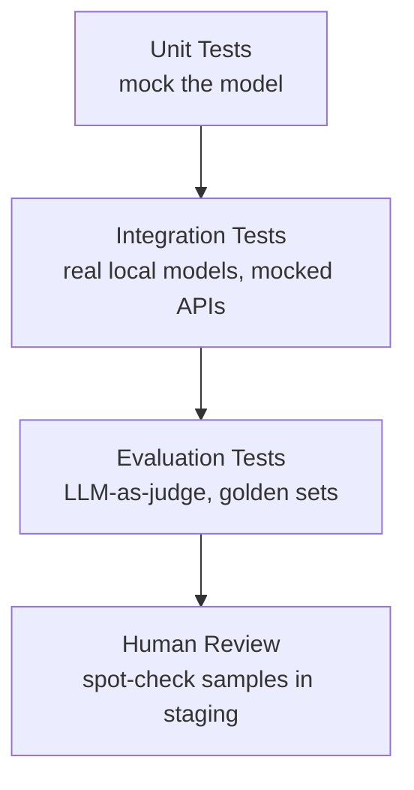

```javascript
// Deterministic: Node-NLP routing is testable with plain assertions
import assert from 'node:assert';

async function testIntentRouting(manager) {
  const result = await manager.process('en', 'I want my money back');
  assert.strictEqual(result.intent, 'billing.refund');
  assert.ok(result.score > 0.6, `confidence too low: ${result.score}`);
}

// Non-deterministic: LLM outputs need an evaluation harness
async function testRefundAnswer(queryEngine) {
  const response = await queryEngine.query({ query: 'Can I return a gift?' });
  const answer = response.toString();

  // 1. Grounding check: the answer must cite the policy window
  assert.ok(/30 days|within 30/.test(answer), 'answer does not reflect policy');

  // 2. Refusal check: must NOT invent a specific number that is not in the docs
  assert.ok(!/within 90 days/.test(answer), 'answer contains invented policy');
}
```

**Practical patterns:**

- **Mock LLM calls in unit tests** — inject a fake `model.invoke()` returning canned responses so pipeline logic (retries, parsing, memory) is tested deterministically.
- **Golden set / regression evals** — keep 50–200 real input/expected-output pairs; run them on every prompt or model change and diff scores.
- **LLM-as-judge** — for open-ended answers, have a second model score correctness/rubric adherence; log scores per release.
- **Property checks for tools** — tool-argument parsers should be fuzzed with malformed JSON; they must never throw unhandled or execute partial actions.
- **Contract tests for ONNX models** — assert `session.inputNames`, tensor shapes, and that output for a known input stays within tolerance across model versions.

## 18. Best Practices {#18-best-practices}

1. ✅ **Design the pipeline first** — validation → model → memory → tools → guardrails — then pick libraries for each stage (see Section 4)
2. ✅ **Always set a `system` message** to constrain role, tone, and format boundaries
3. ✅ **Validate model output** with schemas (Zod/Valibot) before business logic uses it
4. ✅ **Load models once** at startup; warm caches; reuse sessions across requests
5. ✅ **Stream responses** to users; bound latency with timeouts and retries
6. ✅ **Persist memory per session** (DB/Redis keyed by session ID), not in a global variable
7. ✅ **Log prompts, responses, token usage, and latency** (redact PII) — you cannot improve what you cannot see
8. ✅ **Route by confidence** — cheap deterministic models first, LLM only when needed
9. ✅ **Ground answers in retrieval (RAG)** instead of hoping the model knows your private data
10. ✅ **Version your prompts and models** like code — review changes, keep rollback, run eval diffs in CI
11. ✅ **Normalize features to 0–1** for Brain.js; validate tensor shapes for ONNX; dispose TF.js tensors
12. ✅ **Keep secrets server-side** — browsers never hold LLM API keys

## 19. Anti-Patterns {#19-anti-patterns}

| ❌ Anti-Pattern | Why it hurts | ✅ Do this instead |
|---|---|---|
| One giant "do everything" prompt | Fragile, untestable, impossible to debug | Chain small steps (LangChain pipelines) |
| Trusting model JSON blindly (`JSON.parse(toolCall.arguments)` straight into `eval`/SQL) | Injection, crashes, data corruption | Schema-validate + allow-list tool calls |
| Creating models/pipelines per request | 100x latency, OOM crashes | Singleton warm model + session reuse |
| Storing conversation history in a global variable | Wrong users see wrong context under load | Session-keyed durable memory store |
| Calling a frontier LLM for "hello" | Cost + latency for trivial routing | Node-NLP/keyword short-circuit first |
| Ignoring tensor disposal in TF.js | Slow memory leak, production OOM | `tf.tidy()` / `tf.dispose()` |
| Feeding unnormalized features to Brain.js | Garbage predictions silently | Min-max scale to 0–1 first |
| Hard-coded ONNX tensor names | Breaks when the model is retrained | Read `session.inputNames/outputNames` |
| Fine-tuning to add private knowledge | Expensive, stale on every doc change | RAG with LlamaIndex |
| Shipping AI without evals | Regressions ship unnoticed | Golden-set evals in CI |
## 20. Common Pitfalls & Troubleshooting {#20-troubleshooting}

| ⚠️ Symptom | Likely cause | Fix |
|---|---|---|
| `401 Unauthorized` from OpenAI/LangChain | `OPENAI_API_KEY` not loaded | Check `process.env.OPENAI_API_KEY`; load `dotenv/config` before SDK init |
| `429 Rate limit` errors | Too many concurrent requests | Enable SDK retries, add queueing/backoff, batch offline work |
| TensorFlow.js OOM / ever-growing memory | Undisposed tensors | Wrap in `tf.tidy()`, call `tf.dispose()`, check `tf.memory().numTensors` |
| Browser ML slow on some machines | CPU backend in use | `await tf.setBackend('webgl')`; verify with `tf.getBackend()` |
| Transformers.js first request takes 30s+ | Model downloading on demand | Warm up at startup, show progress, rely on cache |
| `onnxruntime-node` install fails | Native binary missing / wrong Node ABI | Reinstall with matching Node LTS; check platform support (win/mac/linux x64/arm64) |
| ONNX: `Invalid input name` | Feeds key doesn't match model | Use `session.inputNames` / `session.outputNames` to build feeds |
| ONNX: wrong results after retraining | Feature order/scale changed | Validate input contract; version the model + preprocessing together |
| Brain.js outputs nonsense | Features not in 0–1 range | Min-max normalize inputs and outputs |
| Brain.js trains forever, never converges | Network too small or learning rate off | Add hidden layers (`{ hiddenLayers: [8, 8] }`), tune `learningRate` |
| LangChain memory lost between requests | Memory stored in module scope | Persist per-session history (Redis/DB) via `RunnableWithMessageHistory` |
| LangChain deprecation warnings | Legacy `ConversationChain`/`BufferMemory` | Migrate to `RunnableWithMessageHistory` (see Section 6) |
| RAG answers ignore private docs | Retrieval returning irrelevant chunks | Fix chunking (≈512 tokens, overlap), check embedder, add metadata filters |
| RAG hallucination persists | Model ignoring context / no sources | Lower temperature, instruct "answer only from context", cite sources |
| Node-NLP always returns `None` intent | Too few utterances per intent | Add 10–20 varied utterances per intent; lower threshold only with fallback logic |
| LLM calls hang indefinitely | No timeout | Set request timeouts; circuit-break the AI dependency |
| Correct locally, fails in prod | API key/region/model-name drift | Config via env per environment; log model name with each request |

## 21. Hands-On Labs {#21-hands-on-labs}

### 🧪 Lab 1: Hybrid Support Bot (Node-NLP → OpenAI fallback)

**Goal:** route simple intents offline, escalate everything else.

```javascript
import OpenAI from 'openai';
import { NlpManager } from 'node-nlp';

const openai = new OpenAI();
const manager = new NlpManager({ languages: ['en'], threshold: 0.7 });

// 1. Train deterministic FAQ intents
manager.addDocument('en', 'what are your hours', 'faq.hours');
manager.addDocument('en', 'when are you open', 'faq.hours');
manager.addAnswer('en', 'faq.hours', 'We are open 9am-5pm, Mon-Fri.');
await manager.train();

// 2. Route: cheap first, LLM only when needed
export async function handleMessage(userText) {
  const nlp = await manager.process('en', userText);

  if (nlp.intent !== 'None' && nlp.score >= 0.7) {
    return { source: 'node-nlp', answer: nlp.answer, latency: 'sub-ms' };
  }

  const completion = await openai.chat.completions.create({
    model: 'gpt-4o-mini',
    messages: [
      { role: 'system', content: 'You are a concise support agent. Max 3 sentences.' },
      { role: 'user', content: userText.slice(0, 2000) }, // input guardrail
    ],
    max_tokens: 200,
  });

  return { source: 'llm', answer: completion.choices[0].message.content };
}
```

**Success criteria:** "when are you open" never hits the API; "my invoice has the wrong tax rate" escalates to the LLM.

### 🧪 Lab 2: Local-First Sentiment & Summary Pipeline (Transformers.js)

**Goal:** analyze any text with zero API calls.

```javascript
import { pipeline, env } from '@huggingface/transformers';

// Optionally disable remote module loading for a fully offline build
env.allowRemoteModels = true; // flip to false + bundle models for air-gapped use

const classifier = await pipeline('sentiment-analysis');
const summarizer = await pipeline('summarization');

export async function analyze(text) {
  const [sentiment] = await classifier(text);
  const [summary] = text.length > 200
    ? await summarizer(text, { max_length: 60 })
    : [{ summary_text: text }];

  return {
    sentiment: sentiment.label,      // POSITIVE / NEGATIVE
    confidence: sentiment.score,     // 0..1
    summary: summary.summary_text,
  };
}
```

**Success criteria:** airplane-mode test — unplug the network, everything still works.

### 🧪 Lab 3: Grounded Knowledge Bot (LlamaIndex RAG)

**Goal:** answer questions strictly from a folder of Markdown docs.

1. `npm init -y && npm i llamaindex dotenv`
2. Put 3–5 real documents in `./company-docs`
3. Build the index once and persist it; expose a query endpoint
4. Add an eval script with 10 real questions + expected facts; run it after every doc change

Use the code in Section 12 (Examples 1–3) as the starting point, then add: a system prompt requiring citations, a chunk-size experiment (256 vs 512 vs 1024 tokens), and logging of retrieved chunks per answer.
## 22. Practice Exercises (with Solutions) {#22-practice-exercises}

### Exercise 1 (Beginner): Fix the Leaky TensorFlow.js Service 🔧

**Task:** the code below runs in a metrics service and OOMs after a few hours. Find and fix all issues.

```javascript
// broken.js — do NOT ship this
export async function check(model, reading) {
  const input = tf.tensor2d([[reading.cpu, reading.mem]]);
  const recon = model.predict(input);
  const err = tf.losses.meanSquaredError(input, recon);
  const v = (await err.data())[0];
  return v > 0.05;
}
```

**Solution:**

1. **Memory leak:** `input`, `recon`, and `err` are never disposed. Wrap in `tf.tidy()` (which auto-disposes everything created inside, except the returned value) or dispose explicitly.
2. **No input validation:** a bad reading (`NaN`, missing field) creates a broken tensor and throws mid-request.
3. **No failure handling:** a throw inside `fit`/`predict` would crash the caller.

```javascript
// fixed.js
export async function check(model, reading) {
  const { cpu, mem } = reading;
  if (![cpu, mem].every(v => Number.isFinite(v))) {
    throw new TypeError('reading.cpu and reading.mem must be finite numbers');
  }

  return tf.tidy(() => {
    const input = tf.tensor2d([[cpu, mem]]);
    const recon = model.predict(input);
    const err = tf.losses.meanSquaredError(input, recon);
    return err.dataSync()[0] > 0.05;   // sync is fine for a single small value
  }); // ✅ everything except the boolean is disposed here
}
```

### Exercise 2 (Intermediate): Schema-Safe Tool Calling 🛠️

**Task:** extend the OpenAI tool-calling example (Section 8) so that `create_calendar_event` is only invoked with validated arguments, and the tool result is fed back to the model to produce a final answer. Write a `runWithTools(messages)` function.

**Solution:**

```javascript
import OpenAI from 'openai';
import { z } from 'zod';

const openai = new OpenAI();

const EventSchema = z.object({
  title: z.string().min(1).max(200),
  time: z.string().regex(/^\\d{4}-\\d{2}-\\d{2}[T ]\\d{2}:\\d{2}$/), // YYYY-MM-DD HH:mm
});

// ✅ Real side effect lives here — with least privilege and no model-supplied auth
function createCalendarEvent(args) {
  // e.g. calendarApi.create(args.title, args.time)
  return { ok: true, id: 'evt_123' };
}

export async function runWithTools(messages, tools) {
  let response = await openai.chat.completions.create({ model: 'gpt-4o-mini', messages, tools });

  const msg = response.choices[0].message;
  if (!msg.tool_calls?.length) return msg.content;

  messages.push(msg); // required: include the assistant's tool_call message

  for (const call of msg.tool_calls) {
    if (call.function.name !== 'create_calendar_event') {
      // ✅ Allow-list: never execute a tool the model wasn't granted
      messages.push({ role: 'tool', tool_call_id: call.id, content: 'Unknown tool' });
      continue;
    }

    let result;
    try {
      const parsed = EventSchema.safeParse(JSON.parse(call.function.arguments));
      result = parsed.success
        ? createCalendarEvent(parsed.data)
        : { ok: false, error: 'Invalid arguments', issues: parsed.error.issues };
    } catch {
      result = { ok: false, error: 'Arguments were not valid JSON' }; // never trust model JSON
    }

    messages.push({ role: 'tool', tool_call_id: call.id, content: JSON.stringify(result) });
  }

  const final = await openai.chat.completions.create({ model: 'gpt-4o-mini', messages, tools });
  return final.choices[0].message.content;
}
```

**Key points:** allow-list tools, schema-validate arguments (Zod), return errors to the model instead of crashing, and push the assistant message back before sending tool results.

### Exercise 3 (Intermediate): Confidence-Based Model Routing 🚦

**Task:** implement `classify(text)` that tries Node-NLP first and falls back to a local Transformers.js zero-shot classifier, returning `{ label, confidence, engine }`. Rules: Node-NLP answers only if score ≥ 0.75; otherwise use the local model; if that model's confidence is below 0.5, return `{ label: 'unclear', engine: 'none' }`.

**Solution:**

```javascript
import { NlpManager } from 'node-nlp';
import { pipeline } from '@huggingface/transformers';

const manager = new NlpManager({ languages: ['en'] });
manager.addDocument('en', 'my card was stolen', 'fraud');
manager.addDocument('en', 'unauthorized transaction on my account', 'fraud');
manager.addDocument('en', 'where is my refund', 'billing');
await manager.train();

const zeroShot = await pipeline('zero-shot-classification');
const LABELS = ['fraud', 'billing', 'technical issue', 'general inquiry'];

export async function classify(text) {
  // Tier 1: deterministic, fast, free
  const nlp = await manager.process('en', text);
  if (nlp.intent !== 'None' && nlp.score >= 0.75) {
    return { label: nlp.intent, confidence: nlp.score, engine: 'node-nlp' };
  }

  // Tier 2: local ML model
  const zs = await zeroShot(text, LABELS);
  if (zs.scores[0] >= 0.5) {
    return { label: zs.labels[0], confidence: zs.scores[0], engine: 'transformers.js' };
  }

  // Tier 3: give up gracefully — the caller decides (human review / LLM escalation)
  return { label: 'unclear', confidence: 0, engine: 'none' };
}
```

**Key points:** this is the routing pattern from Section 14 in code — cheap → local → escalate — with every tier's confidence surfaced to the caller.

### Exercise 4 (Advanced): Build a Mini RAG Layer Without a Framework 🧱

**Task:** implement `answer(docs, question)` — chunk documents (~2 sentences per chunk), embed chunks with Transformers.js, retrieve the top-2 chunks by cosine similarity, and answer with the OpenAI SDK restricted to that context. Then state one limitation your mini version has versus LlamaIndex.

**Solution:**

```javascript
import { pipeline } from '@huggingface/transformers';
import OpenAI from 'openai';

const embedder = await pipeline('feature-extraction', 'Xenova/all-MiniLM-L6-v2');
const openai = new OpenAI();

async function embed(text) {
  const out = await embedder(text, { pooling: 'mean', normalize: true });
  return Array.from(out.data); // already unit-normalized → dot product = cosine
}

function chunk(text, sentencesPerChunk = 2) {
  const sentences = text.match(/[^.!?]+[.!?]+/g) || [text];
  const chunks = [];
  for (let i = 0; i < sentences.length; i += sentencesPerChunk) {
    chunks.push(sentences.slice(i, i + sentencesPerChunk).join(' ').trim());
  }
  return chunks;
}

export async function answer(docs, question) {
  // 1. Index phase
  const chunks = docs.flatMap(d => chunk(d));
  const vectors = await Promise.all(chunks.map(embed));

  // 2. Retrieve top-2 by cosine similarity
  const q = await embed(question);
  const scored = chunks.map((c, i) => ({ c, s: vectors[i].reduce((a, v, j) => a + v * q[j], 0) }));
  scored.sort((a, b) => b.s - a.s);
  const context = scored.slice(0, 2).map(x => x.c).join('\n---\n');

  // 3. Grounded generation
  const res = await openai.chat.completions.create({
    model: 'gpt-4o-mini',
    temperature: 0,
    messages: [
      { role: 'system', content: 'Answer ONLY from the context. If the context lacks the answer, reply exactly: NOT IN DOCS.' },
      { role: 'user', content: `Context:\n${context}\n\nQuestion: ${question}` },
    ],
  });
  return res.choices[0].message.content;
}
```

**Limitations vs LlamaIndex:** no overlap between chunks, no metadata/filtering, no persistence (re-embeds every call), no hybrid retrieval or re-ranking, and no document ingestion pipeline (PDF/HTML readers). That's precisely the value a framework adds on top of ~40 lines you now understand.
## 23. Question Bank (50 Questions) {#23-question-bank}

### Beginner (Q1–Q15)

**Q1.** What is the difference between "using AI" and "engineering with AI"? — *A:* Using AI = a single unstructured API call; engineering with AI = a pipeline with validation, memory, tools, guardrails, and failure handling around the model.*

**Q2.** Name the five steps of the TensorFlow.js workflow. — *A:* Define architecture → compile (loss + optimizer) → feed tensors → train (`.fit()`) → predict (`.predict()`).*

**Q3.** What does the `units: 1` and `inputShape: [1]` mean in a dense layer? — *A:* One output neuron; the model expects input vectors with one feature.*

**Q4.** Which TensorFlow.js package should Node.js services use for acceleration, and why? — *A:* `@tensorflow/tfjs-node` — native C++ bindings are much faster than the pure-JS backend.*

**Q5.** What is a tensor? — *A:* TensorFlow's n-dimensional array data structure that all model inputs/outputs flow through.*

**Q6.** What does `optimizer: 'sgd'` do? — *A:* Stochastic gradient descent — updates layer weights step-by-step to minimize the loss.*

**Q7.** Which library lets you run transformer models fully in the browser without a server call? — *A:* Transformers.js (via ONNX compiled to WASM/WebGL).*

**Q8.** Which package name should new Transformers.js projects use? — *A:* `@huggingface/transformers` (v3) — `@xenova/transformers` is the older v2 line.*

**Q9.** Which SDK is the fastest path from idea to working LLM feature in JS? — *A:* The OpenAI Node SDK.*

**Q10.** What does `stream: true` change about the OpenAI response? — *A:* You receive an async iterator of chunks as tokens are generated, instead of one complete response.*

**Q11.** What is Brain.js best suited for? — *A:* Small, narrow neural-network problems with tiny datasets and minimal setup.*

**Q12.** What numeric range does Brain.js require for inputs and outputs? — *A:* 0 to 1 — features must be normalized first.*

**Q13.** What is ONNX? — *A:* Open Neural Network Exchange — a shared model format that lets models trained in any framework run in other runtimes, including Node.js.*

**Q14.** Is ONNX Runtime a training tool? — *A:* No — it is a deployment/inference runtime; training happens in PyTorch/sklearn/TF and the model is exported.*

**Q15.** What is Node-NLP's advantage over calling an LLM for simple routing? — *A:* Faster (sub-millisecond), free, fully offline, and deterministic for narrow domains.*

### Intermediate (Q16–Q35)

**Q16.** Describe the feedback loop in the production AI pipeline diagram. — *A:* The response (and interaction) flows back into the Memory & Context Store, so future turns have context.*

**Q17.** In LangChain, what do chains, memory, and tools each provide? — *A:* Chains: data flow between steps; memory: cross-turn context; tools: LLM-initiated calls to external systems.*

**Q18.** Why are `ConversationChain` and `BufferMemory` deprecated, and what replaced them? — *A:* They were inflexible; `RunnableWithMessageHistory` (and LangGraph for agents) is the supported pattern in LangChain 0.3+.*

**Q19.** In the modern LangChain memory example, what is the role of `MessagesPlaceholder("history")`? — *A:* It declares where the stored message history is injected into the prompt each invocation.*

**Q20.** How does prompt chaining work in the outline→draft example? — *A:* The first call's output (`outline.content`) is formatted into the second prompt template as an input variable.*

**Q21.** Why does Transformers.js avoid a network round-trip at inference time? — *A:* The model is downloaded once and cached; execution happens locally in WASM/WebGL/WebGPU.*

**Q22.** Name three situations where Transformers.js beats a hosted LLM. — *A:* Offline operation, privacy-sensitive data that must not leave the device, and eliminating per-request API cost.*

**Q23.** Why should tool-call arguments from an LLM never be trusted blindly? — *A:* Model output can be malformed or manipulated (prompt injection); validate with a schema and allow-list before executing.*

**Q24.** What is the correct handling of the tool-call loop with the OpenAI SDK? — *A:* Push the assistant tool-call message, execute tools, push each result as a `role: 'tool'` message with the matching `tool_call_id`, then call the API again.*

**Q25.** Why is the XOR problem a meaningful Brain.js demo? — *A:* XOR is not linearly separable, so solving it proves the network learned a genuinely non-linear mapping.*

**Q26.** How do you persist a trained Brain.js network? — *A:* `net.toJSON()` / `net.fromJSON()` — train once at build time and ship the weights.*

**Q27.** What is the practical division of labor between Python and JS teams when using ONNX? — *A:* Python trains/exports the model once; JS loads the `.onnx` file and serves inference in the product.*

**Q28.** How do you discover the correct tensor names for `session.run(feeds)`? — *A:* Inspect `session.inputNames` and `session.outputNames` — never hard-code assumed names.*

**Q29.** What are the two phases of RAG, and what runs in each? — *A:* Indexing (chunk → embed → store in vector DB, periodic) and Querying (embed question → similarity search → inject top-K → LLM generates, per question).*

**Q30.** Why is RAG usually preferable to fine-tuning for private knowledge? — *A:* Data stays separate and swappable — update documents and answers update instantly, with no expensive retraining.*

**Q31.** What is a good starting chunk size and overlap for RAG? — *A:* ~512 tokens with 10–20% overlap, then tune with real user questions.*

**Q32.** How does `index.asChatEngine()` differ from `asQueryEngine()`? — *A:* The chat engine maintains conversation memory, so follow-up questions reference earlier turns.*

**Q33.** Which Node-NLP configuration controls when a match is "good enough"? — *A:* The `threshold` option plus a runtime check of `result.score` before acting.*

**Q34.** How do you avoid retraining Node-NLP on every boot? — *A:* `manager.save()` after training; `manager.load()` at startup.*

**Q35.** In the combined stack, what job does each of Node-NLP, LangChain, LlamaIndex, OpenAI SDK, and Transformers.js do? — *A:* Node-NLP: FAQ short-circuit; LangChain: orchestration + memory; LlamaIndex: retrieval grounding; OpenAI: final generation; Transformers.js: local tone/sentiment guardrail.*

### Advanced (Q36–Q50)

**Q36.** Why must TF.js tensors be disposed, and how does `tf.tidy()` help? — *A:* Tensors hold GPU/CPU memory until disposed; `tf.tidy()` auto-disposes everything created inside the callback except its return value.*

**Q37.** How does streaming reduce *perceived* latency even when total generation time is unchanged? — *A:* Users see first tokens in ~200ms over SSE instead of waiting for the full completion.*

**Q38.** Design a model-routing strategy to cut LLM cost in a support bot. — *A:* Node-NLP for known intents → local model (Transformers.js) → frontier LLM only on low confidence; cache deterministic answers; measure escalation rate.*

**Q39.** What is a semantic cache and when does it help? — *A:* A cache keyed by embedding similarity rather than exact text — it serves answers for paraphrased repeated questions.*

**Q40.** Why measure p95/p99 latency instead of averages for LLM features? — *A:* Long-tail slow requests (retries, throttling) break SLAs even when the average looks fine.*

**Q41.** Explain prompt injection and give three defenses. — *A:* Treating user text as instructions to hijack the model; defenses: constrain the system prompt, use structured/tool-calling outputs, validate tool calls against an allow-list, and least-privilege tool credentials.*

**Q42.** Why must LLM API keys never live in browser code? — *A:* Bundled client code is public — anyone can extract the key and bill you; proxy through your backend instead.*

**Q43.** How should model outputs be validated before touching business logic? — *A:* Parse with a schema (e.g., Zod), reject/repair invalid output, and never interpolate raw model text into SQL, shell, or HTML.*

**Q44.** How do you test a non-deterministic LLM feature deterministically? — *A:* Unit-test pipeline logic with a mocked model; use golden-set evals, grounding/refusal assertions, and LLM-as-judge scoring for outputs.*

**Q45.** What is an LLM-as-judge eval? — *A:* A second model scores outputs against a rubric, turning subjective quality into tracked, comparable metrics per release.*

**Q46.** Why validate `EXPECTED_FEATURES` in the ONNX Express endpoint? — *A:* Wrong-length or non-finite inputs produce wrong predictions or runtime errors; the contract must be enforced at the boundary.*

**Q47.** How would you roll back a regressing ONNX model without redeploying? — *A:* Store models in versioned paths and keep the active version in config; point config to the previous version's file.*

**Q48.** What signals indicate your RAG retrieval (not the LLM) is the weak link? — *A:* Retrieved chunks are irrelevant when inspected, answers cite wrong sources, and scores don't improve with a better LLM — fix chunking/embedding/filters first.*

**Q49.** When is fine-tuning the right choice over RAG? — *A:* For style/format/behavior adaptation on stable tasks — not for injecting frequently changing private knowledge.*

**Q50.** A stakeholder asks for "AI in our app" with no other requirements. What do you build first, and why? — *A:* Clarify the user job-to-be-done, then prototype the smallest useful path — usually the OpenAI SDK with a system prompt + streaming — instrumented with evals, then layer memory (LangChain) and grounding (LlamaIndex) only as requirements emerge.*
## 24. Test Your Understanding {#24-test-your-understanding}

Answer these 10 questions from memory, then check yourself. (Score 8+ = ready to build; below 8 = re-read Sections 4, 13, and 16.)

1. Draw (or describe) the production AI pipeline from Section 4. Which part creates the feedback loop?
   <details><summary>Answer</summary>Validation → Model/LLM → Memory → Tools → Guardrails → Response; the Memory & Context Store receives output, giving future turns context.</details>

2. Your TF.js Node service grows by ~50 MB per hour. What is leaking and what are two fixes?
   <details><summary>Answer</summary>Undisposed tensors; fix with `tf.tidy()` wrappers or explicit `tf.dispose()`, monitor `tf.memory().numTensors`.</details>

3. In LangChain, how does the output of one LLM call become the input of another? Show the pattern in one line.
   <details><summary>Answer</summary>`const draft = await model.invoke(await draftPrompt.format({ outline: outline.content }));` — format a template with the previous output.</details>

4. A teammate's code still uses `ConversationChain` + `BufferMemory`. What do you migrate it to and why?
   <details><summary>Answer</summary>`RunnableWithMessageHistory` (or LangGraph) — the legacy classes are deprecated in LangChain 0.3+.</details>

5. What runs where in a Transformers.js sentiment pipeline — and why is there no inference network call?
   <details><summary>Answer</summary>Model runs locally via WASM/WebGL/WebGPU; only the one-time model download uses the network, inference is on-device.</details>

6. Why does the production OpenAI flow loop after a tool call? What message roles make it work?
   <details><summary>Answer</summary>The model needs tool results to compose its answer; assistant tool-call message + `role:'tool'` results with matching `tool_call_id`, then call again.</details>

7. Brain.js returns `0.72` for a price-recommendation trained with raw prices like `499`. What went wrong and what's the fix?
   <details><summary>Answer</summary>Features weren't normalized to 0–1; min-max scale all inputs/outputs before training.</details>

8. Name two validations the Express ONNX endpoint performs before inference and one thing it should also do.
   <details><summary>Answer</summary>Array check + length + finite check (and 503 while loading); should also log/model-version tag and set request timeouts.</details>

9. What threshold behavior does Node-NLP need before routing to an intent handler, and what happens without it?
   <details><summary>Answer</summary>Check `result.score` (and configure `threshold`) — without it, low-confidence `None`/wrong intents get acted on as if correct.</details>

10. In RAG, the LLM gives great generic answers but wrong facts about your docs. Which phase is failing, and name two knobs to turn.
    <details><summary>Answer</summary>Retrieval/indexing; tune chunk size (~512 tokens, overlap), embedding model, metadata filters, and add "answer only from context" instructions.</details>

## 25. Common Interview Questions {#25-common-interview-questions}

1. **"How would you architect an AI feature that can't be a one-off API call?"** — *Strong answer:* describe the pipeline (validation → model → memory → tools → guardrails → response), name which libraries cover which stage, and mention evals and observability from day one.*

2. **"When would you run models locally instead of calling an LLM API?"** — *A:* privacy/compliance (data must not leave device), offline/edge use, cost at high volume, latency; concede the trade-off of lower model quality.*

3. **"Explain RAG to a product manager."** — *A:* open-book exam analogy: we index documents into a searchable store, fetch the relevant passages per question, and the model answers strictly from them — fresh answers without retraining.*

4. **"How do you prevent prompt injection?"** — *A:* treat user text as data, constrain system prompts, prefer structured/tool outputs, schema-validate and allow-list tool executions, least-privilege credentials, and human review for high-risk actions.*

5. **"A model call is slow and expensive. Optimize it."** — *A:* stream responses, cache (exact + semantic), route cheap-first (Node-NLP/local model → LLM), batch offline work, quantize local models, measure p95/p99 and cut token counts.*

6. **"How do you test non-deterministic AI outputs?"** — *A:* layered: unit tests with mocked models; integration tests against local models; golden-set regression evals; LLM-as-judge rubric scoring; human spot-checks in staging.*

7. **"Our Python team has a trained churn model. How does it reach our Node app?"** — *A:* export to ONNX (`skl2onnx`/torch.onnx), load with `onnxruntime-node`, validate input contract at the API boundary, version model files for rollback.*

8. **"Why is conversation memory hard in serverless/production?"** — *A:* in-process memory doesn't survive restarts or share across instances — persist per-session history in Redis/DB and inject it via `RunnableWithMessageHistory`.*

9. **"What's wrong with trusting `JSON.parse(toolCall.arguments)`?"** — *A:* model output may be malformed or injection-crafted; parse defensively, validate with a schema, allow-list tool names, and return errors to the model rather than crashing.*

10. **"How would you decide between Node-NLP and an LLM for message classification?"** — *A:* consider domain stability, volume, latency budget, and ambiguity; deterministic offline routing for narrow stable domains, LLM for open-ended language, or hybrid with confidence-based escalation.*
## 26. Self-Assessment Checklist {#26-self-assessment-checklist}

Mark each item honestly. Aim for all boxes before calling this tutorial complete.

- [ ] I can explain the difference between a toy demo and a production AI architecture
- [ ] I have trained and run a model with TensorFlow.js (and used `tf.tidy()` correctly)
- [ ] I have built a LangChain workflow with a prompt template and per-session memory
- [ ] I have migrated (or can migrate) legacy `BufferMemory` code to `RunnableWithMessageHistory`
- [ ] I have run a Transformers.js pipeline locally and warmed it up at startup
- [ ] I can stream OpenAI responses and handle the tool-calling loop with validation
- [ ] I have solved a small prediction problem with Brain.js using normalized features
- [ ] I have loaded an `.onnx` model in Node and validated its input contract
- [ ] I have built a Node-NLP bot with a confidence threshold and fallback
- [ ] I have built (or can build) a RAG flow: chunk → embed → retrieve → grounded answer
- [ ] I can use the decision framework to pick a library for a new requirement
- [ ] I know the key security controls: key handling, prompt injection, output validation, rate limits
- [ ] I know how to test non-deterministic AI features (mocks, golden sets, LLM-as-judge)
- [ ] I have completed at least one hands-on lab (Section 21)
- [ ] I scored 8+ on the Test Your Understanding quiz (Section 24)

## 27. Summary & Key Takeaways {#27-summary}

You don't need to become a machine learning researcher to build serious AI products in JavaScript. What separates a toy demo from a production system isn't the sophistication of the model — it's the **architecture** around it:

- 🧩 **Structured workflows instead of one-off calls** (LangChain.js)
- 🧠 **Memory and context instead of stateless requests**
- 📚 **Retrieval grounding instead of hallucination-prone guessing** (LlamaIndex.js)
- ⚖️ **The right tool matched to the right job** — local vs. hosted, simple vs. complex
- 🔒 **Production concerns are non-negotiable** — validation, security, testing, and observability from day one

Pick the abstractions that match your actual problem, structure your AI logic like any other well-engineered system, and you'll end up with something that doesn't just demo well — it holds up in production.

| Library | One-line takeaway |
|---|---|
| TensorFlow.js | Full ML lifecycle in JS — define, compile, fit, predict (mind your tensors) |
| LangChain.js | Turn LLM calls into pipelines with memory and tools |
| Transformers.js | Frontier-style models running fully on-device |
| OpenAI SDK | Fastest path to production LLM features — stream, call tools, validate |
| Brain.js | Quick-sketch neural nets for tiny numeric problems |
| ONNX Runtime | Train in Python once, deploy to Node with zero retraining |
| Node-NLP | Deterministic offline intent routing — cheap first, LLM later |
| LlamaIndex.js | Chat with your data: chunk, embed, retrieve, ground |

## 28. Further Reading & Resources {#28-further-reading}

**Official documentation**

- TensorFlow.js — https://www.tensorflow.org/js
- LangChain.js — https://js.langchain.com/
- Transformers.js — https://huggingface.co/docs/transformers.js
- OpenAI Node SDK — https://github.com/openai/openai-node
- Brain.js — https://brain.js.org/
- ONNX Runtime — https://onnxruntime.ai/
- Node-NLP (nlp.js) — https://github.com/axa-group/nlp.js
- LlamaIndex (TypeScript) — https://ts.llamaindex.ai/

**Deeper topics**

- LangGraph (agents) — https://langchain-ai.github.io/langgraphjs/
- skl2onnx (scikit-learn export) — https://onnx.ai/sklearn-onnx/
- ONNX model zoo — https://github.com/onnx/models
- Hugging Face model hub — https://huggingface.co/models
- OWASP Top 10 for LLM Applications — https://owasp.org/www-project-top-10-for-large-language-model-applications/
- OpenAI API reference (tool calling, structured outputs) — https://platform.openai.com/docs

## 29. Learning Path & Next Steps {#29-next-steps}

**Week 1:** OpenAI SDK — build a streaming chat endpoint with a system prompt and one validated tool.
**Week 2:** LangChain.js — add per-session memory (`RunnableWithMessageHistory`) and a two-step chain.
**Week 3:** LlamaIndex.js — index your own docs, build a grounded Q&A bot, and write your first golden-set eval.
**Week 4:** Pick one specialist need — local inference (Transformers.js), custom training (TensorFlow.js), or model deployment (ONNX) — and ship it.

**Where to go next after this tutorial:**

- 🤖 **Agents:** graduate from chains to LangGraph for stateful, tool-using agents
- 📊 **Observability:** add LangSmith/OpenTelemetry tracing to every AI call
- 🏗️ **Vector databases:** move LlamaIndex from in-memory to Pinecone/Qdrant/pgvector for scale
- 🧪 **Eval platforms:** automate prompt/model regression testing in CI
- 🌐 **Multi-provider:** abstract behind Vercel AI SDK / LiteLLM so model choice is configuration, not code

---

> 📖 **Document info:** Built as a comprehensive deep-dive tutorial. Content core provided by the author; augmented with architecture, security, testing, and production-practice guidance. All code examples use JavaScript (ES modules unless shown otherwise); version notes mark deprecated or renamed APIs as of 2026-08.

*Last Updated: 2026-08-30*