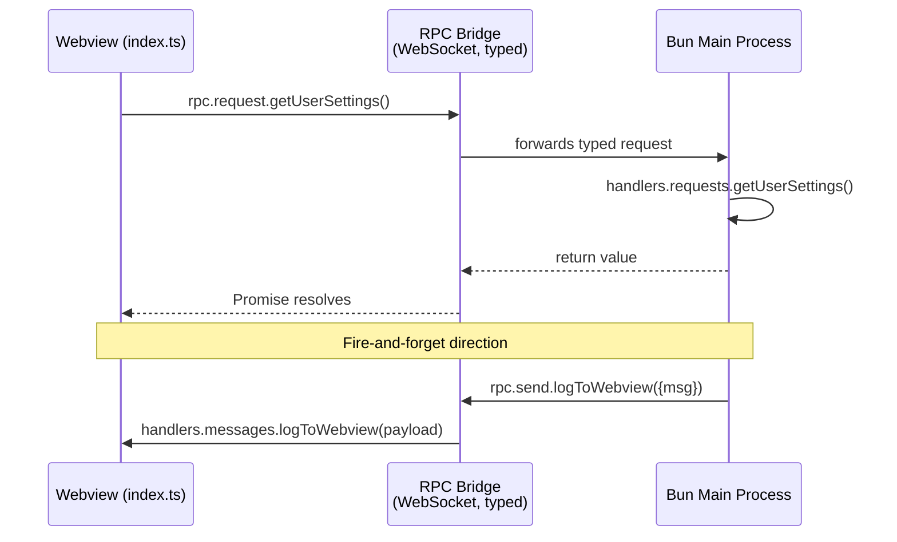
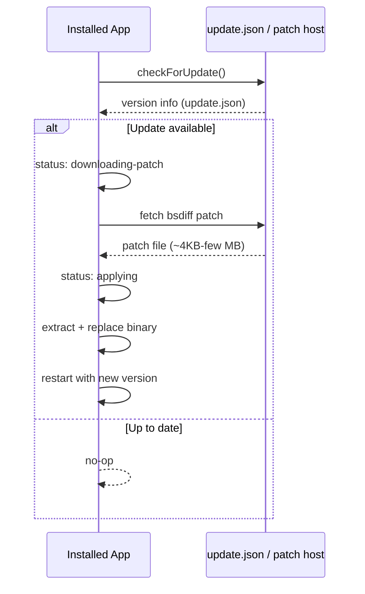
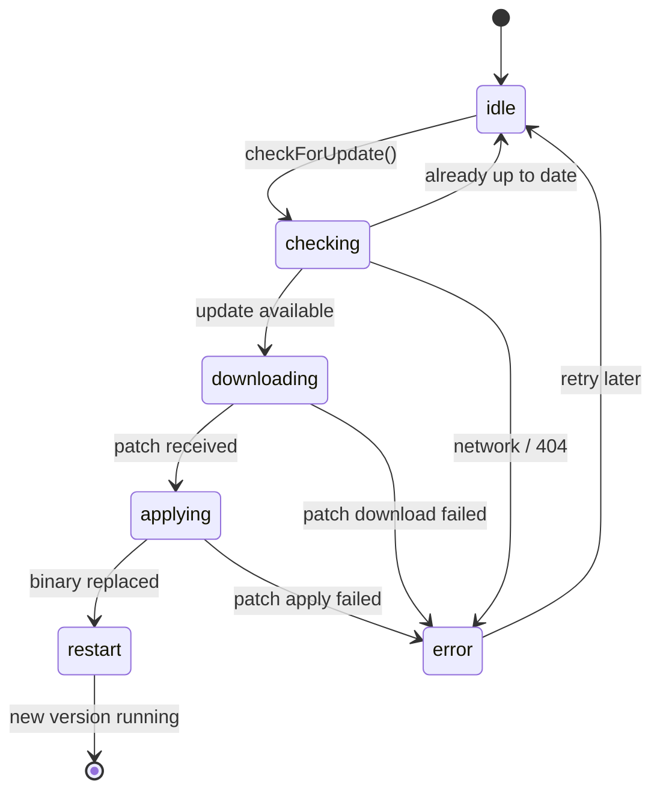
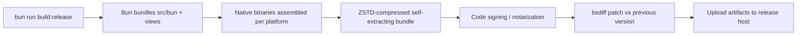
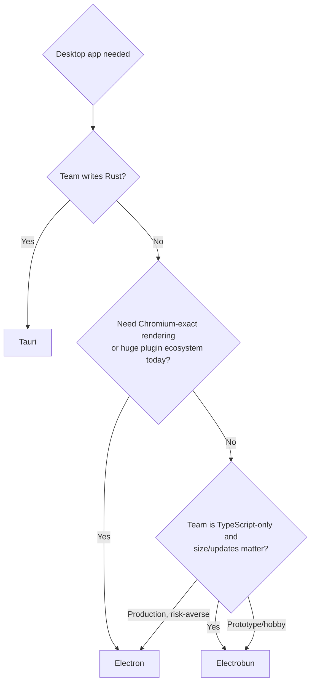

# Electrobun: The Complete Developer Tutorial

> 📦 **A comprehensive deep dive into building lightweight, TypeScript-native desktop applications with Electrobun**

| | |
|---|---|
| 🎯 **Difficulty Level** | Intermediate |
| ⏱️ **Estimated Reading Time** | ~75 minutes (plus 3–5 hours of hands-on practice) |
| 👤 **Target Audience** | Intermediate developers (comfortable with TypeScript, basic Node/Bun, and desktop app concepts) |
| 🛠️ **Primary Language** | TypeScript (Bun runtime) |
| 📅 **Last Updated** | 2026-08-30 |
| 🚧 **Framework Status** | Young / pre-1.0-feeling — treat with healthy skepticism for production bets |

---

## 📋 Table of Contents

1. [Introduction & Overview](#1-introduction--overview)
2. [Architecture Deep Dive](#2-architecture-deep-dive)
3. [Prerequisites](#3-prerequisites)
4. [Installation and Project Setup](#4-installation-and-project-setup)
5. [Your First Window (Hello World, Explained)](#5-your-first-window-hello-world-explained)
6. [RPC: The Heart of Electrobun](#6-rpc-the-heart-of-electrobun)
7. [Multiple Windows and Views (BrowserView)](#7-multiple-windows-and-views-browserview)
8. [Native OS Integration](#8-native-os-integration)
9. [Auto-Updates](#9-auto-updates)
10. [Building and Shipping](#10-building-and-shipping)
11. [Electrobun vs. Alternatives — When to Reach for It](#11-electrobun-vs-alternatives--when-to-reach-for-it)
12. [Real-World Examples and Use Cases](#12-real-world-examples-and-use-cases)
13. [Best Practices](#13-best-practices)
14. [Anti-Patterns (What NOT to Do)](#14-anti-patterns-what-not-to-do)
15. [Performance Considerations](#15-performance-considerations)
16. [Security Considerations](#16-security-considerations)
17. [Testing Strategies](#17-testing-strategies)
18. [Migration Guide: Electron → Electrobun](#18-migration-guide-electron--electrobun)
19. [Common Pitfalls & Troubleshooting](#19-common-pitfalls--troubleshooting)
20. [Practice Exercises (with Detailed Solutions)](#20-practice-exercises-with-detailed-solutions)
21. [Hands-On Labs](#21-hands-on-labs)
22. [Test Your Understanding](#22-test-your-understanding)
23. [Common Interview Questions](#23-common-interview-questions)
24. [Question Bank (50 Questions)](#24-question-bank-50-questions)
25. [Self-Assessment Checklist](#25-self-assessment-checklist)
26. [Pro Tips for Advanced Users](#26-pro-tips-for-advanced-users)
27. [Summary / Key Takeaways](#27-summary--key-takeaways)
28. [Learning Path & Next Steps](#28-learning-path--next-steps)
29. [Resources & Further Reading](#29-resources--further-reading)

---

## 1. Introduction & Overview

### 🎯 Learning Objectives

By the end of this tutorial, you will be able to:

1. **Explain** what Electrobun is, why it exists, and how it differs architecturally from Electron and Tauri.
2. **Describe** Electrobun's multi-process architecture: the Bun main process, webview processes, and the typed RPC bridge between them.
3. **Scaffold, build, and run** a complete Electrobun application from scratch.
4. **Design and implement** a strictly typed, bidirectional RPC contract between the Bun backend and the webview frontend.
5. **Integrate** native OS capabilities: application menus, system trays, notifications, dialogs, and context menus.
6. **Ship** your app with the built-in `bsdiff`-based auto-updater.
7. **Evaluate** when Electrobun is the right choice — and when it is not.
8. **Avoid** the common pitfalls that trip up developers adopting a young framework.

### 1.1 What is Electrobun?

Electrobun is a **TypeScript desktop application framework** that replaces Electron's core assumptions:

| Electron | Electrobun |
|---|---|
| Bundles full Chromium + Node.js | Uses the OS's native webview (WebKit on macOS, WebView2 on Windows, WebKitGTK on Linux) |
| App size: 150–250MB+ | App size: ~12–14MB (system webview) |
| Node.js runtime | Bun runtime (main process) |
| Manual updater setup (electron-builder, Squirrel) | Built-in `bsdiff`-based binary-patch updater (patches as small as 4KB) |
| JS main + JS renderer, loosely typed IPC | TypeScript main + TypeScript renderer, **strictly typed RPC** |

It positions itself alongside Tauri (Rust) and NeutralinoJS, but its selling point is: **you never leave TypeScript** — not even for the "native" backend layer, which is plain Bun.

> ⚠️ **Reality check before you build on it**: Electrobun is genuinely young. Docs occasionally drift from the actual generated boilerplate, some native bindings are still maturing (there are open issues around Windows/WebView2 preload injection, for example), and the CEF-based renderer option exists specifically because system webviews behave inconsistently across OSes. Treat it the way you'd treat any pre-1.0-feeling framework: great for internal tools, utilities, and hobby apps; do a stability spike before betting a production app on it.

### 1.2 Why it exists — the architectural pitch

Think of it this way: **Electron ships a whole browser to every user; Tauri ships a Rust compiler to your whole team; Electrobun asks for neither.** It keeps the "backend" in TypeScript by running it on Bun, and borrows whatever webview the operating system already provides.

```mermaid
graph TB
    subgraph Electron["Electron App"]
        E1[Chromium Browser Engine ~130MB]
        E2[Node.js Runtime ~40MB]
        E3[Your App Code]
        E1 --- E2 --- E3
    end

    subgraph Tauri["Tauri App"]
        T1[System WebView]
        T2[Rust Runtime]
        T3[Your App Code - Rust + JS]
        T1 --- T2 --- T3
    end

    subgraph Electrobun["Electrobun App"]
        B1[System WebView]
        B2[Bun Runtime ~small]
        B3[Your App Code - 100% TypeScript]
        B1 --- B2 --- B3
    end

    style Electron fill:#3a1f1f,stroke:#c0392b
    style Tauri fill:#1f2e1f,stroke:#27ae60
    style Electrobun fill:#1f2530,stroke:#2980b9
```



### 1.3 Use cases where Electrobun genuinely shines

1. **Internal dev tools / admin dashboards** — small teams, fast iteration, don't need to fight Rust's borrow checker (Tauri) or ship 200MB (Electron).
2. **Menu-bar / tray utilities** — clipboard managers, quick-launchers, status monitors — where a 12MB footprint and instant startup matter.
3. **Companion apps for web products** — a native shell around an existing web app that needs OS integration (tray, notifications, file dialogs) without a huge rewrite.
4. **Prototypes and MVPs** — validate a desktop product idea in days, in a language your whole team already knows.
5. **Media/creative tools with native GPU needs** — Electrobun exposes a native `WGPU`/WebGPU rendering path *outside* the webview process for things like real-time visualizers or lightweight 3D tools.

> 💡 **Aha moment**: Electrobun is best understood as *"Electron's developer ergonomics, Tauri's delivery size, and Bun's speed — with typed RPC as the glue."* If any one of those three resonates with your pain point, keep reading.

---

## 2. Architecture Deep Dive

Electrobun runs (at minimum) **two separate processes** that talk over a typed RPC bridge:

```mermaid
graph LR
    subgraph MainProcess["Bun Main Process (Node-like backend)"]
        A[index.ts entrypoint]
        B[BrowserWindow instances]
        C[Native FFI Bridge<br/>Zig / ObjC / C++]
        D[Tray / ApplicationMenu / Utils]
        A --> B
        B --> C
        A --> D
    end

    subgraph WebviewProcess["Webview Process (per window)"]
        E[System WebView<br/>WebKit / WebView2 / WebKitGTK]
        F[Your HTML/CSS/TS UI]
        G[electrobun/view RPC client]
        E --> F --> G
    end

    C -.->|Native OS calls| OS[(Operating System)]
    B <==>|Typed RPC<br/>WebSocket transport| G

    style MainProcess fill:#1f2530,stroke:#2980b9
    style WebviewProcess fill:#241f30,stroke:#8e44ad
```



### 🔑 Key architectural facts worth internalizing

- **Isolation by design.** The webview never gets direct access to Bun/filesystem/OS APIs. Everything crosses through RPC — this is Electrobun's answer to Electron's `contextIsolation`/`nodeIntegration` footguns, except it's the *default and only* way, not an opt-in security setting.
- **RPC is bidirectional and typed.** You define a shared TypeScript type describing "requests" (return a value, awaited) and "messages" (fire-and-forget) for both directions — Bun→webview and webview→Bun.
- **Multiple windows = multiple webview processes.** Each `BrowserWindow` gets its own OS-level webview process, so a crash in one view doesn't take down the whole app (similar to Chromium's per-tab process model).
- **Optional CEF renderer.** Because native webviews differ subtly across platforms, Electrobun offers Chromium Embedded Framework (CEF) as a drop-in alternative renderer for apps that need pixel-perfect Chromium consistency (at the cost of bundle size).
- **WebGPU outside the webview.** For GPU-heavy work, Electrobun can render directly to native GPU surfaces via a `GpuWindow`, bypassing the webview's WebGPU implementation entirely — useful for things that would otherwise choke a browser-based renderer.

> 💡 **Aha moment — the Feynman version**: Imagine Electron as a food truck that brings its *own entire kitchen* to every customer. Electrobun is a chef (Bun) who walks into whatever kitchen (the OS webview) is already there and just uses it. That's why it's ~12MB instead of ~200MB.

### 🔄 Quick Recap

- Two processes minimum: **Bun main** (backend, OS access) + **webview** (UI, sandboxed).
- All cross-process communication is **typed RPC** — requests (awaited) and messages (fire-and-forget).
- Each window is its own webview process; CEF is opt-in for rendering consistency; WebGPU can render natively without a webview.

---

## 3. Prerequisites

| Requirement | Notes |
|---|---|
| [Bun](https://bun.sh) | Required — this *is* the runtime and bundler |
| macOS (Apple Silicon or Intel) | Official support |
| Windows x64 | Official support |
| Linux (Ubuntu 24.04+, x64/arm64) | Official support |

> ✅ **Good news**: You do **not** need Zig/ObjC/C++ toolchains locally for normal app development — those are only needed if you're contributing to Electrobun's native core.

**Knowledge prerequisites for this tutorial:**

- Solid TypeScript (you'll be writing type contracts, not just annotations)
- Basic command-line familiarity
- Light HTML/CSS — the UI layer is ordinary web tech
- Helpful but not required: prior Electron experience (many concepts map 1:1, see the [Migration Guide](#18-migration-guide-electron--electrobun))

---

## 4. Installation and Project Setup

### 4.1 Scaffold a new app

```bash
npx electrobun init
```

This prompts you to pick a template:

| Template | What it demonstrates |
|---|---|
| `hello-world` | Minimal single-window app (**start here**) |
| `photo-booth` | `getUserMedia`/camera access from a webview |
| `wgpu-threejs` | Native GPU rendering without a webview at all |
| `tray-app` | Menu-bar/status-bar utility pattern |

```bash
cd my-app
bun install
```

### 4.2 Project structure

```
my-app/
├── electrobun.config.ts     # App metadata + build pipeline (source of truth)
├── package.json              # scripts: start / dev / build
└── src/
    ├── bun/
    │   └── index.ts           # Main process entry — window & OS logic
    ├── mainview/
    │   ├── index.html         # UI entry point
    │   ├── index.ts           # UI logic + RPC handlers
    │   └── index.css
    └── shared/
        └── types.ts           # Shared RPC schema types (you create this)
```

### 4.3 `electrobun.config.ts` — the config file

```ts
import { defineConfig } from "electrobun";

export default defineConfig({
  app: {
    name: "MyApp",
    identifier: "com.example.myapp", // reverse-DNS bundle id
    version: "0.1.0",
  },
  build: {
    bun: {
      entrypoint: "src/bun/index.ts", // default
    },
    views: {
      mainview: "src/mainview/index.ts", // maps view name -> entry
    },
    copy: {
      // static assets copied verbatim into the build output
      "src/mainview/assets": "views/mainview/assets",
    },
  },
});
```

Each key in `build.views` becomes an addressable view you reference later via the `views://` URL scheme (e.g. `views://mainview/index.html`).

### 4.4 Dev workflow

```bash
bun run dev             # hot-reloading dev build
bun run start           # bun src/bun/index.ts — runs the entry directly
bun run build:release   # optimized, packaged, signed build for distribution
```

Under the hood, `electrobun dev` resolves platform-specific binaries (`BUN_BINARY`, dev launcher, extractor), bundles `src/bun/` and each view with Bun's bundler per your config, then spawns the actual app process — so rebuild/reload cycles are close to instant.

> 💡 **Pro tip**: Treat `electrobun.config.ts` as the single source of truth for app metadata and view mapping. If a doc example doesn't compile, compare it against what `npx electrobun init` generated *today* — the config schema is the fastest way to spot doc drift.

---

## 5. Your First Window (Hello World, Explained)

**Step 1 — the Bun main process** (`src/bun/index.ts`):

```ts
import { BrowserWindow } from "electrobun/bun";

const win = new BrowserWindow({
  title: "My First Electrobun App",
  url: "views://mainview/index.html", // the views:// scheme maps to build.views
  frame: {
    width: 900,
    height: 600,
    x: 100,
    y: 100,
  },
  titleBarStyle: process.platform === "darwin" ? "hiddenInset" : "default",
});
```

**Step 2 — the webview UI** (`src/mainview/index.html`):

```html
<!DOCTYPE html>
<html>
  <head>
    <link rel="stylesheet" href="index.css" />
  </head>
  <body>
    <h1>Hello from the webview 👋</h1>
    <button id="ping">Ping the Bun process</button>
    <p id="result"></p>
    <script type="module" src="index.ts"></script>
  </body>
</html>
```

That's a fully functioning window. No RPC yet — just a plain webview rendering local HTML via the `views://` scheme.

> 💡 **Note the platform awareness**: `titleBarStyle: "hiddenInset"` gives macOS the modern inset look; on Windows/Linux we fall back to the default. Small touches like this are typical of cross-platform desktop work.

---

## 6. RPC: The Heart of Electrobun

Because the webview is sandboxed from Bun, **all** communication — calling backend functions, pushing live data to the UI, reacting to UI events in the backend — goes through Electrobun's typed RPC layer.



### 6.1 Step 1: Define a shared schema

The RPC schema lives in a shared module both sides import. It becomes your **single source of truth** — change it once and both the Bun and webview sides get compile errors until they match.

`src/shared/types.ts`:

```ts
export type MyAppRPC = {
  bun: {
    requests: {
      someBunFunction: (args: { a: number; b: number }) => number;
      getUserSettings: () => { theme: "light" | "dark"; fontSize: number };
    };
    messages: {
      logToBun: (payload: { msg: string }) => void;
    };
  };
  webview: {
    requests: {
      someWebviewFunction: (args: { a: number; b: number }) => number;
    };
    messages: {
      logToWebview: (payload: { msg: string }) => void;
    };
  };
};
```

**How to read this type:**

- `bun.requests` — functions the *webview* may call *on Bun*, which return a value (awaited).
- `bun.messages` — fire-and-forget payloads sent *to* Bun.
- `webview.requests` — functions *Bun* may call *on the webview*.
- `webview.messages` — fire-and-forget payloads pushed *to* the webview.

### 6.2 Step 2: Wire up the Bun side

`src/bun/index.ts`:

```ts
import { BrowserWindow, BrowserView } from "electrobun/bun";
import type { MyAppRPC } from "../shared/types";

// defineRPC is called on BrowserView — the RPC definition is attached
// to a view, then passed to the window via `rpc`.
const myAppRPC = BrowserView.defineRPC<MyAppRPC>({
  maxRequestTime: 5000, // ms before a pending request times out
  handlers: {
    requests: {
      someBunFunction: ({ a, b }) => {
        console.log(`browser asked me to add ${a} + ${b}`);
        return a + b;
      },
      getUserSettings: () => ({ theme: "dark", fontSize: 14 }),
    },
    messages: {
      // "*" is a wildcard handler — fires for every message received
      "*": (messageName, payload) => {
        console.log("global message handler:", messageName, payload);
      },
      logToBun: ({ msg }) => console.log("[webview]:", msg),
    },
  },
});

const win = new BrowserWindow({
  title: "RPC Demo",
  url: "views://mainview/index.html",
  frame: { width: 900, height: 600, x: 100, y: 100 },
  rpc: myAppRPC, // <-- attach the RPC definition here
});
```

### 6.3 Step 3: Wire up the webview side

`src/mainview/index.ts`:

```ts
import { Electroview } from "electrobun/view";
import type { MyAppRPC } from "../shared/types";

const electrobun = new Electroview<MyAppRPC>({
  handlers: {
    requests: {
      someWebviewFunction: ({ a, b }) => a * b,
    },
    messages: {
      logToWebview: ({ msg }) => console.log("[bun]:", msg),
    },
  },
});

document.getElementById("ping")?.addEventListener("click", async () => {
  const sum = await electrobun.rpc.request.someBunFunction({ a: 4, b: 6 });
  document.getElementById("result")!.textContent = `4 + 6 = ${sum}`;

  electrobun.rpc.send.logToBun({ msg: "button was clicked" });
});
```

> ✅ **Correct vs ❌ incorrect usage**:
>
> ✅ `const sum = await electrobun.rpc.request.someBunFunction({ a: 4, b: 6 });` — `request` returns a Promise; await it.
>
> ❌ `electrobun.rpc.send.someBunFunction(...)` — `send` is for *messages* only. Calling a request-shaped handler via `send` silently drops the return value and can confuse handlers expecting payloads.

---

### 6.4 Calling from Bun → webview (the reverse direction)

```ts
// From anywhere in the Bun process, given a BrowserWindow reference:
const webview = BrowserView.getById(win.webview.id);

const product = await webview.rpc.request.someWebviewFunction({ a: 4, b: 6 });
webview.rpc.send.logToWebview({ msg: "background sync complete" });
```

**Use case: live dashboard.** Say your app tails a log file or polls an API in Bun (which has full Node-like filesystem/network access) and needs to push updates into the UI in real time:

```ts
setInterval(async () => {
  const stats = await getSystemStats(); // runs in Bun, has OS access
  webview.rpc.send.logToWebview({ msg: JSON.stringify(stats) });
}, 1000);
```

The webview side just listens on `messages.logToWebview` and re-renders — no polling from the frontend needed, no exposed Node APIs in the browser context.

### 6.5 Choosing between `requests` and `messages`

| You need... | Use | Semantics | Typical example |
|---|---|---|---|
| A value back | `requests` | Awaited Promise, has timeout (`maxRequestTime`) | `getUserSettings()`, file read, computation |
| One-way notification | `messages` | Fire-and-forget, no return | "sync complete", log lines, progress ticks |
| Streaming-ish updates | `messages` (repeated) | Push many, UI re-renders | Live dashboards, tailing logs |
| UI asks backend to do work | `requests` | Return success/failure | Save file, run command |

> ⚠️ **Gotcha**: mixing these up leads to either unnecessary `await`s or lost data. If you find yourself `await`ing a `send`, stop — you probably wanted a `request`.

### 6.6 Quick Recap

- One shared type (`MyAppRPC`) defines both directions; it is your **contract**.
- Bun side: `BrowserView.defineRPC<T>(...)`, attached via `rpc:` on the `BrowserWindow`.
- Webview side: `new Electroview<T>({ handlers })`; call via `electrobun.rpc.request.*` / `electrobun.rpc.send.*`.
- Bun → webview: `BrowserView.getById(win.webview.id)` then `rpc.request`/`rpc.send`.
- Wildcard handler `"*"` catches every incoming message.

---

## 7. Multiple Windows and Views (BrowserView)

`BrowserWindow` wraps a default `BrowserView`, but you can manage views more granularly — useful for multi-pane apps, embedded browsers, or OOPIF-style tabbed UIs.

```ts
import { BrowserWindow, BrowserView } from "electrobun/bun";

const win = new BrowserWindow({
  title: "Multi-view App",
  url: "views://mainview/index.html",
  frame: { width: 1200, height: 800, x: 100, y: 100 },
});

// Nested/tabbed webview using the <electrobun-webview> tag pattern
// (used e.g. in Electrobun's own multi-tab browser example)
```

**Use case: a lightweight internal browser/tab manager** — Electrobun's own example apps include a multi-tabbed browser built with `<electrobun-webview>` for out-of-process iframe (OOPIF) isolation, so each tab is its own sandboxed webview process rather than a same-process iframe.

> 💡 **Why OOPIF matters**: a normal `<iframe>` shares the parent's renderer process — one crashing/hanging page (or one malicious one) can degrade the whole window. With `<electrobun-webview>`, each tab is an independent process with its own permissions boundary, closer to how Chrome treats tabs.

---

## 8. Native OS Integration

This is where Electrobun earns the "not just a webview wrapper" label — everything below runs from the Bun process via FFI into native OS APIs.

### 8.1 Application menu (macOS top bar / Windows-Linux window menu)

```ts
import { ApplicationMenu } from "electrobun/bun";

ApplicationMenu.setApplicationMenu([
  {
    label: "File",
    submenu: [
      { label: "New Window", action: "new-window", accelerator: "CommandOrControl+N" },
      { role: "quit" },
    ],
  },
  {
    label: "Edit",
    submenu: [{ role: "undo" }, { role: "redo" }, { role: "copy" }, { role: "paste" }],
  },
]);

ApplicationMenu.on("application-menu-clicked", (event) => {
  if (event.action === "new-window") {
    // spawn another BrowserWindow
  }
});
```

### 8.2 System tray (menu-bar utility pattern)

```ts
import { Tray } from "electrobun/bun";

const tray = new Tray({ title: "⚡" });

tray.setMenu([
  { label: "Open Dashboard", action: "open" },
  { label: "Pause Sync", action: "pause", checked: false },
  { role: "separator" },
  { role: "quit" },
]);
```

**Use case: menu-bar clipboard manager.** Combine `Tray` + a hidden/small `BrowserWindow` that toggles visibility on tray click — this is one of the framework's flagship scenarios given its ~12MB footprint and fast cold start.

### 8.3 Notifications, dialogs, and file access

```ts
import { Utils } from "electrobun/bun";

Utils.showNotification({ title: "Sync complete", body: "42 files updated" });

const confirmed = await Utils.showMessageBox({
  title: "Delete file?",
  message: "This cannot be undone.",
  buttons: ["Cancel", "Delete"],
});

const paths = await Utils.openFileDialog({
  properties: ["openFile", "multiSelections"],
});

Utils.showItemInFolder(paths[0]);
Utils.openExternal("https://electrobun.dev");
```

### 8.4 Context menu (right-click)

```ts
import { ContextMenu } from "electrobun/bun";

ContextMenu.on("context-menu-clicked", (event) => {
  console.log("clicked:", event.action);
});

// Triggered e.g. from an RPC handler when the webview reports a right-click
ContextMenu.showContextMenu([
  { label: "Copy", role: "copy" },
  { label: "Inspect Element", action: "inspect" },
]);
```

### 8.5 Error handling around native calls

Native FFI calls can fail in ways JS calls don't (OS denies permission, dialog dismissed unexpectedly). Wrap them:

```ts
// ✅ Correct: defensive error handling around a native dialog flow
async function pickLogFile(): Promise<string | null> {
  try {
    const paths = await Utils.openFileDialog({ properties: ["openFile"] });
    if (!paths || paths.length === 0) return null; // user cancelled — NOT an error
    return paths[0];
  } catch (err) {
    console.error("file dialog failed:", err);
    Utils.showNotification({ title: "Could not open file picker", body: String(err) });
    return null;
  }
}
```

```ts
// ❌ Incorrect: assuming the dialog always returns a path
async function pickLogFileBad(): Promise<string> {
  const paths = await Utils.openFileDialog({ properties: ["openFile"] });
  return paths[0]; // throws "Cannot read properties of undefined" if user cancels
}
```

---

## 9. Auto-Updates

Electrobun ships a built-in updater using **binary diffing (bsdiff)** — instead of re-downloading the whole app, users fetch a patch as small as a few KB.



### 9.1 Updater lifecycle (state view)



### 9.2 Code

```ts
import { Updater } from "electrobun/bun";

const updater = new Updater({
  updateUrl: "https://updates.mycompany.com/myapp",
});

updater.on("status", (status) => {
  console.log("updater status:", status); // 'checking' | 'downloading-patch' | 'applying' | ...
});

await updater.checkForUpdate();
```

**Use case: rapidly-iterating internal tools.** Because patches can be a few KB, you can ship frequent small fixes to a whole team without anyone noticing a slow re-download — a real advantage over Electron apps that often ship full-size updates unless you've carefully set up `electron-updater` diffing yourself.

---

## 10. Building and Shipping

```bash
bun run build:release
```

This produces:

- A **self-extracting, ZSTD-compressed bundle** (~12–14MB baseline with system webview)
- Platform-correct artifact naming: `MyApp.app` (macOS), `MyApp-Setup.exe` (Windows), AppImage/deb-style output on Linux
- `bsdiff` patch artifacts for the update system
- Code-signing/notarization hooks for macOS and Windows (configured per-platform in `electrobun.config.ts`)



---

## 11. Electrobun vs. Alternatives — When to Reach for It

| Criteria | Electron | Tauri | Electrobun |
|---|---|---|---|
| Bundle size | 150–250MB+ | ~5–10MB | ~12–14MB |
| Backend language | JS/TS (Node) | Rust | TS (Bun) |
| Rendering consistency | Very high (bundled Chromium) | Medium (native webview quirks) | Medium (native webview, CEF opt-in) |
| Learning curve for JS devs | Low | High (Rust) | Low |
| Ecosystem/maturity | Very mature | Mature | Young, active |
| Built-in diff-based updater | No (needs setup) | Partial | Yes, built-in |
| Best for | Complex, mature production apps | Security- and size-critical apps, teams OK with Rust | Fast-moving internal tools, TS-only teams, small utilities |

> ✅ **Rule of thumb**: choose Electrobun when your team is TypeScript-only, you want Electron-like ergonomics without the bloat, and you can tolerate (or actively want to contribute to) a framework that's still finding its footing. Choose Tauri if you need Rust-grade performance/security guarantees and can invest in Rust. Stick with Electron if you need maximum ecosystem maturity and Chromium-exact rendering today.

### Decision flow



---

## 12. Real-World Examples and Use Cases

### 📦 Case study 1: Menu-bar clipboard manager (tray utility)

**Scenario**: A 3-person startup wants a clipboard history tool for macOS + Windows. Cold start must feel instant; the app lives in the background all day.

- **Why Electrobun**: ~12MB footprint, instant tray availability, and the whole thing is one Bun process plus one hidden webview.
- **Architecture**: `Tray` with a toggle menu; a hidden `BrowserWindow` that shows/hides on tray click; RPC `requests` for reading/writing clipboard entries from Bun (which owns OS access), `messages` to push clipboard-change events into the UI.
- **Electron comparison**: same app would ship ~180MB and load Chromium into memory before the first tray tick.

### 📦 Case study 2: Internal release dashboard with live updates

**Scenario**: An engineering org wants a dashboard polling CI status, tailing deploy logs, and showing system stats.

- **Why Electrobun**: Bun's backend does filesystem/network polling natively; `messages` push updates to the UI — the frontend never polls.
- **Pattern**: `setInterval` in Bun → `webview.rpc.send.logToWebview({ msg: JSON.stringify(stats) })` → webview `messages.logToWebview` handler re-renders.
- **Updater**: bsdiff patches mean shipping 5 fixes/day costs each user kilobytes, not gigabytes.

### 📦 Case study 3: Multi-tab internal browser

**Scenario**: A support team needs a small browser with isolated tabs for admin consoles.

- **Why Electrobun**: the `<electrobun-webview>` tag gives OOPIF-style per-tab process isolation — each tab is its own sandboxed webview process.
- **Trade-off**: rendering consistency across macOS/Windows/Linux webviews isn't pixel-perfect; use the CEF renderer option if that matters.

### 📦 Case study 4: Native GPU visualizer (`wgpu-threejs` template)

**Scenario**: A real-time audio visualizer / lightweight 3D tool.

- **Why Electrobun**: `GpuWindow` renders to native GPU surfaces *outside* the webview via the `WGPU` path — sidestepping browser-WebGPU quirks entirely, with your logic still in TypeScript.

### When NOT to use these patterns

- A production consumer product needing pixel-identical rendering on every OS → Electron (bundled Chromium) today.
- A security-critical tool where the team knows Rust → Tauri.
- Anything where a framework bug would block your launch → wait for Electrobun maturity or prototype first.

---

## 13. Best Practices

1. **Design the RPC schema first.** Define `src/shared/types.ts` before writing handlers. It becomes the contract between processes and gives autocomplete on both sides.
2. **Use `messages` for one-way pushes, `requests` for anything needing a return value.** Mixing these up leads to unnecessary `await`s or silently lost data.
3. **Set a realistic `maxRequestTime`.** 5000ms is a fine default; long-running operations should return quickly and stream progress via `messages` instead.
4. **Keep the webview dumb, the Bun process capable.** All filesystem/OS work belongs in Bun; the webview only renders and collects input.
5. **Handle the empty/cancelled case in dialogs.** `Utils.openFileDialog` can return nothing when the user cancels — treat that as normal, not exceptional.
6. **Test on all three OSes early.** System webviews differ; a preload script that works on macOS may truncate on Windows/WebView2.
7. **Keep preload scripts lean.** Reported Windows/WebView2 issues involve large preload scripts being truncated — inject only the minimum global surface (`window.__electrobun`) you need.
8. **Check the repo's `templates/` folder when docs drift.** The generated boilerplate from `npx electrobun init` is the truth; docs sometimes lag it.
9. **Version-pin your update server artifacts.** Keep every release's `update.json` and bsdiff patches hosted so users on old versions can still patch up.
10. **Use the wildcard `"*"` message handler for logging/metrics.** It's an easy catch-all for debugging message flow without touching every handler.
11. **Model window state in Bun, mirror in the webview.** The backend owns truth (visibility, settings, paths); the UI renders state pushed to it.
12. **Write idempotent RPC request handlers.** Retries/timeouts can double-fire; make `requests` safe to re-execute or dedupe by id.

---

## 14. Anti-Patterns (What NOT to Do)

### ❌ Anti-pattern 1: Doing filesystem work in the webview

```ts
// ❌ Wrong: treating the webview like Node — there is no fs here, and even the
// workarounds defeat Electrobun's sandboxing model.
const data = await (window as any).someLegacyBridge.readFile("config.json");
```

```ts
// ✅ Right: expose a typed request and read the file in Bun.
// types.ts: requests: { readConfig: () => AppConfig }
const config = await electrobun.rpc.request.readConfig();
```

### ❌ Anti-pattern 2: Awaiting fire-and-forget messages

```ts
// ❌ Wrong: send() returns no result — this await is meaningless and hides a design bug.
await electrobun.rpc.send.logToBun({ msg: "save now" });
```

```ts
// ✅ Right: if you need confirmation, model it as a request.
const result = await electrobun.rpc.request.saveDocument({ id: doc.id });
```

### ❌ Anti-pattern 3: Mega preload script

```ts
// ❌ Wrong: 50KB of preload globals — known to truncate on Windows/WebView2.
window.__api = { ...dozensOfFunctions }; // truncation risk, huge attack surface
```

```ts
// ✅ Right: minimal preload; the typed RPC is the bridge, not a custom global API.
```

### ❌ Anti-pattern 4: One RPC type for everything (schema sprawl)

As your app grows, one monolithic `MyAppRPC` becomes a bottleneck. Group by domain (settings, files, sync) and compose types:

```ts
// ✅ Right: compose domain schemas
type AppRPC = MyAppRPC & SyncRPC & FilesRPC;
```

### ❌ Anti-pattern 5: Polling from the webview

```ts
// ❌ Wrong: frontend polls backend every second — wasted RPC churn.
setInterval(async () => {
  const stats = await electrobun.rpc.request.getSystemStats();
  render(stats);
}, 1000);
```

```ts
// ✅ Right: Bun pushes; webview listens.
// bun side: setInterval(() => webview.rpc.send.statsUpdated(stats), 1000)
// webview side: messages: { statsUpdated: (s) => render(s) }
```

### ❌ Anti-pattern 6: Treating docs as ground truth on a young framework

Docs sometimes lag the boilerplate. ❌ Copy-pasting a doc example that doesn't compile and "fixing" it by disabling types. ✅ Diff it against the generated `templates/` code from the current `npx electrobun init`.

---

## 15. Performance Considerations

| Area | Guidance |
|---|---|
| **Bundle size** | ~12-14MB baseline with system webview vs 150-250MB+ for Electron. Opting into CEF trades size back for rendering consistency - measure before enabling. |
| **Cold start** | No Chromium to boot; tray/menu-bar utilities feel instant. Keep the Bun entrypoint light - defer heavy work until after the first window shows. |
| **IPC throughput** | Every RPC crosses a WebSocket transport. Batch high-frequency data (e.g. log tails) into chunks instead of one message per line. |
| **Request timeouts** | `maxRequestTime` bounds stuck promises; do not set it to 60s to "fix" slow handlers - fix the handler or stream via `messages`. |
| **Payload size** | Serialize deliberately: sending a 10MB JSON blob over RPC freezes both sides. Paginate, or pass a file path and fetch chunks. |
| **Multiple windows** | Each window spawns its own webview process - great for isolation, but N windows cost N processes. Do not open windows speculatively. |
| **GPU work** | Move real-time rendering to the native `GpuWindow`/`WGPU` path rather than fighting webview-WebGPU performance cliffs. |
| **Bundler** | Bun's bundler is fast; dev rebuild/reload cycles are near-instant. Prefer many small modules over pre-optimizing. |

**Performance-optimized push pattern (batching):**

```ts
// Batch log lines: 1 RPC message per 250ms (or 50 lines), not per line
let buffer: string[] = [];
setInterval(() => {
  if (buffer.length === 0) return;
  webview.rpc.send.logBatch({ lines: buffer });
  buffer = [];
}, 250);

logTail.on("line", (line) => buffer.push(line));
```

> 💡 **Benchmark intuition**: the win is not only download size. Startup latency and steady-state memory dominate day-to-day "feel" for tray apps - exactly where Electron's bundled Chromium hurts most.

---

## 16. Security Considerations

1. **Sandboxing is the default, not an option.** Unlike Electron's `nodeIntegration: false` (which you must remember to set), the Electrobun webview has *no* direct Bun/filesystem/OS access. Everything crosses typed RPC. Do not undermine this with ad-hoc bridges.
2. **The RPC schema is your permission boundary.** Only expose request handlers for operations the UI genuinely needs. A handler like `runCommand(cmd: string)` is a remote-code-execution hole; prefer narrow, parameterized handlers like `openPath(path: SafePath)`.
3. **Validate at the Bun boundary.** Types are compile-time only - a compromised webview can still send malformed payloads. Validate/parse untrusted input inside Bun request handlers before touching the filesystem or network.
4. **Preload scripts are attack surface.** Keep them minimal. Every global you inject into the webview is callable by any script that ends up running there.
5. **OOPIF isolation for third-party content.** Rendering external web pages? Use `<electrobun-webview>` so each site gets its own process and sandbox, not a same-process iframe.
6. **Updates are code execution.** Serve `update.json` and bsdiff patches over HTTPS from a host you control, and keep the code-signing/notarization hooks configured - a compromised update channel is a compromised user machine.
7. **`Utils.openExternal` discipline.** Only ever pass URLs you constructed or validated; never forward arbitrary webview-originated URLs straight to the OS.
8. **CEF trade-off.** The CEF renderer improves consistency but ships Chromium - revisit your security review if you enable it.

```ts
// Correct: narrow, validated request handler in Bun (validation shown hand-rolled,
// but use whatever validator your project already has)
const ALLOWED_REPORT_ROOT = "/Users/Shared/Reports/";

handlers: {
  requests: {
    openReport: async (args: { path: string }) => {
      // throws/rejects on anything outside the allowlist root
      if (!args.path.startsWith(ALLOWED_REPORT_ROOT)) {
        throw new Error("path outside allowed reports directory");
      }
      return Utils.showItemInFolder(args.path);
    },
  },
}
```

---

## 17. Testing Strategies

### 17.1 Kitchen — Electrobun's own integration test runner

Electrobun's integration test runner ("Kitchen") spans **both** the Bun and webview processes — useful as a reference pattern for testing your own RPC handlers end-to-end. When in doubt, mirror how Kitchen drives a real window and asserts on both sides of the RPC bridge.

### 17.2 A layered testing approach

| Layer | What to test | How |
|---|---|---|
| **Unit (Bun)** | Request/message handler logic, config parsing, path validation | Plain `bun test` against handler functions extracted from the RPC definition |
| **Contract** | The shared `MyAppRPC` type matches implementations on both sides | TypeScript compilation *is* the test — `tsc`/`bun build` fails on drift |
| **Integration (RPC)** | Real request/response round-trips, timeout behavior, wildcard handlers | Follow the Kitchen pattern: spawn the app, drive RPC from a harness process |
| **UI (webview)** | Handlers wired, DOM updates after RPC responses | Your normal web tooling (vitest/playwright) against the webview code |
| **Cross-platform** | Preload injection, menus, trays, dialogs on macOS/Windows/Linux | Manual smoke checklist + CI matrix on the three OSes |

### 17.3 Example: unit-testing a request handler in Bun

```ts
// src/bun/handlers.ts — handlers extracted so they are testable without a window
export function add({ a, b }: { a: number; b: number }) {
  return a + b;
}

// handlers.test.ts
import { describe, it, expect } from "bun:test";
import { add } from "./handlers";

describe("add request handler", () => {
  it("adds two numbers", () => expect(add({ a: 4, b: 6 })).toBe(10));
  it("handles negatives", () => expect(add({ a: -2, b: 2 })).toBe(0));
  it("guards the boundary from untrusted payloads", () => {
    // simulate a malformed payload crossing the bridge
    const untrusted: any = { a: "4", b: 6 };
    expect(typeof add({ a: Number(untrusted.a), b: untrusted.b })).toBe("number");
  });
});
```

> 💡 **Key insight**: because both sides import one shared type, *type drift is caught at build time*, not in production. Lean on this — it is the strongest testing lever Electrobun gives you.

---

## 18. Migration Guide: Electron → Electrobun

If you know Electron, you already know most of Electrobun's shape. Here is the concept mapping:

| Electron | Electrobun | Notes |
|---|---|---|
| `new BrowserWindow({...})` | `new BrowserWindow({...})` | Nearly identical; `frame` nests `width/height/x/y` |
| `ipcMain.handle` / `ipcRenderer.invoke` | Typed `rpc.request.*` + `handlers.requests` | Same call-response semantics, but compile-time checked via the shared type |
| `webContents.send` / `ipcRenderer.on` | `rpc.send.*` + `handlers.messages` | Fire-and-forget; the `"*"` wildcard handler replaces ad-hoc channel scanning |
| `preload.js` exposing globals | Lean preload (`window.__electrobun`) + typed RPC | Keep preload minimal — see security notes |
| `electron-builder` / `Squirrel` | Built-in `bsdiff` patch updater | Configure `updateUrl`; host `update.json` + patches over HTTPS |
| Bundled Chromium renderer | System webview (or opt-in CEF) | Test rendering per OS; enable CEF only if consistency demands it |
| `app.whenReady()` | Top-level code in `src/bun/index.ts` | Bun entry runs directly; no app-lifecycle boilerplate for basics |
| `Menu.setApplicationMenu` | `ApplicationMenu.setApplicationMenu` | Same structure; events via `application-menu-clicked` |
| `Tray` | `Tray` | Same menu-bar pattern |
| `dialog.showOpenDialog` | `Utils.openFileDialog` | Returns paths (possibly empty on cancel) — handle that |
| `shell.openExternal` | `Utils.openExternal` | Same discipline about validating URLs |

### Migration steps (small app)

1. **Scaffold** a parallel Electrobun app with `npx electrobun init` (pick `hello-world`); do not port in place first.
2. **Move shared logic** (pure functions, types, validation) into `src/shared/` — this code is runtime-agnostic and ports as-is (Node APIs → Bun equivalents; they are largely compatible).
3. **Replace IPC channels with a schema.** For each `ipcMain.handle(channel, fn)` pair, add an entry to `src/shared/types.ts` under `bun.requests`; same for pushes → `messages`. Implement handlers in Bun; replace `ipcRenderer.invoke` calls with `rpc.request.*`.
4. **Port main-process glue**: windows, menus, tray, dialogs using the mapping table above.
5. **Kill preload workarounds.** Any `contextBridge.exposeInMainWorld` surface becomes a typed request; the webview should have zero custom globals beyond the Electrobun bridge.
6. **Set up the updater** by hosting artifacts and pointing `Updater` at your `updateUrl`.
7. **Run the smoke matrix** on macOS, Windows, and Linux before switching your release pipeline.

> ⚠️ **Expect friction**: docs may not match generated boilerplate, and Windows/WebView2 preload injection has open issues. Budget a spike (days, not hours) for the first real migration.

---

## 19. Common Pitfalls & Troubleshooting

### 🐞 Pitfall 1: Windows/WebView2 preload truncation

**Symptom**: your preload-defined globals are partially missing on Windows only.
**Cause**: reported issues where large preload scripts get truncated under WebView2.
**Fix**: keep preload scripts lean; move logic into the typed RPC layer; test on all three OSes before shipping.

### 🐞 Pitfall 2: Docs vs. generated boilerplate drift

**Symptom**: a doc example does not compile or references APIs your scaffold lacks.
**Fix**: check the `templates/` folder in the Electrobun GitHub repo, or re-run `npx electrobun init` in a scratch folder and diff. The framework is young; the generated code is the ground truth.

### 🐞 Pitfall 3: RPC handler never fires

**Checklist**:
1. Did you attach the RPC to the window (`rpc: myAppRPC` on `BrowserWindow`)? Defining it is not enough.
2. Are you using `request` vs `send` correctly on the caller side? A `request` needs a handler under `handlers.requests`; a `message` needs `handlers.messages`.
3. Did the request exceed `maxRequestTime`? The Promise rejects silently-looking; log `updater`-style status and RPC errors.
4. Are both sides importing the *same* shared type module (same relative path from both `src/bun/` and `src/mainview/`)?

### 🐞 Pitfall 4: `openFileDialog` returns nothing

The user cancelled — this is a normal outcome, not an exception. Handle `!paths || paths.length === 0` before using `paths[0]`.

### 🐞 Pitfall 5: UI freezes when pushing big payloads

A 10MB JSON blob over the WebSocket transport stalls both processes. Paginate or chunk (see batching pattern in the Performance section).

### 🐞 Pitfall 6: Rendering looks different across OSes

System webviews (WebKit / WebView2 / WebKitGTK) have subtle differences. Test per-OS early; if you need Chromium-exact output, evaluate the CEF renderer option and accept the size cost.

### 🐞 Pitfall 7: Menu/tray clicks do nothing

`ApplicationMenu`/`ContextMenu` emit events (e.g. `application-menu-clicked`) — a menu item with an `action` string does nothing until you listen for the event and branch on `event.action`. Roles (`quit`, `copy`, `paste`) are handled natively.

### 🧰 Troubleshooting decision table

| Symptom | Likely cause | First thing to try |
|---|---|---|
| Window opens but blank | Wrong `views://` path or view not in `build.views` | Check `electrobun.config.ts` view keys vs URL |
| `rpc.request` hangs | Handler missing or timeout too long | Add the handler; log in `"*"` wildcard; verify `rpc:` attached |
| Works on macOS, broken on Windows | WebView2/preload quirks | Shrink preload; retest; check GitHub issues |
| Updater stuck on `checking` | Unreachable `updateUrl` / bad `update.json` | Curl the URL; validate JSON shape |
| App huge after build | CEF enabled | Confirm CEF opt-in is intentional |
| Dialog crashes on cancel | Assuming `paths[0]` exists | Guard the empty case |

---

## 20. Practice Exercises (with Detailed Solutions)

### Exercise 1 - Build a settings round-trip (Beginner to Intermediate)

**Task**: Extend the hello-world app so the webview can (a) request current settings from Bun via a `request`, and (b) notify Bun of a theme change via a `message`. Bun should log theme changes.

**Solution**:

```ts
// src/shared/types.ts
export type SettingsRPC = {
  bun: {
    requests: {
      getSettings: () => { theme: "light" | "dark"; fontSize: number };
    };
    messages: {
      themeChanged: (payload: { theme: "light" | "dark" }) => void;
    };
  };
  webview: {
    requests: {};
    messages: {};
  };
};
```

```ts
// src/bun/index.ts
import { BrowserWindow, BrowserView } from "electrobun/bun";
import type { SettingsRPC } from "../shared/types";

const rpc = BrowserView.defineRPC<SettingsRPC>({
  maxRequestTime: 5000,
  handlers: {
    requests: {
      getSettings: () => ({ theme: "dark", fontSize: 14 }),
    },
    messages: {
      themeChanged: ({ theme }) => console.log("theme is now:", theme),
    },
  },
});

new BrowserWindow({
  title: "Settings Demo",
  url: "views://mainview/index.html",
  frame: { width: 600, height: 400 },
  rpc,
});
```

```ts
// src/mainview/index.ts
import { Electroview } from "electrobun/view";
import type { SettingsRPC } from "../shared/types";

const app = new Electroview<SettingsRPC>({ handlers: { requests: {}, messages: {} } });

const settings = await app.rpc.request.getSettings(); // awaited request
console.log("loaded settings:", settings);

app.rpc.send.themeChanged({ theme: "light" }); // fire-and-forget message
```

**Key points**: `requests` return values and are awaited; `messages` are one-way; the same shared type constrains both sides; `rpc:` must be attached to the window.

---

### Exercise 2 - Push live stats into the UI (Intermediate)

**Task**: Bun polls a fake stats source every second and pushes stats to the webview via `messages` (no frontend polling). The webview renders the latest value and a running count of updates.

**Solution**:

```ts
// src/shared/types.ts (additions)
// bun.messages: { statsUpdated: (payload: { cpu: number; count: number }) => void }

// src/bun/index.ts
let count = 0;
setInterval(() => {
  count++;
  const webview = BrowserView.getById(win.webview.id);
  webview.rpc.send.statsUpdated({ cpu: Math.random() * 100, count });
}, 1000);

// src/mainview/index.ts
const app = new Electroview<StatsRPC>({
  handlers: {
    messages: {
      statsUpdated: ({ cpu, count }) => {
        document.getElementById("cpu")!.textContent = `CPU: ${cpu.toFixed(1)}%`;
        document.getElementById("count")!.textContent = `updates: ${count}`;
      },
    },
  },
});
```

**Key points**: Bun owns timers (the backend is the capability layer); the webview never polls; each push is fire-and-forget, so handlers must be cheap and idempotent.

### Exercise 3 - Menu-bar quick note app (Intermediate to Advanced)

**Task**: Create a tray utility: a `Tray` with "Open Note", a hidden `BrowserWindow` toggled by that action, and a `request` handler `saveNote(text: string)` in Bun that (simulatedly) persists the note. Include handling for a cancelled/failed save.

**Solution**:

```ts
// src/shared/types.ts
export type NoteRPC = {
  bun: {
    requests: { saveNote: (args: { text: string }) => { ok: boolean; error?: string } };
    messages: {};
  };
  webview: { requests: {}; messages: {} };
};

// src/bun/index.ts
import { BrowserWindow, BrowserView, Tray } from "electrobun/bun";
import type { NoteRPC } from "../shared/types";

const rpc = BrowserView.defineRPC<NoteRPC>({
  maxRequestTime: 5000,
  handlers: {
    requests: {
      saveNote: async ({ text }) => {
        try {
          if (!text.trim()) return { ok: false, error: "empty note" }; // edge case
          // Bun has real fs access: await Bun.write("notes.txt", text);
          return { ok: true };
        } catch (err) {
          return { ok: false, error: String(err) }; // keep raw errors out of the UI contract
        }
      },
    },
  },
});

const win = new BrowserWindow({
  title: "Quick Note",
  url: "views://mainview/index.html",
  frame: { width: 400, height: 300 },
  rpc,
});

const tray = new Tray({ title: "📝" });
tray.setMenu([{ label: "Open Note", action: "open-note" }, { role: "quit" }]);
```

**Key points**: the tray is Bun-side; requests return a result object rather than throwing across the bridge; edge cases (empty text, write failure) are part of the typed contract, not surprises.

---


## 21. Hands-On Labs

### Lab 1: Hello RPC (15 min)

1. `npx electrobun init` -> pick `hello-world`; `bun install`.
2. Create `src/shared/types.ts` with an `add(a, b)` request and a `logToBun` message.
3. Wire `BrowserView.defineRPC` in Bun, attach via `rpc:`; call it from a button in the webview.
4. **Success criteria**: clicking the button renders `4 + 6 = 10` and Bun logs the message.

### Lab 2: Tray + hidden window (30 min)

1. Start from the `tray-app` template.
2. Add a tray menu with "Show", "Hide", "Quit".
3. Toggle a small `BrowserWindow` from the tray actions (listen for the menu event in Bun).
4. **Success criteria**: the window appears/disappears without restarting; Quit exits the app.

### Lab 3: Live log tail dashboard (45 min)

1. In Bun, tail a growing log file (or simulate with `setInterval`).
2. Batch lines and push them via a `logBatch` message every 250ms.
3. Render the last 20 lines in the webview; add a `clearLogs` request the UI can call.
4. **Success criteria**: UI updates with zero polling from the webview; `clearLogs` round-trips through the typed request.

### Lab 4 (Stretch): Updater dry run (60 min)

1. Wire `Updater` with a local/static-file `updateUrl` serving a fake `update.json`.
2. Log every `status` event; observe the `checking -> downloading-patch -> applying` flow.
3. **Success criteria**: you can articulate what your release host must serve and why patches stay tiny.

---

## 22. Test Your Understanding

Answer from memory first, then check. (Answers below each question — no peeking!)

1. **What webview does Electrobun use on each OS?**
   *Answer*: WebKit on macOS, WebView2 on Windows, WebKitGTK on Linux.

2. **Approximate bundle size of an Electrobun app vs an Electron app?**
   *Answer*: ~12–14MB vs 150–250MB+ (Electron bundles Chromium + Node).

3. **Which runtime powers Electrobun's main process?**
   *Answer*: Bun.

4. **What is the difference between `requests` and `messages` in the RPC schema?**
   *Answer*: `requests` return a value and are awaited (with `maxRequestTime` timeout); `messages` are fire-and-forget with no return value.

5. **Where do you define the RPC contract, and why there?**
   *Answer*: In a shared module (e.g. `src/shared/types.ts`) imported by both processes — it becomes the compile-time contract and gives autocomplete on both sides.

6. **How do you get a webview reference from the Bun side to call into it?**
   *Answer*: `BrowserView.getById(win.webview.id)`, then `webview.rpc.request.*` / `webview.rpc.send.*`.

7. **What is the `"*"` message handler for?**
   *Answer*: A wildcard handler that receives every incoming message (name + payload) — handy for logging/metrics.

8. **Why does Electrobun offer CEF as an alternative renderer?**
   *Answer*: Because native webviews behave inconsistently across OSes; CEF provides Chromium-exact consistency at the cost of bundle size.

9. **What technology backs the built-in updater, and how small can patches be?**
   *Answer*: `bsdiff` binary diffing; patches can be as small as a few KB (e.g. ~4KB).

10. **Name two reported platform quirks to budget for.**
    *Answer*: Windows/WebView2 preload script truncation; docs drifting from generated boilerplate (check `templates/`).

---

## 23. Common Interview Questions

1. **How does Electrobun achieve a ~12MB app size while Electron needs 150–250MB?**
   *Electron bundles Chromium + Node.js into every app. Electrobun uses the OS's native webview (WebKit/WebView2/WebKitGTK) and Bun as a compact backend runtime — no browser engine shipped.*

2. **Compare IPC in Electron with RPC in Electrobun.**
   *Electron's ipcMain/ipcRenderer is channel-string based and loosely typed. Electrobun's RPC is defined by one shared TypeScript type for both directions, so drift is a compile error, and it distinguishes awaited `requests` from fire-and-forget `messages`.*

3. **How does Electrobun's process model improve on Electron's security story?**
   *The webview has no direct access to Bun/filesystem/OS — everything crosses typed RPC. Electron's `nodeIntegration`/`contextIsolation` are opt-in settings teams get wrong; in Electrobun sandboxing is the default and only mode.*

4. **Why does each BrowserWindow get its own webview process, and what does that buy you?**
   *Fault isolation and independence (similar to Chromium's per-tab processes): one view crashing doesn't take down the app; each view has its own permission boundary — the basis for the `<electrobun-webview>` OOPIF tab pattern.*

5. **Explain the built-in updater. Why is bsdiff significant?**
   *The updater diffs binaries with bsdiff, so users fetch small patches (down to ~4KB) instead of full re-downloads. Status events (`checking`, `downloading-patch`, `applying`) let you surface progress.*

6. **When would you choose Tauri over Electrobun? Electron over both?**
   *Tauri: you want Rust-grade performance/security and the team knows Rust. Electron: you need maximum ecosystem maturity and Chromium-exact rendering today. Electrobun: TS-only teams wanting Electron ergonomics without bloat who tolerate pre-1.0 risk.*

7. **How would you push real-time data from backend to UI without polling?**
   *Run the polling/tailing loop in Bun (it has OS access) and `rpc.send` messages to the webview; the UI only implements a `messages` handler. Batch high-frequency data.*

8. **What are the risks of building on a young framework like this, and how do you mitigate them?**
   *Doc drift, immature native bindings (e.g. WebView2 preload injection), webview inconsistencies. Mitigate with a stability spike, diffing docs against `templates/`, lean preloads, per-OS smoke tests, and an exit plan.*

9. **Where should file I/O live, and why?**
   *In the Bun process. The webview is sandboxed; exposing fs via narrow typed `requests` keeps the permission boundary explicit and the UI dumb.*

10. **How do you test an Electrobun app?**
    *Layers: `bun test` unit tests for handlers, TypeScript compilation as the contract test, Kitchen-style integration across both processes, web tooling for the webview, and a per-OS smoke matrix.*

---

## 24. Question Bank (50 Questions)

### Level 1 — Beginner (Q1–Q15)

1. What is Electrobun? *A TypeScript desktop app framework using the OS webview + Bun backend.*
2. Which OSes does Electrobun officially support? *macOS (Apple Silicon/Intel), Windows x64, Linux (Ubuntu 24.04+, x64/arm64).*
3. What command scaffolds a new Electrobun app? *`npx electrobun init`.*
4. Name the four official templates. *`hello-world`, `photo-booth`, `wgpu-threejs`, `tray-app`.*
5. What is the main-process entry file? *`src/bun/index.ts`.*
6. What does the `views://` scheme do? *Addresses built views, e.g. `views://mainview/index.html`.*
7. What config file is the source of truth for app metadata and build pipeline? *`electrobun.config.ts`.*
8. Do you need Zig/ObjC/C++ toolchains for normal app development? *No — only for contributing to the native core.*
9. What must you install as a prerequisite? *Bun (it is the runtime and bundler).*
10. What class creates a window? *`BrowserWindow` from `electrobun/bun`.*
11. What are the two RPC communication kinds? *`requests` (awaited, return a value) and `messages` (fire-and-forget).*
12. Which import provides the webview-side RPC client? *`Electroview` from `electrobun/view`.*
13. What does `Tray` provide? *A system tray / menu-bar icon with a menu.*
14. What utility shows a native notification? *`Utils.showNotification`.*
15. What does `bun run build:release` produce? *A ZSTD-compressed self-extracting bundle, platform artifacts, bsdiff patches, signing hooks.*

### Level 2 — Intermediate (Q16–Q35)

16. How does Electrobun position itself against Tauri and NeutralinoJS? *Same lightweight philosophy, but the entire backend stays in TypeScript on Bun.*
17. Why is the webview sandboxed by default? *Security: it forces all OS access through explicit typed RPC rather than opt-in flags.*
18. What does `maxRequestTime` control? *How long a pending RPC request may take before timing out.*
19. How do you call a webview function from Bun? *`BrowserView.getById(win.webview.id).rpc.request.*`.*
20. What is the purpose of `build.views` keys? *They name addressable views referenced via `views://`.*
21. What is the `copy` config section for? *Static assets copied verbatim into build output.*
22. What is OOPIF-style isolation and which Electrobun feature provides it? *Out-of-process iframes: `<electrobun-webview>` gives each tab its own webview process.*
23. Why does the framework offer a CEF renderer? *Native webviews differ per OS; CEF gives Chromium-exact consistency for a size cost.*
24. What is `GpuWindow` for? *Rendering to native GPU surfaces (WGPU/WebGPU path) outside the webview.*
25. How does the updater decide what to download? *It checks `update.json` version info, then fetches only the bsdiff patch vs the installed binary.*

26. How do you handle menu clicks? *Listen for `application-menu-clicked` (or `context-menu-clicked`) and branch on `event.action`; `role` items are native.*
27. How do you open a native file dialog and what edge case must you handle? *`Utils.openFileDialog({ properties: [...] })`; handle empty result when the user cancels.*
28. What is the `"*"` wildcard message handler useful for? *Catch-all logging/metrics for every incoming message.*
29. Why should high-frequency data be batched before sending over RPC? *Each message crosses a WebSocket transport; per-line sends waste throughput and can stall both processes.*
30. How do you surface updater progress in the UI? *Subscribe to `updater.on("status", ...)` and forward statuses (`checking`, `downloading-patch`, `applying`) as RPC messages.*
31. What artifact naming does the release build use per platform? *`.app` on macOS, `-Setup.exe` on Windows, AppImage/deb-style on Linux.*
32. Why keep preload scripts lean? *Reported Windows/WebView2 truncation of large preloads, plus reduced attack surface.*
33. What happens if a `BrowserWindow` is created without `rpc:`? *The window renders, but no RPC bridge is attached — handlers never fire.*
34. How does the shared type give you "testing for free"? *TypeScript compilation fails when either side drifts from the contract.*
35. What is Kitchen? *Electrobun's own integration test runner, spanning both the Bun and webview processes.*

### Level 3 — Advanced (Q36–Q50)

36. Contrast Electron's `contextIsolation` model with Electrobun's default posture. *Electron makes isolation configurable (and escapable); Electrobun makes sandboxing structural — the webview simply has no other channel than typed RPC.*
37. Why is a `runCommand(cmd: string)` request handler dangerous, and what is the safer shape? *It is arbitrary code execution from the webview; prefer narrow, parameterized, allowlist-validated handlers.*
38. Why must Bun-side handlers validate payloads despite the typed contract? *Types are erased at runtime; a compromised webview can still send malformed payloads across the bridge.*
39. What are the trade-offs of enabling CEF? *Pixel-perfect Chromium consistency vs bundle size and a Chromium security surface.*
40. How does per-window webview process isolation affect resource planning? *N windows cost N processes; do not open windows speculatively.*
41. How would you design an RPC contract for a 100-request app? *Compose domain-scoped schemas (settings, files, sync) rather than one monolith; version the contract; keep result types explicit.*
42. What must your release host serve for the updater to work, and how do you keep old clients patchable? *`update.json` plus per-version bsdiff patches over HTTPS; host every historical patch chain.*
43. How would you test timeout behavior of a request handler? *Kitchen-style integration that delays the handler beyond `maxRequestTime` and asserts the caller's Promise rejects.*
44. How do you make RPC handlers safe against double-fire? *Idempotent handlers, dedupe by request id, or model mutating operations as explicit `requests` with result objects.*
45. Why does Electrobun resolve `BUN_BINARY` and dev launcher binaries under the hood? *`electrobun dev` must run the app with the exact Bun build and extraction tooling it was packaged for.*
46. When is the `wgpu-threejs`/GpuWindow path the right choice? *Real-time visualizers/lightweight 3D where webview-WebGPU inconsistencies or overhead would hurt.*
47. How would you migrate an Electron app's preload-exposed API? *Replace each `contextBridge` function with a typed `request` (or `message`), implement it in Bun, and delete the preload surface.*
48. What is the risk of forwarding webview-originated URLs to `Utils.openExternal`? *Arbitrary OS-level opens (phishing/handler abuse); validate or construct URLs server-side (in Bun).*
49. How do you decide between pushing stats via repeated `messages` vs a streaming `request`? *Push semantics fit `messages`; a `request` implies a single awaited result — never hold one open as a stream.*
50. What should a stability spike before production include? *Per-OS smoke tests, preload behavior on WebView2, updater dry run against your host, doc-vs-boilerplate diff, and an assessment of open issues affecting your features.*

---

## 25. Self-Assessment Checklist

Mark yourself honestly — aim for all boxes checked before calling yourself Electrobun-productive:

- [ ] I can explain why Electrobun apps are ~12MB while Electron apps are 150–250MB.
- [ ] I can draw the two-process architecture (Bun main + webview) from memory.
- [ ] I can scaffold, run (`bun run dev`), and build (`build:release`) an app.
- [ ] I can write a shared RPC schema and wire both sides (`defineRPC` + `Electroview`).
- [ ] I know when to use `requests` vs `messages` — and never await a `send`.
- [ ] I can call from Bun into a webview via `BrowserView.getById`.
- [ ] I can set up an application menu and a tray with actions.
- [ ] I can show notifications, dialogs, and external links via `Utils`.
- [ ] I can configure the updater and explain the bsdiff patch flow.
- [ ] I can explain the CEF option and its trade-off.
- [ ] I keep preload scripts lean and know the WebView2 truncation issue.
- [ ] I validate untrusted payloads in Bun handlers despite the typed contract.
- [ ] I test on all three OSes and know how to check `templates/` for doc drift.

---
## 26. Pro Tips for Advanced Users

1. 💡 **Read the source, not just the docs.** For a young framework, the GitHub repo (especially `templates/` and the Kitchen test suite) is the most reliable documentation.
2. 💡 **Treat the RPC schema as a versioned API.** When it changes, think about the install base that still needs to receive and apply patches.
3. 💡 **Use the wildcard handler as your observability hook.** Log every message name + payload size in dev — it catches accidental payload bloat early.
4. 💡 **Design for the patcher.** Keep your Bun entrypoint and native-dependent pieces small and stable; bsdiff patches are smallest when changes are localized.
5. 💡 **Isolate risky rendering behind `<electrobun-webview>`.** Per-tab process isolation is cheap insurance for third-party content.
6. 💡 **Prototype in one file first.** Start with everything in `src/bun/index.ts` + one view; extract domains into composed RPC schemas only when the shape stabilizes.
7. 💡 **Contribute upstream.** Electrobun's maturity gaps (Windows/WebView2 preload, doc drift) are exactly the kind of issues where small PRs have outsized impact — and you get answers faster than filing issues.

---

## 27. Summary / Key Takeaways

- **Electrobun = system webview + Bun backend + strictly typed RPC.** You get Electron-style ergonomics at ~12–14MB, without leaving TypeScript.
- **Architecture**: at least two processes — a Bun main process with native FFI access to OS APIs, and sandboxed webview processes (one per window) connected by a bidirectional typed RPC bridge over WebSocket.
- **RPC discipline is everything**: one shared type defines `requests` (awaited, return values) and `messages` (fire-and-forget) in both directions. Define it first; it is your contract, your permission boundary, and your compile-time test.
- **Native integration is first-class**: `ApplicationMenu`, `Tray`, `ContextMenu`, and `Utils` (notifications, dialogs, file access) run from Bun via FFI.
- **Shipping is built in**: ZSTD-compressed self-extracting bundles, per-platform artifacts, and a bsdiff-based updater whose patches can be kilobytes.
- **Caveats matter**: the framework is young — docs drift from boilerplate, WebView2 preload injection has open issues, and webview rendering varies per OS (CEF exists as the consistency escape hatch).
- **Choose deliberately**: Electrobun for TS-only teams building internal tools, tray utilities, companion apps, prototypes, and GPU-light creative tools; Tauri for Rust-grade guarantees; Electron for maximum maturity and Chromium-exact rendering.

---

## 28. Learning Path & Next Steps

**Suggested progression after this tutorial:**

1. **Week 1**: Labs 1–2 (Hello RPC, tray utility). Build muscle memory for the scaffold → RPC → run loop.
2. **Week 2**: Lab 3 (live log dashboard) plus unit tests for your handlers with `bun test`.
3. **Week 3**: Study the `tray-app` and `wgpu-threejs` templates in the repo; rebuild one from scratch without the template.
4. **Week 4**: Ship something real — set up an update host, do a `build:release`, and run the three-OS smoke checklist.
5. **Ongoing**: Watch the GitHub repo for releases and open issues; the framework is moving fast.

**Related topics to deepen:** Bun's APIs (fs, http, test runner), WebView2/WebKitGTK platform behaviors, bsdiff/bspatch fundamentals, and Electron IPC (for comparison during migration).

---

## 29. Resources & Further Reading

- 📖 **Official docs**: <https://electrobun.dev>
- 💻 **GitHub repository** (see `templates/` and Kitchen tests): <https://github.com/blackboardsh/electrobun>
- 🧠 **DeepWiki — auto-generated deep architecture reference**: <https://deepwiki.com/blackboardsh/electrobun>
- 🟡 **Bun documentation** (the runtime you will live in): <https://bun.sh/docs>
- 🔎 **Comparison context**: Tauri (<https://tauri.app>) and Electron (<https://www.electronjs.org>) docs, for evaluating trade-offs.

> 📅 **Last Updated**: 2026-08-30
>
> ✅ **Verification note**: verify all commands and API shapes against the current official docs and the generated boilerplate from `npx electrobun init` — Electrobun evolves quickly and this tutorial reflects its documented behavior as of the date above.
