<!--
  Tutorial: Modern JavaScript Web APIs: The Complete Developer's Guide (Part 3 - Beyond the Basics)
  Difficulty: Intermediate
  Estimated Reading Time: 75-95 minutes
  Last Updated: 2026-09-01
  Source: Content provided by the user, augmented to meet tutorial-preferences.md requirements
  Based on: Modern browser Web APIs - View Transitions, Popover, URL Pattern, Web Locks, Screen Orientation, MediaRecorder, SpeechSynthesis, Compression Streams, Web Bluetooth, and Push
-->

# Modern JavaScript Web APIs: The Complete Developer's Guide (Part 3 — Beyond the Basics)

> **_"Before your next `npm install`, it's worth checking whether the platform already does it."_**

---

## ⏱️ Estimated Reading Time: 75–95 minutes

**Difficulty Level:** 🟡 Intermediate
**Prerequisites:** Solid JavaScript fundamentals (functions, objects, promises, `async`/`await`), basic HTML/CSS, working knowledge of the DOM, and a high-level idea of what a Service Worker is (needed for the Push API section). No framework knowledge required — every example is vanilla JavaScript you can paste into a browser DevTools console.

---

## 📋 Table of Contents

1. [Introduction: The Platform Is Eating the Package Registry](#introduction)
2. [Prerequisites](#prerequisites)
3. [Learning Objectives](#learning-objectives)
4. [How to Use This Tutorial](#how-to-use)
5. [View Transitions API](#view-transitions)
6. [Popover API](#popover)
7. [URL Pattern API](#url-pattern)
8. [Web Locks API](#web-locks)
9. [Screen Orientation API](#screen-orientation)
10. [MediaRecorder API](#mediarecorder)
11. [SpeechSynthesis API](#speechsynthesis)
12. [Compression Streams API](#compression-streams)
13. [Web Bluetooth API](#web-bluetooth)
14. [Push API](#push)
15. [Putting It All Together: A Decision Framework](#decision-framework)
16. [Best Practices](#best-practices)
17. [Anti-Patterns](#anti-patterns)
18. [Performance Considerations](#performance)
19. [Security Considerations](#security)
20. [Testing Strategies](#testing)
21. [Migration Guide: From Libraries to the Platform](#migration-guide)
22. [Troubleshooting & Common Pitfalls](#troubleshooting)
23. [Practice Exercises (with Detailed Solutions)](#practice-exercises)
24. [Hands-On Lab: Build a Voice-Memo PWA](#hands-on-lab)
25. [Pro Tips](#pro-tips)
26. [Test Your Understanding](#test-your-understanding)
27. [Question Bank (50+ Questions)](#question-bank)
28. [Common Interview Questions](#interview-questions)
29. [Self-Assessment Checklist](#self-assessment)
30. [Summary & Key Takeaways](#summary)
31. [Further Reading & Resources](#further-reading)
32. [Learning Path & Next Steps](#learning-path)
33. [Final Thoughts](#final-thoughts)

---

<a name="introduction"></a>
## 1. Introduction: The Platform Is Eating the Package Registry

For years, common browser problems were solved almost exclusively through npm packages. Need a smooth page transition? Install Framer Motion or a routing-transition library. Need an accessible dropdown? Reach for Radix or Headless UI. Need to match URL patterns? Pull in a router.

That era is quietly ending. Modern browsers have absorbed entire categories of tooling directly into the platform, and the ten APIs in this guide represent the newest wave of that shift. This tutorial doesn't just list them — it walks through **how each one works internally, when to reach for it, when *not* to, and how it fits into a real production app.**

By the end, you'll understand not just the syntax, but the underlying browser mechanics, so you can make an informed decision the next time you're about to run `npm install`.

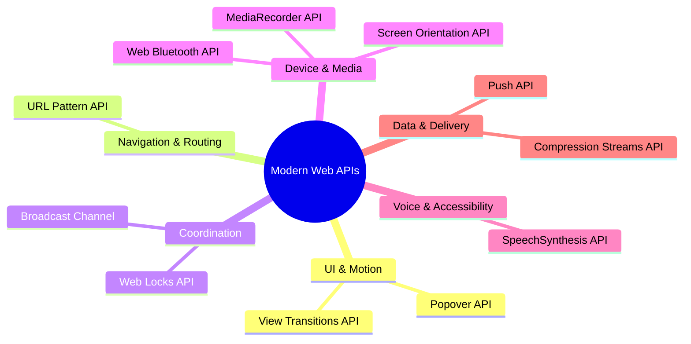

### The Shift, Quantified

| Capability | The npm Era | The Platform Era |
|---|---|---|
| Animated page transitions | Framer Motion / transition libs (~15–45 kB) | `document.startViewTransition()` — 0 kB |
| Accessible dropdown/tooltip | Radix / Headless UI / Popper (~10–30 kB) | `popover` attribute — 0 kB |
| Route matching | path-to-regexp / react-router (~8–20 kB) | `new URLPattern()` — 0 kB |
| Cross-tab coordination | Redux + storage events, polyfills | `navigator.locks` — 0 kB |
| Client-side compression | pako (~45 kB) | `CompressionStream` — 0 kB |
| Text-to-speech | Cloud TTS APIs (network + per-request cost) | `speechSynthesis` — 0 kB, offline |

> **💡 Key Insight:** The platform doesn't just save bundle size. Native APIs ship with the browser's own accessibility tree, security sandbox, and compositor-level performance — three things JavaScript libraries can only approximate, never fully replicate.

> **⚠️ Reality Check:** "Native" does not mean "universally supported." Several of these ten APIs (cross-document View Transitions, URL Pattern in Firefox, Web Bluetooth everywhere) still require careful feature detection and fallbacks. Every section below tells you exactly where the gaps are.

---

<a name="prerequisites"></a>
## 2. Prerequisites

### Technical Requirements

| Skill | Minimum Level |
|---|---|
| **JavaScript fundamentals** | Comfortable with functions, objects, arrays, and control flow |
| **Async JavaScript** | Understand Promises and can read/write `async`/`await` code |
| **HTML & CSS** | Can read a stylesheet; understand selectors and basic layout |
| **The DOM** | Can query elements and attach event listeners |
| **Service Workers (nice to have)** | Only needed for the Push API section — conceptual understanding is enough |

### What This Tutorial IS and IS NOT

> **📝 This tutorial is:**
> - A **deep dive** into *how* ten modern Web APIs work internally — not just syntax listings
> - A **decision guide** — every section ends with "when to still use a library instead"
> - **Hands-on** — every example is runnable, and the tutorial ends with exercises, a lab, and a 50+ question bank

> **❌ This tutorial is NOT:**
> - An exhaustive spec reference (see MDN links in Further Reading)
> - A framework tutorial (React/Angular/Vue adapters are mentioned only where relevant)
> - A polyfill catalog (we use progressive enhancement, not shims, for missing features)

---

<a name="learning-objectives"></a>
## 3. Learning Objectives

By the end of this tutorial, you will be able to:

1. **Explain the internal mechanics** of each API — snapshot capture and compositor handoff (View Transitions), top-layer rendering (Popover), pattern compilation (URL Pattern), cross-tab mutex semantics (Web Locks), and the push subscription lifecycle.
2. **Implement production-quality code** with each API, including error handling, feature detection, and graceful degradation.
3. **Choose correctly between platform and library** using the decision framework and comparison tables.
4. **Recognize the classic pitfalls** of each API (empty voice lists, fullscreen-gated orientation locks, permission-timing mistakes) and avoid them.
5. **Test browser-API-dependent code** with mocks, feature detection, and end-to-end strategies.
6. **Migrate an existing library-based codebase** to platform APIs incrementally and safely.
7. **Apply security best practices** around permissions, VAPID keys, user gestures, and secure contexts.

---

<a name="how-to-use"></a>
## 4. How to Use This Tutorial

Each API section follows the same structure:

1. **What problem it solves** — the pain point it replaces
2. **How it works** — a deeper explanation than "here's the syntax"
3. **Multiple examples** — from basic to advanced
4. **A diagram** — visualizing the flow or lifecycle
5. **Real-world use cases**
6. **Browser support & limitations**
7. **When to still use a library instead**

> **💡 Tip:** Short on time? Read sections 15 (Decision Framework) and 16–17 (Best Practices and Anti-Patterns) first, then return to the APIs you actually need. Every API section is self-contained.

---
<a name="view-transitions"></a>
## 5. View Transitions API

### 5.1 The Problem It Solves

Before this API, animating between two UI states (a list turning into a detail view, or a full page navigation) meant manually:

- Measuring the "before" position of every element (`getBoundingClientRect`)
- Measuring the "after" position
- Calculating the delta
- Running a FLIP (First, Last, Invert, Play) animation yourself, or via a library like Framer Motion

This is exactly the kind of work the browser is now willing to do for you.

### 5.2 How It Works

`document.startViewTransition()` takes a callback. Internally, the browser:

1. Takes a **screenshot** of the current DOM state
2. Runs your callback, which updates the DOM to the new state
3. Takes a screenshot of the **new** state
4. Cross-fades and animates between the two, **on the compositor thread** — meaning it doesn't block JavaScript execution or trigger layout thrashing the way a hand-rolled animation might

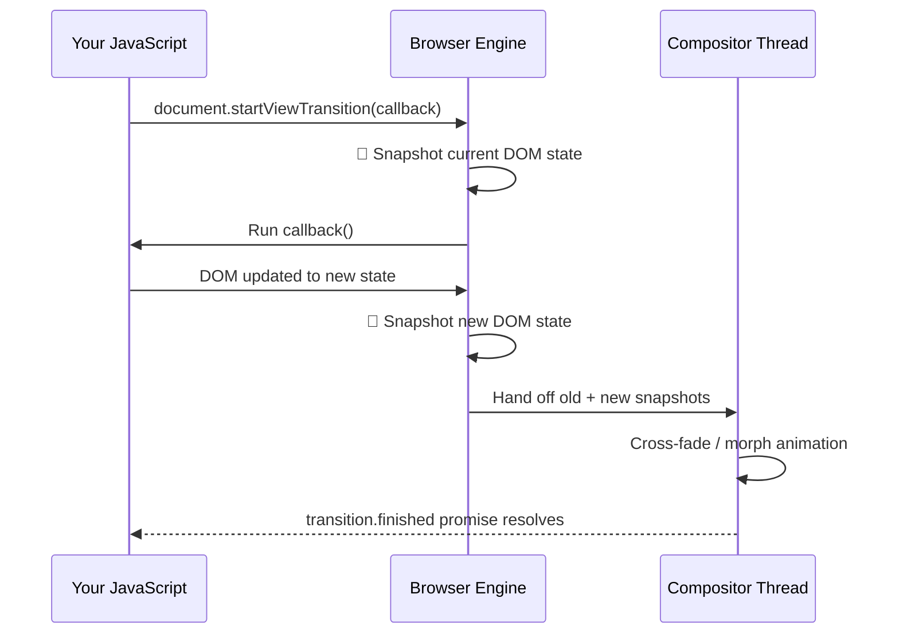

### 5.3 Examples (Basic → Advanced)

#### Example 1: Basic Same-Document Transition

```javascript
function updateDOMToNewState() {
  document.getElementById("card").classList.add("expanded");
}

document.startViewTransition(() => {
  updateDOMToNewState();
});
```

#### Example 2: Named Transitions for Shared-Element Animation

You can animate a *specific* element (like a thumbnail morphing into a hero image) by giving it a `view-transition-name`:

```css
.product-thumbnail {
  view-transition-name: product-hero;
}
```

```javascript
async function openProductDetail(product) {
  const transition = document.startViewTransition(() => {
    renderProductDetailPage(product);
  });

  await transition.finished;
  console.log("Transition complete");
}
```

#### Example 3: Full Page Navigation (Cross-Document)

No JavaScript required — just an opt-in in CSS on both the source and destination pages:

```css
@view-transition {
  navigation: auto;
}
```

#### Example 4: Progressive Enhancement Fallback

```css
@supports (view-transition-name: none) {
  .card {
    view-transition-name: card-transition;
  }
}
```

```javascript
function navigate(newState) {
  if (!document.startViewTransition) {
    // Fallback for unsupported browsers
    updateDOMToNewState(newState);
    return;
  }
  document.startViewTransition(() => updateDOMToNewState(newState));
}
```

### 5.4 Correct vs. Incorrect: Timing Is Everything

```javascript
// ❌ Wrong: the DOM is already changed when the "before" snapshot is taken,
// so the browser has nothing to animate — the change just happens instantly.
document.getElementById("card").classList.add("expanded");
document.startViewTransition(() => { /* nothing left to do */ });
```

```javascript
// ✅ Right: the DOM change happens *inside* the callback.
document.startViewTransition(() => {
  document.getElementById("card").classList.add("expanded");
});
```

> **⚠️ Pitfall:** Every rendered element must have a **unique** `view-transition-name`. If two elements share one (e.g., a list where every item got the same name), the transition is skipped entirely and the console reports a duplicate-name error. Generate names programmatically when animating list items:

```javascript
items.forEach((item, i) => item.style.viewTransitionName = `item-${i}`);
```

### 5.5 Error Handling and Skipping

```javascript
const transition = document.startViewTransition(async () => {
  const data = await fetchProductDetail(id); // network I/O inside the transition
  renderDetail(data);                        // DOM update after data arrives
});

// If the callback throws, the old snapshot stays on screen and the
// transition never starts. Handle it explicitly:
try {
  await transition.updateCallbackDone;
} catch (err) {
  console.error("DOM update failed:", err);
  transition.skipTransition(); // bail out gracefully, restore normal rendering
}
```

> **💡 Key Insight:** A `ViewTransition` exposes three distinct promises: `updateCallbackDone` (did your callback succeed?), `ready` (are snapshots captured and the animation about to start?), and `finished` (is the whole thing over?). Use `updateCallbackDone` for error handling and `finished` for cleanup logic.

### 5.6 Real-World Use Cases

| Scenario | How View Transitions Help |
|---|---|
| E-commerce product grid → detail page | Thumbnail smoothly morphs into hero image |
| Multi-step form wizard | Steps slide/fade without a JS animation library |
| Dark mode toggle | Smooth cross-fade instead of an instant jarring switch |
| Full MPA (multi-page app) navigation | Native page transitions with zero JS |

### 5.7 Limitations

- Same-document transitions: supported across all major browsers
- Cross-document transitions: Chrome and Safari; Firefox is still catching up
- Best treated as **progressive enhancement**, not a hard dependency

### 5.8 When to Still Use a Library

If you need complex physics-based animation (springs, gestures, drag interactions), Framer Motion still has capabilities View Transitions doesn't attempt to replace.

---
<a name="popover"></a>
## 6. Popover API

### 6.1 The Problem It Solves

Building a dropdown, tooltip, or menu by hand usually runs into three recurring nightmares:

1. **Z-index wars** — the popover gets clipped by a parent's `overflow: hidden`
2. **Focus management** — trapping and restoring focus correctly for accessibility
3. **Dismiss logic** — closing on outside click, Escape key, or scroll, without bugs

### 6.2 How It Works

Any element with the `popover` attribute is automatically promoted to the browser's **top layer** — a special rendering layer above the entire document, the same mechanism `<dialog>` uses. This sidesteps stacking context and overflow issues entirely.

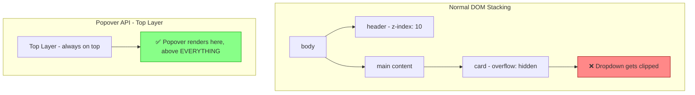

Popovers are also **light-dismiss by default** (`popover="auto"`): clicking outside or pressing Escape closes them, and the browser restores focus to the invoking element. With `popover="manual"`, you control opening and closing yourself.

### 6.3 Examples (Basic → Advanced)

#### Example 1: Basic Popover

```html
<button popovertarget="menu">Open menu</button>
<div id="menu" popover>
  <p>Menu content here</p>
</div>
```

#### Example 2: Manual Control (No Toggle Button)

```html
<div id="tooltip" popover="manual">
  Helpful tip text
</div>
```

```javascript
const tooltip = document.getElementById("tooltip");

button.addEventListener("mouseenter", () => tooltip.showPopover());
button.addEventListener("mouseleave", () => tooltip.hidePopover());
```

#### Example 3: Explicit Show/Hide/Toggle Actions

```html
<button popovertarget="menu" popovertargetaction="show">Show</button>
<button popovertarget="menu" popovertargetaction="hide">Hide</button>
```

#### Example 4: Styling the Popover and Its Backdrop

```css
[popover] {
  border-radius: 8px;
  padding: 1rem;
  border: none;
  box-shadow: 0 8px 24px rgba(0, 0, 0, 0.15);
}

[popover]::backdrop {
  background: rgba(0, 0, 0, 0.3);
}
```

#### Example 5: Reacting to Open/Close State

```javascript
const menu = document.getElementById("menu");

menu.addEventListener("toggle", (event) => {
  // event.newState: "open" | "closed"; event.oldState: the previous state
  if (event.newState === "open") {
    console.log("Menu opened — lazy-load its content here");
  }
});
```

### 6.4 Correct vs. Incorrect: Declarative Beats Imperative

```javascript
// ❌ Fragile: hand-rolled open/close with z-index juggling and manual listeners
document.addEventListener("click", (e) => {
  if (!menu.contains(e.target) && !button.contains(e.target)) {
    menu.style.display = "none"; // no focus restore, no Escape key, no top layer
  }
});
```

```html
<!-- ✅ Right: the browser handles top layer, light-dismiss, and focus -->
<button popovertarget="menu">Open menu</button>
<div id="menu" popover>Menu content</div>
```

> **💡 Pro Tip:** Guard `showPopover()` calls. Calling `showPopover()` on an already-open popover throws `InvalidStateError`. Check `el.matches(":popover-open")` first, or wrap in `try/catch`:

```javascript
function safeShow(el) {
  if (!el.matches(":popover-open")) {
    try { el.showPopover(); } catch (err) { console.warn("Popover failed:", err); }
  }
}
```

### 6.5 Real-World Use Cases

- **Navigation menus** that need to escape a fixed-height header
- **Tooltips** inside cards with `overflow: hidden`
- **Toast notifications** that must always render above modals
- **Context menus** (right-click style menus) without a positioning library

### 6.6 Limitations

- Core functionality works reliably across all major browsers
- Minor focus-handling inconsistencies remain specifically for popovers nested inside **Shadow DOM**, in Firefox and Safari
- Popover **does not position** the element for you — it pairs beautifully with the CSS Anchor Positioning API for that

### 6.7 When to Still Use a Library Instead

Radix, Headless UI, and Floating UI still win when you need combobox behaviors, rich keyboard-navigable listboxes, or complex multi-level menus — though check whether their latest versions build on the Popover API internally (many now do).

---

<a name="url-pattern"></a>
## 7. URL Pattern API

### 7.1 The Problem It Solves

Every router library — React Router, Vue Router, or a custom Express-style router — has, at its core, logic that turns a pattern like `/products/:id` into a regular expression and extracts named groups from a matching URL. That logic is now built into the browser.

### 7.2 How It Works

`URLPattern` compiles a route-style pattern into an internal matcher. Calling `.exec()` on a URL either returns `null` (no match) or a result object containing named groups extracted from the URL.

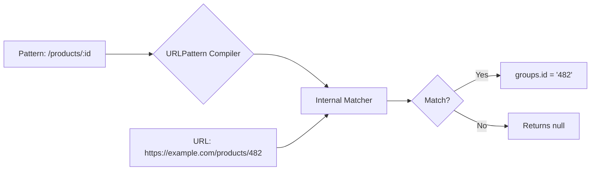

A `URLPattern` matches **five components at once**: protocol, username, password, hostname, and pathname (plus port, search, and hash). Matching is component-wise, which is why results are grouped per component (`match.pathname.groups`, `match.hostname.groups`, ...).

### 7.3 Examples (Basic → Advanced)

#### Example 1: Basic Path Matching

```javascript
const pattern = new URLPattern({ pathname: "/products/:id" });
const match = pattern.exec("https://example.com/products/482");
console.log(match.pathname.groups.id); // "482"
```

#### Example 2: Multiple Named Groups

```javascript
const pattern = new URLPattern({ pathname: "/blog/:year/:month/:slug" });
const match = pattern.exec("https://example.com/blog/2026/08/view-transitions");

console.log(match.pathname.groups);
// { year: "2026", month: "08", slug: "view-transitions" }
```

#### Example 3: Wildcards, Optional Segments, and Host Matching

```javascript
const wildcard = new URLPattern({ pathname: "/files/*" });
console.log(wildcard.test("https://example.com/files/a/b/c.pdf")); // true

const optional = new URLPattern({ pathname: "/products/:id/:variant?" });
console.log(optional.exec("https://example.com/products/482")); // matches, variant undefined

// Match a specific host, not just any:
const api = new URLPattern({ hostname: "api.example.com", pathname: "/v1/:resource" });
console.log(api.test("https://api.example.com/v1/orders")); // true
```

#### Example 4: Matching Inside a Service Worker

```javascript
const apiPattern = new URLPattern({ pathname: "/api/v1/*" });

self.addEventListener("fetch", (event) => {
  if (apiPattern.test(event.request.url)) {
    event.respondWith(handleApiRequest(event.request));
  } else {
    event.respondWith(caches.match(event.request));
  }
});
```

#### Example 5: Compile Once, Reuse Many Times

```javascript
// ❌ Wrong: compiling inside a hot path (service worker fetch handler)
self.addEventListener("fetch", (event) => {
  if (new URLPattern({ pathname: "/api/*" }).test(event.request.url)) { /* ... */ }
});

// ✅ Right: compile at startup, reuse
const routes = {
  api: new URLPattern({ pathname: "/api/v1/*" }),
  assets: new URLPattern({ pathname: "/assets/:name.:ext" }),
};
```

### 7.4 Real-World Use Cases

- **Service worker routing** — deciding which requests to cache vs. proxy to network
- **Lightweight client-side routers** without a full framework
- **Middleware-style logic** in edge functions that need route matching
- **Deep-link validation** in a PWA

### 7.5 Limitations

Well supported in Chromium browsers and Safari; check current Firefox coverage before relying on it as a hard dependency in production. A tiny, tree-shakeable fallback (or the `urlpattern` npm package, which is the same code as the spec) keeps unsupported browsers working.

---
<a name="web-locks"></a>
## 8. Web Locks API

### 8.1 The Problem It Solves

Imagine a user has your app open in three browser tabs. All three tabs detect an expired auth token at the same moment and each tries to refresh it independently. Now you've got a race condition — duplicate network requests, possibly invalidated tokens, or a corrupted auth state.

### 8.2 How It Works

`navigator.locks.request()` acts like a mutex, but **across tabs, not just within one**. Only one tab can hold a named lock at a time; others requesting the same lock name queue up and wait their turn.

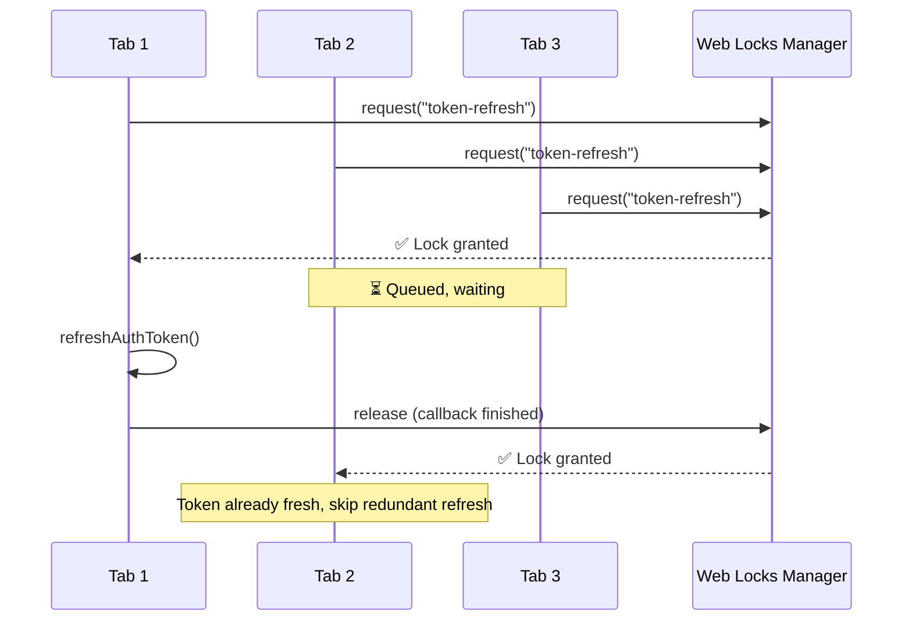

Two details matter for correct usage:

1. **The lock is released when the callback's promise settles** — an `async` callback that awaits network I/O holds the lock the whole time. That's a feature: the lock guards the entire critical section.
2. **Locks are best-effort, not durable.** They live in memory, are scoped to the origin, and are released when the tab navigates or crashes. Never use them as a source of truth — they are a coordination primitive, not storage.

### 8.3 Examples (Basic → Advanced)

#### Example 1: Basic Cross-Tab Coordination

```javascript
navigator.locks.request("token-refresh", async (lock) => {
  await refreshAuthToken();
});
```

#### Example 2: Avoiding Redundant Work (Double-Check Inside the Lock)

```javascript
navigator.locks.request("token-refresh", async () => {
  if (isTokenStillFresh()) {
    return; // another tab already refreshed it while we waited
  }
  await refreshAuthToken();
});
```

#### Example 3: Non-Blocking Check (`ifAvailable`)

```javascript
navigator.locks.request(
  "sync-job",
  { ifAvailable: true },
  async (lock) => {
    if (!lock) {
      console.log("Another tab is already syncing");
      return;
    }
    await performBackgroundSync();
  }
);
```

#### Example 4: Combining With Broadcast Channel

```javascript
const channel = new BroadcastChannel("auth");

navigator.locks.request("token-refresh", async () => {
  const newToken = await refreshAuthToken();
  channel.postMessage({ type: "TOKEN_UPDATED", token: newToken });
});

channel.onmessage = (event) => {
  if (event.data.type === "TOKEN_UPDATED") {
    updateLocalToken(event.data.token);
  }
};
```

#### Example 5: Shared vs. Exclusive Modes (Reader/Writer Pattern)

```javascript
// Multiple readers can hold 'shared' locks simultaneously...
await navigator.locks.request("config", { mode: "shared" }, async () => {
  return await readConfig();
});

// ...but an 'exclusive' (default) writer blocks all of them
await navigator.locks.request("config", { mode: "exclusive" }, async () => {
  await writeConfig(newConfig);
});
```

### 8.4 Correct vs. Incorrect: Why localStorage "Locks" Fail

```javascript
// ❌ Wrong: localStorage flags are NOT atomic across tabs
if (!localStorage.getItem("refreshing")) {
  localStorage.setItem("refreshing", "true");
  await refreshAuthToken();            // two tabs can pass the check
  localStorage.removeItem("refreshing"); // before either sets the flag
}
```

```javascript
// ✅ Right: the browser grants the lock to exactly one tab
await navigator.locks.request("token-refresh", async () => {
  if (!isTokenStillFresh()) await refreshAuthToken();
});
```

### 8.5 Error Handling: Abort and Timeouts

```javascript
// Don't queue forever — bail out if the lock doesn't come free in 3 seconds
const controller = new AbortController();
setTimeout(() => controller.abort(), 3000);

try {
  await navigator.locks.request("heavy-migration", { signal: controller.signal }, async () => {
    await runMigration();
  });
} catch (err) {
  console.warn("Could not acquire lock in time:", err.name); // "AbortError"
}
```

### 8.6 Real-World Use Cases

- **Auth token refresh** coordination across tabs
- **IndexedDB writes** that must not race between tabs
- **Background sync jobs** that should only run once, not once per open tab
- **Leader election** — designating one tab as the "primary" for a shared task

### 8.7 Limitations

Supported in all major browsers (it spread from Chromium to Safari 15.2 and Firefox 96), but **not available in non-secure contexts** — your app must be on HTTPS. There is no built-in priority ordering for the queue; grants are roughly first-come, first-served.

### 8.8 When to Still Use a Library Instead

If you need locks that survive tab crashes, work across devices, or coordinate server-side, you need real infrastructure — Redis/Redlock, database advisory locks, or a leader-election service. Web Locks coordinate *tabs on one device, one browser profile, one origin* — nothing more.

---

<a name="screen-orientation"></a>
## 9. Screen Orientation API

### 9.1 The Problem It Solves

Games, video players, and media apps often need to know — or control — whether the device is in portrait or landscape mode.

### 9.2 How It Works

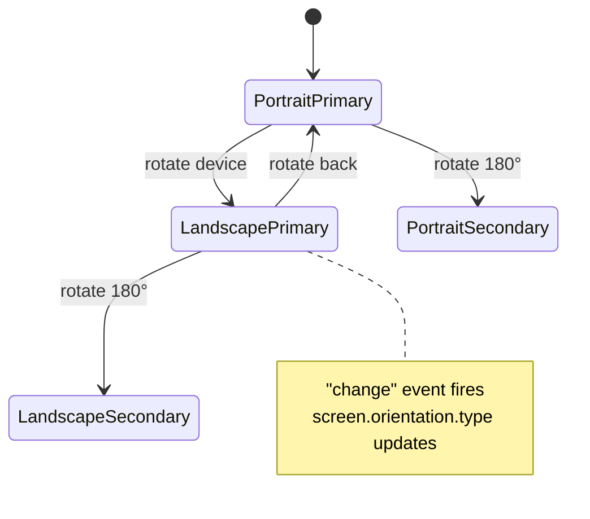

The `type` property reports one of four values (`portrait-primary`, `portrait-secondary`, `landscape-primary`, `landscape-secondary`), and `angle` reports the current rotation in degrees (0, 90, 180, or 270). The `change` event fires on `screen.orientation` whenever either changes.

### 9.3 Examples (Basic → Advanced)

#### Example 1: Reading Current Orientation

```javascript
console.log(screen.orientation.type);  // "portrait-primary"
console.log(screen.orientation.angle); // 0
```

#### Example 2: Reacting to Orientation Changes

```javascript
screen.orientation.addEventListener("change", () => {
  console.log("Orientation changed to", screen.orientation.type);
  adjustGameLayout(screen.orientation.type);
});
```

#### Example 3: Locking Orientation (Requires Fullscreen)

```javascript
async function enterGameMode() {
  await document.documentElement.requestFullscreen();
  try {
    await screen.orientation.lock("landscape");
  } catch (err) {
    console.warn("Orientation lock not supported:", err);
  }
}
```

#### Example 4: Conditional UI Based on Orientation

```javascript
function updateLayout() {
  const isLandscape = screen.orientation.type.startsWith("landscape");
  document.body.classList.toggle("landscape-layout", isLandscape);
}

screen.orientation.addEventListener("change", updateLayout);
updateLayout();
```

### 9.4 Correct vs. Incorrect: Listening in the Right Place

```javascript
// ❌ Wrong: guessing via resize events misses 180° flips and fires for
// unrelated resizes (dev tools opening, keyboard popping up on mobile).
window.addEventListener("resize", () => {
  const isLandscape = window.innerWidth > window.innerHeight; // approximate
});

// ✅ Right: the platform tells you exactly what happened
screen.orientation.addEventListener("change", () => {
  const isLandscape = screen.orientation.type.startsWith("landscape");
});
```

> **⚠️ Warning:** `screen.orientation.lock()` throws a `NotSupportedError` on most desktop browsers and a `SecurityError` if the document is not fullscreen. Always wrap it in `try/catch` and design your layout to work in *both* orientations regardless — the lock is a bonus, never a guarantee.

### 9.5 Real-World Use Cases

- **Mobile games** locking to landscape during gameplay
- **Video players** that switch to a cinema layout in landscape
- **Camera/scanner apps** adjusting UI controls based on device rotation

### 9.6 Limitations

Reading orientation works everywhere; **locking** it is generally mobile-only and typically requires fullscreen mode first. iOS Safari historically ignored orientation locks entirely — verify behavior on real devices before committing to a lock-dependent UX.

---
<a name="mediarecorder"></a>
## 10. MediaRecorder API

### 10.1 The Problem It Solves

Recording audio or video used to require either a native app or shipping media to a server for processing. `MediaRecorder` does it entirely client-side.

### 10.2 How It Works

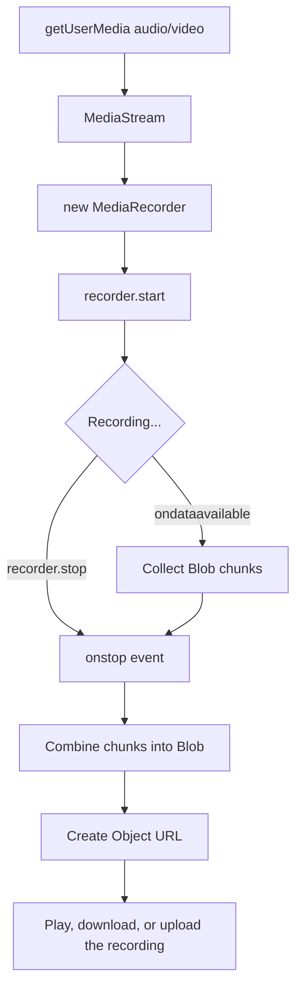

The recorder consumes a `MediaStream` (from a camera, microphone, screen, or even a `<canvas>`) and emits it as a sequence of `Blob` chunks. Two behaviors matter in production:

1. **Chunks are only guaranteed at `stop()`** unless you pass a *timeslice* to `start()` — `recorder.start(1000)` flushes a chunk every second, which is essential for long recordings (memory) and live uploads (streaming).
2. **The browser picks a container/codec** (`audio/webm`, `video/mp4`, ...) depending on platform. Never hard-code one — negotiate with `MediaRecorder.isTypeSupported()`.

### 10.3 Examples (Basic → Advanced)

#### Example 1: Recording Audio

```javascript
const stream = await navigator.mediaDevices.getUserMedia({ audio: true });
const recorder = new MediaRecorder(stream);
const chunks = [];

recorder.ondataavailable = (e) => chunks.push(e.data);
recorder.onstop = () => {
  const blob = new Blob(chunks, { type: recorder.mimeType });
  console.log("Recording ready:", URL.createObjectURL(blob));
};

recorder.start();
// later: recorder.stop();
```

#### Example 2: Recording Video With a Time Limit

```javascript
const stream = await navigator.mediaDevices.getUserMedia({ video: true, audio: true });
const recorder = new MediaRecorder(stream, { mimeType: "video/webm;codecs=vp9" });
const chunks = [];

recorder.ondataavailable = (e) => e.data.size > 0 && chunks.push(e.data);
recorder.start();

setTimeout(() => recorder.stop(), 30000); // auto-stop after 30s
```

#### Example 3: Recording the Canvas Element (Screen/Animation Capture)

```javascript
const canvas = document.querySelector("canvas");
const stream = canvas.captureStream(30); // 30 fps
const recorder = new MediaRecorder(stream);
const chunks = [];

recorder.ondataavailable = (e) => chunks.push(e.data);
recorder.onstop = () => {
  const blob = new Blob(chunks, { type: "video/webm" });
  downloadBlob(blob, "canvas-recording.webm");
};

recorder.start();
```

#### Example 4: Uploading the Recording Directly

```javascript
recorder.onstop = async () => {
  const blob = new Blob(chunks, { type: "audio/webm" });
  const formData = new FormData();
  formData.append("audio", blob, "voice-memo.webm");

  await fetch("/api/upload", { method: "POST", body: formData });
};
```

### 10.4 Correct vs. Incorrect: Codec Negotiation and Cleanup

```javascript
// ❌ Wrong: assuming a codec, and never releasing the camera/mic
const recorder = new MediaRecorder(stream, { mimeType: "video/mp4" }); // throws on Firefox
// ...stream tracks stay live forever: hot mic, camera LED on, battery drain
```

```javascript
// ✅ Right: negotiate, then always release hardware in a finally block
const candidates = ["video/webm;codecs=vp9,opus", "video/webm", "video/mp4"];
const mimeType = candidates.find((t) => MediaRecorder.isTypeSupported(t));

try {
  const recorder = new MediaRecorder(stream, mimeType ? { mimeType } : undefined);
  // ...record...
} finally {
  stream.getTracks().forEach((track) => track.stop()); // release camera + mic
}
```

> **⚠️ Edge Case:** If a recording comes out as an empty or unplayable Blob, the usual causes are: calling `stop()` before any `dataavailable` fired, stopping the stream tracks *before* the recorder, or a codec/container mismatch. For recordings longer than a few seconds, always use `start(timeslice)`.

### 10.5 Real-World Use Cases

- **In-browser voice memo apps**
- **Screen/canvas recorders** for tutorials or demo capture
- **Video note apps** attached to tickets or documents
- **Async video messaging** tools (Loom-style)

### 10.6 Limitations

Works across all major browsers, but container formats differ (Chrome/Firefox favor WebM, Safari favors MP4). There is no built-in pause-resume-to-new-file, no native MP3 output, and `getDisplayMedia` screen capture requires a user gesture plus its own permission prompt.

### 10.7 When to Still Use a Library Instead

For **live-streaming** (WebRTC SFUs like LiveKit or Janus), post-processing (trimming, transcoding — e.g., ffmpeg.wasm), or waveform visualization, dedicated libraries still earn their place. Plain record-download-upload flows do not need one.

---

<a name="speechsynthesis"></a>
## 11. SpeechSynthesis API

### 11.1 The Problem It Solves

Text-to-speech historically meant shipping pre-recorded audio files or calling a paid cloud API. `SpeechSynthesis` uses the operating system's built-in voices, for free, with zero network round-trip.

### 11.2 How It Works

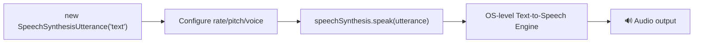

The browser delegates synthesis to the OS speech engine, so voice availability varies by device and platform. Crucially, `speechSynthesis.getVoices()` returns the voice list **asynchronously** on some browsers — calling it once at page load often yields an empty array.

### 11.3 Examples (Basic → Advanced)

#### Example 1: Basic Usage

```javascript
const utterance = new SpeechSynthesisUtterance("Your order has shipped");
utterance.rate = 1;
speechSynthesis.speak(utterance);
```

#### Example 2: Choosing a Specific Voice (the Safe Way)

```javascript
// ❌ Wrong: voices may not be loaded yet on Chrome
const voices = speechSynthesis.getVoices(); // often [] at page load

// ✅ Right: wait for the voiceschanged event
function loadVoices() {
  return new Promise((resolve) => {
    const existing = speechSynthesis.getVoices();
    if (existing.length) return resolve(existing);
    speechSynthesis.addEventListener("voiceschanged", () => resolve(speechSynthesis.getVoices()), { once: true });
  });
}

async function speakWithVoice(text, voiceName) {
  const voices = await loadVoices();
  const utterance = new SpeechSynthesisUtterance(text);
  utterance.voice = voices.find((v) => v.name === voiceName) || voices[0];
  speechSynthesis.speak(utterance);
}
```

#### Example 3: Read-Aloud for an Article

```javascript
function readArticleAloud(articleText) {
  const utterance = new SpeechSynthesisUtterance(articleText);
  utterance.rate = 0.95;
  utterance.pitch = 1;

  utterance.onboundary = (event) => {
    highlightWordAt(event.charIndex); // sync highlight with speech
  };

  utterance.onerror = (event) => console.error("Speech failed:", event.error);
  speechSynthesis.speak(utterance);
}
```

#### Example 4: Pause, Resume, and Cancel Controls

```javascript
document.getElementById("pause-btn").onclick = () => speechSynthesis.pause();
document.getElementById("resume-btn").onclick = () => speechSynthesis.resume();
document.getElementById("stop-btn").onclick = () => speechSynthesis.cancel();
```

> **⚠️ Chrome Quirk:** Long utterances (roughly 15+ seconds of speech) can stall mid-way in Chrome. The well-known workaround is a keep-alive timer:

```javascript
setInterval(() => {
  if (speechSynthesis.speaking && !speechSynthesis.paused) {
    speechSynthesis.pause();
    speechSynthesis.resume();
  }
}, 12000);
```

> **💡 Autoplay Policy:** Like audio playback, `speak()` may be ignored until the user interacts with the page. Trigger speech from a click handler, not on page load.

### 11.4 Real-World Use Cases

- **Accessibility tooling** — screen-reader-adjacent features for visually impaired users
- **"Read aloud" buttons** on blog posts or documentation
- **Order/notification confirmations** spoken aloud
- **Language learning apps** for pronunciation

### 11.5 Pairs With

The Speech *Recognition* API (speech-to-text), covered in Part 1 — together they form a complete voice interface loop.

### 11.6 When to Still Use a Library Instead

Cloud TTS (ElevenLabs, Azure Neural voices, Google WaveNet) still wins for natural, brand-specific voices and fine-grained SSML control. `SpeechSynthesis` is unbeatable for zero-cost, offline, low-latency utility speech.

---
<a name="compression-streams"></a>
## 12. Compression Streams API

### 12.1 The Problem It Solves

Compressing data client-side (before an upload) or decompressing a fetched resource used to require a JS compression library like pako.

### 12.2 How It Works

Compression happens as a **stream**, meaning data is processed in chunks rather than loaded entirely into memory first — important for large files. The API exposes two global transform classes:

- `CompressionStream(format)` — compresses
- `DecompressionStream(format)` — decompresses

Both accept three formats: `"gzip"`, `"deflate"` (zlib wrapper), and `"deflate-raw"` (raw DEFLATE, no wrapper — this is the format of a ZIP entry's payload). Because they are standard stream transforms, they plug into `ReadableStream.pipeThrough()` and compose with any other stream processing you already have.

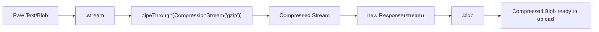

The `new Response(stream)` trick is the idiomatic way to consume a stream: the `Response` constructor accepts a stream as a body, letting you collect the result as `.blob()`, `.text()`, `.arrayBuffer()`, or even pipe it onward.

### 12.3 Examples (Basic → Advanced)

#### Example 1: Compressing Text

```javascript
async function compress(text) {
  const stream = new Blob([text]).stream().pipeThrough(new CompressionStream("gzip"));
  return new Response(stream).blob();
}
```

#### Example 2: Decompressing a Fetched Resource

```javascript
async function decompress(blob) {
  const stream = blob.stream().pipeThrough(new DecompressionStream("gzip"));
  return new Response(stream).text();
}
```

#### Example 3: Compressing a Large File Before Upload

```javascript
async function compressFile(file) {
  const compressedStream = file.stream().pipeThrough(new CompressionStream("gzip"));
  const compressedBlob = await new Response(compressedStream).blob();

  const formData = new FormData();
  formData.append("file", compressedBlob, `${file.name}.gz`);
  await fetch("/api/upload", { method: "POST", body: formData });
}
```

#### Example 4: Using `deflate` Instead of `gzip`

```javascript
const compressed = new Blob([jsonString])
  .stream()
  .pipeThrough(new CompressionStream("deflate"));
```

#### Example 5: A Round-Trip With Compression-Ratio Reporting

```javascript
async function gzipRoundTrip(text) {
  const compressed = await new Response(
    new Blob([text]).stream().pipeThrough(new CompressionStream("gzip"))
  ).arrayBuffer();

  const decompressed = await new Response(
    new Blob([compressed]).stream().pipeThrough(new DecompressionStream("gzip"))
  ).text();

  if (decompressed !== text) throw new Error("Compression round-trip failed!");
  console.log(`Ratio: ${(compressed.byteLength / new Blob([text]).size * 100).toFixed(1)}%`);
  return compressed;
}
```

### 12.4 Correct vs. Incorrect: Pick the Right Data

```javascript
// ❌ Pointless: JPEG, PNG, MP4, and ZIP are already compressed —
// gzip adds CPU time and can even make them slightly larger.
await compressBlob(new Blob([jpegBytes]), "gzip");
```

```javascript
// ✅ Right: highly repetitive text — JSON, CSV, logs, SVG, source code —
// routinely shrinks 5–20x.
const gz = await new Response(
  jsonBlob.stream().pipeThrough(new CompressionStream("gzip"))
).blob();
```

### 12.5 Real-World Use Cases

- **Compressing form/log payloads** before sending to an API
- **Client-side caching** of large text data in IndexedDB with less storage overhead
- **Decompressing gzip resources** fetched from third-party APIs without a library
- **Importing `.gz` exports** (analytics dumps, backups) directly in the browser

### 12.6 Limitations and Browser Support

Supported in all major browsers and in Node.js (18+ via `node:stream/web`, stable globals in 19+). No support for archives (`.zip` containers) or formats like brotli — the API is deliberately minimal. The main server-side gotcha: your backend must know the payload is gzipped (e.g., a `Content-Encoding: gzip` header on raw-body uploads) — don't expect frameworks to decompress a file inside `multipart/form-data` automatically.

### 12.7 When to Still Use a Library Instead

Need ZIP archives (multiple files + directory structure), brotli, or streaming compression in very old browsers? pako, fflate, or JSZip remain the right tools. For single-payload gzip/deflate, the platform is enough.

---

<a name="web-bluetooth"></a>
## 13. Web Bluetooth API

### 13.1 The Problem It Solves

Connecting a web app directly to a nearby Bluetooth Low Energy (BLE) device — a heart rate monitor, a smart light, a fitness tracker — without a native app.

### 13.2 How It Works

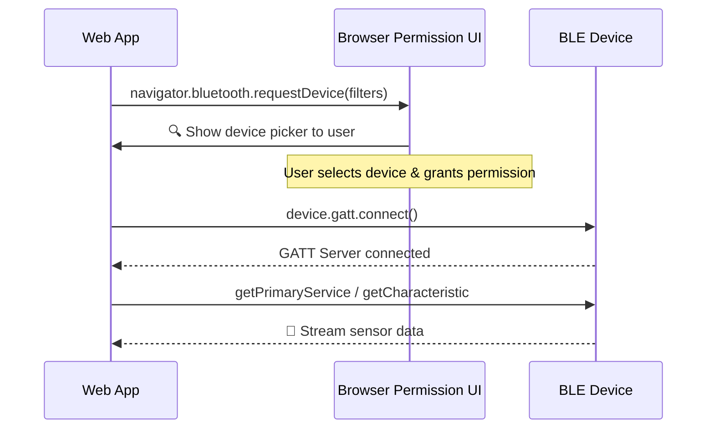

BLE devices expose a **GATT** (Generic Attribute Profile) hierarchy: a *server* offers *services* (identified by UUIDs or standard names like `heart_rate`), which contain *characteristics* — the actual readable, writable, notifiable values. The browser never scans silently: `requestDevice()` always shows the user a picker, and the user explicitly grants access to one device.

### 13.3 Examples (Basic → Advanced)

#### Example 1: Connecting to a Heart Rate Monitor

```javascript
const device = await navigator.bluetooth.requestDevice({
  filters: [{ services: ["heart_rate"] }],
});
const server = await device.gatt.connect();
```

#### Example 2: Reading a Characteristic Value

```javascript
const service = await server.getPrimaryService("heart_rate");
const characteristic = await service.getCharacteristic("heart_rate_measurement");
const value = await characteristic.readValue();

console.log("Heart rate:", value.getUint8(1)); // per the Bluetooth spec layout
```

#### Example 3: Listening for Live Updates (Notifications)

```javascript
await characteristic.startNotifications();
characteristic.addEventListener("characteristicvaluechanged", (event) => {
  const heartRate = event.target.value.getUint8(1);
  updateHeartRateDisplay(heartRate);
});
```

#### Example 4: Handling Disconnection Gracefully

```javascript
device.addEventListener("gattserverdisconnected", () => {
  console.log("Device disconnected, attempting reconnect...");
  reconnectToDevice(device);
});

async function reconnectToDevice(d, attempts = 5) {
  for (let i = 0; i < attempts; i++) {
    try {
      await d.gatt.connect(); // re-reads services on the same device object
      return;
    } catch (err) {
      await new Promise((r) => setTimeout(r, 500 * (i + 1))); // backoff
    }
  }
  console.error("Reconnection failed — ask the user to pick the device again");
}
```

### 13.4 Correct vs. Incorrect: User Gesture and Error Handling

```javascript
// ❌ Wrong: calling requestDevice() on page load — it throws a TypeError
// because the API requires a user gesture (a click, tap, or keypress).
window.addEventListener("load", () => navigator.bluetooth.requestDevice({ acceptAllDevices: true }));
```

```javascript
// ✅ Right: triggered by a click, with cancellation handled
scanButton.addEventListener("click", async () => {
  try {
    const device = await navigator.bluetooth.requestDevice({
      filters: [{ services: ["heart_rate"] }],
    });
    await connect(device);
  } catch (err) {
    if (err.name === "NotFoundError") return; // user cancelled the picker — not an error
    console.error("Bluetooth failed:", err.name, err.message);
  }
});
```

> **⚠️ Gotcha:** `filters` and `acceptAllDevices` are mutually exclusive. If you use `acceptAllDevices: true`, you must pass `optionalServices: ["battery_service", ...]` — otherwise you cannot access *any* services on the device, even after connecting.

### 13.5 Real-World Use Cases

- **Fitness tracker dashboards** reading live heart rate/step data
- **Smart home controllers** for BLE lights, locks, or thermostats
- **Hardware prototyping tools** for makers testing BLE devices

### 13.6 Limitations

Chromium browsers only — no Safari or Firefox support. Requires HTTPS (secure context) and a user gesture. Best used as a Chromium-specific tool or clearly labeled progressive enhancement, with a clear message when `navigator.bluetooth` is undefined.

### 13.7 When to Still Use a Library Instead

Web Bluetooth *is* the library-free path; there's no meaningful npm alternative in the browser. For Native apps, or if you need Bluetooth Classic (audio, SPP serial), you'll need a native wrapper (Capacitor/Electron) — the web API covers BLE GATT only.

---
<a name="push"></a>
## 14. Push API

### 14.1 The Problem It Solves

Sending a notification to a user **even when your site isn't open** — the mechanism behind every "Enable notifications?" prompt.

### 14.2 How It Works

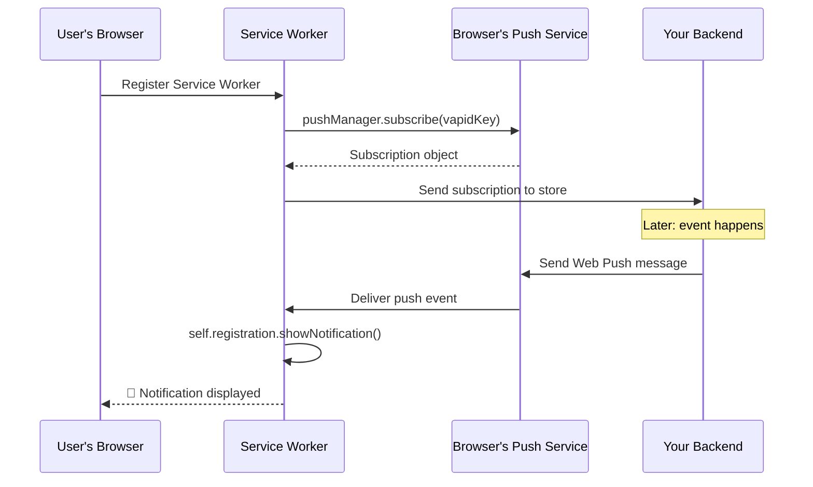

Push is genuinely cross-vendor: Chrome talks to Google's FCM endpoint, Firefox to Mozilla's, Safari to Apple's — but your server only ever speaks standard **Web Push** (RFC 8030) with **VAPID** (Voluntary Application Server Identification) keys, and each browser routes the message itself. Payloads are end-to-end encrypted by the server using keys embedded in the subscription object; the push service can never read the message content.

The full checklist for a working setup:

1. A registered **Service Worker** (the `push` event can only fire there)
2. A **VAPID key pair** generated once, public key on the client, private key on the server
3. A **subscription flow** triggered by a user gesture
4. A backend (or edge function) that stores subscriptions and calls the push endpoint

### 14.3 Examples (Basic → Advanced)

#### Example 1: Subscribing to Push (with the required key conversion)

```javascript
function urlBase64ToUint8Array(base64String) {
  const padding = "=".repeat((4 - (base64String.length % 4)) % 4);
  const base64 = (base64String + padding).replace(/-/g, "+").replace(/_/g, "/");
  const raw = atob(base64);
  return Uint8Array.from([...raw].map((c) => c.charCodeAt(0)));
}

async function subscribeToPush() {
  const registration = await navigator.serviceWorker.ready;
  const subscription = await registration.pushManager.subscribe({
    userVisibleOnly: true,
    applicationServerKey: urlBase64ToUint8Array(publicVapidKey),
  });
  // send `subscription` to your server to store and use later
  await fetch("/api/push/subscribe", {
    method: "POST",
    headers: { "Content-Type": "application/json" },
    body: JSON.stringify(subscription),
  });
}
```

#### Example 2: Handling the Push Event in the Service Worker

```javascript
self.addEventListener("push", (event) => {
  const data = event.data.json();
  event.waitUntil(
    self.registration.showNotification(data.title, {
      body: data.body,
      icon: "/icon.png",
      data: { url: data.url }, // carry context for the click handler
    })
  );
});
```

#### Example 3: Handling Notification Clicks

```javascript
self.addEventListener("notificationclick", (event) => {
  event.notification.close();
  event.waitUntil(
    clients.matchAll({ type: "window", includeUncontrolled: true }).then((windowClients) => {
      // Focus an existing tab if there is one, otherwise open a new window
      const existing = windowClients.find((c) => c.url.includes("/orders"));
      return existing ? existing.focus() : clients.openWindow("/orders/latest");
    })
  );
});
```

#### Example 4: Sending From a Node.js Backend (using `web-push`)

```javascript
const webpush = require("web-push");

webpush.setVapidDetails("mailto:you@example.com", publicVapidKey, privateVapidKey);

await webpush.sendNotification(
  storedSubscription,
  JSON.stringify({ title: "Order shipped!", body: "Track it now", url: "/orders/latest" })
).catch((err) => {
  if (err.statusCode === 404 || err.statusCode === 410) {
    // Subscription expired or user revoked — remove it from the database
    return deleteSubscription(storedSubscription.endpoint);
  }
  throw err;
});
```

### 14.4 Correct vs. Incorrect: Permission Timing

```javascript
// ❌ Wrong: prompting on page load. Most users dismiss it, the browser
// remembers the denial, and winning them back later is nearly impossible.
window.addEventListener("load", () => subscribeToPush());
```

```javascript
// ✅ Right: ask in context, after showing the value first
notifyButton.addEventListener("click", async () => {
  if (Notification.permission === "denied") {
    showInstructions("Notifications are blocked in your browser settings.");
    return;
  }
  await subscribeToPush();
});
```

> **💡 Key Insight:** `userVisibleOnly: true` is mandatory in Chromium — a push subscription that could deliver invisible background messages is rejected. If the `push` event fires and you don't show a notification, the browser displays a generic "site updated in background" notice on your behalf.

### 14.5 Real-World Use Cases

- **E-commerce order updates** ("Your package shipped")
- **Chat apps** notifying users of new messages while the tab is closed
- **News/content apps** alerting users to breaking updates

### 14.6 Limitations

Requires a registered Service Worker **and** a backend capable of sending Web Push messages (using VAPID keys) — more setup than any other API on this list. On iOS and iPadOS, Web Push only works for sites **installed to the home screen as a PWA** (since iOS 16.4). Safari requires HTTPS throughout.

### 14.7 When to Still Use a Library Instead

The client side has no library worth installing — the API is small. On the server, use a proven Web Push library (`web-push` for Node, `pywebpush` for Python, `laravel-notification-channels/webpush` for PHP): they implement payload **encryption** (RFC 8291) and VAPID signing (RFC 8292), which you should never hand-roll.

---

<a name="decision-framework"></a>
## 15. Putting It All Together: A Decision Framework

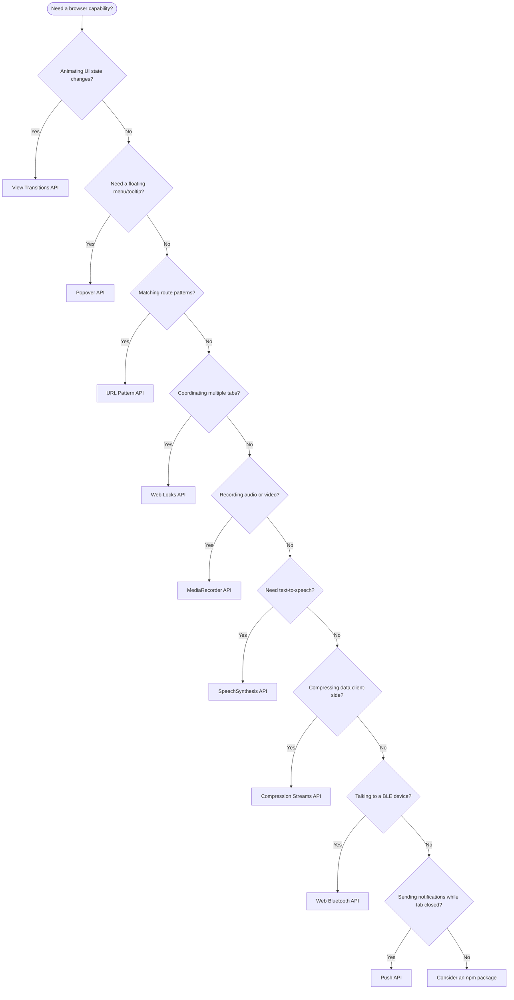

### Quick Reference Table

| API | Solves | Cross-Browser? | Setup Complexity |
|---|---|---|---|
| View Transitions | Animated state/page changes | Partial (Firefox lagging on cross-doc) | Low |
| Popover | Accessible floating UI | Yes | Low |
| URL Pattern | Route matching | Mostly (check Firefox) | Low |
| Web Locks | Cross-tab coordination | Yes | Medium |
| Screen Orientation | Reading/locking orientation | Yes (locking is mobile-only) | Low |
| MediaRecorder | Audio/video capture | Yes | Medium |
| SpeechSynthesis | Text-to-speech | Yes | Low |
| Compression Streams | Client-side gzip/deflate | Yes | Low |
| Web Bluetooth | BLE device connection | Chromium only | Medium |
| Push | Background notifications | Yes | High |

### Library Replacement Matrix

| You currently use... | Replace (partly) with | Keep the library if you need... |
|---|---|---|
| Framer Motion page transitions | View Transitions API | Springs, gestures, drag physics |
| Radix / Headless UI Popover | Popover API (+ CSS Anchor Positioning) | Comboboxes, listboxes, complex menus |
| path-to-regexp / small routers | URL Pattern API | Nested layouts, data loaders, redirects |
| Redux cross-tab sync / storage hacks | Web Locks + BroadcastChannel | Cross-device or server-side state |
| pako / fflate (single-payload gzip) | Compression Streams API | ZIP archives, brotli, old browsers |
| Cloud TTS for utility speech | SpeechSynthesis API | Natural brand voices, SSML, offline-quality |

---
<a name="best-practices"></a>
## 16. Best Practices

1. **Feature-detect, never UA-sniff.** `if ("startViewTransition" in document)` is stable and future-proof; user-agent strings are neither.
2. **Treat every API here as progressive enhancement.** Build the plain, working experience first, then layer the platform polish. Nothing in this guide should be a hard dependency except Push (which is an all-or-nothing feature).
3. **Request permissions inside a user gesture, in context.** Notifications, Bluetooth, microphone, and camera all perform dramatically better when asked *after* the user expressed intent — and worse when asked on page load.
4. **Release what you acquire.** Stop `MediaStream` tracks after recording, call `speechSynthesis.cancel()` when leaving a page, and close `BroadcastChannel`s on teardown. Hardware and OS resources leak silently otherwise.
5. **Name things deliberately.** `view-transition-name` values must be unique per rendered element, and Web Lock names are global per origin — use a namespace convention (e.g., `myapp:token-refresh`) to avoid collisions between features.
6. **Prefer declarative wiring.** `popovertarget` beats `addEventListener`, and `@view-transition { navigation: auto; }` beats a router-integration module — less code, fewer bugs, better accessibility for free.
7. **Write the fallback first.** Decide what unsupported browsers see *before* implementing the API, so the enhancement path never becomes the critical path.
8. **Keep View Transition callbacks fast.** The old snapshot is frozen on screen while your callback runs — move data fetching out of it when you can, or show a loading state in the new state.
9. **Verify on real browsers every release.** Support matrices for these APIs shift quarterly; a CI matrix of Chromium + Firefox + Safari (e.g., Playwright) catches regressions before users do.
10. **Serve over HTTPS.** Web Locks, Web Bluetooth, Push, and Service Workers all require secure contexts — this is non-negotiable infrastructure for the platform era.

---

<a name="anti-patterns"></a>
## 17. Anti-Patterns

| ❌ Anti-Pattern | Why It Hurts | ✅ Do Instead |
|---|---|---|
| UA-string sniffing to gate features | Breaks constantly; new browsers and iOS quirks defeat it | Feature detection with `in` / `typeof` checks |
| Permission prompt on page load | Highest denial rate; browsers remember rejections | Contextual ask behind an explicit button |
| Mutating DOM *before* `startViewTransition()` | Nothing animates; snapshots capture the final state | Mutate inside the callback only |
| Duplicate `view-transition-name` on list items | Transition silently skipped; console error | Generate unique names (`item-${id}`) |
| localStorage flags as cross-tab locks | Not atomic; two tabs pass the check simultaneously | `navigator.locks.request()` |
| `getVoices()` immediately after load | Empty array on Chrome; silent failure | `voiceschanged` event / promise wrapper |
| Holding an exclusive lock across long awaits | Every other tab queues behind a slow network call | Narrow critical section, or `ifAvailable: true` |
| Hard-coded MediaRecorder mimeType | Throws on Safari/Firefox depending on codec | `isTypeSupported()` candidate list |
| Gzipping already-compressed media | Wasted CPU, possibly larger output | Compress text-ish payloads only |
| VAPID private key in client code | Anyone can send push as your site | Private key server-side only |
| `acceptAllDevices` without `optionalServices` | Connected device, zero accessible services | Declare needed services explicitly |

---
<a name="performance"></a>
## 18. Performance Considerations

### View Transitions
- Snapshots are **texture captures**: the old and new states are rasterized off the main thread. Freezing a huge DOM (thousands of elements, large scroll areas) costs memory and capture time — animate subtrees, not the whole page.
- Animations run on the **compositor**, so they stay smooth even while JavaScript is busy — this is the core performance argument over JS-driven FLIP loops.
- Keep the callback short. The old-state snapshot is frozen on screen during it; slow async work inside the callback reads as a visual stall, not a transition.

### Web Locks
- `ifAvailable: true` converts a queued wait into an immediate skip — use it for *opportunistic* work (sync jobs) so tabs never pile up.
- Keep exclusive-lock critical sections as short as possible; every awaited network call inside the lock makes all other tabs wait.

### MediaRecorder
- Without a timeslice, the whole recording accumulates in memory before `stop()` — a 10-minute video can be hundreds of MB. Use `start(1000)` and flush chunks incrementally (upload them or move to IndexedDB).
- Encoding runs in native code off the main thread, but `ondataavailable` handlers run on it — keep them cheap (push to an array or a `WritableStream`).

### SpeechSynthesis
- Synthesis is native and near-zero JS cost, but very long utterances both hit the Chrome stall bug and delay `onboundary` word highlighting — split long articles into sentence- or paragraph-sized utterances and queue them.

### Compression Streams
- The streaming design means a 1 GB log file compresses in a constant memory envelope — this is the decisive advantage over pako, which buffers whole payloads.
- Compression burns CPU on the user's device. For large files, show progress (wrap the stream to count chunks) and consider whether the server could accept raw data and compress on cheap server CPUs instead.

### URL Pattern
- Patterns are compiled once — hoist `new URLPattern(...)` to module scope. Compilation inside a service worker `fetch` handler adds latency to every single request.

### Popover
- Top-layer rendering is cheap; the cost is your content. Lazy-fill popover content on `toggle` (`newState === "open"`) instead of at page load.

### Push
- `event.waitUntil()` keeps the service worker alive while promises run — resolve it promptly or the browser may kill the worker mid-notification.

---

<a name="security"></a>
## 19. Security Considerations

| Concern | Guidance |
|---|---|
| **Secure contexts** | Web Locks, Web Bluetooth, Push, Service Workers, and several other APIs here require HTTPS. Mixed content will silently break them. |
| **Permission fatigue** | Every prompt you show trains users to deny. Batch asks, explain value first, and never re-prompt after denial — surface manual-enable instructions instead. |
| **VAPID keys** | The **private** key signs every push your server sends. Anyone holding it can impersonate your site's push. Keep it in server-side secrets storage, never in client bundles or repos. |
| **Push payload confidentiality** | Web Push mandates payload encryption (RFC 8291); libraries handle it. But treat the *subscription endpoint URL* as a secret too — anyone with it can send unencrypted (empty) pushes to your user. |
| **Bluetooth data sensitivity** | Health sensor data (heart rate, glucose) is personal data under GDPR/HIPAA-adjacent rules. The device picker gives user consent for *connection*, not for what you do with the data — handle it accordingly. |
| **Origin isolation** | `BroadcastChannel` and Web Locks are scoped to the exact origin (`https://app.example.com` ≠ `https://www.example.com`). That's a security feature — don't weaken it by relaying through postMessage wildcards. |
| **Media capture** | A live `getUserMedia` stream is a hot microphone/camera. Always stop tracks; consider visible recording indicators and never capture without explicit user action. |
| **Notification content** | Notification bodies render as plain text, but `data` payloads drive navigation — validate any URL you pass to `clients.openWindow()` against an allowlist to avoid open-redirect abuse. |

---

<a name="testing"></a>
## 20. Testing Strategies

### Layer 1: Unit Tests with Mocks
Most of these APIs are mockable. Vitest/Jest example for a Web Locks-based token refresher:

```javascript
// tokenRefresher.test.js
const locks = new Map(); // simulate: one lock holder at a time

global.navigator = {
  locks: {
    request: (name, fn) => {
      if (locks.has(name)) return Promise.resolve(); // "queued" — skipped in this sim
      locks.set(name, true);
      return Promise.resolve(fn({ name })).finally(() => locks.delete(name));
    },
  },
};

test("second tab skips the refresh", async () => {
  const refresh = vi.fn().mockResolvedValue("token");
  await navigator.locks.request("token-refresh", refresh);
  await navigator.locks.request("token-refresh", refresh);
  expect(refresh).toHaveBeenCalledTimes(1);
});
```

### Layer 2: Component Tests with Fakes
- Fake `MediaRecorder` with an object that emits synthetic `dataavailable`/`stop` events — test that your chunk-collection and upload logic is correct.
- Stub `speechSynthesis` (`speaking`, `getVoices` returning a fixed list, `speak` recording utterances) to test voice selection and pause/resume wiring.
- For `URLPattern`, no mock is needed where the runtime supports it — and its pure input/output nature makes it a perfect candidate for table-driven tests.

### Layer 3: End-to-End with Real Browsers (Playwright)
- **Permissions:** launch contexts with `--deny-permission=notifications` (or grant them) to test both acceptance and denial paths deterministically.
- **Popover/View Transitions:** assert `:popover-open` state and the `toggle` event, rather than pixel differences.
- **Web Bluetooth cannot be automated** end-to-end in CI. The pragmatic pattern is an **adapter layer**: `deviceProvider.connect()` in production, a fake provider returning canned `DataView` readings in tests, so all business logic stays testable.
- **Push:** test the service worker's `push`/`notificationclick` handlers with Playwright's service-worker APIs, and test the server side by calling the real Web Push endpoint against a test subscription.

### What to Verify Manually
Device-dependent behavior resists automation: real orientation locks on physical phones, actual BLE hardware, OS voice quality, and cross-document transitions on real navigations. Keep a short manual smoke checklist per release.

---
<a name="migration-guide"></a>
## 21. Migration Guide: From Libraries to the Platform

### The Incremental Migration Procedure (works for every API here)

1. **Inventory** — grep your bundle for the library and list every call site and which *capability* it actually uses (most apps use 20% of a library's features).
2. **Gate** — wrap each call site behind a tiny adapter module (e.g., `transitions.js`, `popover.js`) so the whole app talks to *your* interface, not the library's.
3. **Branch** — inside the adapter, feature-detect the platform API and fall back to the library when it's missing.
4. **Dual-run** — ship both paths under the adapter; watch error tracking and support channels for behavioral drift.
5. **Delete** — when your browser-support matrix is fully covered (or the fallback is acceptable), remove the library and its adapter branch. Check the bundle-size delta and celebrate.

### Worked Example: Replacing a Popover Library

```javascript
// popover.js — the adapter from step 2
export function openPopover(el) {
  if (typeof el.showPopover === "function") {
    el.showPopover();                       // platform path: top layer, focus, light-dismiss
  } else {
    legacyOpenPopover(el);                  // library path, unchanged
  }
}
```

```javascript
// step 5, months later: legacyOpenPopover is deleted, adapter collapses to one line
export const openPopover = (el) => el.showPopover();
```

### Migration Risk Table

| Migration | Risk | Mitigation |
|---|---|---|
| Framer Motion → View Transitions | Gesture/physics needs resurface later | Migrate only page/state transitions; keep Framer Motion for gestures |
| Radix → Popover API | Keyboard/focus subtleties differ per browser | Test focus restore in Safari and Firefox explicitly |
| Router internals → URL Pattern | Path-to-regexp syntax differs (`:id?` vs `:id*` semantics) | Write a table-driven parity test comparing old and new matchers before deleting the old one |
| pako → Compression Streams | Server must handle gzip bodies | Coordinate the `Content-Encoding` contract with the backend first |
| Cross-tab hacks → Web Locks | Locks vanish on tab close/crash | Design for lock loss: re-check state inside every lock (double-check pattern) |

> **⚠️ Migrating Away from pako?** Watch the format: pako's `deflate` with a zlib header maps to `"deflate"`; raw DEFLATE maps to `"deflate-raw"`. Choosing the wrong one produces bytes your server (or old clients) can't read.

---

<a name="troubleshooting"></a>
## 22. Troubleshooting & Common Pitfalls

| Symptom | Likely Cause | Fix |
|---|---|---|
| View transition plays no animation | DOM mutated before/outside the callback | Move all mutations inside `startViewTransition(callback)` |
| Transition skipped, console warns about duplicate names | Two rendered elements share a `view-transition-name` | Generate unique names per element |
| `transition.finished` resolved but nothing animated | Callback threw; transition skipped | Check `updateCallbackDone` and handle the rejection |
| Popover never appears | `popover` element without an invoker, or `manual` with no `showPopover()` call | Add `popovertarget` or call `showPopover()` |
| `showPopover()` throws `InvalidStateError` | Popover is already open | Guard with `el.matches(":popover-open")` |
| Popover closes when you don't want it to | Default `auto` light-dismiss | Use `popover="manual"` and manage open/close yourself |
| `pattern.exec(url)` returns unexpected `null` | Matching another component (hostname/protocol) you didn't intend to constrain | Construct with `{ pathname: ... }` explicitly rather than a pattern string that pins the host |
| Groups land in a different place than expected | Read `match.pathname.groups`, not `match.groups` | Access groups per component |
| Web Locks callback never runs | Another tab holds the lock forever (callback awaiting a hung request) | Add `AbortSignal` timeouts; shrink critical sections |
| `navigator.locks` is `undefined` | Non-secure context (HTTP or `file://`) | Serve over HTTPS |
| `screen.orientation.lock()` throws `SecurityError` | Document is not fullscreen | Call `requestFullscreen()` first (see Example 3) |
| `lock()` throws `NotSupportedError` on desktop | Desktop browsers don't support locks | `try/catch` + design for both orientations |
| Recording Blob is empty or unplayable | `stop()` before data, tracks stopped early, or codec mismatch | Use `start(timeslice)`, stop tracks in `onstop`/`finally`, negotiate codec with `isTypeSupported` |
| `speechSynthesis.speak()` is silent | Voices not loaded, autoplay policy, or Chrome long-utterance stall | Await `voiceschanged`, trigger from a gesture, use the pause/resume keep-alive |
| `CompressionStream` is `undefined` | Old browser, or Node < 18 | Feature-detect and fall back to pako/fflate |
| Decompressed text is garbage | Wrong format (`deflate` vs `deflate-raw` vs `gzip`) | Match compress/decompress formats; check server expectations |
| `requestDevice()` throws immediately | No user gesture, or non-Chromium browser | Call from a click handler; feature-detect `navigator.bluetooth` |
| Bluetooth connected but services inaccessible | `acceptAllDevices: true` without `optionalServices` | Declare the services you need in the options |
| `pushManager.subscribe` rejects `NotAllowedError` | Permission denied (possibly remembered from a page-load prompt) | Better permission UX; user re-enables in site settings |
| Push works on desktop but not iPhone | iOS requires installed-PWA context (16.4+) | Guide iOS users through Add to Home Screen first |
| Notification never appears though push arrived | No notification shown during `event.waitUntil()` | Always `showNotification()` inside `waitUntil` |

---
<a name="practice-exercises"></a>
## 23. Practice Exercises (with Detailed Solutions)

### Exercise 1: Cross-Tab Token Refresh Coordinator 🟡

**Task:** Three tabs share one auth state. Implement `ensureFreshToken()` that (a) refreshes the token at most once even when all tabs fire simultaneously, (b) broadcasts the new token to every tab, and (c) never queues tabs behind a refresh if the token is already fresh by the time they get the lock.

#### Solution

```javascript
const channel = new BroadcastChannel("auth");
let token = { value: null, expiresAt: 0 };

function isTokenStillFresh() {
  return token.value && Date.now() < token.expiresAt - 30_000; // 30s safety margin
}

channel.onmessage = (event) => {
  if (event.data.type === "TOKEN_UPDATED") {
    token = event.data.payload; // late tabs adopt the fresh token
  }
};

async function ensureFreshToken() {
  if (isTokenStillFresh()) return token; // fast path, no lock needed

  await navigator.locks.request("app:token-refresh", async () => {
    // Double-check: a tab that refreshed while we queued already fixed it
    if (isTokenStillFresh()) return;

    const fresh = await refreshAuthToken();            // network call INSIDE the lock
    token = fresh;
    channel.postMessage({ type: "TOKEN_UPDATED", payload: fresh });
  });

  return token;
}
```

**Why this is correct:** the lock guarantees a single refresher across tabs; the *double-check inside the lock* handles the queue-wait case; the broadcast delivers the result to tabs that never joined the queue; and the fast path keeps token-fresh tabs from touching the lock at all.

---

### Exercise 2: Gallery-to-Detail View Transition with Fallback 🟢

**Task:** A product grid (`.product-thumbnail` items) opens a detail view. Animate the clicked thumbnail morphing into the detail hero image using View Transitions — with a working path for browsers without the API, and no duplicate-name errors when many thumbnails render.

#### Solution

```javascript
// Only the clicked thumbnail carries the shared name — and only during the transition
async function openDetail(product, clickedThumb) {
  const applyNewState = () => renderDetailPage(product);

  if (!document.startViewTransition) {
    applyNewState(); // graceful fallback: instant swap
    return;
  }

  clickedThumb.style.viewTransitionName = "product-hero"; // unique: only this one
  const transition = document.startViewTransition(applyNewState);

  try {
    await transition.finished;
  } finally {
    clickedThumb.style.viewTransitionName = ""; // clean up for next render
  }
}
```

```css
.detail-hero {
  view-transition-name: product-hero;
}
```

**Why this is correct:** assigning the name *only to the clicked element* avoids the duplicate-name skip; the `finally` block cleans up even if the transition errors; and the early return gives unsupported browsers identical functionality without animation.

---

### Exercise 3: Client-Side Log Compressor with Round-Trip Guarantee 🟡

**Task:** Before uploading a JSON log payload, gzip it client-side. Verify the round trip before sending (a corrupted upload is worse than an uncompressed one), report the compression ratio, and fall back to raw JSON when `CompressionStream` is unavailable or compression *grows* the payload.

#### Solution

```javascript
async function uploadLogs(jsonPayload) {
  const raw = new Blob([jsonPayload]);

  if (typeof CompressionStream === "undefined") {
    return send(raw, "logs.json");
  }

  const compressed = await new Response(
    raw.stream().pipeThrough(new CompressionStream("gzip"))
  ).blob();

  if (compressed.size >= raw.size) {
    return send(raw, "logs.json"); // tiny or incompressible payload — send raw
  }

  // Verify the round trip before committing to the compressed upload
  const roundTripped = await new Response(
    compressed.stream().pipeThrough(new DecompressionStream("gzip"))
  ).text();
  if (roundTripped !== jsonPayload) {
    return send(raw, "logs.json"); // never risk corruption
  }

  console.log(`gzip ratio: ${(compressed.size / raw.size * 100).toFixed(1)}%`);
  return send(compressed, "logs.json.gz");
}

function send(blob, filename) {
  const fd = new FormData();
  fd.append("file", blob, filename);
  return fetch("/api/logs", { method: "POST", body: fd });
}
```

**Why this is correct:** feature detection, a size sanity check (gzip has ~20 bytes of overhead that can exceed tiny payloads), an explicit integrity verification, and a clean fallback at every stage.

---

### Exercise 4: An Accessible Manual Tooltip 🟢

**Task:** Build a tooltip for an info icon inside a card with `overflow: hidden`, using `popover="manual"`. It must open on hover *and* on keyboard focus, close on mouse-leave and blur, and never throw when toggled rapidly.

#### Solution

```html
<div class="card">
  <button id="info-btn" aria-describedby="info-tip">ⓘ</button>
  <div id="info-tip" popover="manual">Explains what this field means</div>
</div>
```

```javascript
const btn = document.getElementById("info-btn");
const tip = document.getElementById("info-tip");

const setOpen = (open) => {
  const isOpen = tip.matches(":popover-open");
  try {
    if (open && !isOpen) tip.showPopover();
    if (!open && isOpen) tip.hidePopover();
  } catch { /* race with browser-initiated dismissal — safe to ignore */ }
};

btn.addEventListener("mouseenter", () => setOpen(true));
btn.addEventListener("mouseleave", () => setOpen(false));
btn.addEventListener("focus", () => setOpen(true)); // keyboard parity
btn.addEventListener("blur", () => setOpen(false));
```

**Why this is correct:** the popover escapes the card's `overflow: hidden` via the top layer; `:popover-open` + `try/catch` make rapid toggling idempotent; and keyboard focus/blur events provide parity for non-mouse users, which a mouse-only implementation misses.

---

<a name="hands-on-lab"></a>
## 24. Hands-On Lab: Build a Voice-Memo PWA 🎙️

**Goal:** combine four APIs from this tutorial into one small app — a voice recorder that stores memos locally, can read a memo's transcript aloud, and (stretch goal) notifies you via push when a memo finishes uploading.

### Requirements

1. **Record** (MediaRecorder + getUserMedia): a record/stop button; codec negotiated with `isTypeSupported`; tracks released after recording; chunks flushed with a timeslice.
2. **Store** (IndexedDB): save each memo as a Blob with a timestamp; list all memos with a play button.
3. **Compress** (Compression Streams): gzip the transcript JSON before storing it alongside the audio.
4. **Read aloud** (SpeechSynthesis): play the transcript through the OS voice engine, with pause/resume.
5. **Stretch — Notify** (Push + Service Worker): after uploading a memo, send a confirmation push from the server.

### Skeleton

```javascript
const state = { recorder: null, chunks: [], stream: null };

recordButton.onclick = async () => {
  if (state.recorder) {
    state.recorder.stop();
    return; // onstop handles storage
  }
  try {
    state.stream = await navigator.mediaDevices.getUserMedia({ audio: true });
    const mime = ["audio/webm;codecs=opus", "audio/webm", "audio/mp4"]
      .find((t) => MediaRecorder.isTypeSupported(t));
    state.recorder = new MediaRecorder(state.stream, mime ? { mimeType: mime } : undefined);
    state.chunks = [];
    state.recorder.ondataavailable = (e) => e.data.size > 0 && state.chunks.push(e.data);
    state.recorder.onstop = async () => {
      const blob = new Blob(state.chunks, { type: state.recorder.mimeType });
      await saveMemo(blob, new Date().toISOString());
      state.stream.getTracks().forEach((t) => t.stop()); // release the mic
      state.recorder = null;
    };
    state.recorder.start(1000); // timeslice: 1s chunks
    recordButton.textContent = "⏹ Stop";
  } catch (err) {
    alert("Microphone unavailable: " + err.message);
  }
};
```

### Success Criteria

- [ ] Recording survives a page reload (persisted in IndexedDB)
- [ ] No camera/mic indicator stays lit after stopping
- [ ] Recordings longer than 2 minutes don't freeze the tab
- [ ] Works in Chrome AND Safari (codec negotiation proves itself here)
- [ ] Read-aloud handles a 3-paragraph transcript without stalling

---

<a name="pro-tips"></a>
## 25. Pro Tips

1. **`transition.ready` + `skipTransition()` = custom animations.** Await `ready`, then drive the `::view-transition-old/new()` pseudo-elements with the Web Animations API for fully custom keyframes on top of the snapshot machinery.
2. **Type-view transitions:** `view-transition-class: card` (plus `::view-transition-group(.card)`) lets one CSS rule animate *many* named elements — the practical fix for grid reflows.
3. **Web Locks as a poor-man's leader election:** the tab holding `app:leader` runs the poller; on `gattserverdisconnected`-style events (visibility, unload) the lock is released and another tab takes over — no coordination code needed.
4. **`deflate-raw` is the ZIP-compatible mode.** Building or parsing ZIP files by hand? Entries use raw DEFLATE — pair `CompressionStream("deflate-raw")` with hand-written headers for a minimal ZIP writer with zero dependencies.
5. **Voice selection heuristic:** `voices.find(v => v.lang.startsWith(navigator.language.slice(0, 2)) && v.localService)` picks a matching offline voice and avoids downloading-voice latency on first speak.
6. **Test cross-document transitions with `@view-transition` + `navigation: auto`** on a static site first — it's the fastest way to feel the mechanics before wiring MPA frameworks.
7. **URLPattern doubles as a URL *builder* via `pattern.exec()` on partial inputs** — and `new URLPattern("https://api.example.com/v1/:resource")` (string form) is often cleaner than the object form when the origin is fixed.
8. **`navigator.locks.query()`** returns the current holders and pending queue for a name — invaluable for debugging "why is my tab waiting?" in production support.

---
<a name="test-your-understanding"></a>
## 26. Test Your Understanding

Answer before revealing — these map 1:1 to the sections above.

**1. Where do popovers render, and why does that eliminate z-index bugs?**
The browser's **top layer** — above the entire document's stacking contexts, so parent `overflow: hidden` and `z-index` can never clip them.

**2. What are the three promises on a `ViewTransition` object, and when do you use each?**
**`updateCallbackDone`** (error handling for your callback), **`ready`** (snapshots captured, animation about to start — for custom animations), **`finished`** (everything done — for cleanup).

**3. Why does mutating the DOM before calling `startViewTransition()` produce no animation?**
The "before" snapshot then already shows the final state, so both snapshots are identical — there is nothing to animate.

**4. How do you animate only the clicked item in a grid of 50 thumbnails?**
Assign `view-transition-name` **only to the clicked element** (ideally cleaned up in a `finally`), since duplicate names on rendered elements skip the whole transition.

**5. What's the difference between `popover="auto"` and `popover="manual"`?**
**`auto`** gets light-dismiss (outside click/Escape) and focus handling from the browser; **`manual`** leaves show/hide entirely to your code via `showPopover()`/`hidePopover()`.

**6. Which two URLPattern components would you combine to route only `https://api.example.com/v1/*` requests in a service worker?**
**`hostname: "api.example.com"`** and **`pathname: "/v1/*"`** — component-wise matching, read back via `match.pathname.groups`.

**7. When exactly is a Web Lock released?**
When the promise returned by your request callback **settles** (resolves or rejects) — so an `async` callback holds it across every `await`.

**8. Why is a localStorage boolean flag unreliable as a cross-tab mutex?**
Check-then-set is **not atomic**: two tabs can read the flag as free before either writes it — the exact race the Web Locks queue eliminates.

**9. What are the two prerequisites `screen.orientation.lock()` usually demands, and what does it throw otherwise?**
A **mobile device** and **fullscreen mode**; otherwise `NotSupportedError` or `SecurityError`.

**10. Why pass a timeslice to `recorder.start()` for long recordings?**
Without it, chunks only flush at `stop()` and the whole recording accumulates in memory; **`start(1000)` flushes a chunk every second**, bounding memory and enabling incremental upload.

**11. A user cancels the Bluetooth device picker. Which rejection do you check for, and should you log it as an error?**
**`NotFoundError`** — it's normal user cancellation, so swallow it rather than treating it as a failure.

**12. On iOS, what extra step does Web Push require, and since which version?**
The site must be **installed to the home screen as a PWA** (iOS 16.4+).

---

<a name="question-bank"></a>
## 27. Question Bank (50+ Questions)

> 📊 Difficulty spread: 18 🟢 Beginner · 22 🟡 Intermediate · 12 🔴 Advanced. Answers in bold after each question.

### 🟢 Beginner (1–18)

**1. Into which rendering layer does the Popover API place its elements?**
The **top layer**, above the entire document.

**2. Which method initiates a same-document view transition?**
**`document.startViewTransition(callback)`**.

**3. Which CSS property links two elements across a transition (thumbnail → hero)?**
**`view-transition-name`**.

**4. Which HTML attribute opens a popover declaratively, without JavaScript?**
**`popovertarget`** (on a button).

**5. What does `URLPattern.prototype.exec()` return when the URL doesn't match?**
**`null`**.

**6. Which object provides cross-tab mutexes in the browser?**
**`navigator.locks`** (the Web Locks API).

**7. Name the four possible values of `screen.orientation.type`.**
**`portrait-primary`, `portrait-secondary`, `landscape-primary`, `landscape-secondary`**.

**8. Which method ends a MediaRecorder capture?**
**`recorder.stop()`**.

**9. In the Compression Streams examples, what idiomatic construct collects a stream into a Blob?**
**`new Response(stream).blob()`**.

**10. What does a `SpeechSynthesisUtterance` object represent?**
**A speech request** — the text plus rate, pitch, and voice configuration.

**11. Which three formats does `CompressionStream` accept?**
**`gzip`, `deflate`, and `deflate-raw`**.

**12. Which browser engines support the Web Bluetooth API?**
**Chromium-based browsers only** (no Safari, no Firefox).

**13. What must be registered before a page can receive `push` events?**
**A Service Worker**.

**14. What does `userVisibleOnly: true` promise the browser?**
That **every push message results in a visible notification**.

**15. Which event fires on a popover element when it opens or closes?**
The **`toggle`** event (with `oldState`/`newState`).

**16. How does a default (`auto`) popover dismiss itself?**
**Light dismiss** — an outside click or the Escape key.

**17. What two conditions does Web Bluetooth require before `requestDevice()`?**
A **secure context (HTTPS)** and a **user gesture**.

**18. Which CSS at-rule opts a multi-page site into cross-document view transitions?**
**`@view-transition { navigation: auto; }`**.

### 🟡 Intermediate (19–40)

**19. Why does the Web Locks double-check pattern re-validate state *inside* the lock?**
Because the tab may have **queued behind another tab's refresh** — by the time the lock arrives, the work may already be done.

**20. What does `navigator.locks.request(..., { ifAvailable: true })` do when the lock is held?**
It **does not queue**: the callback runs immediately with `lock === null`.

**21. What is the difference between `mode: "shared"` and `mode: "exclusive"`?**
**Shared** locks are granted to many holders at once (readers); **exclusive** blocks everything (writer).

**22. How would you bound how long a tab waits for a lock?**
Pass an **`AbortController` signal** and abort it after a timeout, catching the `AbortError`.

**23. Where do extracted path segments live in a URLPattern match result?**
In **per-component groups**, e.g. **`match.pathname.groups.id`**.

**24. Why should `new URLPattern(...)` not be constructed inside a service worker's `fetch` handler?**
Compilation cost would be paid **per request**; compile once at startup instead.

**25. What does the `::backdrop` pseudo-element style on a popover?**
The **dimming layer behind the top-layer popover**, between it and the page.

**26. How do you react programmatically when a popover opens to lazy-load its content?**
Listen for the **`toggle` event** and check `event.newState === "open"`.

**27. Why can't you rely on `getVoices()` returning a populated list at page load?**
Voice enumeration is **asynchronous** on some browsers; wait for **`voiceschanged`**.

**28. What is the known Chrome workaround for long utterances stalling?**
A keep-alive interval that calls **`pause()` then `resume()`** on `speechSynthesis` while speaking.

**29. Which event lets you highlight words in sync with speech, and what does it provide?**
**`onboundary`**, providing **`event.charIndex`** of the current word.

**30. What is a recorder timeslice?**
The argument to **`start(ms)`** that flushes a `dataavailable` chunk every interval.

**31. Why must `MediaRecorder.isTypeSupported()` precede construction with a mimeType?**
The constructor **throws `NotSupportedError`** for unsupported codecs, which vary by browser.

**32. Why should stream tracks be stopped after recording?**
To **release the microphone/camera** — otherwise the hardware stays on (privacy indicator, battery drain).

**33. What's the difference between `deflate` and `deflate-raw`?**
**`deflate`** adds a zlib wrapper (header/checksum); **`deflate-raw`** is bare DEFLATE — the format inside ZIP entries.

**34. Why is gzipping a JPEG pointless?**
It's **already compressed** — gzip spends CPU and may even enlarge it.

**35. What does `canvas.captureStream(30)` produce?**
A **MediaStream of the canvas at 30 fps**, recordable by MediaRecorder.

**36. Which Web Locks method inspects current holders and the pending queue?**
**`navigator.locks.query()`**.

**37. What GATT objects sit between the server and the actual values?**
**Services**, which contain **characteristics** (the readable/notifiable values).

**38. What happens if you connect with `acceptAllDevices: true` but no `optionalServices`?**
The device connects but **no services are accessible** — the connection is useless.

**39. Which rejection name signals that the user dismissed the Bluetooth picker?**
**`NotFoundError`**.

**40. What does the push subscription object contain that your server must store?**
The **endpoint URL** and the **encryption keys** (`keys.p256dh`, `keys.auth`).

---
### 🔴 Advanced (41–52)

**41. Explain why View Transition animations remain smooth even while JavaScript blocks the main thread.**
Snapshot cross-fades are animated **on the compositor thread** from captured textures — the main thread's JS/layout work doesn't gate the animation frames.

**42. How would you implement leader election across tabs using only the Web Locks API?**
Have each tab request an **exclusive lock** (e.g., `app:leader`) with a long-lived callback; the holder runs the shared job, and when it closes/crashes the lock is released and a queued tab's callback runs — plus a re-check of shared state on acquisition.

**43. Why is a lock alone insufficient for a correct token refresh, and what completes the design?**
Locks serialize but don't dedupe: a queued tab still refreshes after the first tab did — the **double-check of freshness inside the lock** (plus a broadcast of the result) completes it.

**44. Describe how Web Push payload confidentiality is achieved end-to-end.**
The server encrypts payloads using **keys from the subscription** per RFC 8291 (ECDH-derived shared secret + AES-GCM); the push service relays ciphertext it cannot decrypt.

**45. What problem do VAPID keys solve, and where must the private key live?**
They **identify and authenticate your application server** to push services (a signed JWT per request) — preventing anyone from spamming your subscribers; the private key stays **server-side only**.

**46. Your server gets `410 Gone` from a push send. What happened and what should you do?**
The subscription is **expired or revoked** — delete it from your database so future sends don't pile up errors (same for `404`).

**47. Explain the iOS constraint on Web Push and its product implication.**
Since iOS 16.4, push works only for **home-screen-installed PWAs**, so iOS notification funnels must include an install step rather than an in-browser permission ask.

**48. Why must `showNotification()` complete within `event.waitUntil()` in a `push` handler?**
`waitUntil` **keeps the service worker alive** while the promise is pending; without it (or if it resolves early) the worker may be terminated before the notification renders.

**49. Why does Compression Streams scale to gigabyte files where pako struggles?**
It processes **chunk-by-chunk as a stream transform** with a constant memory envelope; pako's convenience APIs buffer whole payloads in JS memory.

**50. A legacy backend expects pako's `deflate()` output. Which CompressionStream format matches it — and which matches raw ZIP entry data?**
pako `deflate()` (zlib wrapper) → **`"deflate"`**; raw ZIP entry payload → **`"deflate-raw"`**.

**51. How would you CI-test cross-document view transitions, which can't run in jsdom?**
A **static site with `@view-transition { navigation: auto; }` driven by Playwright** in real Chromium/Safari — asserting that animations start (`::view-transition` pseudo-elements present) rather than pixel output.

**52. In a `notificationclick` handler, why prefer `clients.matchAll()` + `focus()` over always `clients.openWindow()`?**
It **reuses/focuses an existing tab** (no duplicate tabs, preserves app state) and only opens a new window as the fallback.

---

<a name="interview-questions"></a>
## 28. Common Interview Questions

**Q1. Your SPA needs smooth list→detail animations. Walk me through your decision between Framer Motion and the View Transitions API.**
Evaluate: is it state/element morphing (View Transitions, zero kB, compositor-driven) or gesture/physics-driven (Framer Motion)? Support matrix (same-document is safe everywhere; cross-document needs Chrome/Safari), and ship View Transitions behind feature detection regardless.

**Q2. How does the Popover API improve accessibility compared to a hand-rolled dropdown?**
The browser provides top-layer rendering, Escape/outside-click light-dismiss, focus restoration to the invoker, and `:popover-open` semantics — a hand-rolled version must reimplement each correctly, and usually misses focus restore or Escape.

**Q3. Implement a debounced, cross-tab-safe analytics flush.**
`navigator.locks.request("analytics:flush", { ifAvailable: true }, cb)` — skip silently when another tab is flushing; batch events and double-check the queue inside the lock.

**Q4. What actually happens under the hood when `document.startViewTransition(cb)` runs?**
Capture old-state snapshot → run `cb` (DOM to new state) → capture new snapshot → hand both to the compositor → animate cross-fade/morph via `::view-transition-*` pseudo-elements → resolve `finished`.

**Q5. Why did the team replace a localStorage-based mutex with Web Locks? Explain the failure mode.**
localStorage check-then-set is non-atomic: two tabs read "free" before either writes, so both run the critical section — a TOCTOU race. Web Locks grant atomically and queue the rest.

**Q6. A user reports recordings are 500 MB and freeze the tab. Diagnose.**
No timeslice: chunks only flush at `stop()`, so the whole capture buffers in memory. Fix: `start(1000)`, incremental upload/storage, and release tracks on stop.

**Q7. How do you handle `getVoices()` returning `[]` in Chrome?**
Voice list loads async — await `voiceschanged` (with a resolved-fast path if already populated), then select a voice.

**Q8. When would you still ship pako despite Compression Streams?**
ZIP archives, brotli, algorithms beyond gzip/deflate, or environments without the API (old browsers/Node < 18).

**Q9. Design the client flow for push notifications without annoying users.**
Explain value in-context first, ask permission from an explicit gesture, handle `denied` gracefully, store subscriptions server-side, prune on 404/410, and show a notification on every push (`userVisibleOnly`).

**Q10. Why does `URLPattern` match components separately, and why does that matter in a service worker?**
Because a request URL has protocol/host/path/search components; constraining hostname prevents other origins from matching your cache/proxy logic — e.g., third-party requests won't hit your `/api/*` route.

**Q11. What's the security story for Web Bluetooth data in a health app?**
The picker gives connection consent only; sensor data remains personal data — HTTPS required, minimize/encrypt what you store, comply with GDPR/health-data rules, and don't retain readings without purpose.

**Q12. How do you architect code that uses these APIs yet stays unit-testable?**
Adapter/provider modules wrapping each API, feature detection at the boundary, fakes for `MediaRecorder`/`speechSynthesis`/`locks` in unit tests, Playwright for real-browser paths, and a manual device checklist for hardware-dependent behavior.

---
<a name="self-assessment"></a>
## 29. Self-Assessment Checklist

Check honestly — any unchecked box points you to the section to re-read.

- [ ] I can explain why popovers render in the top layer and what that means for z-index/overflow bugs
- [ ] I know the three `ViewTransition` promises and when to use `updateCallbackDone` vs `finished`
- [ ] I know where the DOM mutation must go for a view transition to animate
- [ ] I can build a popover that works with zero JavaScript and add `manual` mode when needed
- [ ] I can extract named groups from a URL with URLPattern and constrain hostname vs pathname
- [ ] I can write a cross-tab token refresh with Web Locks, double-check, and BroadcastChannel
- [ ] I know what `ifAvailable`, `mode: shared`, and `AbortSignal` do for lock requests
- [ ] I know when `screen.orientation.lock()` is allowed and what it throws otherwise
- [ ] I can record audio/video with codec negotiation and track cleanup
- [ ] I know why `getVoices()` is empty on load and how to wait correctly
- [ ] I can gzip a payload with Compression Streams and choose between `gzip`/`deflate`/`deflate-raw`
-  [ ] I can connect to a BLE device, read a characteristic, and subscribe to notifications
- [ ] I can implement the full push flow: SW, VAPID keys, subscribe, `push` handler, `notificationclick`
- [ ] I can decide platform-vs-library for each capability using the decision framework
- [ ] I can migrate a library-based codebase to these APIs incrementally via adapters

### 📊 Difficulty Level Breakdown

| Level | Who it's for | Sections to focus on |
|---|---|---|
| 🟢 Beginner | New to Web APIs | Sections 5–14 examples 1–2 of each API, sections 16–17, beginner question bank |
| 🟡 Intermediate | Shipping features with these APIs | Exercises 1–4, Performance/Security/Testing, intermediate questions 19–40 |
| 🔴 Advanced | Owning architecture decisions | Interview questions, advanced questions 41–52, Hands-On Lab stretch goals |

---

<a name="summary"></a>
## 30. Summary & Key Takeaways

- The platform has absorbed **page transitions, floating UI, route matching, cross-tab coordination, orientation control, media capture, TTS, compression, BLE, and push** — ten categories that used to be npm packages.
- **Progressive enhancement is the default strategy**: feature-detect, build the fallback first, and layer platform polish on top.
- **Every API has a failure mode with a name** — duplicate `view-transition-name`, empty `getVoices()`, non-atomic localStorage "locks", missing `optionalServices`, late permission prompts. Knowing them is what separates a demo from production.
- **Performance wins are architectural**: compositor-driven transitions and stream-based compression beat JS-library equivalents *because* of where the work runs, not just because they're free.
- **Permissions are UX**: contextual asks behind user gestures dramatically outperform page-load prompts.
- **Libraries aren't dead** — physics animation, complex comboboxes, ZIP archives, and server-side push encryption still belong to them. The skill is knowing which side of the line each need falls on.

---

<a name="further-reading"></a>
## 31. Further Reading & Resources

### Official Documentation

- **MDN:** [View Transitions API](https://developer.mozilla.org/en-US/docs/Web/API/View_Transitions_API) · [Popover API](https://developer.mozilla.org/en-US/docs/Web/API/Popover_API) · [URL Pattern API](https://developer.mozilla.org/en-US/docs/Web/API/URL_Pattern_API) · [Web Locks API](https://developer.mozilla.org/en-US/docs/Web/API/Web_Locks_API) · [Screen Orientation](https://developer.mozilla.org/en-US/docs/Web/API/Screen_Orientation_API) · [MediaRecorder](https://developer.mozilla.org/en-US/docs/Web/API/MediaRecorder) · [SpeechSynthesis](https://developer.mozilla.org/en-US/docs/Web/API/SpeechSynthesis) · [Compression Streams](https://developer.mozilla.org/en-US/docs/Web/API/Compression_Streams_API) · [Web Bluetooth](https://developer.mozilla.org/en-US/docs/Web/API/Web_Bluetooth_API) · [Push API](https://developer.mozilla.org/en-US/docs/Web/API/Push_API)
- **Specifications:** [CSS View Transitions Level 1](https://drafts.csswg.org/css-view-transitions-1/) · [HTML Popover](https://html.spec.whatwg.org/multipage/popover.html) · [URLPattern](https://urlpattern.spec.whatwg.org/) · [Web Locks](https://w3c.github.io/web-locks/) · [Web Push Protocol (RFC 8030)](https://datatracker.ietf.org/doc/html/rfc8030)

### Tutorials & Deep Dives

- Chrome for Developers: View Transitions, Popover API, and Web Push deep-dive articles
- web.dev: [view-transitions demo gallery](https://chrome.dev/view-transitions/) and Popover cookbook patterns
- The `web-push` npm package docs — the canonical Node backend reference

### Series Navigation

- **Part 1:** Speech Recognition, core device APIs, and the foundations of the platform-era shift
- **Part 2:** The first wave of "npm-replacement" APIs already shipping broadly
- **Part 3 (this guide):** the newest wave — ten APIs and the decision framework for each

---

<a name="learning-path"></a>
## 32. Learning Path & Next Steps

1. **Today:** Build the Exercise 1 cross-tab token refresher into a real app — it exercises Web Locks + BroadcastChannel + double-check in ~20 lines.
2. **This week:** Add a Popover-based menu to an existing project, replacing (or feature-detecting) any dropdown library.
3. **This month:** Ship a View Transition on one high-traffic navigation path; measure the code deleted vs. the old FLIP/Framer path.
4. **This quarter:** Implement the Voice-Memo PWA lab end-to-end, including the push stretch goal with a real `web-push` backend.
5. **Ongoing:** Before every `npm install` for a UI/platform capability, check MDN for twenty minutes first — the list of "platform does it now" keeps growing (Anchor Positioning, Web Share, File System Access are next in line).

---

<a name="final-thoughts"></a>
## 33. Final Thoughts

The theme connecting this entire series is that the browser platform keeps absorbing categories of work that used to be someone's npm dependency. Page transitions, popovers, route matching — these used to mean evaluating libraries, reading their docs, and shipping their bundle size to your users. Increasingly, it means reading MDN for twenty minutes and writing a few lines of native code.

That doesn't mean libraries are obsolete — Framer Motion still beats View Transitions for gesture-based physics, and a full router still beats URLPattern for a large SPA with nested layouts and data loading. But before your next `npm install`, it's worth checking whether the platform already does it.

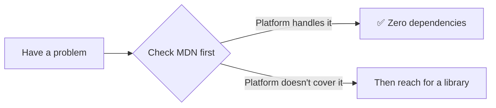

---

*Generated for the knowledge base on 2026-09-01 · Part 3 of the Modern JavaScript Web APIs series · Feedback and corrections welcome via the repo's issues page.*