# The Update Ladder: A Complete Guide to Choosing the Right Real-Time Technology

| Attribute | Value |
|---|---|
| **Difficulty Level** | 🟡 Intermediate |
| **Estimated Reading Time** | ⏱️ ~90 minutes |
| **Format** | Comprehensive Deep Dive |
| **Prerequisites** | HTTP fundamentals, JavaScript, basic Node.js |
| **Last Updated** | 2026-08-30 |

> 💡 **The one-sentence version:** "Real time" is not a technology — it is a requirement with a number attached. Pick the *lowest* rung on the ladder that satisfies your direction and staleness requirements.

---

## Table of Contents

1. [Introduction: The WebSockets Reflex](#1-introduction-the-websockets-reflex)
2. [Prerequisites](#2-prerequisites)
3. [Learning Objectives](#3-learning-objectives)
4. [The Two Questions Framework](#4-the-two-questions-framework)
5. [The Update Ladder — Big Picture](#5-the-update-ladder--big-picture)
6. [Rung 1: Short Polling](#6-rung-1-short-polling)
7. [Rung 2: Long Polling](#7-rung-2-long-polling)
8. [Rung 3: Server-Sent Events (SSE)](#8-rung-3-server-sent-events-sse)
9. [Rung 4: WebSockets](#9-rung-4-websockets)
10. [Rung 5: WebTransport](#10-rung-5-webtransport)
11. [Decision Flowchart](#11-decision-flowchart)
12. [Real-World Use Cases by Industry](#12-real-world-use-cases-by-industry)
13. [Trade-offs & Special Situations](#13-trade-offs--special-situations)
14. [Best Practices](#14-best-practices)
15. [Anti-Patterns](#15-anti-patterns)
16. [Performance Considerations](#16-performance-considerations)
17. [Security Considerations](#17-security-considerations)
18. [Testing Strategies](#18-testing-strategies)
19. [Migration Guide: Climbing Up and Down the Ladder](#19-migration-guide-climbing-up-and-down-the-ladder)
20. [Common Pitfalls & Troubleshooting Guide](#20-common-pitfalls--troubleshooting-guide)
21. [Practice Exercises (with Solutions)](#21-practice-exercises-with-solutions)
22. [Hands-On Labs](#22-hands-on-labs)
23. [Test Your Understanding](#23-test-your-understanding)
24. [Question Bank (50 Questions)](#24-question-bank-50-questions)
25. [Common Interview Questions](#25-common-interview-questions)
26. [Pro Tips](#26-pro-tips)
27. [Self-Assessment Checklist](#27-self-assessment-checklist)
28. [Summary & Key Takeaways](#28-summary--key-takeaways)
29. [Further Reading & Resources](#29-further-reading--resources)
30. [Next Steps](#30-next-steps)

---

## 1. Introduction: The WebSockets Reflex

Almost every product team has lived through this scene:

> **PM:** "We need this dashboard to update in real time."
> **Engineer:** "Got it — WebSockets."
> *(Three months later...)*
> **On-call Engineer:** "Why do we have 4,000 dropped connections at 2 AM?"

This happens because "real time" is treated as a single technology decision, when it's actually a **requirements problem** with a well-known solution space. The goal of this tutorial is to give you a repeatable framework — the **Update Ladder** — so that you choose the *cheapest* technology that satisfies your actual requirements, not the most impressive-sounding one.

By the end of this guide, you'll be able to:

- Precisely define what "real time" means for a given feature.
- Choose confidently between polling, long polling, SSE, WebSockets, and WebTransport.
- Understand the *infrastructure* cost of each choice, not just the protocol mechanics.
- Avoid the most common failure modes (reconnect storms, thundering herds, stateful server sprawl).

> 💡 **"Aha" moment ahead:** The most senior engineers are not the ones who default to the most advanced technology — they are the ones who can *defend the simplest choice with math*.

---

## 2. Prerequisites

To get the most out of this tutorial, you should already be comfortable with:

- ✅ **HTTP basics** — request/response model, status codes (`200`, `304`, `101 Switching Protocols`), and headers (`ETag`, `If-None-Match`, `Cache-Control`, `Authorization`).
- ✅ **JavaScript fundamentals** — `async/await`, `fetch`, event listeners, `setInterval`/`setTimeout`, `JSON`.
- ✅ **Basic Node.js** — running an Express server, routing, middleware, `req`/`res` objects.
- ✅ **Conceptual infrastructure vocabulary** — what load balancers and reverse proxies (e.g., Nginx) do.

> ⚠️ **Not required:** prior experience with WebSockets, SSE, or QUIC. Every technology is introduced from scratch at its rung. If you can build a REST endpoint, you can follow every example here.

> 💡 **Recommended setup:** Node.js 20+ and a modern Chromium- or Firefox-based browser. The [Hands-On Labs](#22-hands-on-labs) section builds a single Express app containing every rung.

---

## 3. Learning Objectives

By the end of this tutorial, you will be able to:

1. **Define** "real time" precisely for any feature by writing down a *direction requirement* and a *staleness budget*.
2. **Choose** confidently between short polling, long polling, SSE, WebSockets, and WebTransport using the Update Ladder.
3. **Implement** a working example of every rung in Node.js and browser JavaScript.
4. **Calculate** the infrastructure cost of each rung — requests/sec, held connections, fan-out backplanes.
5. **Harden** any rung against its characteristic failure modes: reconnect storms, proxy buffering, load balancer idle timeouts.
6. **Secure** real-time endpoints — authentication, replay authorization, rate limiting.
7. **Test** real-time features across unit, integration, load, and chaos scenarios.
8. **Migrate** between rungs in production — both climbing up and (the harder skill) climbing down.

---

## 4. The Two Questions Framework

Before writing a single line of networking code, answer these two questions. Write the answers down — literally, in the ticket or design doc.

### Question 1: Which direction does data need to flow, and how often?

Don't conflate "the user takes actions" with "I need a bidirectional streaming channel." A plain `POST /api/orders` handles "the user places an order" perfectly well. You only need a **persistent bidirectional channel** when:

- The client sends **high-frequency** updates (mouse/cursor position, keystrokes, game input), **and**
- Those updates need to be reflected to *other clients* with low latency.

| Scenario | Real direction requirement |
|---|---|
| User sends a chat message | Client → Server, low frequency → plain POST is fine |
| Two users co-editing a document, seeing each other's cursors | Bidirectional, high frequency → needs a persistent channel |
| User "likes" a post | Client → Server, one-off → plain POST |
| Multiplayer game input | Bidirectional, very high frequency → needs a persistent channel |

### Question 2: What is your staleness budget?

This is the number everyone skips. It's the maximum acceptable delay between "the data changed on the server" and "the user sees it."

| Feature | Realistic staleness budget |
|---|---|
| Stock trading ticker | ~200 ms |
| Live chat | 1–2 seconds |
| Multiplayer game state | < 100 ms |
| Order status tracker | 5–15 seconds |
| Notification bell | 15–30 seconds |
| Analytics dashboard | 1–5 minutes |
| "Is my report done processing?" | 10–30 seconds |

> ⚠️ **Warning:** Teams that skip this step default to "instant" — and **instant is the most expensive requirement you can write**, because it forces you to the top of the ladder even when nobody actually needed it.

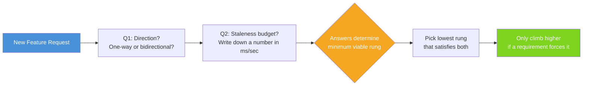

> ✅ **Tip:** Turn "we need real time" into "we need updates visible within 5 seconds, one direction, server → client." That sentence is buildable, testable, and cheap. The first one is neither.

---

## 5. The Update Ladder — Big Picture

Picture five rungs on a ladder. Each rung up buys you lower latency and more capability — and costs you more infrastructure, more server-side state, and more failure modes to handle.

**The rule:** Stay on the lowest rung that meets your direction and staleness requirements. Climb only when a real requirement forces you up — not because a rung "sounds more modern."

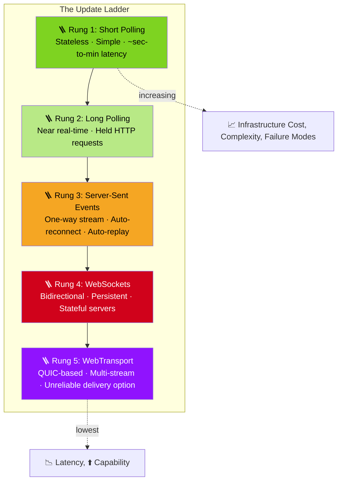

Notice what this diagram does **not** ask: "which technology is trendiest?" That question always produces WebSockets. The ladder asks a narrower, more useful question: *what is the minimum I need?*

> 💡 **Feynman check:** If you can't explain to a product manager why Rung 1 is the right answer for their feature (with math), you don't understand the ladder yet — you've just memorized the ordering.

---

## 6. Rung 1: Short Polling — The Rung Everyone Skips Too Early

Short polling is simply: the browser asks "anything new?" on a timer. It has a bad reputation, and it's also the *correct* choice more often than any other rung on the ladder.

### How it works

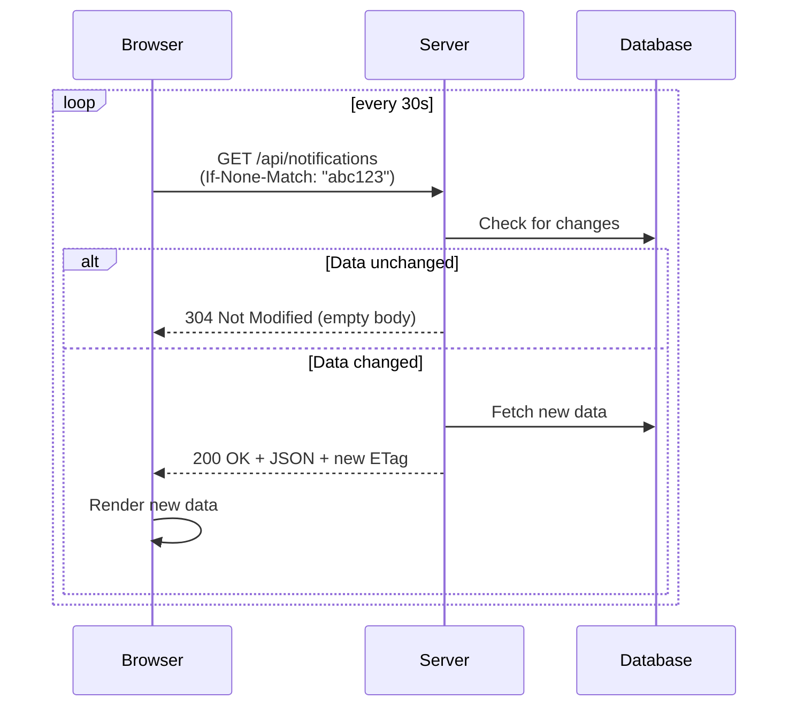

### Example 1: Basic conditional polling (JavaScript)

```javascript
let lastEtag = null;

async function poll() {
  const res = await fetch('/api/notifications', {
    headers: lastEtag ? { 'If-None-Match': lastEtag } : {}
  });

  if (res.status === 200) {
    lastEtag = res.headers.get('ETag');
    const data = await res.json();
    render(data);
  }
  // 304 Not Modified — nothing to do, body is empty
}

setInterval(poll, 30_000);
```

### Example 2: Polling with exponential backoff on failure

```javascript
let interval = 30_000;
const MAX_INTERVAL = 5 * 60_000;

async function pollWithBackoff() {
  try {
    const res = await fetch('/api/notifications');
    if (res.ok) {
      interval = 30_000; // reset on success
      render(await res.json());
    }
  } catch (err) {
    interval = Math.min(interval * 2, MAX_INTERVAL); // back off on failure
    console.warn(`Poll failed, backing off to ${interval}ms`);
  } finally {
    setTimeout(pollWithBackoff, interval);
  }
}

pollWithBackoff();
```

### Example 3: Server-side ETag generation (Node.js/Express)

```javascript
import crypto from 'crypto';

app.get('/api/notifications', async (req, res) => {
  const notifications = await getNotificationsForUser(req.user.id);
  const body = JSON.stringify(notifications);
  const etag = crypto.createHash('md5').update(body).digest('hex');

  if (req.headers['if-none-match'] === etag) {
    return res.status(304).end(); // no body — cheap!
  }

  res.set('ETag', etag);
  res.type('json').send(body);
});
```

### Why it's better than its reputation

- **Stateless.** Every request is a normal HTTP call. Load balancers, CDNs, serverless platforms, and proxies handle it with zero special configuration.
- **Cheap when done properly.** A "nothing changed" 304 response over HTTP/2 or HTTP/3 is a few hundred bytes. The "polling is wasteful" stereotype comes from polling *without* conditional requests.
- **Failure handling is free.** No reconnect logic needed — the next timer tick just tries again.

### Do the math before rejecting it

| Users | Interval | Requests/sec | Mostly... |
|---|---|---|---|
| 10,000 | 30s | ~333 req/s | 304s (cheap) |
| 100,000 | 30s | ~3,333 req/s | 304s, still manageable with caching |
| 10,000 | 30s (WebSockets instead) | 10,000 **held connections** | Persistent state, heartbeats, reconnects |

A single modest server instance can serve 333 mostly-empty requests per second without breaking a sweat. The WebSocket alternative requires holding 10,000 connections open continuously.

### Real-world use cases

- **Notification badges** ("You have 3 new messages") — 15–30s staleness is invisible to users.
- **Background job status** ("Your report is generating...") — poll every few seconds until done, then stop.
- **Inventory checks on a product page** — "still in stock?" doesn't need sub-second freshness.
- **CI/CD pipeline status pages** — checking build status every 10–20s.

### Where this rung ends

When your staleness budget drops below your polling interval, or the polled endpoint is expensive to compute and caching can't absorb the load — that's your signal to climb to Rung 2 or 3.

> ❌ **Common mistake:** using an unconditional `GET` that always returns the full payload. That's the version of polling that deserves its bad reputation.

---

## 7. Rung 2: Long Polling — Hold the Line Until Something Happens

Long polling keeps the "just HTTP requests" mental model but removes the fixed interval. The server holds the request open until it has new data (or hits a timeout, typically 20–30s), responds, and the client immediately re-issues the request.

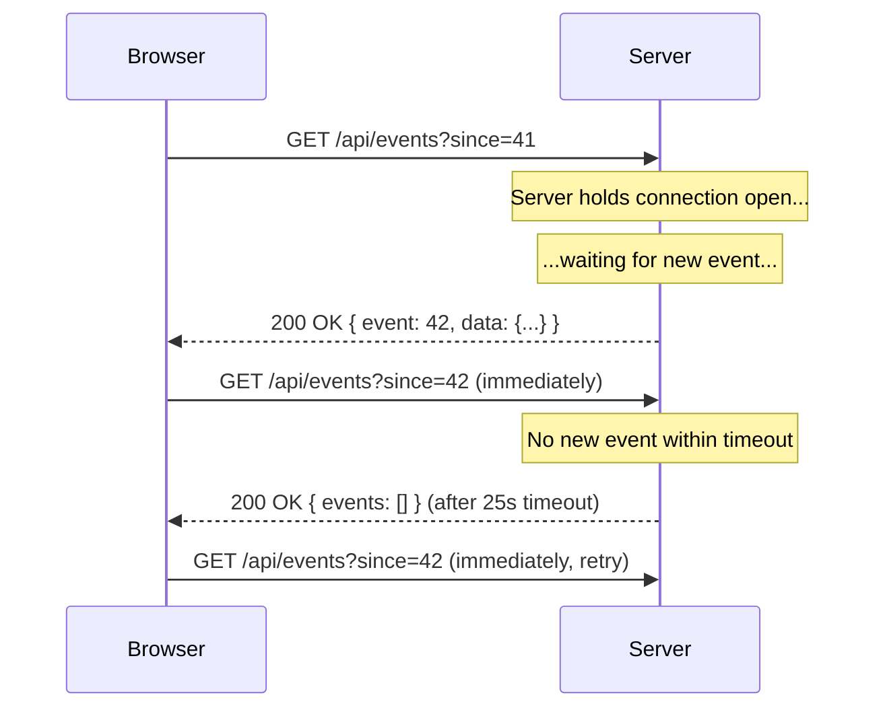

### Example 1: Client-side long-polling loop

```javascript
let since = 0;

async function longPoll() {
  try {
    const res = await fetch(`/api/events?since=${since}`);
    const { events, cursor } = await res.json();

    events.forEach(render);
    since = cursor; // move the cursor forward, never lose events
  } catch (err) {
    await sleep(1000); // brief pause before retry on network error
  } finally {
    longPoll(); // immediately re-poll
  }
}

longPoll();
```

### Example 2: Server-side (Node.js, using an async event emitter)

```javascript
app.get('/api/events', async (req, res) => {
  const since = Number(req.query.since) || 0;
  const timeoutMs = 25_000;

  const existing = eventLog.getEventsSince(since);
  if (existing.length > 0) {
    return res.json({ events: existing, cursor: eventLog.latestId() });
  }

  // Wait for a new event, or time out
  const newEvents = await eventLog.waitForNext(timeoutMs);
  res.json({ events: newEvents, cursor: eventLog.latestId() });
});
```

### Costs to be aware of

- **Held connections require an async runtime.** Node.js, Go, or async Python/Java handle this well; classic one-thread-per-request servers (e.g., traditional PHP-FPM, synchronous WSGI) will exhaust their worker pool fast.
- **You're building a mini replay log.** The `since=42` cursor pattern means you need to track and store recent events so a client that reconnects doesn't miss anything.

### Real-world use cases

- Legacy chat systems built before SSE/WebSockets were widely supported.
- Environments with corporate proxies or ancient infrastructure that breaks streaming protocols but tolerates ordinary (if slow) HTTP requests.
- Fallback mode inside libraries like **Socket.IO**, used only when WebSockets and other transports fail.

### Where this rung ends

In 2026, this rung is narrow. If your infrastructure can hold a request open for 25 seconds, it can almost certainly hold an SSE stream open too — and SSE gives you more capability (auto-reconnect, auto-replay) for a similar cost. Long polling today is mostly a **fallback**, not a primary design choice.

> ⚠️ **Warning:** If you find yourself writing a *new* long-polling endpoint in 2026 with a modern async stack, pause and re-read Rung 3. You are probably one `Content-Type` header away from a better design.

---

## 8. Rung 3: Server-Sent Events — The Quiet Renaissance

SSE is a single long-lived HTTP response that never closes. The server writes plain-text events over time; the browser's built-in `EventSource` API parses them automatically.

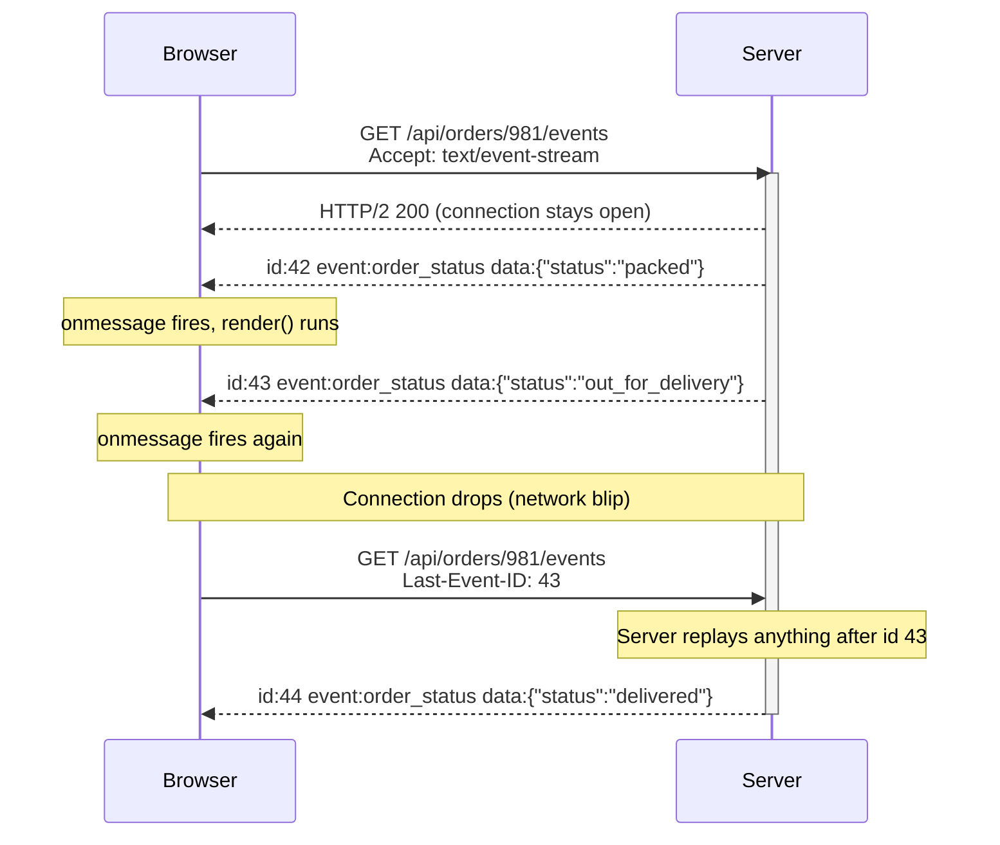

### Example 1: Server-side event stream (Node.js/Express)

```javascript
app.get('/api/orders/:id/events', (req, res) => {
  res.set({
    'Content-Type': 'text/event-stream',
    'Cache-Control': 'no-cache',
    'Connection': 'keep-alive',
    'X-Accel-Buffering': 'no' // disable Nginx buffering
  });
  res.flushHeaders();

  const orderId = req.params.id;
  const send = (id, event, data) => {
    res.write(`id: ${id}\n`);
    res.write(`event: ${event}\n`);
    res.write(`data: ${JSON.stringify(data)}\n\n`);
  };

  // Replay missed events if client reconnected
  const lastId = Number(req.headers['last-event-id']) || 0;
  getOrderEventsSince(orderId, lastId).forEach(e => send(e.id, 'order_status', e.data));

  // Subscribe to future updates
  const unsubscribe = orderEvents.subscribe(orderId, (e) => send(e.id, 'order_status', e.data));

  // Keep-alive comment every 20s so proxies don't kill the connection
  const keepAlive = setInterval(() => res.write(': ping\n\n'), 20_000);

  req.on('close', () => {
    clearInterval(keepAlive);
    unsubscribe();
  });
});
```

### Example 2: Client-side consumption

```javascript
const stream = new EventSource('/api/orders/981/events');

stream.addEventListener('order_status', (e) => {
  const data = JSON.parse(e.data);
  render(data);
});

stream.onerror = () => {
  // The browser automatically reconnects — you usually don't need to do anything here.
  console.warn('SSE connection interrupted; browser will retry');
};
```

### Example 3: Authenticated SSE with a fetch-based client (bypassing EventSource's header limitation)

```javascript
import { fetchEventSource } from '@microsoft/fetch-event-source';

await fetchEventSource('/api/orders/981/events', {
  headers: { Authorization: `Bearer ${accessToken}` },
  onmessage(ev) {
    render(JSON.parse(ev.data));
  },
  onerror(err) {
    console.warn('Retrying SSE connection...', err);
    // return nothing / don't throw, and the library retries automatically
  }
});
```

### Why SSE is more common than people realize

You've almost certainly used SSE today without knowing it: **every ChatGPT-style interface that streams tokens one at a time is streaming over SSE.** It's the transport behind the OpenAI and Anthropic streaming APIs. The LLM boom quietly made SSE one of the most-used real-time technologies on the internet.

### Two things SSE gives you for free

1. **Automatic reconnection** — if the connection drops, `EventSource` reconnects on its own.
2. **Resume via `Last-Event-ID`** — on reconnect, the browser sends the last event ID it saw, and your server can replay what was missed.

With WebSockets, both of these become *your* code, *your* bugs, and *your* on-call pages.

### Know the limits

| Limitation | Detail | Mitigation |
|---|---|---|
| HTTP/1.1 connection cap | Browsers allow ~6 connections/domain over HTTP/1.1 | Serve over HTTP/2 (multiplexes ~100 streams over 1 connection) |
| Text-only | UTF-8 text (JSON in practice); binary needs base64 | Fine for almost all real-time UI use cases |
| One direction | Client → server needs a normal HTTP request, not the SSE channel | Usually fine per Question 1 |
| No custom headers in native `EventSource` | Complicates `Authorization: Bearer` | Use cookie auth, or a fetch-based SSE client library |
| Proxy buffering | Middleboxes can buffer and break streaming | `X-Accel-Buffering: no`, periodic keep-alive comments |

### Real-world use cases

- **LLM chat interfaces** streaming tokens as they're generated.
- **Order tracking pages** — "packed → shipped → out for delivery → delivered."
- **Live sports score tickers.**
- **Build/deploy log streaming** (e.g., watching a CI pipeline output live).
- **Stock price tickers** where staleness budget is a few hundred ms to a couple seconds (with HTTP/2, this is very achievable).

### Where this rung ends

When Question 1 comes back "yes, genuinely bidirectional and high-frequency" — i.e., the client needs to push a *stream* of updates back, not just occasional actions.

> 💡 **"Aha" moment:** SSE's killer feature is not streaming — it's that *reconnect and replay are handled by a browser standard* instead of by your on-call rotation.

---

## 9. Rung 4: WebSockets — Pay the Price Only When You Must

WebSockets give you what nothing below can: a single persistent, low-latency, **bidirectional** channel carrying text or binary data in both directions.

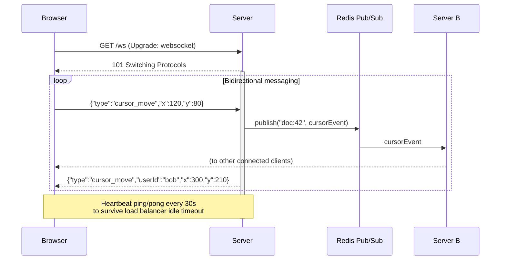

### Example 1: Basic WebSocket server (Node.js with `ws`)

```javascript
import { WebSocketServer } from 'ws';

const wss = new WebSocketServer({ port: 8080 });

wss.on('connection', (socket) => {
  socket.isAlive = true;
  socket.on('pong', () => { socket.isAlive = true; });

  socket.on('message', (raw) => {
    const msg = JSON.parse(raw);
    broadcastToDocument(msg.docId, msg); // fan out to other connected clients
  });

  socket.on('close', () => cleanupPresence(socket));
});

// Heartbeat to detect dead connections and satisfy LB idle timeouts
setInterval(() => {
  wss.clients.forEach((socket) => {
    if (!socket.isAlive) return socket.terminate();
    socket.isAlive = false;
    socket.ping();
  });
}, 30_000);
```

### Example 2: Client-side reconnect logic with exponential backoff + jitter

```javascript
function connect() {
  const socket = new WebSocket('wss://api.example.com/ws');
  let retries = 0;

  socket.onopen = () => { retries = 0; };

  socket.onclose = () => {
    const delay = Math.min(1000 * 2 ** retries, 30_000) * (0.5 + Math.random());
    retries++;
    setTimeout(connect, delay); // jitter prevents thundering herd on mass reconnects
  };

  socket.onmessage = (e) => render(JSON.parse(e.data));
}
connect();
```

### Example 3: Fan-out across multiple servers with Redis pub/sub

```javascript
import { createClient } from 'redis';

const sub = createClient();
await sub.connect();

// Every server instance subscribes to the same channel
await sub.subscribe('doc:42:updates', (message) => {
  // Push to any locally-connected clients editing this document
  localConnectionsFor('doc:42').forEach((socket) => socket.send(message));
});

// When server A receives a message from a client, it publishes for all servers
function onClientMessage(docId, message) {
  redisPublisher.publish(`${docId}:updates`, message);
}
```

### The full cost — read this before committing

| Cost Category | Detail |
|---|---|
| **Load balancer configuration** | AWS ALB default idle timeout is 60s — no message for 60s and the connection silently dies. Requires heartbeats. |
| **Managed gateway ceilings** | AWS API Gateway WebSocket APIs cap connections at 2 hours, idle at 10 minutes — requires reconnect-and-resync logic. |
| **Stateful servers** | Every deploy, autoscale-down, or instance crash drops thousands of connections at once, which then reconnect at once — a self-inflicted thundering herd unless you add jitter. |
| **Fan-out backplane** | With more than one server, messages must cross servers to reach the right clients — usually via Redis pub/sub or a message broker. Your "simple persistent connection" is now a distributed system. |
| **No built-in replay** | Unlike SSE, missed messages during a disconnect are entirely your problem — you need sequence numbers and gap-filling logic. |
| **Rolling restarts** | Need connection draining logic so deploys don't just yank every open socket at once. |

### Real-world use cases

- **Live chat with typing indicators** — bidirectional and low-latency.
- **Multiplayer games** — very high-frequency, bidirectional state sync.
- **Collaborative document editing** (Google Docs-style cursors and live text) — bidirectional, high-frequency.
- **Live trading platforms** — sub-200ms bidirectional updates.
- **Video call signaling** (WebRTC negotiation channel).

### A useful habit

Estimate the engineering cost of the four items in the cost table above **for your specific team and stack**, and compare it against what you actually gain over SSE for the feature at hand. When the honest answer is "typing indicators," SSE plus a plain `POST` is often the better trade.

---

## 10. Rung 5: WebTransport — The Newest Rung (2026 Update)

Two developments changed the landscape recently, and much of what's written online about WebTransport is already stale.

### What changed

- **WebTransport reached Baseline in March 2026.** With Safari 26.4 shipping support, it became available in all major browsers — closing the last major gap (including iOS). It's built on **HTTP/3 and QUIC**, offering multiple independent streams without head-of-line blocking, and an *optional unreliable delivery mode* — ideal for games and live media where a dropped packet should be skipped, not retransmitted and re-ordered.
- **WebSocket-over-HTTP/3 is still theoretical.** RFC 9220 defines it, but as of early 2026 no major browser or server ships a production implementation. WebSockets over HTTP/1.1 and HTTP/2 (RFC 8441) remain the production reality — question any vendor claiming you need HTTP/3 WebSockets today.

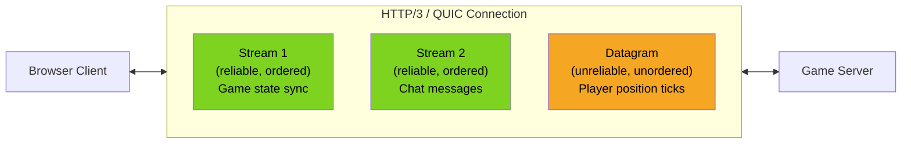

### Example: Basic WebTransport connection (client-side)

```javascript
const transport = new WebTransport('https://game.example.com:4433/session');
await transport.ready;

// Reliable, ordered stream — e.g., important game events
const stream = await transport.createBidirectionalStream();
const writer = stream.writable.getWriter();
await writer.write(new TextEncoder().encode(JSON.stringify({ type: 'join', player: 'alice' })));

// Unreliable datagrams — e.g., frequent position updates where a dropped
// packet is fine, because the *next* one will arrive shortly anyway
const datagrams = transport.datagrams.writable.getWriter();
setInterval(() => {
  datagrams.write(new TextEncoder().encode(JSON.stringify({ x: player.x, y: player.y })));
}, 50); // 20 updates/sec, no retransmission needed
```

### Where this rung is appropriate

- Fast-paced multiplayer games where occasional dropped position updates are acceptable but you still need low latency.
- Live media / low-latency video streaming.
- Any scenario needing multiple independent data streams over one connection without one slow stream blocking the others (no head-of-line blocking).

### Where this rung is *not* appropriate (yet)

- General product features. Server-side support is still thin, older browsers linger for years, and there's no automatic fallback story the way SSE has reconnect/replay built in.
- Treat it as a **specialized tool** for latency-critical streaming, not a WebSocket replacement for typical app features.

---

## 11. Decision Flowchart: Picking Your Rung

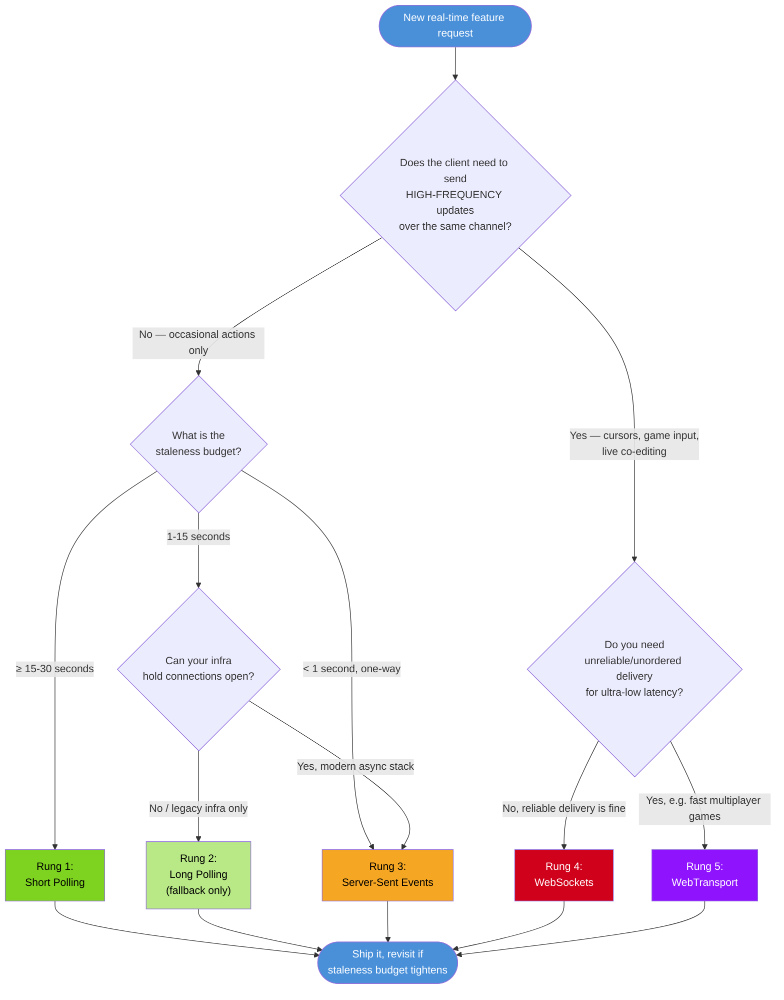

---

## 12. Real-World Use Cases by Industry

### E-commerce

| Feature | Rung | Why |
|---|---|---|
| "Item in stock?" indicator | 1 (Short Polling) | Staleness budget of minutes is fine |
| Order status tracker ("packed → shipped → delivered") | 3 (SSE) | One-way, needs push-style updates within seconds |
| Live customer support chat | 4 (WebSockets) | Bidirectional, low latency expected |

### FinTech

| Feature | Rung | Why |
|---|---|---|
| Daily portfolio summary | 1 (Short Polling) | Minutes-level staleness is acceptable |
| Live stock ticker | 3 (SSE) or 4 depending on need for user-submitted trade cancellation over same channel | Usually one-way price feed |
| High-frequency trading terminal | 4 (WebSockets) | Sub-200ms bidirectional requirement |

### SaaS / Productivity Tools

| Feature | Rung | Why |
|---|---|---|
| "Report generation complete" notification | 1 (Short Polling) | Poll every few seconds until done, then stop |
| Collaborative document cursors (Google Docs style) | 4 (WebSockets) | Bidirectional, high-frequency |
| Dashboard analytics refresh | 1 (Short Polling) | Minutes-level staleness budget |
| Build/CI log streaming | 3 (SSE) | One-way stream of log lines |

### Gaming

| Feature | Rung | Why |
|---|---|---|
| Leaderboard updates | 1 (Short Polling) | Seconds-to-minutes staleness is fine |
| In-lobby chat | 4 (WebSockets) | Bidirectional, moderate frequency |
| Real-time player position sync | 5 (WebTransport) | Needs unreliable/unordered delivery for lowest latency |

### AI / LLM Products

| Feature | Rung | Why |
|---|---|---|
| Token-by-token response streaming | 3 (SSE) | Exactly what OpenAI/Anthropic streaming APIs use today |
| "Model is still thinking" status | 1 or 3 | Depends on whether you also need mid-generation events |

---

## 13. Trade-offs & Special Situations

### 13.1 Shared connections change the math

The ladder assumes you pick a rung **per feature**, but connections are shared per app. If your product already maintains a WebSocket for chat, adding notifications to that *existing* channel is cheaper than standing up a separate SSE endpoint — the marginal cost of one more message type on an already-open connection is near zero. The ladder prices your **first** real-time feature accurately; for later features, "reuse the channel we already pay for" can legitimately beat "lowest sufficient rung."

### 13.2 Managed services change the arithmetic

Products like **Ably**, **Pusher**, or **AWS AppSync** absorb the Rung-4 infrastructure burden (heartbeats, fan-out, reconnect logic, scaling) for a subscription fee. With them, WebSockets stop being *engineering-expensive* — the cost moves from engineering time to money and vendor coupling. The ladder still tells you what capability you need; managed services just change *who* pays for the complexity.

### 13.3 Battery and mobile networks

A persistent connection on a phone keeps the radio active, draining battery. Counterintuitively, aggressive short polling can cost *more* battery than a quiet SSE stream, while **OS-level push (APNs/FCM)** beats both for rare events. If your "real-time" feature is a mobile notification, the honest answer is often **"Rung 0: platform push"** — which isn't part of the browser ladder at all.

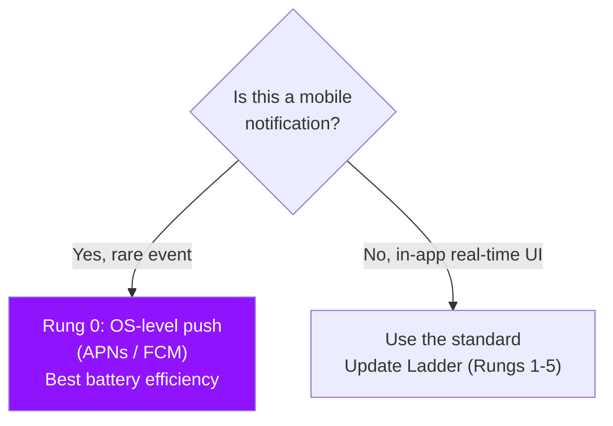

### 13.4 Serverless platforms invert the costs

On classic serverless (one invocation per request), held connections are awkward — SSE and long polling can burn function-minutes while doing nothing. Platforms have adapted (AWS Lambda supports response streaming; API Gateway offers a managed WebSocket layer), but if your stack is fully serverless, **Rung 1 becomes even more attractive** by default, and Rungs 2–4 need a platform-specific design rather than the textbook approach.

### 13.5 Reconnect storms — the failure mode to always plan for

Any design with thousands of held connections (Rungs 2–5) must plan for the moment they **all drop together**: a deploy, a load balancer restart, a network blip. Exponential backoff with jitter is not optional at scale — it's the difference between a brief blip and a full outage.

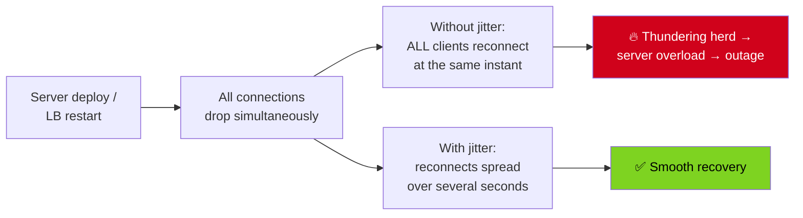

---

## 14. Best Practices

### 14.1 Process practices (before any code)

- ✅ **Write the two answers down** (direction + staleness budget) in the ticket or design doc. A requirement that isn't a number isn't a requirement.
- ✅ **Default to the lowest rung** and let measured production data justify climbing.
- ✅ **Price the four WebSocket costs** (LB config, gateway ceilings, stateful deploys, fan-out backplane) for *your* team and stack before committing to Rung 4.
- ✅ **Reuse an existing channel** when the marginal cost of one more message type is near zero (see §13.1).
- ✅ **Instrument delivered staleness** in production — the gap between the event timestamp and the render timestamp is your real number.

### 14.2 Implementation practices (per rung)

| Rung | Always do |
|---|---|
| 1 — Short Polling | Use conditional requests (`ETag`/`If-None-Match`); add a small random jitter to the interval so clients don't synchronize; pause polling when the tab is hidden; stop polling when the awaited state is terminal ("report done") |
| 2 — Long Polling | Run on an async runtime; implement the cursor replay pattern (`since=`); keep timeouts modest (20–30s); treat it as a fallback, never the primary design |
| 3 — SSE | Send keep-alive comments (`: ping\n\n`) every ~20s; set `X-Accel-Buffering: no` behind Nginx; serve over HTTP/2; implement `Last-Event-ID` replay; use a fetch-based client when you need `Authorization` headers; always clean up subscriptions on `close` |
| 4 — WebSockets | Heartbeat more frequently than your LB idle timeout; reconnect with exponential backoff **and jitter**; use a fan-out backplane (Redis pub/sub) the moment you have >1 server; attach sequence numbers to messages; implement graceful connection draining for deploys |
| 5 — WebTransport | Keep the reliable ordered stream for state that must arrive; use datagrams *only* for data where the next update supersedes the last (positions, media frames); design your own fallback since there is none built in |

### 14.3 Correct vs incorrect: pausing polling on hidden tabs

❌ **Incorrect** — burns battery and server capacity for a tab nobody is watching:

```javascript
// Polls forever, even when the user has 20 other tabs open
setInterval(poll, 30_000);
```

✅ **Correct** — respects the Page Visibility API:

```javascript
let timer = null;

function startPolling() {
  // Small jitter prevents fleets of tabs from polling in sync
  const interval = 30_000 + Math.floor(Math.random() * 5_000);
  timer = setInterval(poll, interval);
}

function stopPolling() {
  clearInterval(timer);
  timer = null;
}

document.addEventListener('visibilitychange', () => {
  if (document.hidden) {
    stopPolling();
  } else {
    poll();        // refresh immediately on return
    startPolling();
  }
});

startPolling();
```

### 14.4 Correct vs incorrect: reconnect delay

❌ **Incorrect** — a fixed retry delay synchronizes every client after a shared outage:

```javascript
socket.onclose = () => setTimeout(connect, 1000); // thundering herd
```

✅ **Correct** — exponential backoff multiplied by a random factor (jitter):

```javascript
socket.onclose = () => {
  const delay = Math.min(1000 * 2 ** retries, 30_000) * (0.5 + Math.random());
  retries++;
  setTimeout(connect, delay);
};
```

---

## 15. Anti-Patterns

| # | Anti-Pattern | Why it hurts | Fix |
|---|---|---|---|
| 1 | **WebSockets by default** for every "live" feature | You inherit stateful servers, heartbeats, backplanes, and reconnect logic for a one-way feature | Apply the ladder; default to SSE for one-way push |
| 2 | **Polling without conditional requests** | Full JSON payload every tick — the stereotype that gives polling its bad name | `ETag` + `If-None-Match`, return `304` with an empty body |
| 3 | **"Instant" as a requirement** | Forces the top of the ladder even when 15–30s is invisible to users | Write a staleness budget number and design to it |
| 4 | **Reconnect without jitter** | Deploys become self-inflicted thundering herds | Exponential backoff × random factor |
| 5 | **WebSocket server without heartbeats** | LB idle timeouts (AWS ALB: 60s) silently kill idle connections | Ping/pong every 15–30s |
| 6 | **In-memory-only fan-out with multiple servers** | Messages reach only clients on the same instance | Redis pub/sub or a message broker backplane |
| 7 | **WebSockets without replay/resume** | Missed messages during disconnects are silently lost | Sequence numbers + gap-filling on reconnect (or just use SSE) |
| 8 | **Long polling as a primary design in 2026** | All the held-connection cost, none of SSE's free features | Use SSE; keep long polling only as a legacy fallback |
| 9 | **One SSE stream per feature over HTTP/1.1** | ~6 connections/domain cap means the second or third tab stalls | Serve over HTTP/2, or multiplex features over one stream |
| 10 | **A new persistent connection per feature** | Each connection adds LB/gateway pressure and ops surface | Prefer one shared channel with typed messages (per §13.1) |

> ⚠️ **The most expensive anti-pattern is #1 combined with #3.** "Instant + WebSockets" for a notification badge is how 2 AM pages get created.

---

## 16. Performance Considerations

### 16.1 Cost profile by rung

| Rung | Requests/sec at 10k users (30s refresh) | Connections held | Server memory/connection* | Statefulness |
|---|---|---|---|---|
| 1 — Short Polling | ~333 (mostly 304s) | 0 (transient) | ~0 (stateless) | None |
| 2 — Long Polling | n/a (held) | 10,000 | ~2–10 KB | Per-request waiters |
| 3 — SSE | n/a (streamed) | 10,000 | ~5–20 KB | Subscription registry |
| 4 — WebSockets | n/a (persistent) | 10,000 | ~10–50 KB | Per-connection state + backplane |
| 5 — WebTransport | n/a (persistent) | 10,000 | ~10–50 KB | Streams + QUIC connection state |

\*Illustrative orders of magnitude for Node.js — always benchmark your own stack.

### 16.2 The capacity math that justifies Rung 1

A conditional poll under HTTP/2 is a request with a ~500-byte header round-trip and (usually) a ~100-byte `304` response. At 30-second intervals:

- **10,000 users → ~333 req/s** — one small instance handles this.
- **100,000 users → ~3,333 req/s** — a modest cluster plus CDN/HTTP caching absorbs it.
- **The same 10,000 users on WebSockets → 10,000 held connections**, each consuming memory, file descriptors, LB connection units, and heartbeat traffic — continuously, even when nothing changes.

> 💡 **Key insight:** Rung 1 pays *per change*; Rungs 2–4 pay *per user per second*. If changes are rare, Rung 1 wins dramatically.

### 16.3 Optimization levers per rung

- **Rung 1:** cheap change detection. Instead of hashing large bodies with `md5` on every request, maintain a monotonically increasing version/updated-at column and use it as a weak `ETag` — O(1) instead of O(payload).
- **Rung 3:** serve over HTTP/2 to escape the ~6-connection HTTP/1.1 cap; one multiplexed stream per user with typed events beats several per-feature streams.
- **Rung 4:** batch high-frequency client messages (e.g., cursor moves coalesced at 30–60 Hz) instead of sending every input event; compress large frames (`permessage-deflate`) at the cost of CPU.
- **All rungs:** keep payloads small — a stale-tolerant feature rarely needs the full entity; a diff or a "changed: true" nudge plus a fetch is often cheaper.

### 16.4 What to measure in production

| Metric | Meaning | Alarm threshold (example) |
|---|---|---|
| Delivered staleness | event-created → rendered timestamp delta | > staleness budget for >1% of updates |
| Held connections / instance | Capacity + memory pressure | > 70% of tested max |
| Reconnect rate | Instability, deploys, LB kills | Spikes correlated with deploys |
| 304 ratio (Rung 1) | Cache efficiency of conditional polls | < 80% means payloads are churning |
| Fan-out latency (Rung 4) | Publish → delivery across backplane | p99 > 250 ms |

---

## 17. Security Considerations

### 17.1 Authentication

- **SSE with native `EventSource` cannot send custom headers.** Prefer short-lived cookie sessions (HttpOnly, Secure, SameSite) or use a fetch-based client (`@microsoft/fetch-event-source`) for `Authorization: Bearer` flows.
- **WebSockets:** the `Origin` header is sent by the browser but *not* enforced by the server — **validate `Origin` explicitly** on upgrade, or any website can open a socket to your API from a victim's browser (CSWSH: Cross-Site WebSocket Hijacking).
- **Never** pass long-lived tokens as WebSocket/SSE query-string parameters — they end up in logs and proxy histories. Use short-lived one-time tickets: request a ticket over an authenticated REST call, then exchange it on connect.

### 17.2 Authorization (the replay trap)

- Replay endpoints (`Last-Event-ID`, `since=` cursors) must **re-authorize per user**: a client must not be able to replay another user's order events by guessing IDs. Authorize the *subscription*, not just the initial connection.
- With WebSockets, validate on **every** subscription/message: `canUserWatch(user, docId)` — never trust a `docId` arriving from the client.

### 17.3 DoS and abuse resistance

- Held connections (Rungs 2–4) are a resource; cap connections per user and per IP, and require authentication *before* holding anything open.
- Rate-limit polling endpoints per user/IP; a polling flood looks like any other HTTP flood but hits your change-detection logic.
- Validate and size-limit WebSocket messages (`JSON` schema + max frame size); a single malformed message shouldn't crash the process — wrap `JSON.parse` in try/catch and terminate abusive sockets.

### 17.4 Transport and data hygiene

- TLS everywhere: `https` for SSE, `wss` for WebSockets; mixed-content browsers will block the insecure variant anyway.
- Set `Cache-Control: no-cache` on event streams so intermediaries never cache partial streams; keep replay retention windows bounded (e.g., 10 minutes) to limit stored personal data.

---

## 18. Testing Strategies

### 18.1 Unit tests — deterministic timing with fake timers

Reconnect/backoff logic is time-dependent; never test it with real sleeps. Use fake timers (Vitest/Jest):

```javascript
import { describe, it, expect, vi, beforeEach } from 'vitest';

describe('backoff calculator', () => {
  beforeEach(() => vi.useFakeTimers());

  it('spreads reconnects via jitter (max < 30s, min > 0.5x base)', () => {
    for (let retries = 0; retries < 10; retries++) {
      const delay = Math.min(1000 * 2 ** retries, 30_000) * (0.5 + Math.random());
      expect(delay).toBeGreaterThan(0);
      expect(delay).toBeLessThanOrEqual(30_000 * 1.5);
    }
    vi.advanceTimersByTime(60_000); // no real waiting ever happens
  });
});
```

### 18.2 Integration tests — SSE format and replay contract

```javascript
// Assert the SSE wire format and the Last-Event-ID replay contract
it('replays events after Last-Event-ID', async () => {
  const res = await request(app)
    .get('/api/orders/981/events')
    .set('Last-Event-ID', '42')
    .set('Accept', 'text/event-stream');

  expect(res.headers['content-type']).toContain('text/event-stream');
  expect(res.text).toContain('id: 43');
  expect(res.text).toMatch(/event: order_status\ndata: /);
});
```

### 18.3 Test matrix by concern

| Concern | Technique |
|---|---|
| Reconnect/backoff math | Unit tests with fake timers |
| SSE event format + `Last-Event-ID` replay | Integration test hitting the endpoint with supertest |
| No missed/duplicate events across reconnect | Contract test: kill socket mid-stream, reconnect with cursor, assert set equality |
| Fan-out correctness across servers | Spin up 2 instances + Redis; publish on A, assert receipt on B's client |
| LB idle timeout behavior | Local proxy with aggressive idle timeout; assert heartbeats keep it alive |
| Reconnect storms | Load test (k6/Artillery): drop all VUs at once; assert p99 latency stays bounded |
| Memory leaks on held connections | Soak test: hours of connect/disconnect cycles; assert heap and subscription count stay flat |

### 18.4 Chaos drills worth scheduling

- **Kill the server** mid-stream → every client must recover with zero lost events (replay) or bounded, acknowledged loss (datagrams).
- **Restart the load balancer** → assert reconnects spread over seconds (jitter working), not a spike to 100% CPU.
- **Rolling deploy** in staging → assert no client-visible message loss during drain.

---

## 19. Migration Guide: Climbing Up and Down the Ladder

### 19.1 Climbing up (requirements tightened)

| From → To | Migration steps |
|---|---|
| 1 → 3 (Polling → SSE) | Add the SSE endpoint alongside the poll; keep the poll as automatic fallback for old proxies; move clients behind a feature flag; watch held-connection counts; remove the poll when SSE is stable |
| 3 → 4 (SSE → WS) | Only if Question 1 is genuinely "bidirectional + high-frequency." Stand up the WS gateway (heartbeat, backplane, jitter, replay) *before* migrating; run both in parallel; migrate per-feature, not the whole app |
| 4 → 5 (WS → WebTransport) | Specialized case (games/live media). Detect `window.WebTransport`, fall back to WS otherwise; keep the message protocol identical on both transports |

### 19.2 Climbing down (you over-climbed)

Climbing down is harder than climbing up — ops has learned to fear touching the WebSocket layer. Do it gradually:

1. **Measure first:** prove with production data that delivered staleness stays inside budget on the lower rung.
2. **Shadow the lower rung:** run SSE/polling in parallel with WS and diff outputs.
3. **Canary the switch:** migrate one low-risk feature (e.g., the notification badge) first.
4. **Retire carefully:** keep the WS channel if it still serves other features (§13.1); only shut it down when the last consumer moves.

### 19.3 Version and deprecation notes (as of 2026-08-30)

- ⚠️ **Long polling as a primary transport is deprecated-by-consensus** — plan its migration to SSE if you still own one.
- ⚠️ **WS-over-HTTP/3 (RFC 9220)** has no production browser/server implementations — don't build for it yet.
- ✅ **WebTransport is Baseline as of March 2026**, but treat it as a specialized tool, not a general upgrade path.
- ✅ **Socket.IO-style fallback stacks** (WS primary, long-polling fallback) remain a valid managed-complexity option if you'd rather buy the ladder than build it.

---

## 20. Common Pitfalls & Troubleshooting Guide

| Symptom | Likely Cause | Fix |
|---|---|---|
| SSE events arrive in one big burst (all at once) | Proxy/response buffering (Nginx default) | `X-Accel-Buffering: no`; disable gzip for `text/event-stream`; send keep-alive comments |
| EventSource never reconnects or fails silently | Non-200 during reconnect, CORS mismatch, or killed auth session | Check reconnect response codes; set CORS headers; refresh credentials via fetch-based client |
| WebSocket dies after exactly ~60s of silence | Load balancer idle timeout (AWS ALB default) | Heartbeat ping/pong every 15–30s (< timeout) |
| Duplicate events after reconnect | Replay overlaps with live subscription | Dedupe by event ID; subscribe only after replay completes, or watermark the boundary |
| Messages silently lost after WS reconnect | No replay/resume on WS | Sequence numbers + gap-fill request, or move the feature to SSE |
| Deploy causes outage; CPU spikes to 100% | Reconnect storm (no jitter) | Exponential backoff × random jitter; server-side accept-rate limiting; connection draining |
| Poll CPU spikes on every request | Server hashing large payloads for `ETag` each time | Use a version counter / `updated-at` as a weak validator (O(1)) |
| Poll traffic arrives in synchronized waves | All clients on the same interval | Client-side interval jitter |
| Second/third tab freezes SSE streams | HTTP/1.1 ~6-connections-per-domain cap | Serve over HTTP/2 or multiplex one stream per user |
| Rapid mobile battery drain | Aggressive polling keeping the radio awake | SSE (quiet stream) or OS push (APNs/FCM) for rare events |
| WS messages from "random" clients crash the server | Unvalidated `JSON.parse` on incoming frames | Try/catch parse, schema-validate, terminate abusive sockets |
| Users see other users' replayed events | Replay path lacks per-user authorization | Re-authorize the subscription on every reconnect/cursor request |

---

## 21. Practice Exercises (with Solutions)

### 🏋️ Exercise 1: Design the real-time architecture for a food delivery app

**Task:** A food delivery app needs: (a) an order status tracker ("confirmed → preparing → out for delivery → delivered"), (b) a live courier map updating the courier's position every 2s, (c) in-app chat between customer and courier, (d) a "table ready" notification for in-store diners. Choose a rung for each feature and justify it with the Two Questions Framework.

**Solution:**

| Feature | Q1 (direction/frequency) | Q2 (staleness budget) | Rung | Why |
|---|---|---|---|---|
| (a) Order status | One-way, server → client | 5–15s | **3 (SSE)** | One-way push; free reconnect/replay for flaky mobile networks |
| (b) Courier map | Client → server is high-frequency (courier's phone), but customer view is one-way; courier pushes positions via plain HTTPS POST every 2s | 2–5s acceptable on a map | **3 (SSE)** for viewers | Only the *courier* sends high-frequency data — a POST handles it; viewers just need a stream |
| (c) Chat | Bidirectional, low frequency (a message every few seconds at most) | 1–2s | **3 (SSE) + POST** for sending | Chat *messages* are occasional actions — only *typing indicators* are high-frequency; if typing indicators matter, this feature is a legitimate Rung-4 candidate, or shares one WS channel with (b)'s infra if it exists |
| (d) Table-ready | One-way, rare event | 15–30s | **1 (Short Polling)** or **Rung 0 (push)** if the diner has left the app | Simplest possible choice; the poll stops once notified |

**Key insight:** Feature (b) *looks* like it needs WebSockets ("live map!"), but Question 1 shows only the courier's phone sends high-frequency data — and that's a plain `POST`. The expensive bidirectional channel is never actually needed.

---

### 🏋️ Exercise 2: Implement an SSE endpoint with guaranteed, deduplicated delivery

**Task:** Extend the Rung-3 server example so that (1) a reconnecting client never receives an event twice, and (2) events sent while the client was disconnected are replayed exactly once, in order.

**Solution:**

```javascript
app.get('/api/orders/:id/events', (req, res) => {
  res.set({
    'Content-Type': 'text/event-stream',
    'Cache-Control': 'no-cache',
    'X-Accel-Buffering': 'no'
  });
  res.flushHeaders();

  const orderId = req.params.id;
  const lastId = Number(req.headers['last-event-id']) || 0;
  let maxSentId = lastId;                 // watermark for replay/live boundary

  const send = (e) => {
    if (e.id <= maxSentId) return;        // (1) never resend below the watermark
    maxSentId = Math.max(maxSentId, e.id);
    res.write(`id: ${e.id}\nevent: order_status\ndata: ${JSON.stringify(e.data)}\n\n`);
  };

  // (2) replay in ID order, THEN subscribe — the watermark closes the gap
  getOrderEventsSince(orderId, lastId).forEach(send);
  const unsubscribe = orderEvents.subscribe(orderId, send);

  const keepAlive = setInterval(() => res.write(': ping\n\n'), 20_000);
  req.on('close', () => { clearInterval(keepAlive); unsubscribe(); });
});
```

**Why this works:** the `maxSentId` watermark converts "replay then subscribe" from a race condition into a total order — any event created between the replay snapshot and the subscription has an ID ≤ watermark only if it was sent; anything new is strictly greater. Combined with the browser's automatic `Last-Event-ID`, the client sees each event **exactly once, in order**.

---

### 🏋️ Exercise 3: Diagnose and fix the 2 AM outage

**Task:** After a deploy, your 10,000 WebSocket clients reconnect within ~50ms of each other; CPU hits 100%, health checks fail, and the LB pulls more servers — which reconnect *again*, amplifying the storm. Also, users report losing chat messages sent during the outage. Identify all failure modes and fix the client and server.

**Solution — four distinct problems:**

1. **No jitter** → synchronized reconnects. Fix with backoff × random factor (below).
2. **No heartbeats** → the LB idle timeout was killing connections all along, contributing to the original drop count. Fix: ping/pong every 30s.
3. **No draining** → deploys yank every socket at once. Fix: stop accepting new connections, notify clients (`{type:"reconnect_soon"}` with a staggered delay), close gracefully, then restart.
4. **No replay** → messages sent during disconnection are lost. Fix: sequence-number every message; on reconnect the client sends its last sequence, and the server gap-fills from a bounded replay buffer (or fails over to a full resync).

```javascript
// Client — fixed
function connect(lastSeq = 0) {
  let retries = 0;
  const socket = new WebSocket('wss://api.example.com/ws');

  socket.onopen = () => {
    retries = 0;
    socket.send(JSON.stringify({ type: 'resume', since: lastSeq })); // gap-fill
  };

  socket.onclose = () => {
    // Backoff × jitter — the storm fix
    const delay = Math.min(1000 * 2 ** retries, 30_000) * (0.5 + Math.random());
    retries++;
    setTimeout(() => connect(lastSeq), delay);
  };

  socket.onmessage = (e) => {
    const msg = JSON.parse(e.data);
    if (msg.seq) lastSeq = Math.max(lastSeq, msg.seq);
    render(msg);
  };
}

// Server — graceful drain
process.on('SIGTERM', () => {
  wss.clients.forEach((ws) => {
    ws.send(JSON.stringify({ type: 'reconnect_soon', delayMs: Math.random() * 10_000 }));
    ws.close(1001, 'server draining'); // 1001 = going away
  });
  setTimeout(() => process.exit(0), 5_000);
});
```

**Bonus (capacity math):** 10,000 clients reconnecting with jitter over ~10s instead of ~50ms reduces the instantaneous reconnect rate from ~200,000/s to ~1,000/s — the difference between overload and a load spike.

### 🏋️ Bonus Exercise 4: The capacity argument

**Task:** Your PM wants "live" analytics dashboards for 250,000 monthly-active users (peak 20,000 concurrent). Staleness budget: 2 minutes. Compute req/s for 60s conditional polling and argue for/against WebSockets.

**Solution:** 20,000 concurrent users polling every 60s = ~333 req/s, of which >95% will be empty-body `304`s (dashboards rarely change within 2 minutes). WebSockets would hold 20,000 connections for the same data. Rung 1 wins by roughly two orders of magnitude of infrastructure cost. **Answer: short polling with `ETag`s.**

---

## 22. Hands-On Labs

### 🧪 Lab 1: Build an "all rungs" playground (45 min)

Build one Express app that serves Rungs 1, 3, and 4 side by side so you can feel the differences.

1. **Setup:**

```bash
mkdir update-ladder-lab && cd update-ladder-lab
npm init -y && npm pkg set type=module
npm install express ws
```

2. **Rung 1** — a `/api/notifications` endpoint with `ETag` support (see §6, Example 3).
3. **Rung 3** — an `/api/events/stream` SSE endpoint emitting a timestamp every 3s with keep-alive comments (see §8, Example 1).
4. **Rung 4** — a `ws` echo/broadcast server with heartbeat (see §9, Example 1).
5. **Test from the browser console:**

```javascript
// Rung 1
setInterval(() => fetch('/api/notifications').then(r => console.log(r.status)), 5000);

// Rung 3
const es = new EventSource('/api/events/stream');
es.onmessage = (e) => console.log('SSE:', e.data);

// Rung 4
const ws = new WebSocket('ws://localhost:8080');
ws.onmessage = (e) => console.log('WS:', e.data);
```

**Expected observations:** polling shows repeated `304`s; the SSE tab shows a steadily growing event log with no requests after the first; the WS connection stays silent until you send something.

### 🧪 Lab 2: Break things on purpose (30 min)

1. **Simulate proxy buffering:** wrap the SSE endpoint in a naive buffering middleware (concatenate chunks, forward after 5s) and watch `EventSource` appear to hang. Fix it by restoring flush behavior — this is exactly what Nginx does without `X-Accel-Buffering: no`.
2. **Simulate an LB idle timeout:** set the `ws` server to terminate sockets that receive no message for 10s. Watch the client die silently. Fix it with a 5s heartbeat loop and confirm the socket survives.
3. **Simulate a reconnect storm:** make 100 tabs connect with the *fixed-delay* reconnect, kill the server, and watch 100 simultaneous retries; then add jitter and repeat. Observe the spread.

### 🧪 Lab 3: Load test the ladder (40 min)

```bash
npm install -g k6
```

Write a k6 script that runs 500 virtual users against the Rung-1 endpoint, then a variant opening 500 concurrent SSE connections. Compare:

- req/s and p95 latency for polling;
- held-connection count and memory slope for SSE;
- what happens when you restart the server mid-test (chaos drill from §18.4).

**Deliverable:** a short write-up comparing infra cost per rung with *your* measured numbers — the same math you'd use to defend a rung choice in a design review.

---

## 23. Test Your Understanding

Answer these ten scenario questions, then check the solutions.

1. A PM says "make the analytics dashboard update in real time." What are your first two questions, and what rung likely results?
2. Why does a `304` response make polling cheap, and what header pair enables it?
3. Your infra runs classic PHP-FPM. Why is long polling dangerous there, and what does this change in the flowchart?
4. What two capabilities does `EventSource` give you for free that WebSockets do not?
5. A user opens your SSE app in 5 tabs over HTTP/1.1 and streams stall. Why, and what are two fixes?
6. Your WebSocket connections die after exactly 60 idle seconds. What's happening and what's the fix?
7. Why does reconnect jitter exist, and what disaster specifically does it prevent?
8. For a multiplayer game's player-position updates, why are WebTransport datagrams preferred over reliable streams?
9. Your app already runs a WebSocket channel for collaborative editing. A new notification feature is requested. Why might Rung 3 not be the right answer despite the ladder?
10. A mobile notification feature is proposed. Which "rung" is the honest best answer, and why isn't it on the browser ladder?

**Solutions:**

1. Ask: (Q1) which direction does data flow and how often; (Q2) what is the staleness budget. A dashboard usually has a 1–5 minute budget → **Rung 1**.
2. `304 Not Modified` has an empty body — a few hundred bytes. `ETag` (server) + `If-None-Match` (client).
3. One thread/worker per request means held requests exhaust the worker pool. In the flowchart, Rung-2Check fails → you're pushed to Rung 1 (or a platform change).
4. Automatic reconnection and resume via `Last-Event-ID` replay.
5. Browsers allow ~6 HTTP/1.1 connections per domain; 5 streams + normal requests exceed it. Fix: serve over HTTP/2, or multiplex one stream per user.
6. The LB idle timeout (e.g., AWS ALB default 60s) closed an idle connection. Fix: heartbeat ping/pong every 15–30s.
7. Jitter spreads reconnect attempts over time; it prevents a **thundering herd** after a mass disconnect (deploy/LB restart) from overloading the recovering servers.
8. Positions are superseded by the next tick — a dropped packet is worthless 50ms later, so retransmission/reordering (head-of-line blocking) only adds latency. Datagrams skip it.
9. The marginal cost of one more message type on an already-paid-for WebSocket channel is near zero — reuse beats "lowest sufficient rung" (§13.1).
10. **Rung 0: OS-level push (APNs/FCM)** — best battery efficiency for rare events; it lives outside the browser ladder entirely.

---

## 24. Question Bank (50 Questions)

### 🟢 Beginner (1–20)

1. **What is the Update Ladder?** — A framework of five rungs (short polling → long polling → SSE → WebSockets → WebTransport) for choosing the *lowest* real-time technology that satisfies a feature's direction and staleness requirements.
2. **What are the Two Questions?** — (1) Which direction does data flow, and how often? (2) What is the staleness budget?
3. **What is a staleness budget?** — The maximum acceptable delay between data changing on the server and the user seeing it.
4. **Which rung is short polling?** — Rung 1.
5. **Why is short polling underrated?** — It's stateless, cheap with conditional requests, and needs no reconnect logic.
6. **Which HTTP status means "nothing changed"?** — `304 Not Modified`.
7. **Which headers enable conditional polling?** — Server `ETag`; client `If-None-Match`.
8. **What is long polling?** — The server holds an HTTP request open until data arrives or a timeout (~20–30s), then the client immediately re-requests.
9. **What is SSE?** — A one-way, server→client stream over plain HTTP parsed by the browser's `EventSource` API.
10. **Name two things SSE gives for free.** — Automatic reconnection and replay via `Last-Event-ID`.
11. **What header does the browser send when `EventSource` reconnects?** — `Last-Event-ID`.
12. **Is SSE text or binary?** — UTF-8 text only (JSON in practice); binary requires base64.
13. **Which rung are WebSockets?** — Rung 4.
14. **What starts a WebSocket connection?** — An HTTP `Upgrade: websocket` request answered with `101 Switching Protocols`.
15. **What is WebTransport built on?** — HTTP/3 and QUIC.
16. **When did WebTransport reach Baseline?** — March 2026, with Safari 26.4.
17. **What is "Rung 0"?** — OS-level push (APNs/FCM) — the right answer for rare mobile notifications.
18. **Which rung for a notification badge with a 30s staleness budget?** — Rung 1, short polling with conditional requests.
19. **Which rung for token-by-token LLM streaming?** — Rung 3, SSE (what OpenAI/Anthropic APIs use).
20. **Why is "instant" the most expensive requirement?** — It forces the top of the ladder (max infrastructure) even when nobody needed it.

### 🟡 Intermediate (21–40)

21. **When do you genuinely need a persistent bidirectional channel?** — Only when the client sends high-frequency updates *and* they must reach other clients with low latency (cursors, game input, co-editing).
22. **Why does an ETag make polling cheap?** — Unchanged data returns an empty-body `304` (a few hundred bytes over HTTP/2) instead of the full payload.
23. **Why do held connections break classic PHP-FPM/WSGI?** — One thread/worker per request is exhausted by waiting requests; you need an async runtime (Node, Go, async Python/Java).
24. **What is the `since=` cursor pattern?** — A replay-log cursor: the client sends the last event ID it saw; the server returns everything after it, so reconnecting clients never miss events.
25. **How does HTTP/2 change SSE scalability?** — It multiplexes ~100 streams over one connection, avoiding the HTTP/1.1 ~6-connections-per-domain cap.
26. **What do keep-alive comments prevent, and what do they look like?** — Proxies/LBs killing idle streams; they're comment lines like `: ping\n\n` sent every ~20s.
27. **Why `X-Accel-Buffering: no`?** — It disables Nginx response buffering, which otherwise delays SSE events until the buffer fills.
28. **`EventSource` auth limitation and two fixes?** — No custom headers; fix with cookie sessions or a fetch-based SSE client (`@microsoft/fetch-event-source`).
29. **Why do WebSockets need heartbeats?** — To keep connections alive under LB idle timeouts (AWS ALB: 60s) and detect dead peers.
30. **What exactly does jitter prevent?** — Thundering-herd reconnect storms after mass disconnects (deploys, LB restarts).
31. **AWS API Gateway WebSocket limits?** — 2-hour max connection duration and 10-minute idle timeout — requiring reconnect-and-resync logic.
32. **Why Redis pub/sub with WebSockets?** — As a fan-out backplane so messages cross server instances and reach clients connected elsewhere.
33. **Why are datagrams ideal for player-position ticks?** — The next update supersedes the last, so retransmitting/reordering a dropped packet only adds latency.
34. **Why is WebSocket-over-HTTP/3 not yet usable?** — RFC 9220 is defined but has no production browser/server implementations as of early 2026.
35. **When does channel reuse beat the lowest rung?** — When the app already pays for a persistent channel (e.g., chat WS); the marginal cost of one more message type is near zero.
36. **How do managed services (Ably/Pusher/AppSync) change the ladder?** — They absorb Rung-4 complexity for money/vendor coupling; the ladder still tells you *what* capability you need.
37. **Why can polling drain more battery than SSE?** — Frequent polling keeps the mobile radio awake; a quiet stream doesn't. OS push beats both for rare events.
38. **Why does serverless favor Rung 1?** — Held connections burn function-minutes doing nothing; classic serverless isn't designed for streams (needs response streaming or managed WS layers).
39. **What must you build yourself on WebSockets that SSE gives free?** — Reconnect logic and message replay (sequence numbers + gap-filling).
40. **Which rung for a 15s-budget order tracker, and why not Rung 1?** — Rung 3 (SSE): one-way push within seconds; a 15s poll *could* work, but push-style updates and replay make SSE the better fit at that budget.

### 🔴 Advanced (41–50)

41. **Design the replay store behind an SSE endpoint.** — Append-only event log with monotonic IDs per topic, indexed lookup `eventsSince(topic, id)`, bounded retention window, and a watermark to dedupe the replay/live boundary.
42. **How do you deploy WS servers without an outage?** — Connection draining: stop accepting, notify clients with staggered reconnect hints, close gracefully (1001), rely on client jitter/backoff and resync-on-reconnect.
43. **What is head-of-line blocking and how does QUIC fix it?** — TCP packet loss stalls all streams until retransmission; QUIC streams are independent, so one lossy stream doesn't block others — the basis of WebTransport's multi-stream design.
44. **Capacity: 100k users, 30s conditional poll?** — ~3,333 req/s, mostly `304`s; handled by a modest cluster + CDN caching, versus 100k held connections on WS.
45. **Sketch WS gap-filling.** — Server stamps monotonic `seq` per topic; client tracks last `seq`; on reconnect it sends `resume {since}`; server replays the missing range from a bounded buffer or triggers a full resync if the buffer no longer covers the gap.
46. **How do you make polling cheap at scale?** — Conditional requests, version-counter ETags (O(1) change detection), interval jitter, CDN/HTTP caching, terminal-state short-circuiting, and pausing on hidden tabs.
47. **Security checklist for SSE endpoints?** — AuthN (cookies or fetch-based Bearer), AuthZ on every replay request (per-user), rate limiting, `no-cache` headers, bounded replay retention, TLS only.
48. **When is long polling the right *primary* choice in 2026?** — Almost never — only where infra can hold requests open but breaks streaming (hostile corporate proxies, ancient gateways); treat it as a fallback tier.
49. **Ticker vs trading terminal: which rungs and why?** — Ticker: Rung 3 (one-way feed, seconds budget). Terminal: Rung 4 (sub-200ms bidirectional — orders/cancels share the channel).
50. **How would you prove you can climb *down* a rung?** — Instrument delivered staleness, reconnect rates, and message frequency; shadow the lower rung and diff outputs; canary one feature; verify the staleness budget holds with production percentiles before retiring the higher rung.

---

## 25. Common Interview Questions

1. **"A PM asks for real-time updates. Walk me through your decision process."** — Model answer: ask the two questions (direction/frequency, staleness budget), write the answers down, apply the decision flowchart, pick the lowest rung, and state the climb conditions. Mention that "instant" is the most expensive answer.
2. **"Short polling vs long polling — trade-offs?"** — Short: stateless, cheap 304s, free failure handling, but interval-bounded latency. Long: near-instant responses but held connections, async runtime requirement, and a replay log — usually a fallback tier in 2026.
3. **"SSE vs WebSockets — when does each win?"** — SSE wins for one-way push with free reconnect/replay and plain-HTTP operability. WS wins only for genuinely bidirectional, high-frequency channels — and you must budget heartbeats, backplanes, jitter, draining, and replay.
4. **"How do you survive a deploy with 10,000 live WebSocket connections?"** — Graceful draining, staggered client reconnect hints, exponential backoff with jitter, resync/gap-fill on reconnect, health-check-aware rollout.
5. **"How does SSE resume after a disconnect?"** — The browser auto-reconnects sending `Last-Event-ID`; the server replays everything after that ID from a bounded event log; a watermark dedupes the replay/live boundary.
6. **"How do you fan out WebSocket messages across multiple servers?"** — A pub/sub backplane (Redis, Kafka, or a broker): every instance subscribes to relevant topics and pushes to its locally connected clients.
7. **"What infrastructure surprises hit WebSockets at scale?"** — LB idle timeouts, managed-gateway ceilings (API Gateway: 2h/10min), stateful autoscaling (connects drop on scale-in), no built-in replay, per-connection memory and file-descriptor limits.
8. **"What is WebTransport and when would you adopt it?"** — QUIC-based transport (Baseline March 2026) with multiple independent streams and unreliable datagrams; adopt for latency-critical games/live media, not general features; you own the fallback story.
9. **"How does HTTP/2 change the SSE picture?"** — Multiplexing removes the ~6-connection HTTP/1.1 bottleneck, making per-user streams viable at typical tab counts; it's a core SSE mitigation.
10. **"Your team over-built WebSockets for a notifications badge. How do you fix it?"** — Measure delivered staleness, shadow SSE in parallel, canary one feature, migrate gradually, keep the WS channel only if other features still use it; document the climb-down like any migration.

---

## 26. Pro Tips

> 💡 **Pro Tip 1 — Write the rung in the design doc title.** "Order tracking (Rung 3: SSE, budget 10s)" ages better than any architecture diagram, because the number is the contract.

> 💡 **Pro Tip 2 — The watermark pattern is universal.** Replay-then-subscribe with a monotonic watermark fixes duplicate delivery in *every* rung (polling cursors, SSE `Last-Event-ID`, WS sequence numbers). Learn it once, apply everywhere.

> 💡 **Pro Tip 3 — Heartbeat interval ≠ ping frequency.** Set your heartbeat well *under* the LB idle timeout (heartbeat 30s for a 60s timeout), and make the *client* also detect silence — a server that stops pinging should trigger a client-side reconnect.

> 💡 **Pro Tip 4 — Jitter everything, not just reconnects.** Polling intervals, reconnect delays, and staggered reconnect hints after deploys: any synchronized timing across thousands of clients eventually becomes an outage.

> 💡 **Pro Tip 5 — Version-counter ETags beat hashing.** For large payloads, an `updated_at`/version column as a weak validator is O(1) per poll instead of O(payload) hashing on every request.

> 💡 **Pro Tip 6 — Budget the replay window deliberately.** A replay log that's too small silently drops reconnecting clients into "full resync" storms; too large costs memory. Size it to your worst-case reconnect time (usually deploy duration + jitter tail).

---

## 27. Self-Assessment Checklist

Check every box you can honestly defend with an explanation (not just recall):

- [ ] I can state the Two Questions and explain why they come *before* any technology choice.
- [ ] I can write the staleness budget for five features in an app I know, in seconds/minutes.
- [ ] I can implement conditional polling with ETag/304 and explain why it's cheap.
- [ ] I can explain when long polling is justified in 2026 (and when it's an anti-pattern).
- [ ] I can build an SSE endpoint with keep-alive, `Last-Event-ID` replay, and correct cleanup.
- [ ] I can explain the HTTP/1.1 connection cap and how HTTP/2 resolves it.
- [ ] I can list the six Rung-4 costs from memory and price them for my stack.
- [ ] I can implement reconnect with exponential backoff *and* jitter, and explain the failure it prevents.
- [ ] I know the AWS ALB and API Gateway WebSocket constraints and design around them.
- [ ] I can explain head-of-line blocking and why QUIC/WebTransport datagrams matter for games.
- [ ] I know when channel reuse (§13.1), managed services (§13.2), or OS push (§13.3) override the ladder.
- [ ] I can secure a real-time endpoint: AuthN, per-user replay AuthZ, origin checks, rate limits.
- [ ] I can design and run a chaos drill for reconnect storms.
- [ ] I can articulate a migration plan both *up* and *down* the ladder.

**Scoring:** 12–14 ✅ ready to design real-time systems and defend them in reviews · 8–11 ✅ solid — re-read the rungs you missed and do the labs · <8 ✅ re-read the tutorial and complete the practice exercises.

---

## 28. Summary & Key Takeaways

### The core mental model

> **"Real time" is not a technology — it is a requirement with a number attached.**

Ask the two questions, write the numbers down, and take the **lowest rung** that satisfies them:

| Rung | Use when... | Avoid when... |
|---|---|---|
| **1. Short Polling** | Staleness budget ≥ 15-30s; one-way; want zero infra complexity | You need sub-second updates |
| **2. Long Polling** | Legacy infra without streaming support; fallback layer only | You control modern infra (use SSE instead) |
| **3. SSE** | One-way server→client push, staleness budget in the seconds; almost always the right default for "live updates" | You need the client to stream high-frequency data back |
| **4. WebSockets** | Genuinely bidirectional AND high-frequency (chat typing indicators, games, collaborative editing, trading) | The feature is really just "notify me when X changes" |
| **5. WebTransport** | Latency-critical streaming needing unreliable/unordered delivery (games, live media) | General product features — still a specialized tool in 2026 |

### Final rule of thumb

You can always **climb the ladder later** if requirements tighten. Climbing **down** — removing a WebSocket layer that ops has learned to fear touching — is much harder. Default to caution: start low, measure your actual staleness needs in production, and only add complexity when real usage proves you need it.

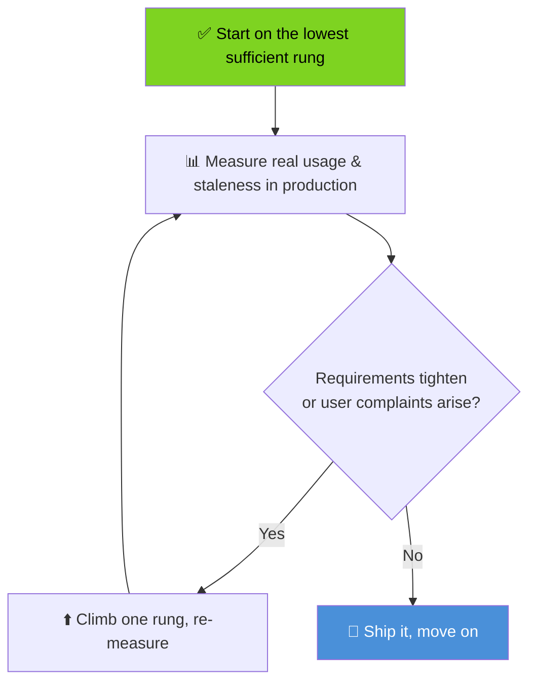

**Five takeaways to remember:**

1. Two questions first — direction and staleness — written down as numbers.
2. The ladder prices your *first* real-time feature; shared channels and managed services reshape later decisions.
3. SSE's free reconnect/replay is the reason it's the default for one-way push.
4. WebSockets are a distributed-systems commitment: heartbeats, backplanes, jitter, draining, replay.
5. Jitter and measured staleness budgets are the two cheapest reliability tools you own.

---

## 29. Further Reading & Resources

**Specifications & documentation**

- MDN — [Server-Sent Events (EventSource)](https://developer.mozilla.org/en-US/docs/Web/API/Server-sent_events) and the [SSE wire format](https://developer.mozilla.org/en-US/docs/Web/API/Server-sent_events/Using_server-sent_events)
- MDN — [WebSockets API](https://developer.mozilla.org/en-US/docs/Web/API/WebSockets_API)
- MDN — [WebTransport API](https://developer.mozilla.org/en-US/docs/Web/API/WebTransport_API)
- RFC 6455 (The WebSocket Protocol), RFC 8441 (WebSockets over HTTP/2), RFC 9220 (WebSockets over HTTP/3)
- WHATWG HTML Living Standard — [server-sent events section](https://html.spec.whatwg.org/multipage/server-sent-events.html)

**Libraries & tools**

- [`ws`](https://github.com/websockets/ws) — the Node.js WebSocket library used in this tutorial
- [`@microsoft/fetch-event-source`](https://github.com/Azure/fetch-event-source) — fetch-based SSE client with custom headers
- [Socket.IO](https://socket.io/docs/v4/) — WS with long-polling fallback and reconnection built in
- [k6](https://k6.io/docs/) — load testing for polling and streaming endpoints

**Managed platforms (for §13.2 context)**

- [Ably](https://ably.com/docs), [Pusher Channels](https://pusher.com/docs), [AWS AppSync](https://docs.aws.amazon.com/appsync/), [AWS API Gateway WebSocket APIs](https://docs.aws.amazon.com/apigateway/latest/developerguide/apigateway-websocket-api.html)

**Operational references**

- AWS — ALB [idle timeout configuration](https://docs.aws.amazon.com/elasticloadbalancing/latest/application/application-load-balancers.html#connection-idle-timeout)
- Nginx — [`X-Accel-Buffering`](https://nginx.org/en/docs/http/ngx_http_proxy_module.html#proxy_buffering) and proxy buffering behavior with event streams

---

## 30. Next Steps

**Learning path after this tutorial:**

1. **Build** the [Lab 1 playground](#22-hands-on-labs) — feeling the rungs beats reading about them.
2. **Audit** one real feature in your codebase: write down its direction and staleness budget; check whether its rung matches.
3. **Deepen** on a rung you'll actually use next: replay-log design (Rung 3) or backplane scaling (Rung 4).
4. **Practice the defense:** write a one-page design doc for a real feature using the decision flowchart, including the climb-up conditions.
5. **Related topics to explore next:** OT/CRDT algorithms for collaborative editing (built atop Rung 4), WebSocket alternatives at the edge (Durable Objects, Cloudflare Queues), and HTTP/3 server deployment for WebTransport readiness.

---

*Last Updated: 2026-08-30 · Difficulty: Intermediate · Format: Comprehensive Deep Dive*

