# VS Code Extensions Every Angular Developer Needs: The Complete Tutorial

> A practical, hands-on guide to the VS Code extensions that make Angular development faster, cleaner, easier to debug, and more productive. It covers templates, TypeScript, Git, APIs, performance, and day-to-day workflow.

---

## Table of Contents

1. [Introduction: Why Extensions Matter](#1-introduction-why-extensions-matter)
2. [The Golden Rule: Don't Install Everything](#2-the-golden-rule-dont-install-everything)
3. [The Big Picture: How Extensions Fit Your Workflow](#3-the-big-picture-how-extensions-fit-your-workflow)
4. [Extension 1: Angular Language Service](#4-extension-1-angular-language-service)
5. [Extension 2: ESLint](#5-extension-2-eslint)
6. [Extension 3: Prettier](#6-extension-3-prettier)
7. [Making ESLint and Prettier Work Together](#7-making-eslint-and-prettier-work-together)
8. [Extension 4: GitLens](#8-extension-4-gitlens)
9. [Extension 5: Error Lens](#9-extension-5-error-lens)
10. [Extension 6: REST Client](#10-extension-6-rest-client)
11. [Extension 7: Thunder Client](#11-extension-7-thunder-client)
12. [REST Client vs Thunder Client](#12-rest-client-vs-thunder-client)
13. [Extension 8: Auto Rename Tag](#13-extension-8-auto-rename-tag)
14. [Extension 9: Path Intellisense](#14-extension-9-path-intellisense)
15. [Extension 10: Import Cost](#15-extension-10-import-cost)
16. [Extension 11: Todo Tree](#16-extension-11-todo-tree)
17. [Extension 12: Docker](#17-extension-12-docker)
18. [Recommended Starter Setup](#18-recommended-starter-setup)
19. [Team Setup: Sharing Extensions and Settings](#19-team-setup-sharing-extensions-and-settings)
20. [Troubleshooting Common Problems](#20-troubleshooting-common-problems)
21. [A Day in the Life: Putting It All Together](#21-a-day-in-the-life-putting-it-all-together)
22. [Cheat Sheet](#22-cheat-sheet)
23. [Practice Exercises](#23-practice-exercises)
24. [Final Thoughts](#24-final-thoughts)

---

## 1. Introduction: Why Extensions Matter

Visual Studio Code is one of the most popular editors for Angular development. Angular provides a powerful framework, but the **right VS Code extensions** make everyday development much smoother.

In a real Angular application, you constantly write and maintain:

| Task | Examples |
|------|----------|
| Components | `user-list.component.ts` |
| Templates | `user-list.component.html` |
| Services | `user.service.ts` |
| Interfaces and models | `user.model.ts` |
| Tests | `user.service.spec.ts` |
| Styles | `user-list.component.scss` |
| Git commits | feature branches, merges, reviews |
| API calls | GET, POST, PUT, DELETE |

A good set of extensions will:

- **Reduce repetitive work** (formatting, renaming tags, typing paths)
- **Catch problems early**, before they become bugs
- **Improve visibility** into errors, history, and dependencies
- **Keep teams consistent** with shared standards

### What You'll Learn

By the end of this tutorial you will be able to:

- Install and configure the essential Angular extensions
- Understand **what problem** each extension solves
- Set up automatic formatting and linting
- Test APIs without leaving your editor
- Share one standard setup across your whole team

### Prerequisites

- VS Code installed
- Node.js and the Angular CLI (`npm install -g @angular/cli`)
- An Angular project (create one with `ng new my-app` if you need one)

---

## 2. The Golden Rule: Don't Install Everything

The most important lesson in this guide is a *restraint* lesson:

> **More extensions do not automatically mean better productivity.**

Every extension:

- Consumes memory and CPU
- Adds to startup time
- May overlap with another extension's features
- Can create visual noise and distractions

### Decision Flow: Should You Install This Extension?

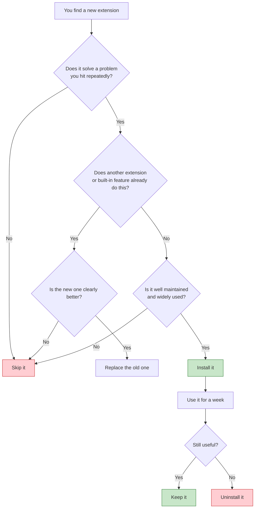

### Tip: Check Extension Performance

Open the Command Palette (`Ctrl+Shift+P` / `Cmd+Shift+P`) and run:

```
Developer: Show Running Extensions
```

This shows each extension's activation time. If one is slow and you don't need it, disable it.

---

## 3. The Big Picture: How Extensions Fit Your Workflow

Before diving into each extension, here is how they map onto the stages of Angular development.

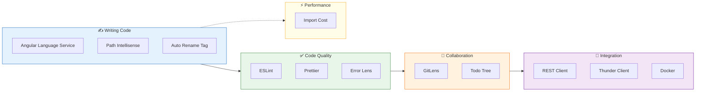

### Extensions at a Glance

| # | Extension | Category | Core Benefit |
|---|-----------|----------|--------------|
| 1 | Angular Language Service | Writing | Smart template and TypeScript support |
| 2 | ESLint | Quality | Finds bugs and enforces standards |
| 3 | Prettier | Quality | Automatic consistent formatting |
| 4 | GitLens | Collaboration | Understand who changed what, and why |
| 5 | Error Lens | Quality | Inline, highly visible errors |
| 6 | REST Client | Integration | Test APIs with plain text files |
| 7 | Thunder Client | Integration | GUI-based API testing |
| 8 | Auto Rename Tag | Writing | Synchronized HTML tag renaming |
| 9 | Path Intellisense | Writing | Autocomplete for file paths |
| 10 | Import Cost | Performance | See package size as you import |
| 11 | Todo Tree | Collaboration | Track TODO and FIXME comments |
| 12 | Docker | Integration | Manage containers from the editor |

---

## 4. Extension 1: Angular Language Service

**Publisher:** Angular
**Extension ID:** `Angular.ng-template`

### What It Does

The Angular Language Service provides intelligent editor support for **Angular templates and TypeScript**. It understands the relationship between your component class and its HTML template.

### Key Features

- **Autocomplete** for component properties, methods, pipes, and directives
- **Go to definition** from the template into the component class
- **Diagnostics** that flag errors inside templates
- **Type checking** for bindings and template expressions
- **Quick info** on hover

### How It Works

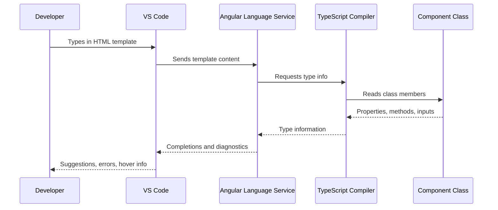

### Example 1: Catching a Missing Method

**Template:**

```html
<button (click)="saveUser()">
  Save
</button>
```

**Component:**

```typescript
@Component({
  selector: 'app-user-form',
  templateUrl: './user-form.component.html'
})
export class UserFormComponent {
  // Oops, saveUser() was never defined!
}
```

**Result:** The editor flags `saveUser` as not existing on `UserFormComponent`. Without the Language Service, you would only discover this at runtime or when the build fails.

**Fix:**

```typescript
export class UserFormComponent {
  saveUser(): void {
    console.log('User saved');
  }
}
```

### Example 2: Autocomplete Inside Templates

```typescript
export class UserListComponent {
  users: User[] = [];
  isLoading = false;
  selectedUser: User | null = null;
}
```

```html
<div *ngIf="isLoading">Loading...</div>

<ul>
  <li *ngFor="let user of users">
    {{ user.na }}  <!-- Autocomplete suggests: name -->
  </li>
</ul>
```

When you type `user.`, the Language Service suggests the real properties of your `User` interface, such as `name`, `email`, and `id`.

### Example 3: Component Inputs and Outputs

```typescript
@Component({
  selector: 'app-user-card',
  templateUrl: './user-card.component.html'
})
export class UserCardComponent {
  @Input() user!: User;
  @Output() selected = new EventEmitter<User>();
}
```

In a parent template, the Language Service autocompletes `[user]` and `(selected)` when you type `<app-user-card`.

```html
<app-user-card
  [user]="currentUser"
  (selected)="onUserSelected($event)">
</app-user-card>
```

If you pass the wrong type to `[user]`, you get an error right in the editor.

### Example 4: Modern Angular Control Flow

The Language Service also supports newer syntax such as `@if` and `@for`:

```html
@if (isLoading) {
  <p>Loading...</p>
} @else {
  <ul>
    @for (user of users; track user.id) {
      <li>{{ user.name }}</li>
    }
  </ul>
}
```

### Enable Stricter Template Checking

In `tsconfig.json`:

```json
{
  "angularCompilerOptions": {
    "strictTemplates": true,
    "strictInjectionParameters": true,
    "strictInputAccessModifiers": true
  }
}
```

This makes the Language Service (and the compiler) much more rigorous about template types.

### Use Cases

| Scenario | How It Helps |
|----------|--------------|
| Large templates with 200+ lines | Navigate quickly and catch typos |
| Refactoring a component property | See broken template references immediately |
| Onboarding a new developer | Hover and jump to definitions to learn the codebase |
| Working with custom pipes | Get type-aware completion in pipe expressions |

---

## 5. Extension 2: ESLint

**Publisher:** Microsoft
**Extension ID:** `dbaeumer.vscode-eslint`

### What It Does

ESLint analyzes your code for **problematic patterns**, **unused variables**, and **violations of project rules**. It is the backbone of code quality in a team environment.

### Why It Matters

In a small solo project you notice mistakes quickly. In a large Angular application with many developers, **consistency becomes difficult**. ESLint turns style and quality expectations into automated, enforceable rules.

> The biggest advantage isn't simply finding errors. It's creating **consistent development standards across the team**.

### Setting Up ESLint in an Angular Project

Modern Angular CLI can add ESLint for you:

```bash
ng add @angular-eslint/schematics
```

This installs the packages and creates an ESLint configuration file.

### Running ESLint from the Terminal

```bash
ng lint
```

Sample output:

```
/src/app/user/user.component.ts
  12:7   error    'unusedVar' is assigned a value but never used   @typescript-eslint/no-unused-vars
  25:3   warning  Unexpected console statement                      no-console

✖ 2 problems (1 error, 1 warning)
```

### Seeing Problems Live in the Editor

With the VS Code extension installed, those same problems appear as squiggly underlines **while you type**, so you don't have to wait for a terminal command.

### The Lint Workflow

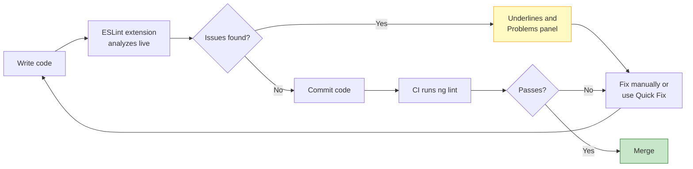

### Example 1: Unused Variable

```typescript
export class OrderService {
  private readonly taxRate = 0.18; // unused

  calculateTotal(price: number): number {
    return price;
  }
}
```

ESLint flags `taxRate` as unused, which often reveals forgotten or incomplete logic.

### Example 2: Template Linting

With `@angular-eslint/template` rules, you can lint HTML templates too:

```html
<!-- ESLint can flag missing track in loops, accessibility issues, etc. -->
  <!-- Rule: alt text is required -->
```

**Fixed:**

```html

```

### Example 3: Enforcing Angular Conventions

A sample `eslint.config.js` (flat config) might include:

```javascript
// eslint.config.js
const eslint = require('@eslint/js');
const tseslint = require('typescript-eslint');
const angular = require('angular-eslint');

module.exports = tseslint.config(
  {
    files: ['**/*.ts'],
    extends: [
      eslint.configs.recommended,
      ...tseslint.configs.recommended,
      ...angular.configs.tsRecommended,
    ],
    processor: angular.processInlineTemplates,
    rules: {
      '@angular-eslint/directive-selector': [
        'error',
        { type: 'attribute', prefix: 'app', style: 'camelCase' },
      ],
      '@angular-eslint/component-selector': [
        'error',
        { type: 'element', prefix: 'app', style: 'kebab-case' },
      ],
      'no-console': 'warn',
    },
  },
  {
    files: ['**/*.html'],
    extends: [
      ...angular.configs.templateRecommended,
      ...angular.configs.templateAccessibility,
    ],
    rules: {},
  }
);
```

> **Note:** Older projects use `.eslintrc.json`. The flat config shown above is the newer format. Use whichever your project's ESLint version supports.

### Auto-Fix on Save

Add this to your VS Code `settings.json`:

```json
{
  "editor.codeActionsOnSave": {
    "source.fixAll.eslint": "explicit"
  }
}
```

Now many simple problems (like unused imports or missing semicolons) are fixed whenever you save.

### Use Cases

| Scenario | How It Helps |
|----------|--------------|
| Team of 10 developers | One shared ruleset, no style arguments in code reviews |
| Preventing bad patterns | Ban `any`, `console.log`, or deprecated APIs |
| Accessibility | Template rules catch missing alt text and labels |
| CI pipelines | `ng lint` blocks merges with violations |

---

## 6. Extension 3: Prettier

**Publisher:** Prettier
**Extension ID:** `esbenp.prettier-vscode`

### What It Does

Prettier is an **opinionated code formatter**. It automatically formats TypeScript, HTML, CSS/SCSS, JSON, Markdown, and more.

> Formatting code manually is a waste of developer time.

### The Problem It Solves

Without a formatter, developers argue over trivia:

```typescript
// Developer A writes:
const user = {name: 'Roshan', age: 28};

// Developer B writes:
const user = {
  name: 'Roshan',
  age: 28
};
```

Neither is wrong, but a mixed codebase is harder to read and produces **noisy Git diffs**. Let the formatter decide.

### Setup

**Step 1:** Install the Prettier extension.

**Step 2:** Add Prettier to your project:

```bash
npm install --save-dev prettier
```

**Step 3:** Create a `.prettierrc` file:

```json
{
  "singleQuote": true,
  "semi": true,
  "tabWidth": 2,
  "trailingComma": "es5",
  "printWidth": 100,
  "arrowParens": "always"
}
```

**Step 4:** Configure VS Code (`.vscode/settings.json`):

```json
{
  "editor.formatOnSave": true,
  "editor.defaultFormatter": "esbenp.prettier-vscode"
}
```

**Step 5:** Optionally, create a `.prettierignore`:

```
dist
node_modules
coverage
.angular
```

### Before and After

**Before (messy):**

```typescript
export class  UserService{
constructor(private http:HttpClient){}
getUsers(){return this.http.get<User[]>('/api/users').pipe(map(users=>users.filter(u=>u.active)))}
}
```

**After (on save):**

```typescript
export class UserService {
  constructor(private http: HttpClient) {}

  getUsers() {
    return this.http
      .get<User[]>('/api/users')
      .pipe(map((users) => users.filter((u) => u.active)));
  }
}
```

### Formatting HTML Templates

```html
<!-- Before -->
<div class="card"><h2>{{title}}</h2><button (click)="save()" [disabled]="!form.valid">Save</button></div>

<!-- After -->
<div class="card">
  <h2>{{ title }}</h2>
  <button (click)="save()" [disabled]="!form.valid">Save</button>
</div>
```

### Format-on-Save Flow

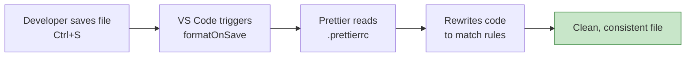

### Useful Manual Commands

```bash
# Check which files are not formatted
npx prettier --check "src/**/*.{ts,html,scss}"

# Format all files at once
npx prettier --write "src/**/*.{ts,html,scss}"
```

### Use Cases

| Scenario | How It Helps |
|----------|--------------|
| Multiple developers on one project | Identical formatting for everyone |
| Code reviews | Reviewers focus on logic, not spacing |
| Merging branches | Fewer whitespace-only conflicts |
| Joining a legacy project | Run `--write` once to normalize everything |

---

## 7. Making ESLint and Prettier Work Together

ESLint and Prettier are both essential, but they can **conflict** if both try to control formatting. The standard solution is to give each a clear job:

- **Prettier** handles *how code looks* (formatting)
- **ESLint** handles *how code behaves* (quality and correctness)

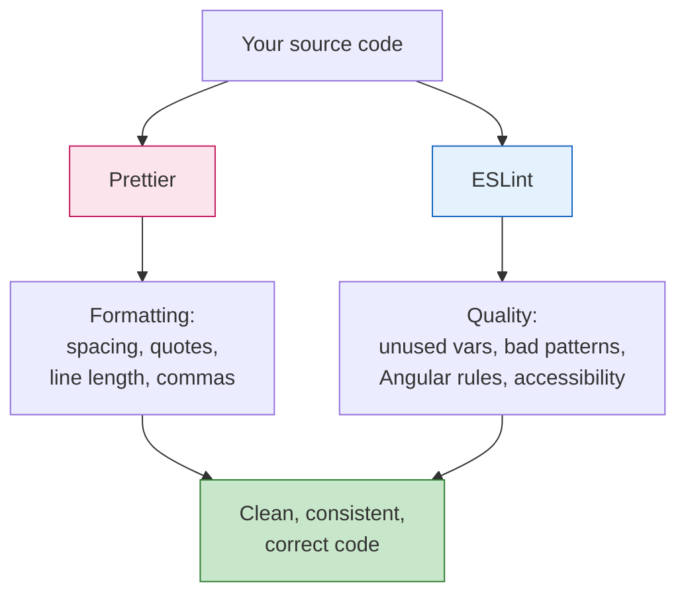

### Disable Conflicting ESLint Formatting Rules

Install `eslint-config-prettier`:

```bash
npm install --save-dev eslint-config-prettier
```

Then add it **last** in your ESLint config so it turns off any stylistic rules that clash with Prettier:

```javascript
const prettier = require('eslint-config-prettier');

module.exports = tseslint.config(
  // ...your other config blocks
  prettier
);
```

### Recommended Combined `settings.json`

```json
{
  "editor.formatOnSave": true,
  "editor.defaultFormatter": "esbenp.prettier-vscode",
  "editor.codeActionsOnSave": {
    "source.fixAll.eslint": "explicit"
  },
  "[html]": {
    "editor.defaultFormatter": "esbenp.prettier-vscode"
  },
  "[typescript]": {
    "editor.defaultFormatter": "esbenp.prettier-vscode"
  }
}
```

---

## 8. Extension 4: GitLens

**Publisher:** GitKraken
**Extension ID:** `eamodio.gitlens`

### What It Does

Git is built into VS Code, but **GitLens adds deep visibility** into your repository's history, directly inside the editor.

### Key Features

| Feature | Description |
|---------|-------------|
| **Inline blame** | See who last changed a line, when, and in which commit |
| **Hover cards** | Hover over blame text to see commit message and details |
| **File history** | View every change made to a file |
| **Line history** | Trace the history of a single line or selection |
| **Commit graph** | Visual view of branches and merges |
| **Compare** | Compare branches, commits, or tags |

### The Problem It Solves

You open an older file and find this:

```typescript
this.userService.getUsers();
```

Instead of wondering:

> "Why was this code written?"

GitLens shows the commit that introduced it. For example:

```
Priya Sharma, 8 months ago • Fix: reload users after role change (#482)
```

Now you can open the commit, read the message, and see the original pull request.

### Investigation Workflow

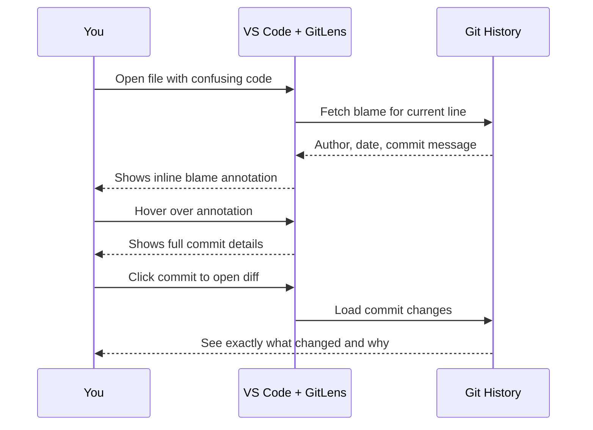

### Example 1: Debugging a Regression

**Scenario:** A date format suddenly looks wrong in the UI.

1. Open the component with the date pipe.
2. Check the inline blame on the relevant line.
3. Click the commit and see that someone changed `'dd/MM/yyyy'` to `'MM/dd/yyyy'` three days ago.
4. Read the commit message to understand whether it was intentional.
5. Ask the author, or revert it with confidence.

### Example 2: Understanding Intent Before Deleting Code

You see an odd-looking workaround:

```typescript
setTimeout(() => this.cdr.detectChanges(), 0);
```

Before removing it, use **Line History** in GitLens. You find it was added to fix a specific `ExpressionChangedAfterItHasBeenChecked` error. Now you know it is not dead code.

### Example 3: Comparing Branches Before a Merge

Use the **Commits** or **Branches** view to compare `feature/user-profile` with `main` and review exactly which files and lines changed.

### Helpful GitLens Settings

```json
{
  "gitlens.currentLine.enabled": true,
  "gitlens.hovers.currentLine.over": "annotation",
  "gitlens.codeLens.enabled": false
}
```

Disabling CodeLens reduces visual clutter if you find it distracting.

> **Note:** Some advanced GitLens features (such as certain visual and cloud-based tools) may require a paid GitKraken plan. The core blame and history features work for free.

### Use Cases

| Scenario | How It Helps |
|----------|--------------|
| Debugging legacy code | Understand *why* something exists |
| Code review | See the history behind changed lines |
| Finding the right person to ask | Instantly identify who owns a piece of code |
| Tracking down regressions | Pinpoint the commit that introduced a bug |

---

## 9. Extension 5: Error Lens

**Publisher:** Alexander
**Extension ID:** `usernamehw.errorlens`

### What It Does

Standard VS Code indicates errors with a small red or yellow underline, which is easy to miss. **Error Lens displays the full diagnostic message directly beside the affected line.**

### Before and After

**Without Error Lens:** You see a subtle squiggle and must hover to read the message.

**With Error Lens:**

```typescript
const total: number = '100';   ❌ Type 'string' is not assignable to type 'number'.
```

The message appears inline, highlighted in color, with no hovering required.

### The Feedback Loop

Error Lens shortens this cycle:

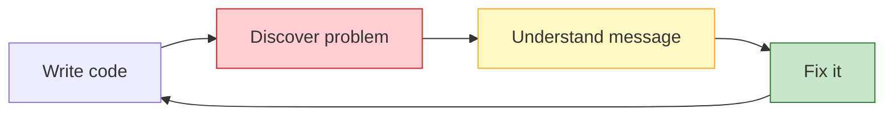

The faster you move through **writing code → discovering the problem → fixing it**, the more productive you are.

### Example 1: TypeScript Type Error

```typescript
export interface User {
  id: number;
  name: string;
}

const user: User = {
  id: '5',          // ❌ Type 'string' is not assignable to type 'number'.
  name: 'Roshan'
};
```

### Example 2: Template Error

```html
<p>{{ user.fullName }}</p>
<!-- ❌ Property 'fullName' does not exist on type 'User'. -->
```

This pairs especially well with the **Angular Language Service**, which produces the diagnostics that Error Lens makes visible.

### Example 3: ESLint Warnings

```typescript
console.log('debugging');   // ⚠️ Unexpected console statement.
```

### Tuning It So It Isn't Overwhelming

Inline messages can feel noisy on lines with many problems. Adjust to your taste:

```json
{
  "errorLens.enabledDiagnosticLevels": ["error", "warning"],
  "errorLens.messageMaxChars": 120,
  "errorLens.delay": 500
}
```

- Show only **errors and warnings** (hide hints and info)
- Cap the message length
- Add a short delay so messages don't flicker while typing

### Use Cases

| Scenario | How It Helps |
|----------|--------------|
| Large TypeScript files | Errors are impossible to overlook |
| Long Angular templates | Template mistakes surface immediately |
| Pair programming and demos | Everyone can see problems on screen |
| Beginners | Messages are visible without extra clicks |

---

## 10. Extension 6: REST Client

**Publisher:** Huachao Mao
**Extension ID:** `humao.rest-client`

### What It Does

Angular applications talk to APIs constantly. **REST Client lets you write and send HTTP requests from plain text files** (`.http` or `.rest`) and view the response in VS Code.

### Getting Started

Create a file called `users.http`:

```http
GET https://jsonplaceholder.typicode.com/users
```

A small **"Send Request"** link appears above the line. Click it, and the response opens in a side panel.

### Example 1: Basic GET

```http
GET https://api.example.com/users
Accept: application/json
```

### Example 2: POST with a JSON Body

```http
POST https://api.example.com/users
Content-Type: application/json

{
  "name": "John",
  "email": "john@example.com"
}
```

> **Important:** Leave a blank line between the headers and the body.

### Example 3: Multiple Requests in One File

Separate requests with `###`:

```http
### Get all users
GET https://api.example.com/users

### Get one user
GET https://api.example.com/users/1

### Create a user
POST https://api.example.com/users
Content-Type: application/json

{
  "name": "Asha",
  "email": "asha@example.com"
}

### Update a user
PUT https://api.example.com/users/1
Content-Type: application/json

{
  "name": "Asha Verma"
}

### Delete a user
DELETE https://api.example.com/users/1
```

### Example 4: Variables

Avoid repeating the base URL:

```http
@baseUrl = https://api.example.com
@token = your-token-here

### Get users
GET {{baseUrl}}/users
Authorization: Bearer {{token}}
```

### Example 5: Environments

In `.vscode/settings.json`:

```json
{
  "rest-client.environmentVariables": {
    "$shared": {
      "version": "v1"
    },
    "development": {
      "baseUrl": "http://localhost:3000"
    },
    "production": {
      "baseUrl": "https://api.example.com"
    }
  }
}
```

Use it like this:

```http
GET {{baseUrl}}/api/{{version}}/users
```

Switch environments from the status bar or with the command **Rest Client: Switch Environment**.

> **Security tip:** Never commit real tokens or passwords. Keep secrets out of version control, and add sensitive `.http` files to `.gitignore`.

### Example 6: Chaining Requests (Login, Then Use Token)

```http
### Login
# @name login
POST {{baseUrl}}/auth/login
Content-Type: application/json

{
  "email": "admin@example.com",
  "password": "secret"
}

###
@authToken = {{login.response.body.token}}

### Get profile using the token
GET {{baseUrl}}/profile
Authorization: Bearer {{authToken}}
```

### Request Flow

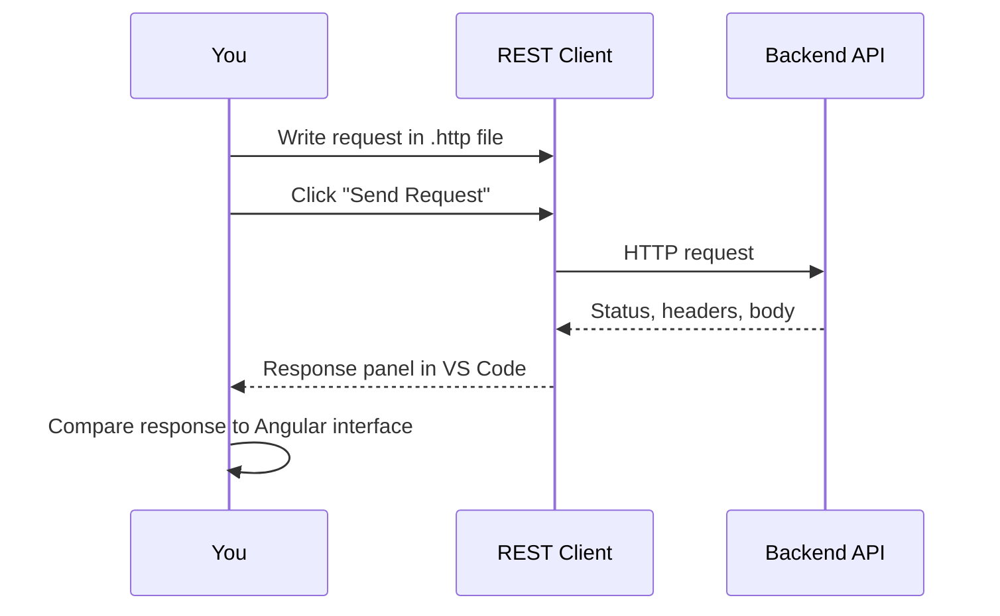

### How It Helps While Building Angular Code

1. Send a request and inspect the real JSON.
2. Copy the shape into a TypeScript interface.
3. Write the Angular service with confidence.

```typescript
// Based on the actual response observed in REST Client
export interface User {
  id: number;
  name: string;
  email: string;
}

@Injectable({ providedIn: 'root' })
export class UserService {
  private http = inject(HttpClient);

  getUsers(): Observable<User[]> {
    return this.http.get<User[]>('https://api.example.com/users');
  }
}
```

### Use Cases

| Scenario | How It Helps |
|----------|--------------|
| Building a new Angular service | Verify the API response shape first |
| Debugging HTTP interceptors | Compare raw requests with what Angular sends |
| Documenting an API | `.http` files double as living documentation in Git |
| Sharing requests with teammates | Plain text files are easy to commit and review |

---

## 11. Extension 7: Thunder Client

**Publisher:** Thunder Client
**Extension ID:** `rangav.vscode-thunder-client`

### What It Does

Thunder Client also lets you test APIs inside VS Code, but with a **graphical interface** similar to tools like Postman.

### Key Features

- Visual request builder (URL, method, headers, body, auth)
- **Collections** to organize requests
- **Environments** and variables
- Response viewer with status, time, and size
- Tests and assertions

### Basic Workflow

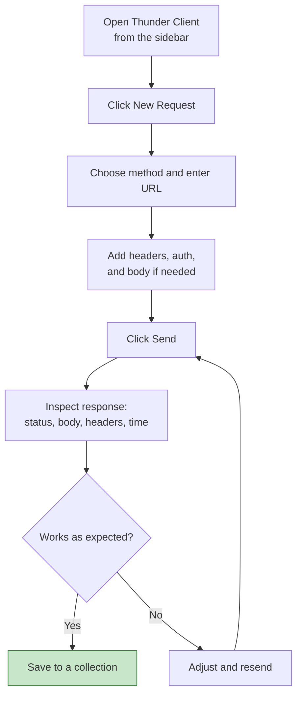

### Example: Testing a Login Endpoint

1. Create a new request.
2. Set method to `POST` and URL to `{{baseUrl}}/auth/login`.
3. Under **Body → JSON**, enter:

```json
{
  "email": "admin@example.com",
  "password": "secret"
}
```

4. Click **Send**.
5. Check for a `200 OK` status and a token in the response.

### Example: Organizing Collections

```
📁 My Angular App
 ├── 📁 Auth
 │    ├── POST Login
 │    └── POST Register
 ├── 📁 Users
 │    ├── GET List users
 │    ├── GET User by id
 │    ├── PUT Update user
 │    └── DELETE Delete user
 └── 📁 Orders
      ├── GET List orders
      └── POST Create order
```

### Use Cases

| Scenario | How It Helps |
|----------|--------------|
| Prefer a visual tool | Familiar interface without leaving VS Code |
| Working with many endpoints | Collections keep everything organized |
| Manual QA of backend changes | Quick checks, saved for reuse |

> **Note:** Some Thunder Client features (such as collection sharing or advanced capabilities) may be limited on the free plan. Check the current pricing if your team plans to rely on them.

---

## 12. REST Client vs Thunder Client

You rarely need both. Choose based on your style.

| Aspect | REST Client | Thunder Client |
|--------|-------------|----------------|
| Interface | Plain text `.http` files | Graphical UI |
| Version control friendly | ✅ Excellent (just text files) | ⚠️ Depends on plan and setup |
| Learning curve | Very low if you like text | Very low if you like GUIs |
| Sharing with team | Commit files to Git | Collections (check plan limits) |
| Best for | Developers who live in the editor and Git | Developers who prefer Postman-like workflows |

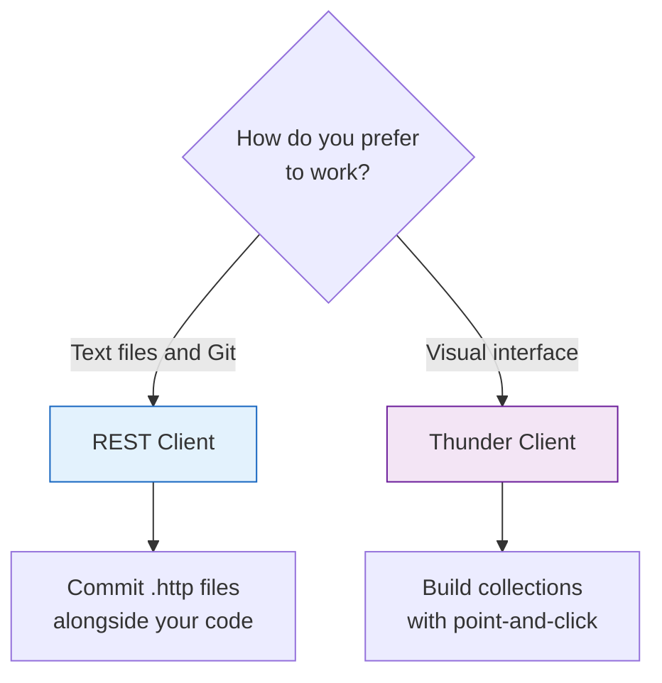

**Recommendation:** Pick **one**. Using both adds clutter without much benefit.

---

## 13. Extension 8: Auto Rename Tag

**Publisher:** Jun Han
**Extension ID:** `formulahendry.auto-rename-tag`

### What It Does

When you rename an opening HTML tag, **the matching closing tag is renamed automatically**.

### Example

You start with:

```html
<div class="card">
  <p>Hello</p>
</div>
```

You change `<div>` to `<section>`:

```html
<section class="card">
  <p>Hello</p>
</section>   <!-- closing tag updated automatically -->
```

### Why It's Valuable in Angular

Angular templates are full of nested HTML:

```html
<div class="container">
  <div class="row">
    <div class="col">
      <app-user-card *ngFor="let user of users" [user]="user"></app-user-card>
    </div>
  </div>
</div>
```

If you change an outer wrapper from `div` to `main`, you would normally have to find and edit the closing tag far below. Auto Rename Tag removes that step and prevents mismatched-tag errors.

### Works with Component Selectors Too

```html
<app-user-card></app-user-card>
```

Renaming to `<app-user-profile>` updates both tags.

### Related Built-in Feature

VS Code also has a built-in setting that provides **linked editing** of tags:

```json
{
  "editor.linkedEditing": true
}
```

Try this first. Depending on your VS Code version and language settings, it may do the same job and save you an extension. If it works well for you, you may not need Auto Rename Tag at all, which fits the "don't install everything" rule.

### Use Cases

| Scenario | How It Helps |
|----------|--------------|
| Refactoring layouts | Swap wrapper elements safely |
| Deeply nested templates | No hunting for the closing tag |
| Converting `div` to semantic tags | Quick, error-free changes |

> It's a small extension, but small improvements repeated hundreds of times make a real difference.

---

## 14. Extension 9: Path Intellisense

**Publisher:** Christian Kohler
**Extension ID:** `christian-kohler.path-intellisense`

### What It Does

It **autocompletes file and folder paths** as you type them in import statements and other string paths.

### The Problem

Angular projects contain many files and folders:

```
src/app/
├── components/
├── services/
├── models/
├── guards/
├── interceptors/
├── pages/
├── shared/
└── utils/
```

Remembering every path is impractical, and a single typo breaks your build.

### Example: Autocompleting an Import

You type:

```typescript
import { UserService } from './services/
```

The extension suggests files in that folder:

```
user.service.ts
auth.service.ts
order.service.ts
```

You select one, and the path is completed:

```typescript
import { UserService } from './services/user.service';
```

### Example: Navigating Up Directories

```typescript
import { User } from '../../models/
```

You get a list of everything inside `models/`, so there's no guessing how many `../` you need.

### Example: Asset Paths in Templates

```html

```

Path Intellisense suggests files from your `assets` folder.

### Using Path Aliases

Many Angular projects define aliases in `tsconfig.json`:

```json
{
  "compilerOptions": {
    "baseUrl": "./",
    "paths": {
      "@app/*": ["src/app/*"],
      "@shared/*": ["src/app/shared/*"],
      "@env/*": ["src/environments/*"]
    }
  }
}
```

Path Intellisense can support aliases through its own mapping setting:

```json
{
  "path-intellisense.mappings": {
    "@app": "${workspaceRoot}/src/app",
    "@shared": "${workspaceRoot}/src/app/shared"
  }
}
```

Now `import { Button } from '@shared/` autocompletes correctly.

### Tip

VS Code's TypeScript support also offers automatic import suggestions as you type a class name. Path Intellisense is most helpful for **manual path typing**, asset paths, and non-TypeScript files. If you rely entirely on auto-imports, you may need it less.

### Use Cases

| Scenario | How It Helps |
|----------|--------------|
| Large apps with deep folders | No need to memorize structure |
| Using `../../../` imports | See actual folder contents while typing |
| Referencing images and styles | Avoid typos in asset paths |

---

## 15. Extension 10: Import Cost

**Publisher:** Wix
**Extension ID:** `wix.vscode-import-cost`

### What It Does

It displays the **approximate size** of imported packages right next to the import line.

### Example

```typescript
import moment from 'moment';          // 290.4KB (gzipped: 72KB)
import { format } from 'date-fns';    // 2.5KB (gzipped: 1KB)
import _ from 'lodash';               // 531KB (gzipped: 94KB)
import { debounce } from 'lodash-es'; // 1.2KB (gzipped: 600B)
```

> **Note:** The numbers above are illustrative only. Actual sizes depend on package versions and how they are bundled.

### Why This Matters

Bundle size directly affects:

- Initial page load time
- Time to interactive
- Mobile and low-bandwidth user experience
- SEO and Core Web Vitals

### Decision Process

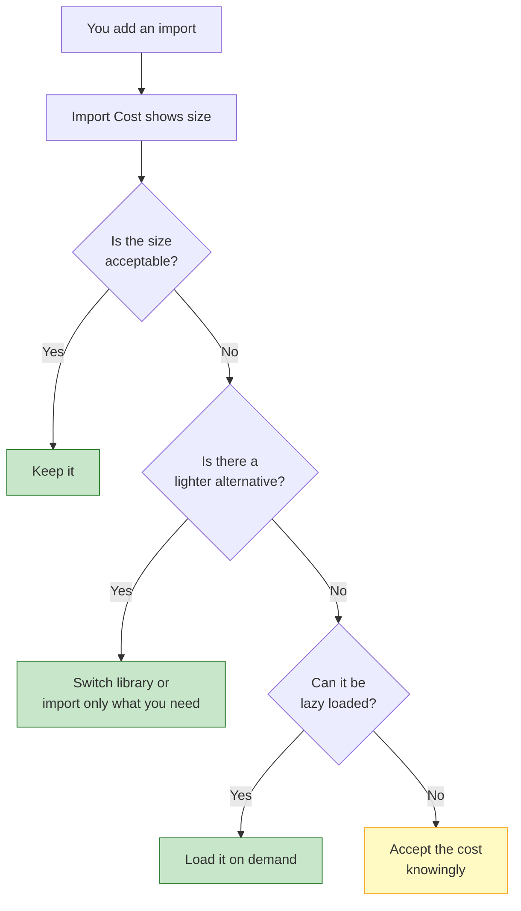

### Example: Choosing a Lighter Alternative

**Heavy approach:**

```typescript
import moment from 'moment';

const formatted = moment(date).format('YYYY-MM-DD');
```

**Lighter approach:**

```typescript
import { format } from 'date-fns';

const formatted = format(date, 'yyyy-MM-dd');
```

**Even lighter: use Angular's built-in `DatePipe`:**

```html
<p>{{ date | date: 'yyyy-MM-dd' }}</p>
```

### Example: Lazy Loading a Heavy Library

```typescript
async exportToPdf() {
  const { jsPDF } = await import('jspdf');   // loaded only when needed
  const doc = new jsPDF();
  doc.text('Report', 10, 10);
  doc.save('report.pdf');
}
```

### Important Caveat

This extension does **not** mean larger packages are bad. It simply gives you information to make informed decisions. Also note that Angular's build tooling (tree shaking, code splitting) affects the final bundle, so use Angular's build analysis for authoritative numbers:

```bash
ng build --stats-json
```

You can then inspect the output with a bundle analyzer tool.

### Use Cases

| Scenario | How It Helps |
|----------|--------------|
| Choosing between libraries | Compare sizes at a glance |
| Auditing a slow app | Spot heavy imports quickly |
| Code review | Catch costly additions early |

---

## 16. Extension 11: Todo Tree

**Publisher:** Gruntfuggly
**Extension ID:** `Gruntfuggly.todo-tree`

### What It Does

It scans your project for comment tags such as `TODO`, `FIXME`, `HACK`, and `BUG`, and shows them in a **tree view** in the sidebar.

### The Problem

```typescript
// TODO: Handle API timeout
```

After months of development, these comments are scattered across dozens of files and quickly forgotten.

### Example Comments It Will Detect

```typescript
// TODO: Add pagination to the user list
// FIXME: Memory leak when navigating away, unsubscribe missing
// HACK: Temporary workaround until backend fixes the date format
// BUG: Filter resets after sorting
// NOTE: This runs on every change detection cycle
```

### Example Tree View

```
📋 TODO TREE
 ├── 📄 user-list.component.ts
 │    ├── TODO: Add pagination to the user list        (line 24)
 │    └── FIXME: Unsubscribe missing                   (line 58)
 ├── 📄 date.util.ts
 │    └── HACK: Temporary workaround for date format   (line 12)
 └── 📄 filter.service.ts
      └── BUG: Filter resets after sorting             (line 40)
```

Click any entry to jump straight to that line.

### Custom Tags and Highlighting

```json
{
  "todo-tree.general.tags": ["TODO", "FIXME", "HACK", "BUG", "REVIEW"],
  "todo-tree.highlights.defaultHighlight": {
    "icon": "alert",
    "type": "text",
    "foreground": "#000000",
    "background": "#FFD54F"
  },
  "todo-tree.highlights.customHighlight": {
    "FIXME": { "background": "#EF5350" },
    "BUG": { "background": "#EF5350" }
  }
}
```

### Best Practice: Write Useful TODOs

| ❌ Vague | ✅ Useful |
|----------|-----------|
| `// TODO: fix this` | `// TODO(roshan): Handle API timeout with retry, see issue #214` |
| `// FIXME` | `// FIXME: Unsubscribe in ngOnDestroy to prevent memory leak` |

### Use Cases

| Scenario | How It Helps |
|----------|--------------|
| Sprint cleanup | Find leftover work before a release |
| Tech debt tracking | Gather all HACK and FIXME comments in one place |
| Onboarding | See known issues in the codebase |

---

## 17. Extension 12: Docker

**Publisher:** Microsoft
**Extension ID:** `ms-azuretools.vscode-docker`

### What It Does

If your Angular application is containerized, the Docker extension lets you manage containers, images, and Compose setups **without leaving VS Code**.

### What You Can Inspect and Manage

- **Containers** (start, stop, view logs, open a shell)
- **Images**
- **Dockerfiles** (syntax highlighting, linting, snippets)
- **Registries** (Docker Hub, Azure Container Registry, and others)
- **Compose configurations**

### Typical Angular Architecture with Docker

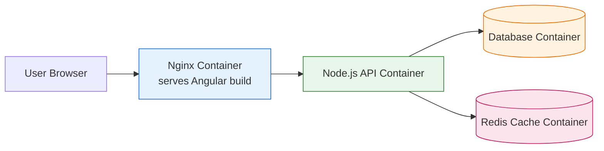

### Example: A Multi-Stage Dockerfile for Angular

```dockerfile
# Stage 1: Build the Angular app
FROM node:20-alpine AS build
WORKDIR /app
COPY package*.json ./
RUN npm ci
COPY . .
RUN npm run build -- --configuration production

# Stage 2: Serve with Nginx
FROM nginx:alpine
COPY --from=build /app/dist/my-app/browser /usr/share/nginx/html
COPY nginx.conf /etc/nginx/conf.d/default.conf
EXPOSE 80
CMD ["nginx", "-g", "daemon off;"]
```

> **Note:** The output folder (`dist/my-app/browser`) depends on your project name and Angular version. Adjust it to match your build output.

### Example: A Simple `nginx.conf` for Angular Routing

```nginx
server {
  listen 80;
  root /usr/share/nginx/html;
  index index.html;

  location / {
    try_files $uri $uri/ /index.html;
  }
}
```

The `try_files` line ensures that Angular's client-side routes work when someone refreshes the page.

### Example: `docker-compose.yml`

```yaml
services:
  web:
    build: .
    ports:
      - "8080:80"
    depends_on:
      - api

  api:
    image: my-company/node-api:latest
    ports:
      - "3000:3000"
    environment:
      - DATABASE_URL=postgres://user:pass@db:5432/appdb
    depends_on:
      - db

  db:
    image: postgres:16
    environment:
      - POSTGRES_USER=user
      - POSTGRES_PASSWORD=pass
      - POSTGRES_DB=appdb
    volumes:
      - dbdata:/var/lib/postgresql/data

volumes:
  dbdata:
```

> **Security tip:** The credentials above are for local development only. Use secrets management for real environments.

### Workflow with the Extension

1. Right-click `Dockerfile` and choose **Build Image**.
2. Open the Docker sidebar and see the new image.
3. Right-click the image and choose **Run**.
4. Right-click the running container and choose **View Logs** or **Attach Shell**.

### Use Cases

| Scenario | How It Helps |
|----------|--------------|
| Full-stack local development | Run API, database, and front end together |
| Debugging a production-like build | Run the exact container locally |
| Cleaning up | Remove unused images and containers visually |

---

## 18. Recommended Starter Setup

Start small, then add more only when a real need appears.

### Core Set

| Priority | Extension | Purpose |
|----------|-----------|---------|
| ⭐⭐⭐ | Angular Language Service | Template and TypeScript intelligence |
| ⭐⭐⭐ | ESLint | Code quality |
| ⭐⭐⭐ | Prettier | Formatting |
| ⭐⭐ | GitLens | Git history and blame |
| ⭐⭐ | Error Lens | Visible diagnostics |
| ⭐⭐ | Path Intellisense | Path completion |
| ⭐⭐ | Auto Rename Tag | Tag renaming |
| ⭐⭐ | REST Client **or** Thunder Client | API testing |

### Add Later When Needed

| Extension | Add It When |
|-----------|-------------|
| Import Cost | You care about bundle size |
| Todo Tree | The project accumulates many TODOs |
| Docker | Your app is containerized |

### Growth Path

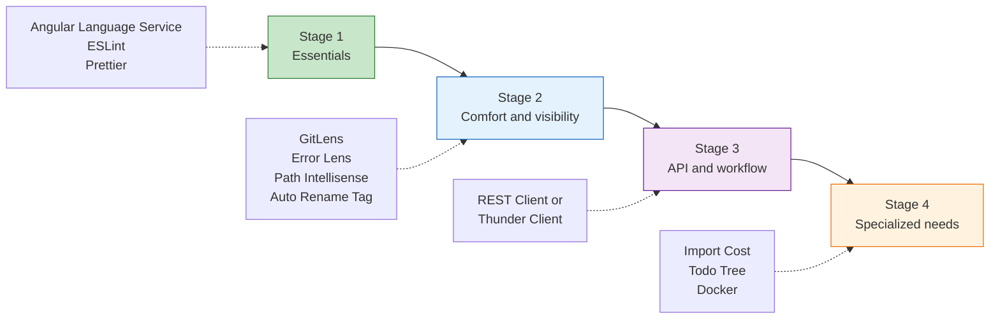

### Install from the Command Line

You can install extensions quickly using the VS Code CLI:

```bash
code --install-extension Angular.ng-template
code --install-extension dbaeumer.vscode-eslint
code --install-extension esbenp.prettier-vscode
code --install-extension eamodio.gitlens
code --install-extension usernamehw.errorlens
code --install-extension christian-kohler.path-intellisense
code --install-extension formulahendry.auto-rename-tag
code --install-extension humao.rest-client
```

---

## 19. Team Setup: Sharing Extensions and Settings

The real power of these tools appears when **the whole team uses the same setup**.

### Recommend Extensions Through the Repository

Create `.vscode/extensions.json`:

```json
{
  "recommendations": [
    "Angular.ng-template",
    "dbaeumer.vscode-eslint",
    "esbenp.prettier-vscode",
    "eamodio.gitlens",
    "usernamehw.errorlens",
    "christian-kohler.path-intellisense",
    "humao.rest-client"
  ]
}
```

When a teammate opens the project, VS Code offers to install these recommended extensions.

### Share Workspace Settings

Create `.vscode/settings.json`:

```json
{
  "editor.formatOnSave": true,
  "editor.defaultFormatter": "esbenp.prettier-vscode",
  "editor.codeActionsOnSave": {
    "source.fixAll.eslint": "explicit"
  },
  "editor.linkedEditing": true,
  "typescript.preferences.importModuleSpecifier": "relative",
  "files.exclude": {
    "**/.angular": true
  }
}
```

### Enforce Standards Before Commits

For extra safety, add Git hooks so that unformatted or unlinted code cannot be committed:

```bash
npm install --save-dev husky lint-staged
npx husky init
```

In `package.json`:

```json
{
  "lint-staged": {
    "*.{ts,html}": ["eslint --fix", "prettier --write"],
    "*.{scss,json,md}": ["prettier --write"]
  }
}
```

In `.husky/pre-commit`:

```bash
npx lint-staged
```

### The Full Quality Pipeline

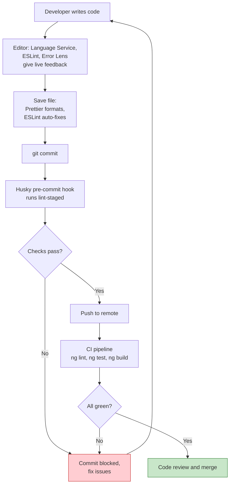

### Use Case: Onboarding a New Developer

**Without shared setup:** A new developer spends half a day installing tools, guessing settings, and producing PRs full of formatting differences.

**With shared setup:** They clone the repo, accept the recommended extensions, and produce correctly formatted, linted code on day one.

---

## 20. Troubleshooting Common Problems

| Problem | Likely Cause | Solution |
|---------|--------------|----------|
| Angular Language Service not working in templates | Wrong TypeScript version or workspace TS not selected | Run **TypeScript: Select TypeScript Version** and choose **Use Workspace Version** |
| No template autocomplete at all | Extension disabled or project not recognized | Make sure `angular.json` and `tsconfig.json` exist at the workspace root; reload the window |
| ESLint not showing errors | ESLint not installed or config missing | Run `npm install`, confirm the config file exists, and check the **ESLint output panel** |
| Prettier doesn't format on save | Another formatter is the default | Set `editor.defaultFormatter` to `esbenp.prettier-vscode` |
| Prettier and ESLint fight each other | Overlapping style rules | Add `eslint-config-prettier` |
| GitLens blame is missing | File is untracked or not in a Git repo | Run `git init` or open the correct repository folder |
| REST Client "Send Request" link missing | File type not recognized | Name the file with `.http` or `.rest` extension |
| VS Code feels slow | Too many extensions | Use **Developer: Show Running Extensions** and disable the slowest ones |
| Settings seem ignored | Workspace settings override user settings | Check `.vscode/settings.json` in the project |

### Quick Reset Steps

1. Run **Developer: Reload Window**.
2. Check the extension's **Output** panel for errors.
3. Disable the extension, reload, and re-enable it.
4. Open **Help → Toggle Developer Tools** to look for console errors.
5. As a last resort, test in a clean profile: **File → New Window with Profile**.

---

## 21. A Day in the Life: Putting It All Together

Here is a realistic scenario showing how the extensions work together on a feature: **"Add a user list page with search."**

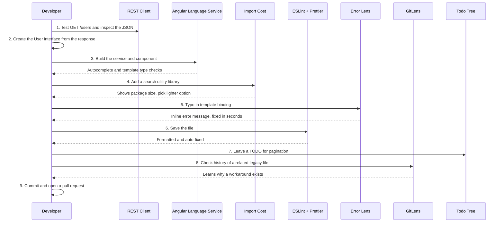

### Step-by-Step Walkthrough

**Step 1: Explore the API** with REST Client:

```http
GET {{baseUrl}}/users?search=ash
```

**Step 2: Model the data:**

```typescript
export interface User {
  id: number;
  name: string;
  email: string;
}
```

**Step 3: Write the service** (the Language Service helps with types):

```typescript
@Injectable({ providedIn: 'root' })
export class UserService {
  private http = inject(HttpClient);

  search(term: string): Observable<User[]> {
    return this.http.get<User[]>('/api/users', { params: { search: term } });
  }
}
```

**Step 4: Build the component:**

```typescript
@Component({
  selector: 'app-user-list',
  standalone: true,
  imports: [AsyncPipe, ReactiveFormsModule],
  templateUrl: './user-list.component.html'
})
export class UserListComponent {
  private userService = inject(UserService);

  searchControl = new FormControl('', { nonNullable: true });

  users$ = this.searchControl.valueChanges.pipe(
    debounceTime(300),
    distinctUntilChanged(),
    switchMap((term) => this.userService.search(term))
  );

  // TODO: Add pagination once the API supports it
}
```

**Step 5: Write the template:**

```html
<input [formControl]="searchControl" placeholder="Search users..." />

<ul>
  @for (user of users$ | async; track user.id) {
    <li>{{ user.name }} ({{ user.email }})</li>
  }
</ul>
```

Along the way:

- **Language Service** autocompleted `user.name` and `user.email`
- **Error Lens** immediately showed a typo when `searchControl` was misspelled
- **Prettier** reformatted everything on save
- **ESLint** flagged an unused import
- **Todo Tree** captured the pagination reminder
- **GitLens** explained a legacy workaround in a neighboring file

---

## 22. Cheat Sheet

### Essential Commands

| Command | Purpose |
|---------|---------|
| `ng lint` | Run ESLint on the project |
| `ng test` | Run unit tests |
| `ng build` | Build the application |
| `npx prettier --write .` | Format all files |
| `code --install-extension <id>` | Install an extension from the CLI |
| `code --list-extensions` | List installed extensions |

### Useful VS Code Shortcuts

| Shortcut (Windows/Linux) | Shortcut (Mac) | Action |
|--------------------------|----------------|--------|
| `Ctrl+Shift+P` | `Cmd+Shift+P` | Command Palette |
| `Ctrl+Shift+X` | `Cmd+Shift+X` | Extensions panel |
| `Ctrl+.` | `Cmd+.` | Quick Fix |
| `F12` | `F12` | Go to Definition |
| `Shift+Alt+F` | `Shift+Option+F` | Format document |
| `Ctrl+Shift+M` | `Cmd+Shift+M` | Problems panel |
| `Ctrl+Space` | `Ctrl+Space` | Trigger autocomplete |

### Key Settings Summary

```json
{
  "editor.formatOnSave": true,
  "editor.defaultFormatter": "esbenp.prettier-vscode",
  "editor.codeActionsOnSave": { "source.fixAll.eslint": "explicit" },
  "editor.linkedEditing": true,
  "errorLens.enabledDiagnosticLevels": ["error", "warning"]
}
```

---

## 23. Practice Exercises

### Exercise 1: Build the Core Setup (Beginner)

1. Install Angular Language Service, ESLint, and Prettier.
2. Create a `.prettierrc` file.
3. Turn on format on save.
4. Intentionally write messy code and confirm it formats on save.

**Success check:** Saving a messy file produces clean, consistent output.

### Exercise 2: Catch Template Errors (Beginner)

1. Add `(click)="doesNotExist()"` to a template button.
2. Observe the diagnostic from the Language Service.
3. Install Error Lens and notice how much more visible the error becomes.
4. Fix it by adding the method.

### Exercise 3: Test an API (Intermediate)

1. Create `api.http` and write GET and POST requests against `https://jsonplaceholder.typicode.com`.
2. Define a variable for the base URL.
3. Build an Angular service that consumes one endpoint.

### Exercise 4: Investigate History (Intermediate)

1. Open any file in a Git-tracked project.
2. Use GitLens to find the author and commit message for three different lines.
3. Open one commit diff and write down why the change was made.

### Exercise 5: Audit Bundle Size (Intermediate)

1. Install Import Cost.
2. Review every third-party import in your project.
3. Identify the heaviest one and research whether a lighter alternative or lazy loading would work.

### Exercise 6: Create a Team Setup (Advanced)

1. Create `.vscode/extensions.json` and `.vscode/settings.json`.
2. Add `husky` and `lint-staged`.
3. Make a deliberately badly formatted commit and confirm the hook fixes or blocks it.

---

## 24. Final Thoughts

The best VS Code extensions are the ones that **solve problems you repeatedly encounter.**

| Extension | Core Value |
|-----------|-----------|
| Angular Language Service | Improves template development |
| ESLint | Maintains code quality |
| Prettier | Keeps formatting consistent |
| GitLens | Makes Git history easier to understand |
| REST Client / Thunder Client | Simplifies backend testing |
| Auto Rename Tag, Path Intellisense | Remove everyday friction |

Remember the main principles:

1. **Start small.** The essentials go a long way.
2. **Understand each tool.** Know what it does and why you installed it.
3. **Avoid overlap.** One API client is enough; check built-in features first.
4. **Share the setup.** Put recommendations and settings in the repository.
5. **Automate the boring parts.** Formatting, linting, and path completion should never require willpower.

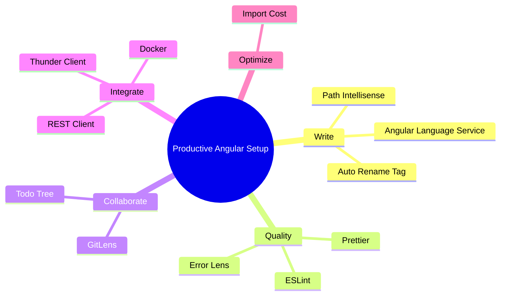

> **The goal isn't to make VS Code look impressive. The goal is to spend less time fighting your tools and more time solving actual problems.**

You don't need 50 extensions to become a productive Angular developer. Start with the essentials, understand what each one does, and build your environment around the way you actually work.

Happy coding! 🚀